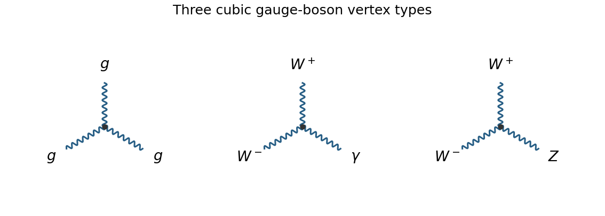

<h1 id="section-a/3/b/solution">Solution</h1>

↑ **Parent:** [B](../b.md)

There are **three vertex types**, with all legs labeled in the following original drawings:

$$
\boxed{ggg,\qquad W^+W^-\gamma,\qquad W^+W^-Z.}
$$

**[Figure 1](#section-a/3/b/image-the-three-fundamental-cubic-gauge-boson-vertex-types). The three fundamental cubic gauge-boson vertex types**.

The [gluon](../../../../../gluon.md) cubic [interaction vertex](../../../../../interaction-vertex.md) follows from the non-Abelian [gauge field strength](../../../../../gauge-field-strength.md) of [Quantum chromodynamics](../../../../../quantum-chromodynamics.md). The electroweak [Yang-Mills theory](../../../../../yang-mills-theory.md) [Lagrangian](../../../../../lagrangian.md), after expressing the fields in the physical charged and neutral [basis](../../../../../basis.md), produces the two charged-[W boson](../../../../../w-boson.md) vertices. In particular there are no fundamental $\gamma\gamma\gamma$, $ZZZ$, $ZZ\gamma$, or $Z\gamma\gamma$ vertices, and the separate colour and electroweak gauge factors do not generate a mixed $gg\gamma$ or $ggZ$ vertex. The count is by the boson labels requested, not by separate assignments of [gluon](../../../../../gluon.md) colour indices.

## ↑ Ancestors (14)

1. [B](../b.md)
2. [3](../../3.md)
3. [Section A](../../../section-a.md)
4. [2022](../../../../2022-split.md)
5. [Past exam of the particle and nuclear physics course of the University of Cambridge](../../../../split.md)
6. [Particle and Nuclear Physics course of the University of Cambridge](../../../../../particle-and-nuclear-physics-course-of-the-university-of-cambridge.md)
7. [Physics course of the year 3 of the natural sciences course of the University of Cambridge](../../../../../physics-course-of-the-year-3-of-the-natural-sciences-course-of-the-university-of-cambridge.md)
8. [Year 3 of the natural sciences course of the University of Cambridge](../../../../../year-3-of-the-natural-sciences-course-of-the-university-of-cambridge.md)
9. [Year of the natural sciences course of the University of Cambridge](../../../../../year-of-the-natural-sciences-course-of-the-university-of-cambridge.md)
10. [Natural sciences course of the University of Cambridge](../../../../../natural-sciences-course-of-the-university-of-cambridge.md)
11. [Course of the University of Cambridge](../../../../../course-of-the-university-of-cambridge.md)
12. [University of Cambridge](../../../../../university-of-cambridge-split.md)
13. [List of universities](../../../../../list-of-universities.md)
14. [Codex Wiki](../../../../../split.md)
