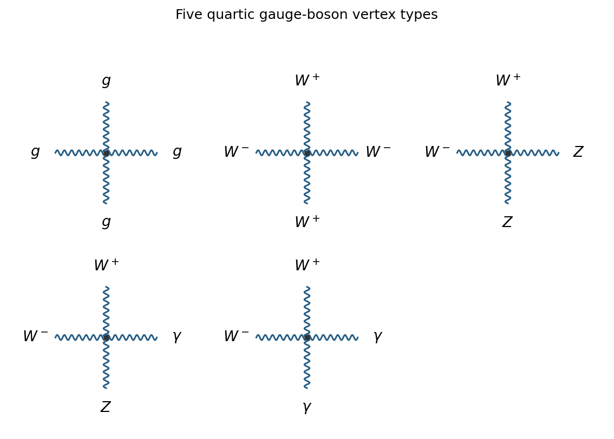

<h1 id="section-a/3/c/solution">Solution</h1>

↑ **Parent:** [C](../c.md)

There are **five vertex types**:

$$
\boxed{gggg,\quad W^+W^-W^+W^-,\quad
W^+W^-ZZ,\quad W^+W^-Z\gamma,\quad W^+W^-\gamma\gamma.}
$$

**[Figure 2](#section-a/3/c/image-the-five-fundamental-quartic-gauge-boson-vertex-types). The five fundamental quartic gauge-boson vertex types**.

The quartic terms arise from the square of the quadratic-field piece of the non-Abelian [gauge field strength](../../../../../gauge-field-strength.md). Every electroweak quartic [gauge boson self-interaction](../../../../../gauge-boson-self-interaction.md) contains a $W^+W^-$ pair. The absence of a fundamental purely neutral quartic vertex does not forbid amplitudes such as light-by-light scattering: those can be generated by [loop diagrams](../../../../../loop-feynman-diagram.md), rather than by a single fundamental [interaction vertex](../../../../../interaction-vertex.md).

## ↑ Ancestors (14)

1. [C](../c.md)
2. [3](../../3.md)
3. [Section A](../../../section-a.md)
4. [2022](../../../../2022-split.md)
5. [Past exam of the particle and nuclear physics course of the University of Cambridge](../../../../split.md)
6. [Particle and Nuclear Physics course of the University of Cambridge](../../../../../particle-and-nuclear-physics-course-of-the-university-of-cambridge.md)
7. [Physics course of the year 3 of the natural sciences course of the University of Cambridge](../../../../../physics-course-of-the-year-3-of-the-natural-sciences-course-of-the-university-of-cambridge.md)
8. [Year 3 of the natural sciences course of the University of Cambridge](../../../../../year-3-of-the-natural-sciences-course-of-the-university-of-cambridge.md)
9. [Year of the natural sciences course of the University of Cambridge](../../../../../year-of-the-natural-sciences-course-of-the-university-of-cambridge.md)
10. [Natural sciences course of the University of Cambridge](../../../../../natural-sciences-course-of-the-university-of-cambridge.md)
11. [Course of the University of Cambridge](../../../../../course-of-the-university-of-cambridge.md)
12. [University of Cambridge](../../../../../university-of-cambridge-split.md)
13. [List of universities](../../../../../list-of-universities.md)
14. [Codex Wiki](../../../../../split.md)
