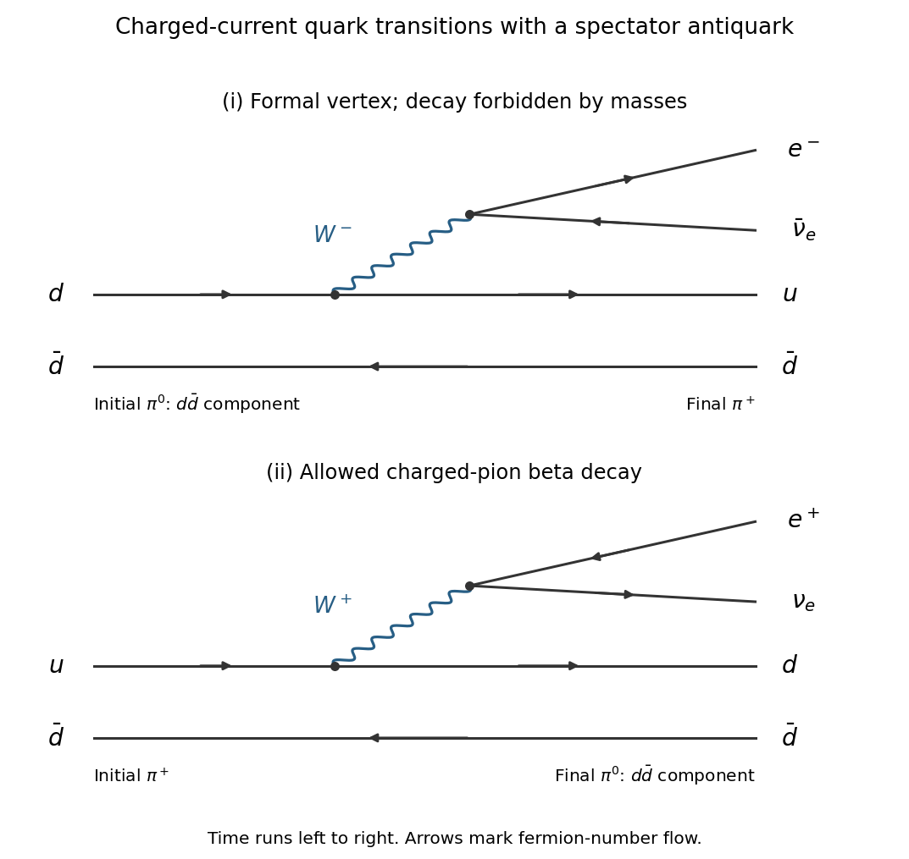

<h1 id="section-b/6/c/solution">Solution</h1>

↑ **Parent:** [C](../c.md)

Both formal processes use one [weak charged current](../../../../../charged-current.md) transition, with a virtual [W boson](../../../../../w-boson.md) producing the lepton pair. Two representative lowest-order quark-line diagrams are shown below. They use the $d\bar d$ component of $\pi^0$; attachment to the antiquark line in the $u\bar u$ component gives the other contribution to the same hadronic current.

**[Figure 4](#section-b/6/c/image-representative-quark-line-diagrams-for-the-two-formal-pion-beta-transitions). Representative quark-line diagrams for the two formal pion beta transitions**.

In the first diagram, $d\to u+W^-$ and $W^-\to e^-\bar\nu_e$, with $\bar d$ a [spectator quark](../../../../../spectator-quark.md). In the second, $u\to d+W^+$ and $W^+\to e^+\nu_e$, again with a spectator $\bar d$. The diagram for the first process describes the coupling but cannot make an energetically forbidden on-shell decay occur.

From the original tables,

$$
m_{\pi^0}=134.9768\,\mathrm{MeV},\qquad
m_{\pi^+}=139.57039\,\mathrm{MeV},\qquad m_e\simeq0.510999\,\mathrm{MeV}.
$$

Therefore the first process has [Q value](../../../../../q-value.md)

$$
Q(\pi^0\to\pi^+e^-\bar\nu_e)=m_{\pi^0}-m_{\pi^+}-m_e
=-5.10459\,\mathrm{MeV}<0,
$$

and is forbidden for an isolated [pion](../../../../../pion.md). The second has

$$
Q(\pi^+\to\pi^0e^+\nu_e)=m_{\pi^+}-m_{\pi^0}-m_e
=4.08259\,\mathrm{MeV}>0.
$$

The table therefore lists only the second, [pion beta decay](../../../../../pion-beta-decay.md), with

$$
\boxed{B(\pi^+\to\pi^0e^+\nu_e)=(1.036\pm0.006)\times10^{-8}.}
$$

Its tiny [branching fraction](../../../../../branching-fraction.md) combines a [weak interaction](../../../../../weak-interaction.md) with an exceptionally small available [energy](../../../../../energy-split.md). An allowed semileptonic transition has a [decay width](../../../../../decay-width.md) scaling approximately as $G_F^2|V_{ud}|^2\Delta^5$, where $\Delta=m_{\pi^+}-m_{\pi^0}$, with electron-threshold and recoil corrections. The fifth power makes the few-MeV gap especially restrictive. Unlike direct $\pi^+\to e^+\nu_e$, this semileptonic channel is not forced to have an amplitude proportional to $m_e$; its primary extra suppression is the small [phase space](../../../../../phase-space.md). Its approximately Cabibbo-favoured $u\leftrightarrow d$ current does not supply a further large flavour suppression. The observed [branching fraction](../../../../../branching-fraction.md) corresponds to a partial decay rate of about $(1.036\times10^{-8})/(2.6033\times10^{-8}\,\mathrm s)=0.398\,\mathrm{s^{-1}}$, competing with the much faster dominant muonic decay.

## ↑ Ancestors (14)

1. [C](../c.md)
2. [6](../../6.md)
3. [Section B](../../../section-b.md)
4. [2022](../../../../2022-split.md)
5. [Past exam of the particle and nuclear physics course of the University of Cambridge](../../../../split.md)
6. [Particle and Nuclear Physics course of the University of Cambridge](../../../../../particle-and-nuclear-physics-course-of-the-university-of-cambridge.md)
7. [Physics course of the year 3 of the natural sciences course of the University of Cambridge](../../../../../physics-course-of-the-year-3-of-the-natural-sciences-course-of-the-university-of-cambridge.md)
8. [Year 3 of the natural sciences course of the University of Cambridge](../../../../../year-3-of-the-natural-sciences-course-of-the-university-of-cambridge.md)
9. [Year of the natural sciences course of the University of Cambridge](../../../../../year-of-the-natural-sciences-course-of-the-university-of-cambridge.md)
10. [Natural sciences course of the University of Cambridge](../../../../../natural-sciences-course-of-the-university-of-cambridge.md)
11. [Course of the University of Cambridge](../../../../../course-of-the-university-of-cambridge.md)
12. [University of Cambridge](../../../../../university-of-cambridge-split.md)
13. [List of universities](../../../../../list-of-universities.md)
14. [Codex Wiki](../../../../../split.md)
