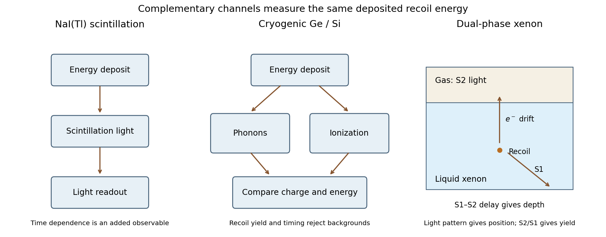

# Paper 1

↑ **Parent:** [2012](../2012.md)

[Original public PDF, physical pages 482–485; dated 27 April 2012](https://www.whatdotheyknow.com/request/natural_science_tripos_physics_e_2/response/2340776/attach/2/FOI%202023%20399%20Zahid%20materials.pdf?cookie_passthrough=1)

**Table of contents**

- [1](#1)
  - [Solution](#1/solution)
- [2](#2)
  - [Solution](#2/solution)
- [3](#3)
  - [a](#3/a)
    - [Solution](#3/a/solution)
  - [b](#3/b)
    - [Solution](#3/b/solution)
  - [c](#3/c)
    - [Solution](#3/c/solution)
  - [d](#3/d)
    - [Solution](#3/d/solution)

## 1

↑ **Parent:** [Paper 1](paper-1.md)

<h3 id="1/solution">Solution</h3>

↑ **Parent:** [1](#1)

The metric source is a gravitational frequency shift. [photons](../../quantum-mechanics.md#photon) following [null geodesics](../../special-relativity.md#null-geodesic) through a time-dependent spatial metric change [momentum](../../momentum.md) relative to the background comoving frame. The directional projection of that metric change gives the $\mu^2$ factor. It is not a collision term or continuing [photon](../../quantum-mechanics.md#photon) scattering after recombination. The normalization and sign belong to the specified definition of $h$ and $\Delta$; a distribution perturbation should not silently be identified with [temperature](../../temperature.md) without fixing that normalization.

Define $\mathcal H=\dot R/R$, where dots here mean conformal-time derivatives. In an Einstein-de Sitter background,

$$
\mathcal H=\frac2\tau,\qquad
\mathcal H^2=\frac{8\pi G}{3}\bar\rho_mR^2,
\qquad4\pi G\bar\rho_mR^2=\frac6{\tau^2}.
$$

A [power law](../../analysis.md#power-law) $h\propto\tau^p$ therefore satisfies $p(p-1)+2p=6$, or $(p-2)(p+3)=0$. Thus

$$
\boxed{h=A\tau^2+B\tau^{-3}},
$$

with the required growing mode $h=A\tau^2$. This is a solution in the perturbation convention used in the question, rather than a statement that every gauge-invariant gravitational potential grows as $\tau^2$.

Use an [integrating factor](../../linear-ordinary-differential-equation.md#integrating-factor) for the [photon](../../quantum-mechanics.md#photon) equation:

$$
\Delta(\tau)=\Delta_R e^{-ik\mu(\tau-\tau_R)}
+2\mu^2\int_{\tau_R}^{\tau}\dot h(t)e^{-ik\mu(\tau-t)}dt.
$$

For the growing mode $\dddot h=0$. For the [polynomial-source photon transport solution](../../cosmic-microwave-background-anisotropy.md#polynomial-source-photon-transport-solution), a particular solution is $B_h=-2i\mu\dot h/k+2\ddot h/k^2$: direct substitution gives $\dot B_h+ik\mu B_h=2\mu^2\dot h$. The initial-value solution is consequently

$$
\boxed{\Delta(\tau)=\left[\Delta_R+\frac{2i\mu\dot h_R}{k}-\frac{2\ddot h_R}{k^2}\right]e^{-ik\mu(\tau-\tau_R)}
-\frac{2i\mu\dot h(\tau)}{k}+\frac{2\ddot h(\tau)}{k^2}}.
$$

This also follows by integrating the source twice by parts. The apparent inverse powers of $k$ cancel in the complete long-wavelength limit; the integral form remains regular. At $\mu=0$, the source vanishes and the complete expression reduces to $\Delta=\Delta_R$.

Physically, the exponential transports the recombination pattern along [photon](../../quantum-mechanics.md#photon) trajectories; its direction-dependent phase projects a Fourier perturbation onto different angular multipoles. The extra terms are the accumulated gravitational contribution, here expressible as endpoint terms because the source has this special time dependence. For [endpoint monopole and dipole in photon transport](../../cosmic-microwave-background-anisotropy.md#endpoint-monopole-and-dipole-in-photon-transport), at the observer the last two terms are respectively a directional dipole and an angular monopole for each mode; they do not supply a new sky pattern at multipoles $\ell\geq2$. The propagating recombination combination contains the intrinsic perturbation and gravitational/velocity endpoint contributions. Individual terms depend on the perturbation gauge; observable [temperature](../../temperature.md) anisotropy requires the consistent emitter and observer contributions.

In pure matter domination the gauge-invariant scalar potentials are constant for a growing linear mode: the matter contrast grows as $R$ while the potential scales as its contrast divided by $R$. Thus **growth of this $h$ is compatible with no late [Integrated Sachs-Wolfe effect](../../cosmic-microwave-background-anisotropy.md#integrated-sachs-wolfe-effect) in Einstein-de Sitter**. When [dark energy](../../cosmology.md#dark-energy) suppresses matter growth, the potentials generally evolve; [photons](../../quantum-mechanics.md#photon) gain and lose unequal energies entering and leaving a potential well. In a convention where $\Phi,\Psi$ are the dimensionless Newtonian-gauge potentials, the integrated [temperature](../../temperature.md) source is $\int(\dot\Phi+\dot\Psi)d\tau$ along the light path.

Large-angle cosmic microwave background data can constrain that late contribution, but low-multipole power alone has large [cosmic variance](../../cosmic-microwave-background-anisotropy.md#cosmic-variance) and depends on the primordial [radiation spectrum](../../electromagnetic-radiation.md#radiation-spectrum), geometry and foreground treatment. Cross-correlating the [temperature](../../temperature.md) map with low-redshift galaxies or other matter tracers isolates a late-time connection; decaying wells typically correlate overdensities with hotter [cosmic microwave background](../../cosmic-microwave-background.md) directions. Boughn and Crittenden compared WMAP [temperature](../../temperature.md) data with the HEAO1 hard X-ray background and examined possible foreground origins of the correlation. This tests potential evolution under a cosmological model, not [dark energy](../../cosmology.md#dark-energy) independently of all gravity and [curvature](../../differential-geometry.md#curvature) assumptions.[abstract and foreground-correlation tests](../../physics-bibliography.md#investigating-the-origins-of-the-cmb-xrb-cross-correlation-by-stephen-boughn-and-robert-crittenden)

## 2

↑ **Parent:** [Paper 1](paper-1.md)

<h3 id="2/solution">Solution</h3>

↑ **Parent:** [2](#2)

Gravitational evidence requires much more nonbaryonic matter than can be supplied by ordinary luminous material or by the baryon abundance permitted by [nucleosynthesis](../../physics.md#nucleosynthesis). A stable, electrically neutral massive particle is a plausible cold component. Thermal production followed by [cosmological particle freeze-out](../../cosmology.md#cosmological-particle-freeze-out) gives an additional motivation: an [annihilation](../../relativistic-quantum-field.md#annihilation) rate near a weak-interaction scale can leave an appreciable relic abundance. This is a mechanism and search hypothesis, not proof that the [dark matter](../../cosmology.md#dark-matter) must be a [WIMP](../../cosmology.md#weakly-interacting-massive-particle) or have any particular elastic-scattering [cross section](../../physics.md#cross-section-physics).

The plotted regions are conditional [WIMP](../../cosmology.md#weakly-interacting-massive-particle) interpretations of different measurements. The experiments use different targets and distinguish signal from background differently:

- [DAMA experiment](../../cosmology.md#dama-experiment) uses NaI(Tl) [particle scintillation](../../physics.md#scintillation-physics) and seeks an annual variation of low-energy single-hit counts as the Earth's velocity through the halo changes. Multiple-hit events and other [energy](../../energy.md) ranges provide controls, but [particle scintillation](../../physics.md#scintillation-physics) alone does not identify every event as an [electron](../../physics.md#electron) or [nuclear recoil](../../atomic-nucleus.md#nuclear-recoil). Converting the modulation into [mass](../../classical-mechanics.md#mass) and [cross section](../../physics.md#cross-section-physics) requires a [halo model](../../large-scale-structure-of-the-universe.md#halo-model) and [nuclear-recoil quenching factor](../../atomic-nucleus.md#nuclear-recoil-quenching-factor) assumptions.[abstract and single-hit annual-modulation analysis](../../physics-bibliography.md#new-results-from-dama-libra-by-r-bernabei-and-others)
- [CoGeNT experiment](../../cosmology.md#cogent-experiment) uses a low-capacitance p-type point-contact [germanium](../../chemical-substance.md#germanium) diode to reach low [ionization](../../atomic-physics.md#ionization) thresholds. Low-energy event [radiation spectrum](../../electromagnetic-radiation.md#radiation-spectrum) and a possible annual modulation can suggest light [dark matter](../../cosmology.md#dark-matter), but surface charge collection, internal x-ray lines and threshold efficiency must be distinguished from bulk recoil events. Its 2011 modulation paper described a modulated component of unknown origin rather than an unambiguous particle identification.[abstract and pulse/energy-event analysis](../../physics-bibliography.md#search-for-an-annual-modulation-in-a-p-type-point-contact-germanium-dark-matter-detector-by-c-e-aalseth-and-others)
- [CDMS experiment](../../cosmology.md#cdms-experiment) measures [phonons](../../quantum-ideal-gas-statistics.md#phonon) and [ionization](../../atomic-physics.md#ionization) in cryogenic [germanium](../../chemical-substance.md#germanium) or [silicon](../../chemical-substance.md#silicon). The smaller [ionization](../../atomic-physics.md#ionization) yield of [nuclear recoils](../../atomic-nucleus.md#nuclear-recoil) and [phonon](../../quantum-ideal-gas-statistics.md#phonon) timing help reject [electron](../../physics.md#electron) and surface events. The lowered-threshold [germanium](../../chemical-substance.md#germanium) analysis improves low-mass sensitivity, at the cost of more difficult background discrimination near threshold; this explains why distinct 2010 and 2011 curves appear.[abstract; low-threshold analysis and background discussion](../../physics-bibliography.md#results-from-a-low-energy-analysis-of-the-cdms-ii-germanium-data-by-cdms-collaboration)
- [XENON100](../../particle-detection.md#xenon100) uses a [dual-phase xenon detector](../../particle-detection.md#dual-phase-xenon-detector). A recoil produces prompt liquid [particle scintillation](../../physics.md#scintillation-physics), S1, and [ionization](../../atomic-physics.md#ionization) [electrons](../../physics.md#electron). A drift field transports the charge to the surface; extracted [electrons](../../physics.md#electron) produce gas [electroluminescence](../../optics.md#electroluminescence), S2. Drift delay and the S2 light pattern reconstruct position, while S2/S1 statistically separates [electron](../../physics.md#electron) and [nuclear recoils](../../atomic-nucleus.md#nuclear-recoil). An inner [fiducial volume](../../particle-detection.md#fiducial-volume) suppresses external radiation. Neutron and gamma [calibrations](../../differential-geometry.md#calibration-differential-geometry) establish recoil response and leakage, and low-light-yield [calibration](../../differential-geometry.md#calibration-differential-geometry) is particularly important for light [WIMPS](../../cosmology.md#weakly-interacting-massive-particle). Neutrons can themselves mimic [nuclear recoils](../../atomic-nucleus.md#nuclear-recoil).[detector principle, signal reconstruction and calibration sections](../../physics-bibliography.md#the-xenon100-dark-matter-experiment-by-the-xenon100-collaboration)

The plot also includes [CRESST experiment](../../cosmology.md#cresst-experiment), whose cryogenic calcium-tungstate modules combine [phonon](../../quantum-ideal-gas-statistics.md#phonon) and scintillation-light signals. Different nuclei contribute to its recoil interpretation. Its excess region is another conditional candidate region, not an extra confirmed detection.[abstract and detector/recoil-population analysis](../../physics-bibliography.md#results-from-730-kg-days-of-the-cresst-ii-dark-matter-search-by-g-angloher-and-others)

Around ten GeV, the shaded regions favour [cross sections](../../physics.md#cross-section-physics) roughly $10^{-41}$–$10^{-40}\,\mathrm{cm^2}$, while the [XENON100](../../particle-detection.md#xenon100) solid curve and the improved low-mass CDMS curve cut into or exclude much of those regions under the common elastic, [spin-independent WIMP-nucleus scattering](../../cosmology.md#spin-independent-wimp-nucleus-scattering) interpretation expressed per [nucleon](../../physics.md#nucleon). **There is tension within that shared model; the plot does not show mutually confirmed discoveries.** [electron](../../physics.md#electron) backgrounds, threshold response, [nuclear-recoil quenching factors](../../atomic-nucleus.md#nuclear-recoil-quenching-factor), channeling assumptions and the halo velocity distribution can shift interpretations. Changing the interaction model can also alter target comparisons, but cannot establish a [WIMP](../../cosmology.md#weakly-interacting-massive-particle) by assertion. The 100-live-day [XENON100](../../particle-detection.md#xenon100) result itself reported candidates compatible with estimated background.[abstract; background-compatible candidates and elastic spin-independent limit](../../physics-bibliography.md#dark-matter-results-from-100-live-days-of-xenon100-data-by-xenon100-collaboration)

For a rough dimensional event estimate, $1\,\mathrm{cm^2}=10^{-4}\,\mathrm{m^2}$ gives

$$
10^{-41}\text{--}10^{-40}\,\mathrm{cm^2}=0.01\text{--}0.1\,\mathrm{fb},
\qquad \mathcal L\sigma\sim20(0.01\text{--}0.1)=\boxed{0.2\text{--}2\ \text{events}}.
$$

If a collider production [cross section](../../physics.md#cross-section-physics) had this value, that small yield, before acceptance and backgrounds, would not support a likely discovery. **The plotted nuclear-scattering [cross section](../../physics.md#cross-section-physics) is not the LHC production [cross section](../../physics.md#cross-section-physics)**, however. Converting between them needs a mediator, couplings, parton distributions and production kinematics; a light stable [WIMP](../../cosmology.md#weakly-interacting-massive-particle) would normally be inferred from [missing transverse momentum](../../particle-detection.md#missing-transverse-momentum) with a visible recoil object, not a visible [WIMP](../../cosmology.md#weakly-interacting-massive-particle) track. The [mass](../../classical-mechanics.md#mass) makes [pair production](../../perturbative-quantum-field-theory.md#pair-production) kinematically accessible, but the plot and [integrated collider luminosity](../../standard-model.md#integrated-collider-luminosity) alone do not decide discovery probability.

For the relic estimate, define $M=mc^2$ and $\theta=k_BT$. The [sharp-freeze-out relic dilution](../../cosmology.md#sharp-freeze-out-relic-dilution) model gives

$$
\theta_f=\frac{M}{P}=\frac{10}{30}\,\mathrm{GeV},\qquad
n_f=6\left[\frac{M\theta_f}{(\hbar c)^2}\right]^{3/2}e^{-P}
=4.27\times10^{35}\,\mathrm{m^{-3}}.
$$

Assume stable particles, no subsequent [annihilation](../../relativistic-quantum-field.md#annihilation), and $RT=\mathrm{constant}$. Conserved comoving particle number then gives

$$
n_0=n_f\left(\frac{T_0}{T_f}\right)^3
=6P^{3/2}\left(\frac{k_BT_0}{\hbar c}\right)^3e^{-P}
=\boxed{0.1497\,\mathrm{m^{-3}}}.
$$

The present rest-energy density and its critical fraction are

$$
\boxed{\rho_{\chi,0}=Mn_0\simeq1.50\,\mathrm{GeV\,m^{-3}},\qquad
\Omega_\chi\simeq\frac{1.50}{5}=0.30}.
$$

Thus the supplied toy model yields a cosmologically substantial density, of the right broad scale to motivate a dark-matter candidate. It is not an independent precision prediction: $P$ is imposed and the abundance depends exponentially on it. If [entropy degrees of freedom](../../cosmology.md#entropy-degrees-of-freedom) change, [entropy](../../entropy.md) conservation instead gives an extra factor $g_{*s,0}/g_{*s,f}$ in $n_0$ when using the [photon](../../quantum-mechanics.md#photon) [temperature](../../temperature.md). The species content needed to evaluate that correction is not supplied. A realistic calculation also follows residual [annihilations](../../relativistic-quantum-field.md#annihilation) with the abundance [Boltzmann equation](../../boltzmann-equation.md) rather than stopping exactly at equilibrium freeze-out.

**[Figure 1](#2/image-complementary-nuclear-recoil-signals). Complementary nuclear-recoil signals**.

## 3

↑ **Parent:** [Paper 1](paper-1.md)

<h3 id="3/a">a</h3>

↑ **Parent:** [3](#3)

<h4 id="3/a/solution">Solution</h4>

↑ **Parent:** [A](#3/a)

[annihilation](../../relativistic-quantum-field.md#annihilation) can produce [gamma rays](../../quantum-mechanics.md#gamma-ray), charged [antiparticles](../../relativistic-quantum-field.md#antiparticle) and [neutrinos](../../standard-model.md#neutrino), directly or through decay and [hadronization](../../standard-model.md#hadronization) of the primary products. For self-conjugate [dark matter](../../cosmology.md#dark-matter) of [mass](../../classical-mechanics.md#mass) $m_\chi$, the [annihilation](../../relativistic-quantum-field.md#annihilation) rate per unit volume is $\langle\sigma v\rangle\rho_\chi^2/(2m_\chi^2)$. For a [photon](../../quantum-mechanics.md#photon) yield $dN_\gamma/dE$, the optically thin flux from a chosen solid angle is

$$
\frac{d\Phi_\gamma}{dE}=\frac{\langle\sigma v\rangle}{8\pi m_\chi^2}\frac{dN_\gamma}{dE}\,
\underbrace{\int_{\Delta\Omega}d\Omega\int_{\rm los}\rho_\chi^2\,dl}_{J}.
$$

Use consistent mass-energy units. The factor $1/2$ assumes identical self-conjugate particles; distinct particle-antiparticle populations require their separate [number densities](../../statistical-physics.md#number-density). A gamma-ray continuum with an endpoint near the particle [mass](../../classical-mechanics.md#mass) is generic for many channels, whereas a narrow line from $\chi\chi\to\gamma\gamma$ or $\gamma Z$ would be especially distinctive but often loop suppressed. [dwarf spheroidal galaxies](../../galaxy.md#dwarf-spheroidal-galaxy) offer high dark-matter content with limited conventional emission; the [Galactic centre](../../galaxy.md#galactic-center) has a potentially larger signal and much more complicated foregrounds.

Charged [Positrons](../../physics.md#positron) and [antiprotons](../../relativistic-quantum-field.md#antiproton) are redistributed by [magnetic fields](../../magnetic-field.md) and lose [energy](../../energy.md), so their [radiation spectrum](../../electromagnetic-radiation.md#radiation-spectrum) depend on propagation and cannot usually point directly to the source. [annihilation](../../relativistic-quantum-field.md#annihilation) [electrons](../../physics.md#electron) can also produce synchrotron and inverse-Compton radiation. [dark matter](../../cosmology.md#dark-matter) captured in the Sun could produce escaping high-energy [neutrinos](../../standard-model.md#neutrino), with the signal depending on capture, [annihilation](../../relativistic-quantum-field.md#annihilation) equilibrium and particle interactions. Early [annihilation](../../relativistic-quantum-field.md#annihilation) [energy](../../energy.md) injection can alter recombination and [cosmic microwave background](../../cosmic-microwave-background.md) anisotropies.

**A persuasive interpretation joins particle-like spectral structure with a consistent density-dependent morphology and other channels.** Pulsars, cosmic-ray interactions and unresolved sources can imitate continuum excesses. Density-profile uncertainties, substructure and velocity-dependent [annihilation](../../relativistic-quantum-field.md#annihilation) modify the predicted signal; a lack of a detectable line does not exclude all annihilating [dark matter](../../cosmology.md#dark-matter).

<h3 id="3/b">b</h3>

↑ **Parent:** [3](#3)

<h4 id="3/b/solution">Solution</h4>

↑ **Parent:** [B](#3/b)

A [cosmological constant](../../cosmology.md#cosmological-constant) has fixed density and [equation of state](../../pressure.md#equation-of-state) $w=p/(\rho c^2)=-1$. A separately conserved dynamical component obeys

$$
\rho_{\rm de}(z)=\rho_{{\rm de},0}\exp\!\left[3\int_0^z\frac{1+w(z')}{1+z'}\,dz'\right].
$$

If $w$ departs from $-1$, its history changes the [Hubble parameter](../../cosmology.md#hubble-parameter), [luminosity distances](../../cosmology.md#luminosity-distance) and angular-diameter distances. Type Ia supernovae probe a relative distance-redshift relation, [baryon acoustic oscillations](../../cosmology.md#baryon-acoustic-oscillation) provide standard-ruler distances and expansion information, and the [cosmic microwave background](../../cosmic-microwave-background.md) fixes early-time scales and geometric combinations. Combining these breaks some degeneracies with [matter density](../../cosmology.md#matter-density), [curvature](../../differential-geometry.md#curvature) and [calibration](../../differential-geometry.md#calibration-differential-geometry). Distance observables integrate the expansion history, so they smooth rapid variations in $w$ and cannot determine an arbitrary function exactly.

Structure-growth measurements add a dynamical test. Galaxy clustering, [redshift-space distortions](../../large-scale-structure-of-the-universe.md#redshift-space-distortions) and [weak gravitational lensing](../../gravitational-lensing.md#weak-gravitational-lensing) constrain the growth of matter perturbations and metric potentials. The late [Integrated Sachs-Wolfe effect](../../cosmic-microwave-background-anisotropy.md#integrated-sachs-wolfe-effect) probes potential evolution through CMB-matter correlations. A scalar-field dark-energy model can have perturbations and an effective [sound speed](../../compressible-flow.md#speed-of-sound) different from other models with a similar background expansion. Comparisons of geometry and growth can therefore distinguish some models and test gravity assumptions.

**A statistically significant, robust departure from $w=-1$ or from constant dark-energy density would disfavor a pure [cosmological constant](../../cosmology.md#cosmological-constant) within the stated framework.** Consistency with $w=-1$ over a finite redshift range does not prove exact constancy: a slowly rolling field can mimic it. Supernova [calibration](../../differential-geometry.md#calibration-differential-geometry)/evolution, [galaxy bias](../../large-scale-structure-of-the-universe.md#galaxy-bias), [photometric redshift](../../cosmology.md#photometric-redshift) errors, [intrinsic galaxy alignments](../../gravitational-lensing.md#intrinsic-galaxy-alignment) and foregrounds must be controlled; modified gravity can also change growth. Parameterizations such as $w(a)=w_0+w_a(1-a)$ are useful finite-dimensional tests rather than a complete classification of all dark-energy histories.

<h3 id="3/c">c</h3>

↑ **Parent:** [3](#3)

<h4 id="3/c/solution">Solution</h4>

↑ **Parent:** [C](#3/c)

The baryon excess requires a mechanism that produces different net [baryon numbers](../../standard-model.md#baryon-number) from an initially symmetric ensemble. In the usual local, CPT-invariant framework, the [Sakharov conditions](../../cosmology.md#sakharov-conditions) are baryon-number violation, C and [CP violation](../../quantum-field-theory.md#cp-violation), and departure from [thermal equilibrium](../../thermal-equilibrium.md). Baryon conservation would preserve zero net [baryon number](../../standard-model.md#baryon-number); exact conjugation symmetries equate the conjugate production processes; equilibrium inverse reactions and [detailed balance](../../markov-chain.md#detailed-balance) erase a would-be asymmetry. These necessary conditions do not determine its magnitude.[1967 original statement of the conditions](../../physics-bibliography.md#violation-of-cp-invariance-c-asymmetry-and-baryon-asymmetry-of-the-universe-by-andrei-sakharov)

For example, let equal numbers of a heavy particle $X$ and its [antiparticle](../../relativistic-quantum-field.md#antiparticle) decay into channels $i$ with [baryon numbers](../../standard-model.md#baryon-number) $B_i$. Their mean net yield per pair is

$$
\epsilon_{\rm pair}=\sum_i B_i\left[\operatorname{Br}(X\to i)-\operatorname{Br}(\bar X\to\bar i)\right].
$$

It can be nonzero even though CPT requires equal total widths: the [branching fractions](../../relativistic-quantum-field.md#branching-fraction) differ among channels carrying different [baryon numbers](../../standard-model.md#baryon-number). A nonzero decay-rate asymmetry requires interference with both a CP-odd [weak phase](../../quantum-field-theory.md#weak-phase-cp-violation) and an [absorptive phase](../../relativistic-quantum-field.md#absorptive-phase-of-a-decay-amplitude). If the expansion rate overtakes the inverse-reaction rate, decays can occur out of equilibrium; later baryon-violating washout must then be weak enough for the asymmetry to survive.

In electroweak [baryogenesis](../../cosmology.md#baryogenesis), CP-asymmetric transport near a first-order phase-transition boundary can bias baryon-violating [sphaleron](../../standard-model.md#sphaleron) transitions. [CP violation](../../quantum-field-theory.md#cp-violation) alone is insufficient: the transition and washout dynamics also matter. In [leptogenesis](../../cosmology.md#leptogenesis), out-of-equilibrium decays of heavy [Majorana neutrinos](../../standard-model.md#majorana-neutrino) can generate [lepton](../../standard-model.md#lepton) asymmetry, part of which [sphalerons](../../standard-model.md#sphaleron) convert into baryon asymmetry while conserving $B-L$. The CKM phase demonstrates [CP violation](../../quantum-field-theory.md#cp-violation) in the [Standard Model](../../standard-model.md) but does not by itself supply a successful cosmological mechanism. **The key quantity is a surviving net charge yield, not merely the existence of a CP-violating reaction.**

<h3 id="3/d">d</h3>

↑ **Parent:** [3](#3)

<h4 id="3/d/solution">Solution</h4>

↑ **Parent:** [D](#3/d)

A [Majorana neutrino](../../standard-model.md#majorana-neutrino) is its own [antiparticle](../../relativistic-quantum-field.md#antiparticle), with a [mass](../../classical-mechanics.md#mass) term that can violate [lepton number](../../standard-model.md#lepton-number) by two units. It is not thereby a state of both readily observable [helicities](../../special-relativity.md#helicity) with equal weak rates: charged-current vertices still select [chirality](../../relativistic-quantum-field.md#chirality-physics). In light-neutrino exchange, the needed [helicity](../../special-relativity.md#helicity) connection between two beta vertices supplies a neutrino-mass factor.

Ordinary two-neutrino [double beta decay](../../physics.md#double-beta-decay) is $(A,Z)\to(A,Z+2)+2e^-+2\bar\nu_e$ and conserves [lepton number](../../standard-model.md#lepton-number). It can occur when the direct single-beta route is energetically forbidden or highly suppressed but the double change is allowed. [neutrinoless double beta decay](../../physics.md#neutrinoless-double-beta-decay), $(A,Z)\to(A,Z+2)+2e^-$, violates [lepton number](../../standard-model.md#lepton-number) by two. For the conventional [light-Majorana exchange in neutrinoless double beta decay](../../physics.md#light-majorana-exchange-in-neutrinoless-double-beta-decay) mechanism,

$$
[T_{1/2}^{0\nu}]^{-1}=G_{0\nu}|\mathcal M_{0\nu}|^2
\left|\frac{m_{\beta\beta}}{m_e}\right|^2,\qquad
m_{\beta\beta}=\left|\sum_iU_{ei}^2m_i\right|.
$$

Here $U$ is the [lepton mixing matrix](../../standard-model.md#lepton-mixing-matrix), $G_{0\nu}$ the phase-space factor in this convention and $\mathcal M_{0\nu}$ a [nuclear matrix element](../../atomic-nucleus.md#nuclear-matrix-element). Complex phases can cancel contributions to the [effective Majorana mass](../../physics.md#effective-majorana-mass); oscillation [mass](../../classical-mechanics.md#mass) differences alone do not fix it. Other lepton-number-violating mechanisms can also cause the process, so a rate is not a model-independent measurement of $m_{\beta\beta}$.

The experimental signature is a peak in the summed [electron](../../physics.md#electron) [energy](../../energy.md) at the nuclear Q-value, apart from small recoil and [energy](../../energy.md) losses. Two-neutrino decay instead gives a continuous sum-energy [radiation spectrum](../../electromagnetic-radiation.md#radiation-spectrum) because [neutrinos](../../standard-model.md#neutrino) carry away variable [energy](../../energy.md). Isotope enrichment, large exposure, good [energy resolution](../../physics.md#energy-resolution) and radiopure shielding improve sensitivity; gamma backgrounds, [radon](../../chemical-substance.md#radon), surface events and the two-neutrino tail require [calibration](../../differential-geometry.md#calibration-differential-geometry) and sideband controls. Coincidence or track information can test whether the topology is compatible with two [electrons](../../physics.md#electron). A later concrete example is GERDA's 2013 germanium-76 source-detector search, which used pulse-shape discrimination and background controls rather than identifying any isolated [energy](../../energy.md) deposit as a decay.[experimental method and pulse-shape/background analysis; published after this exam](../../physics-bibliography.md#results-on-neutrinoless-double-beta-decay-of-76ge-from-gerda-phase-i-by-the-gerda-collaboration)

**Observation would establish lepton-number violation and support a Majorana [mass](../../classical-mechanics.md#mass) component; a null search constrains mechanisms and does not prove [neutrinos](../../standard-model.md#neutrino) are Dirac particles.**

## ↑ Ancestors (11)

1. [2012](../2012.md)
2. [Past exam of the particle Astrophysics course of the University of Cambridge](../../past-exam-of-the-particle-astrophysics-course-of-the-university-of-cambridge.md)
3. [Particle Astrophysics course of the University of Cambridge](../../university-of-cambridge.md#particle-astrophysics-course-of-the-university-of-cambridge)
4. [Physics course of the year 4 of the natural sciences course of the University of Cambridge](../../university-of-cambridge.md#physics-course-of-the-year-4-of-the-natural-sciences-course-of-the-university-of-cambridge)
5. [Year 4 of the natural sciences course of the University of Cambridge](../../university-of-cambridge.md#year-4-of-the-natural-sciences-course-of-the-university-of-cambridge)
6. [Year of the natural sciences course of the University of Cambridge](../../university-of-cambridge.md#year-of-the-natural-sciences-course-of-the-university-of-cambridge)
7. [Natural sciences course of the University of Cambridge](../../university-of-cambridge.md#natural-sciences-course-of-the-university-of-cambridge)
8. [Course of the University of Cambridge](../../university-of-cambridge.md#course-of-the-university-of-cambridge)
9. [University of Cambridge](../../university-of-cambridge.md)
10. [List of universities](../../README.md#list-of-universities)
11. [Codex Wiki](../../README.md)
