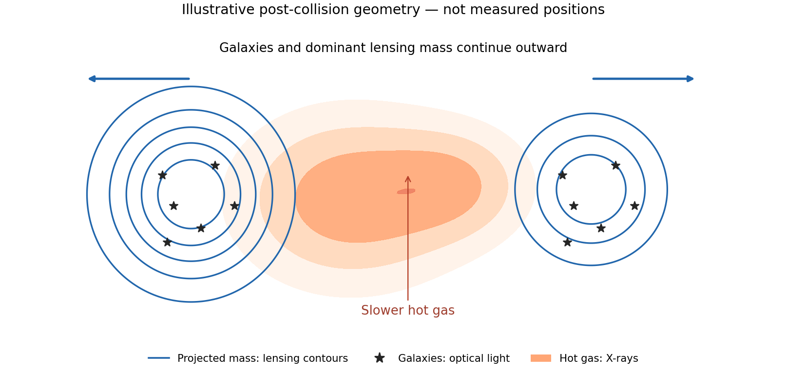

<h1 id="1/solution">Solution</h1>

↑ **Parent:** [1](../1.md)

For an isolated approximately spherical [mass](../../../../mass.md) distribution outside its luminous extent, retain the gravitational [force](../../../../force-split.md) $GMm/r^2$ and use the specified low-acceleration inertial law. [circular motion](../../../../circular-motion.md) then gives

$$
\frac{GMm}{r^2}=\frac m{a_0}\left(\frac{v^2}{r}\right)^2,
\qquad\boxed{v^4=GMa_0}.
$$

The [radius](../../../../radius.md) cancels when enclosed luminous [mass](../../../../mass.md) is effectively constant. This is the asymptotic [modified Newtonian dynamics](../../../../modified-newtonian-dynamics.md) result associated with the [baryonic Tully-Fisher relation](../../../../baryonic-tully-fisher-relation.md); an arbitrary extended disk cannot everywhere be replaced exactly by a point [mass](../../../../mass.md).

At the disk edge,

$$
a(R)=\frac{(9\times10^4)^2}{3\times10^{20}}
=\boxed{2.7\times10^{-11}\,\mathrm{m\,s^{-2}}=0.27a_0}.
$$

Using $G=6.67\times10^{-11}\,\mathrm{m^3\,kg^{-1}\,s^{-2}}$ gives

$$
M_{\rm MOND}=\frac{v^4}{Ga_0}=9.84\times10^{39}\,\mathrm{kg}
=\boxed{4.9\times10^9M_\odot}.
$$

This is an order-of-magnitude isolated, low-acceleration estimate. The edge [acceleration](../../../../acceleration.md) is below $a_0$, but not extremely small compared with it; a full interpolation law, disk geometry and an external gravitational field can affect a more precise [mass](../../../../mass.md) fit.

For the [spherical mass profile for a flat rotation curve](../../../../spherical-mass-profile-for-a-flat-rotation-curve.md), assume spherical symmetry where the halo dominates. A [flat rotation curve](../../../../flat-galaxy-rotation-curve.md) gives $M(<r)=v^2r/G$, and differentiating $M(<r)=4\pi\int_0^r\rho(s)s^2\,ds$ yields

$$
\boxed{\rho(r)=\frac{v^2}{4\pi Gr^2}}.
$$

Here $\rho$ is the density of the spherical gravitating model; it is not an exact deprojection of a thin luminous disk or a proof that the central density must diverge. At the outermost stated measured [radius](../../../../radius.md),

$$
M(<2R)=\frac{v^2(2R)}G=7.29\times10^{40}\,\mathrm{kg}
=\boxed{3.6\times10^{10}M_\odot}.
$$

This gives the requested galaxy-plus-halo [mass](../../../../mass.md) estimate if the model is truncated at the outermost observed [radius](../../../../radius.md) $2R$. **The observation itself constrains enclosed [mass](../../../../mass.md) within $2R$**; any additional outer halo remains unconstrained. Extending $\rho\propto r^{-2}$ to infinity would give divergent [mass](../../../../mass.md). Subtracting the MOND-inferred luminous [mass](../../../../mass.md) to obtain a Newtonian halo [mass](../../../../mass.md) would mix independent model-dependent estimates without an independently measured luminous [mass](../../../../mass.md).

In the [Bullet Cluster](../../../../bullet-cluster.md) collision, most observed baryonic [mass](../../../../mass.md) is hot gas. [ram pressure](../../../../ram-pressure.md) slows and [shocks](../../../../shock-wave.md) the gas, while the galaxies pass through much more freely. [weak gravitational lensing](../../../../weak-gravitational-lensing.md) maps the projected gravitational [mass](../../../../mass.md) without requiring that the gas be in [hydrostatic equilibrium](../../../../hydrostatic-equilibrium.md). The dominant lensing peaks lie closer to the galaxies than to the displaced X-ray gas. This supports a dominant weakly collisional [dark matter](../../../../dark-matter.md) component under the usual gravity model. It is stronger evidence than a mass-to-light discrepancy alone because distinct components separate during the same encounter. The inference needs background-source shape/redshift [calibration](../../../../calibration-differential-geometry.md), projection control and uncertainty in the lensing reconstruction; it does not identify a [WIMP](../../../../weakly-interacting-massive-particle.md) species or by itself exclude every modified-gravity theory.[Abstract and comparison of lensing mass, optical galaxies and X-ray gas](../../../../a-direct-empirical-proof-of-the-existence-of-dark-matter-by-douglas-clowe-and-others.md)

**[Figure 1](#1/image-original-conceptual-merger-sketch-showing-galaxies-and-dominant-lensing-mass-displaced-from-slowed-x-ray-gas-illustrative-positions-not-observational-data). Original conceptual merger sketch showing galaxies and dominant lensing mass displaced from slowed X-ray gas; illustrative positions, not observational data**.

For [dark-matter direct detection](../../../../dark-matter-direct-detection.md), consider [XENON100](../../../../xenon100.md) at Gran Sasso. A halo [WIMP](../../../../weakly-interacting-massive-particle.md) can undergo [elastic scattering](../../../../elastic-scattering.md) from a [xenon](../../../../xenon.md) [atomic nucleus](../../../../atomic-nucleus-split.md), leaving a recoil of only a few to tens of keV. The expected rate is very low, so a large target, low threshold and long exposure must be combined with background rejection. The [nuclear-recoil kinematics of WIMP scattering](../../../../nuclear-recoil-kinematics-of-wimp-scattering.md) gives $E_{R,\max}=2\mu_{\chi N}^2v^2/m_N$ in the nonrelativistic limit, where $\mu_{\chi N}$ is the [reduced mass](../../../../reduced-mass.md) and [masses](../../../../mass.md) and [velocities](../../../../velocity.md) use consistent units. This explains why low-energy response [calibration](../../../../calibration-differential-geometry.md) matters.

The dual-phase [xenon](../../../../xenon.md) detector measures prompt [particle scintillation](../../../../scintillation-physics.md) S1 and delayed [electroluminescence](../../../../electroluminescence.md) S2 from [ionization](../../../../ionization.md) electrons extracted into gas. Their time separation gives interaction depth; the S2 light pattern supplies transverse position. An inner [fiducial volume](../../../../fiducial-volume.md) uses [xenon](../../../../xenon.md)'s self-shielding to suppress external backgrounds. The S2/S1 distribution statistically separates [nuclear recoils](../../../../nuclear-recoil.md) from [electron recoils](../../../../electron-recoil.md); it is not perfect event-by-event identification. Underground siting reduces cosmic-ray backgrounds, while passive shielding, low-radioactivity components, [xenon](../../../../xenon.md) purification and a surrounding [active detector veto](../../../../active-detector-veto.md) reduce other events.[Sections 2–3, two-phase detection, detector design and background control](../../../../the-xenon100-dark-matter-experiment-by-the-xenon100-collaboration.md)

Neutrons can also make [nuclear recoils](../../../../nuclear-recoil.md), so charge-to-light discrimination alone cannot eliminate them. Multiple-scatter rejection, shielding and background modelling remain necessary. Gamma-source and neutron-source [calibrations](../../../../calibration-differential-geometry.md) map electron- and nuclear-recoil distributions, [energy](../../../../energy-split.md) scale and selection acceptance. Position-dependent light collection and charge losses need correction; photon-counting fluctuations and uncertain low-energy yields limit threshold sensitivity. Blind event selection and independent sidebands guard against tuning cuts to apparent candidates. The 224.6-live-day, 34 kg search found two benchmark candidates against about one expected background event, consistent with background. Its interaction limit therefore depends on the assumed halo distribution, [WIMP](../../../../weakly-interacting-massive-particle.md) [mass](../../../../mass.md) and nuclear response; it is not a detection or an exclusion of all [dark matter](../../../../dark-matter.md).[Printed pp. 2–4, calibrations, blind selection and backgrounds; abstract for exposure and result](../../../../dark-matter-results-from-225-live-days-of-xenon100-data-by-the-xenon100-collaboration.md)

## ↑ Ancestors (13)

1. [1](../1.md)
2. [Paper 1](../../paper-1-split.md)
3. [2013](../../split.md)
4. [Past exam of the particle Astrophysics course of the University of Cambridge](../../../split.md)
5. [Particle Astrophysics course of the University of Cambridge](../../../../particle-astrophysics-course-of-the-university-of-cambridge.md)
6. [Physics course of the year 4 of the natural sciences course of the University of Cambridge](../../../../physics-course-of-the-year-4-of-the-natural-sciences-course-of-the-university-of-cambridge.md)
7. [Year 4 of the natural sciences course of the University of Cambridge](../../../../year-4-of-the-natural-sciences-course-of-the-university-of-cambridge.md)
8. [Year of the natural sciences course of the University of Cambridge](../../../../year-of-the-natural-sciences-course-of-the-university-of-cambridge.md)
9. [Natural sciences course of the University of Cambridge](../../../../natural-sciences-course-of-the-university-of-cambridge.md)
10. [Course of the University of Cambridge](../../../../course-of-the-university-of-cambridge.md)
11. [University of Cambridge](../../../../university-of-cambridge-split.md)
12. [List of universities](../../../../list-of-universities.md)
13. [Codex Wiki](../../../../split.md)
