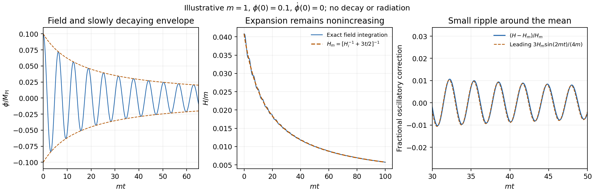

<h1 id="3/solution">Solution</h1>

↑ **Parent:** [3](../3.md)

For a homogeneous canonical [scalar field](../../../../scalar-field.md), $\rho_\phi=\dot\phi^2/2+V$ and $P_\phi=\dot\phi^2/2-V$. Potential-energy domination gives $P_\phi\simeq-\rho_\phi$, accelerated expansion and a decreasing [comoving Hubble radius](../../../../comoving-hubble-radius.md). [Hubble friction](../../../../hubble-friction.md) can permit slow roll down a sufficiently flat potential. Enough inflation stretches an initially small causally connected region to encompass our observable universe, suppresses the relative spatial-curvature term and dilutes unwanted massive relics. [quantum fluctuations](../../../../quantum-fluctuation.md) supply possible seeds for cosmological structure; a successful model must also end inflation and create the hot post-inflationary universe. These statements do not imply that arbitrary initial conditions inevitably inflate.

Use the stated reduced-Planck units throughout the field calculation. Differentiating the Friedmann constraint and substituting the field equation gives

$$
2H\dot H=\frac13\dot\phi(\ddot\phi+m^2\phi)
=-H\dot\phi^2,\qquad
\boxed{\dot H=-\frac12\dot\phi^2}.
$$

Division assumes the nontrivial expanding branch $H>0$; the [vacuum](../../../../vacuum.md) endpoint follows continuously.

During rapid [oscillations](../../../../oscillation.md), require $m\gg H$ and $|\dot A|\ll mA$. To leading order, $\dot\phi\simeq-mA\sin mt$, while the Friedmann constraint gives $H_m^2\simeq m^2A^2/6$. Thus

$$
\dot H\simeq-\frac{m^2A^2}{2}\sin^2mt
=-\frac32H_m^2(1-\cos2mt).
$$

Averaging over many [oscillations](../../../../oscillation.md) on a timescale still short compared with $H^{-1}$ gives

$$
\boxed{\dot H_m=-\frac32H_m^2}.
$$

The [quadratic-inflaton Hubble oscillations](../../../../quadratic-inflaton-hubble-oscillations.md) obey, to leading order in $H_m/m$,

$$
H_{\rm fluct}\simeq\frac{3H_m^2}{4m}\sin2mt,
\qquad \frac{|H_{\rm fluct}|}{H_m}=O(H_m/m)\ll1.
$$

Differentiating this expression reproduces the cosine term, with smaller corrections from the slowly varying amplitude. Instantaneously $H$ remains nonincreasing because its exact [derivative](../../../../derivative.md) is $-\dot\phi^2/2$; an oscillatory correction does not mean oscillatory growth of the total [Hubble parameter](../../../../hubble-parameter.md).

The mean equation integrates to

$$
\frac1{H_m(t)}=\frac1{H_m(t_i)}+\frac32(t-t_i),\qquad
\boxed{H_m(t)=\frac{2}{3(t-t_*)}},\qquad
\boxed{a(t)\propto(t-t_*)^{2/3}}.
$$

The shift $t_*$ is set by matching to the earlier evolution, not necessarily the Big Bang origin of the full solution. Averaged kinetic and [potential energies](../../../../potential-energy.md) are equal, so $\langle P_\phi\rangle\simeq0$, $\langle\rho_\phi\rangle\propto a^{-3}$ and $A\propto a^{-3/2}$. **The coherent quadratic [oscillations](../../../../oscillation.md) behave as [pressureless matter](../../../../pressureless-matter.md), not [radiation](../../../../radiation.md)**, even though they are a [scalar field](../../../../scalar-field.md) rather than a gas of cold particles. [radiation](../../../../radiation.md) would instead give $a\propto t^{1/2}$. The averaged approximation is controlled only after [oscillations](../../../../oscillation.md) are fast compared with expansion.

**[Figure 2](#3/image-original-dimensionless-scalar-field-integration-showing-a-decaying-oscillation-envelope-and-a-nonincreasing-hubble-parameter-with-a-matter-like-average). Original dimensionless scalar-field integration showing a decaying oscillation envelope and a nonincreasing Hubble parameter with a matter-like average**.

[reheating](../../../../reheating.md) requires interactions beyond the isolated field equations above. The oscillating [inflaton](../../../../inflaton.md) can decay into other particles, whose scattering and further decays establish a thermal bath. The [perturbative inflaton reheating equations](../../../../perturbative-inflaton-reheating-equations.md) are

$$
\dot\rho_\phi+3H\rho_\phi=-\Gamma\rho_\phi,\qquad
\dot\rho_r+4H\rho_r=\Gamma\rho_\phi.
$$

Expansion redshifts the components differently; transfer becomes efficient around $H\sim\Gamma$, and [radiation](../../../../radiation.md) domination follows when the transferred relativistic [energy](../../../../energy-split.md) dominates. For suitable couplings, nonperturbative [preheating](../../../../preheating.md) by [parametric resonance](../../../../parametric-resonance.md) can precede thermalization, with backreaction and rescattering affecting its completion. Neither the decay rate nor thermalization is specified by $m$ and $V$ alone. Instantaneous [reheating](../../../../reheating.md) idealizes all this as immediate conversion of the end-of-inflation [energy](../../../../energy-split.md) to [radiation](../../../../radiation.md).[Abstract and Introduction: perturbative decay, resonant preheating, backreaction and thermalization](../../../../towards-the-theory-of-reheating-after-inflation-by-lev-kofman-and-others.md)

For [instantaneous-reheating horizon matching](../../../../instantaneous-reheating-horizon-matching.md), specify the comparison: take the initial patch to be of order $H_i^{-1}$, compare the same-shaped inflationary history with approximately fixed $H_i/H_{\rm end}$, and assume instantaneous [reheating](../../../../reheating.md) followed by [adiabatic expansion](../../../../adiabatic-expansion.md). Ignoring changes in relativistic degrees of freedom, $a_0/a_{\rm reh}\propto T_{\rm reh}$, while [energy](../../../../energy-split.md) conservation and the [Friedmann equation](../../../../friedmann-equations.md) give $H_{\rm end}\propto T_{\rm reh}^2$. The present size of this inflated patch therefore scales as

$$
\ell_0\sim H_i^{-1}e^N\frac{a_0}{a_{\rm reh}}
\propto\frac{e^N}{T_{\rm reh}}.
$$

At fixed present [Hubble radius](../../../../hubble-radius.md), **a higher instantaneous [reheating](../../../../reheating.md) scale requires more e-folds** in this standard comparison, approximately $\Delta N\simeq\ln(T_2/T_1)$, up to slow scale and entropy-degree corrections. Hotter [reheating](../../../../reheating.md) gives more subsequent expansion, but the associated initial Hubble patch is smaller by a stronger [power](../../../../power.md) of [temperature](../../../../temperature-split.md). If instead one artificially holds the initial physical patch or $H_i$ fixed while varying the end [energy](../../../../energy-split.md) independently, the post-inflationary geometric effect alone would give the opposite trend. [temperature](../../../../temperature-split.md) without an inflation-scale comparison convention does not fix that alternative problem; this is why the matching assumptions must be stated.[Section II, equations 2, 6–8: horizon-scale matching and its dependence on inflation and reheating energy scales](../../../../how-long-before-the-end-of-inflation-were-observable-perturbations-produced-by-andrew-r-liddle-and-samuel-m-leach.md)

## ↑ Ancestors (13)

1. [3](../3.md)
2. [Paper 1](../../paper-1-split.md)
3. [2013](../../split.md)
4. [Past exam of the particle Astrophysics course of the University of Cambridge](../../../split.md)
5. [Particle Astrophysics course of the University of Cambridge](../../../../particle-astrophysics-course-of-the-university-of-cambridge.md)
6. [Physics course of the year 4 of the natural sciences course of the University of Cambridge](../../../../physics-course-of-the-year-4-of-the-natural-sciences-course-of-the-university-of-cambridge.md)
7. [Year 4 of the natural sciences course of the University of Cambridge](../../../../year-4-of-the-natural-sciences-course-of-the-university-of-cambridge.md)
8. [Year of the natural sciences course of the University of Cambridge](../../../../year-of-the-natural-sciences-course-of-the-university-of-cambridge.md)
9. [Natural sciences course of the University of Cambridge](../../../../natural-sciences-course-of-the-university-of-cambridge.md)
10. [Course of the University of Cambridge](../../../../course-of-the-university-of-cambridge.md)
11. [University of Cambridge](../../../../university-of-cambridge-split.md)
12. [List of universities](../../../../list-of-universities.md)
13. [Codex Wiki](../../../../split.md)
