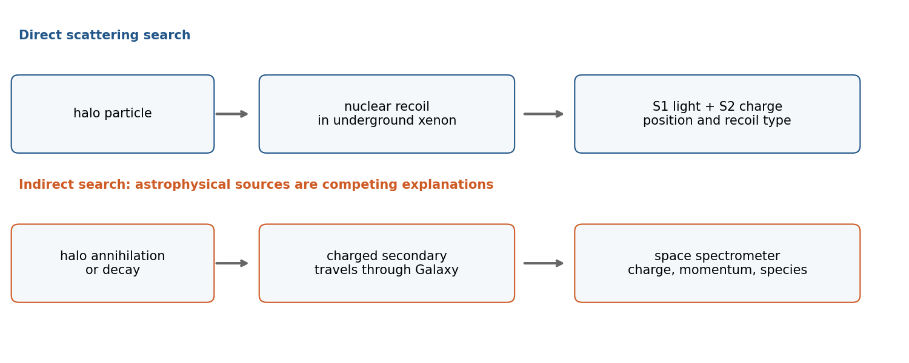

# Paper 1

↑ **Parent:** [2014](../2014.md)

[Original examination PDF, physical pages 681–683](https://www.whatdotheyknow.com/request/natural_science_tripos_physics_e_2/response/2340776/attach/2/FOI%202023%20399%20Zahid%20materials.pdf?cookie_passthrough=1#page=681)

**Table of contents**

- [1](#1)
  - [Solution](#1/solution)
- [2](#2)
  - [Solution](#2/solution)
- [3](#3)
  - [a](#3/a)
    - [Solution](#3/a/solution)
  - [b](#3/b)
    - [Solution](#3/b/solution)
  - [c](#3/c)
    - [Solution](#3/c/solution)

## 1

↑ **Parent:** [Paper 1](paper-1.md)

<h3 id="1/solution">Solution</h3>

↑ **Parent:** [1](#1)

For a fixed comoving cell, take physical volume $V=R^3$ and energy density $u=\rho c^2$. With negligible chemical potentials and fixed relativistic species, $u=AT^4$ and $P=u/3$. The [first law of thermodynamics](../../first-law-of-thermodynamics.md) gives

$$
T\,dS=d(uR^3)+\frac u3d(R^3),\qquad dS=d\!\left(\frac{4AR^3T^3}{3}\right).
$$

Choosing zero entropy at zero temperature yields **$S=4R^3u/(3T)$**. Reversible expansion conserves this entropy; when species disappear, the effective entropy degrees of freedom must be changed rather than keeping $A$ fixed.

Before electron-positron annihilation, photons contribute two states, electrons plus positrons four, and three neutrino/antineutrino species six. Thus

$$
g_*=2+\frac78(4+6)=\frac{43}{4},\qquad\boxed{u=\frac a2g_*T^4=\frac{43}{8}aT^4.}
$$

After neutrinos decouple, the electromagnetic entropy alone is conserved through annihilation: $(2+7\times4/8)T_i^3R_i^3=2T_\gamma^3R_f^3$, while $T_\nu R_f=T_iR_i$. Consequently

$$
\boxed{\frac{T_\nu}{T_\gamma}=\left(\frac4{11}\right)^{1/3}\simeq0.714.}
$$

This assumes instantaneous decoupling, negligible neutrino masses/chemical potentials and complete electromagnetic thermalization. Small noninstantaneous corrections are outside this approximation.

In the [Pati-Salam model](../../classical-field-theory.md#pati-salam-model), right-handed quarks and leptons fill a $(4,1,2)$ multiplet. The neutrino component has no colour, $T_L=0$ and hypercharge $Y=T_{3R}+(B-L)/2=1/2-1/2=0$. Hence $\nu_R$ is a [Standard Model gauge singlet neutrino](../../standard-model.md#standard-model-gauge-singlet-neutrino), with no ordinary weak or electromagnetic gauge coupling. It is **sterile under the low-energy Standard Model**, not a singlet of the full unbroken Pati-Salam group. A heavy Majorana mass can arise after symmetry breaking. The representation alone fixes neither its mass nor the stability, mixing or relic abundance needed for dark matter.[1974 gauge embedding and right-handed neutrino](../../physics-bibliography.md#lepton-number-as-the-fourth-color-by-jogesh-pati-and-abdus-salam)

**Space example: [AMS-02](../../particle-detection.md#ams-02)**, a magnetic spectrometer on the International Space Station. Tracker curvature determines rigidity and charge sign; transition-radiation detection and an electromagnetic calorimeter distinguish electrons/positrons from the much larger proton background. It measures charged cosmic-ray spectra, including positrons that could arise from halo-particle annihilation. This is an **indirect dark-matter search**, despite directly recording the charged products: it does not measure scattering of neutral halo WIMPs, and astrophysical sources can mimic a positron excess. Calling it direct WIMP detection would misstate the technique.[2013 positron fraction and detector discrimination](../../physics-bibliography.md#first-result-from-the-alpha-magnetic-spectrometer-on-the-international-space-station-by-ams-collaboration)

**Underground example: [XENON100](../../particle-detection.md#xenon100)**, a [dual-phase xenon detector](../../particle-detection.md#dual-phase-xenon-detector). A candidate WIMP scatters from a xenon nucleus, producing prompt liquid scintillation S1 and ionization electrons. Drift and extraction into gas produce delayed proportional scintillation S2. Their delay and light patterns reconstruct the interaction position; S2/S1 discriminates nuclear recoils from electron-recoil backgrounds. Underground shielding, fiducial cuts and calibration reduce backgrounds, though neutrons can imitate nuclear recoils. This is direct recoil detection; a null excess constrains cross sections for an assumed halo and interaction model.[Dual-phase time-projection chamber, scintillation and ionization](../../physics-bibliography.md#the-xenon100-dark-matter-experiment-by-the-xenon100-collaboration)[2012 search found no significant dark-matter excess](../../physics-bibliography.md#dark-matter-results-from-225-live-days-of-xenon100-data-by-the-xenon100-collaboration)

**[Figure 1](#1/image-underground-scattering-and-space-based-annihilation-product-searches-test-different-dark-matter-signals). Underground scattering and space-based annihilation-product searches test different dark-matter signals**. [Source](paper-1-pa2014-search-techniques.py).

## 2

↑ **Parent:** [Paper 1](paper-1.md)

<h3 id="2/solution">Solution</h3>

↑ **Parent:** [2](#2)

For successive radial null rays from a comoving source, $\int_{t_1}^{t_0}c\,dt/R(t)$ equals the same spatial integral. Subtracting two nearby wavecrests gives $\delta t_0/R_0=\delta t_1/R_1$, hence the [cosmological redshift](../../cosmology.md#cosmological-redshift)

$$
\boxed{1+z=\nu_1/\nu_0=R_0/R_1.}
$$

For transparent propagation, photon energies are reduced by $1+z$ and arrival intervals increased by $1+z$. The observer-area sphere is $4\pi(R_0r)^2$, so the observed bolometric flux is

$$
F=\frac{L}{4\pi(R_0r)^2(1+z)^2},\qquad\boxed{D_L=(1+z)R_0r.}
$$

Thus the requested $D_L=(1+z)D$ uses $D=R_0r$, the present transverse proper/area distance. In a curved metric this is not the radial proper distance $R_0\int_0^rdr'/\sqrt{1-Kr'^2}$; the two coincide for $K=0$. The source's unqualified “proper distance” needs this distinction.

[Type Ia supernovae](../../stellar-astrophysics.md#type-ia-supernova) are standardizable candles: light-curve shape and colour calibrate their luminosity. Distant events are fainter, hence have larger inferred [luminosity distances](../../cosmology.md#luminosity-distance), than appropriate matter-only decelerating models predict. Their redshift–distance relation favours recent accelerated expansion. In general relativity, sufficiently negative pressure, $\rho+3P/c^2<0$, drives acceleration. Dust, evolution, calibration and selection are checked as possible systematics; a single faint supernova is not the argument.[1998 luminosity-distance evidence](../../physics-bibliography.md#observational-evidence-from-supernovae-for-an-accelerating-universe-and-a-cosmological-constant-by-adam-riess-and-others)

An independent complementary test combines the [cosmic microwave background](../../cosmic-microwave-background.md) acoustic distance/near-flat geometry with matter-density and [baryon acoustic oscillation](../../cosmology.md#baryon-acoustic-oscillation) constraints. Matter alone does not supply the required late-time expansion history; a dark-energy component fits the joint data. CMB geometry alone has curvature/expansion degeneracies and is not an assumption-free detection of a cosmological constant.[CMB,BAO and expansion-model constraints](../../physics-bibliography.md#planck-2013-results-xvi-cosmological-parameters-by-planck-collaboration)

In natural units $c=\hbar=1$, a regulated [zero-point energy](../../quantum-harmonic-oscillator.md#zero-point-energy) estimate is

$$
\rho_{\rm zp}(M)=\sum_i\frac{(-1)^{F_i}g_i}{2}\int_{|\mathbf k|<M}\frac{d^3k}{(2\pi)^3}\sqrt{k^2+m_i^2},\qquad\Lambda_{\rm geom}=\Lambda_{\rm bare}+8\pi G\rho_{\rm zp}.
$$

The integral is ultraviolet divergent and requires renormalization; it is not a finite prediction from counting “virtual pairs.” An electroweak scale estimate gives $|\rho_{\rm vac}|\sim m_t^4=(174)^4\,\mathrm{GeV^4}\simeq9.2\times10^8\,\mathrm{GeV^4}$, or somewhat smaller with loop factors. Compared with $10^{-47}\,\mathrm{GeV^4}$ this is roughly **$10^{56}$ too large**.

**The source's units are inconsistent:** $10^{-47}\,\mathrm{GeV^4}$ is a vacuum energy density, whereas $8\pi G\rho_{\rm vac}$ has units $\mathrm{GeV^2}$. The comparison above consistently uses densities. Bare and quantum contributions must cancel to extraordinary accuracy if this naive scale estimate is representative: the [cosmological constant problem](../../cosmology.md#cosmological-constant-problem). Its severity is not a measured value of an individual cutoff integral.

## 3

↑ **Parent:** [Paper 1](paper-1.md)

<h3 id="3/a">a</h3>

↑ **Parent:** [3](#3)

<h4 id="3/a/solution">Solution</h4>

↑ **Parent:** [A](#3/a)

[Supersymmetry](../../supersymmetry.md) relates bosons and fermions whose spins differ by one-half. Broken supersymmetry can soften Higgs-mass sensitivity and improve gauge-coupling unification in suitable spectra; neither feature establishes that nature realizes it. Collider searches look for squarks/gluinos or electroweak superpartners through jets/leptons, missing transverse momentum and appropriate cascade-decay kinematics. Null searches constrain specified masses and branching fractions, with weaker reach for compressed or nonstandard spectra.

With conserved [R-parity](../../supersymmetry.md#r-parity), superpartners are pair-produced and the lightest supersymmetric particle is stable. A neutral weakly coupled lightest state, such as a [neutralino](../../supersymmetry.md#neutralino), can be a dark-matter candidate. Its thermal abundance follows annihilation freeze-out when $n_\chi\langle\sigma v\rangle\sim H$; later expansion dilutes number density while leaving the comoving relic abundance approximately fixed. Coannihilation and resonances can change the result. Recoil searches and cosmic-ray/photon searches test complementary couplings.

Cosmology also constrains unstable long-lived relics through nucleosynthesis and reheating; not every supersymmetric spectrum gives the observed dark matter. R-parity is an additional assumption: supersymmetry by itself does not guarantee a stable neutral relic. Laboratory discovery and a matching cosmological abundance would both be needed.

<h3 id="3/b">b</h3>

↑ **Parent:** [3](#3)

<h4 id="3/b/solution">Solution</h4>

↑ **Parent:** [B](#3/b)

[Cosmic inflation](../../cosmic-inflation.md) is accelerated expansion with decreasing comoving Hubble radius, $\ddot R>0$ or $\epsilon_H=-\dot H/H^2<1$. It can make the observed region causally connected before inflation and dilute spatial curvature or unwanted relics. A slowly rolling scalar has energy and pressure $\rho_\phi=\dot\phi^2/2+V$, $P_\phi=\dot\phi^2/2-V$ in natural units. Potential domination gives near-exponential expansion; ending inflation and reheating must create the hot radiation era.

For a canonical single scalar with reduced Planck mass $M_{\rm Pl}$,

$$
\epsilon_V=\frac{M_{\rm Pl}^2}{2}(V'/V)^2\ll1,\qquad|\eta_V|=|M_{\rm Pl}^2V''/V|\ll1,
\qquad n_s-1\simeq-6\epsilon_V+2\eta_V,\quad r\simeq16\epsilon_V.
$$

Quantum fluctuations stretched to cosmological scales seed density perturbations. Tests include the scalar spectral tilt, acoustic coherence, spatial curvature, non-Gaussianity and tensor-induced CMB B-mode polarization. Foregrounds and lensing must be separated from primordial tensors. A tensor non-detection does not exclude all inflation; tilt and tensor consistency predictions depend on the model. Approximate flatness and near-scale-invariant fluctuations support the framework but do not uniquely determine a potential or prove an exact de Sitter phase.

<h3 id="3/c">c</h3>

↑ **Parent:** [3](#3)

<h4 id="3/c/solution">Solution</h4>

↑ **Parent:** [C](#3/c)

[Baryogenesis](../../cosmology.md#baryogenesis) dynamically creates a baryon–antibaryon imbalance rather than assuming it as an initial condition. Under the usual local relativistic assumptions, the [Sakharov conditions](../../cosmology.md#sakharov-conditions) are baryon-number violation, C and CP violation, and departure from thermal equilibrium. Without the last condition, inverse reactions and equilibrium constraints cancel a net asymmetry; CP-conjugate rates must differ in a channel with the required number violation.

In [heavy-boson decay baryogenesis](../../cosmology.md#heavy-boson-decay-baryogenesis), heavy particles decay through baryon-violating channels with CP-asymmetric branching. Expansion makes decays/inverse decays fall out of equilibrium; washout reactions must then become ineffective. Inflation would dilute an earlier asymmetry, so the generation/reheating history matters.

In [leptogenesis](../../cosmology.md#leptogenesis), out-of-equilibrium Majorana-neutrino decays first produce lepton number. Electroweak [sphalerons](../../standard-model.md#sphaleron) violate $B+L$ while preserving $B-L$ and convert part of the surviving asymmetry to baryon number. In the minimal Standard Model chemical-equilibrium limit, $B=28(B-L)/79$; the coefficient depends on particle content and equilibrated interactions. Electroweak baryogenesis is another possibility if CP violation and a sufficiently strong nonequilibrium phase transition are supplied. The Standard Model's observed parameters do not by themselves furnish an adequate conventional electroweak scenario. Each proposal must quantitatively match the relic asymmetry and avoid washout.

## ↑ Ancestors (11)

1. [2014](../2014.md)
2. [Past exam of the particle Astrophysics course of the University of Cambridge](../../past-exam-of-the-particle-astrophysics-course-of-the-university-of-cambridge.md)
3. [Particle Astrophysics course of the University of Cambridge](../../university-of-cambridge.md#particle-astrophysics-course-of-the-university-of-cambridge)
4. [Physics course of the year 4 of the natural sciences course of the University of Cambridge](../../university-of-cambridge.md#physics-course-of-the-year-4-of-the-natural-sciences-course-of-the-university-of-cambridge)
5. [Year 4 of the natural sciences course of the University of Cambridge](../../university-of-cambridge.md#year-4-of-the-natural-sciences-course-of-the-university-of-cambridge)
6. [Year of the natural sciences course of the University of Cambridge](../../university-of-cambridge.md#year-of-the-natural-sciences-course-of-the-university-of-cambridge)
7. [Natural sciences course of the University of Cambridge](../../university-of-cambridge.md#natural-sciences-course-of-the-university-of-cambridge)
8. [Course of the University of Cambridge](../../university-of-cambridge.md#course-of-the-university-of-cambridge)
9. [University of Cambridge](../../university-of-cambridge.md)
10. [List of universities](../../README.md#list-of-universities)
11. [Codex Wiki](../../README.md)
