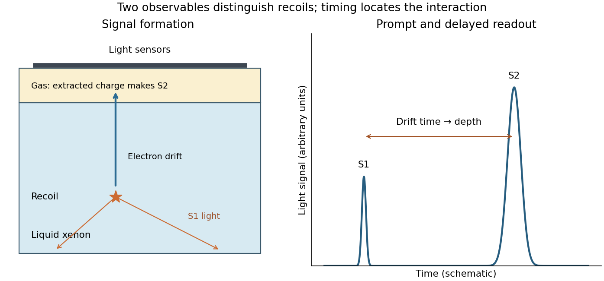
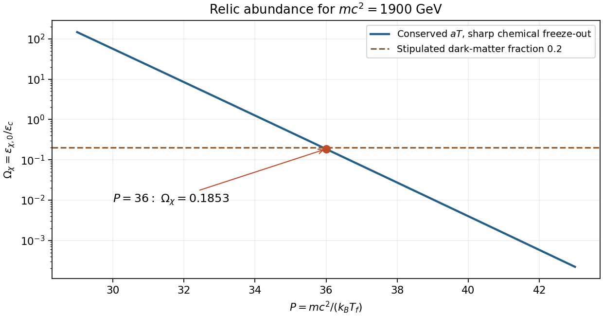

# Paper 1

↑ **Parent:** [2015](../2015.md)

Original solutions for the shared Physics and Astrophysics paper. [Original examination PDF, physical pages 755–757](https://www.whatdotheyknow.com/request/natural_science_tripos_physics_e_2/response/2340776/attach/2/FOI%202023%20399%20Zahid%20materials.pdf?cookie_passthrough=1)

**Table of contents**

- [1](#1)
  - [Solution](#1/solution)
- [2](#2)
  - [a](#2/a)
    - [Solution](#2/a/solution)
  - [b](#2/b)
    - [Solution](#2/b/solution)
  - [Solution](#2/solution)
- [3](#3)
  - [a](#3/a)
    - [Solution](#3/a/solution)
  - [b](#3/b)
    - [Solution](#3/b/solution)
  - [c](#3/c)
    - [Solution](#3/c/solution)

## 1

↑ **Parent:** [Paper 1](paper-1.md)

<h3 id="1/solution">Solution</h3>

↑ **Parent:** [1](#1)

**Cosmological variables and conventions.** The [scale factor](../../cosmology.md#scale-factor-cosmology) $R(t)$ describes the relative separation of [comoving observers](../../cosmology.md#comoving-observer); dots denote [derivatives](../../calculus.md#derivative) with respect to [cosmic time](../../cosmology.md#cosmic-time) $t$. The [Hubble parameter](../../cosmology.md#hubble-parameter) is $H(t)=\dot R/R$, usually time dependent; “[Hubble constant](../../cosmology.md#hubble-constant)” conventionally means its present value. Here $\rho$ is mass-equivalent density, so $\epsilon=\rho c^2$ is [energy density](../../statistical-physics.md#energy-density), while $P$ is isotropic [pressure](../../pressure.md). $G$ is the [gravitational constant](../../newton-s-law-of-universal-gravitation.md#gravitational-constant) and $c$ the [speed of light](../../special-relativity.md#speed-of-light). The constant $K$ specifies [cosmological spatial curvature](../../cosmology.md#spatial-curvature-of-an-flrw-universe): with $R$ a length, $K=kc^2$ and $k=+1,0,-1$ describe closed, flat and open spatial geometries. Alternative normalizations of $R$ move a constant factor into $K$. In the printed equations $\Lambda$ has units $\mathrm{s}^{-2}$: it is $c^2$ times a [cosmological constant](../../cosmology.md#cosmological-constant) defined in inverse square metres. This [time-unit convention for the cosmological constant](../../cosmology.md#time-unit-convention-for-the-cosmological-constant) prevents a missing factor of $c^2$.

**Continuity and the first law.** Differentiating the first [Friedmann equation](../../cosmology.md#friedmann-equations) with constant $K$ and $\Lambda$, and then eliminating $\ddot R/R$ with the second, gives

$$
2H\left(\dot H-\frac{K}{R^2}\right)=\frac{8\pi G}{3}\dot\rho,\qquad
\dot H-\frac{K}{R^2}=-4\pi G\left(\rho+\frac{P}{c^2}\right).
$$

Thus, on an expanding or contracting branch,

$$
\boxed{\dot\rho=-3H\left(\rho+\frac{P}{c^2}\right).}
$$

The relation extends continuously to a regular turning point. For a physical volume $V(t)=V_*R^3(t)$ bounded by fixed [comoving coordinates](../../cosmology.md#comoving-coordinate), $\dot V=3HV$. Multiplication by $c^2V$ gives

$$
\frac{d}{dt}(\rho c^2V)=-P\dot V,\qquad
\boxed{dU+P\,dV=0,\quad U=\rho c^2V.}
$$

This [adiabatic work in a comoving volume](../../cosmology.md#adiabatic-work-in-a-comoving-volume) is the [first law of thermodynamics](../../first-law-of-thermodynamics.md) for adiabatic evolution with fixed [entropy](../../entropy.md) and no additional chemical work. It expresses local [energy](../../energy.md) conservation, including [pressure](../../pressure.md) work. **It does not assert that $U$ is constant:** [radiation](../../physics.md#radiation) loses [internal energy](../../internal-energy.md) as it does work; negative [pressure](../../pressure.md) makes $U$ grow during expansion. A generic expanding spacetime has no global time-translation [symmetry](../../physics.md#symmetry-physics) from which a conserved total [energy](../../energy.md) follows.

**Constant scalar-field [energy density](../../statistical-physics.md#energy-density).** Setting $\dot\rho=0$ in the continuity equation, with $H\ne0$, gives

$$
\boxed{P=-\rho c^2,\qquad w=\frac{P}{\rho c^2}=-1.}
$$

For a homogeneous canonical [scalar field](../../classical-field-theory.md#scalar-field), in units $c=1$, $\epsilon=\dot\phi^2/2+V(\phi)$ and $P=\dot\phi^2/2-V(\phi)$. A stationary potential-dominated field has precisely this [equation of state](../../pressure.md#equation-of-state). A general evolving [scalar field](../../classical-field-theory.md#scalar-field) need not have $w=-1$; the constant-density assumption is essential.

**Expansion at the stipulated Higgs [energy density](../../statistical-physics.md#energy-density).** With zero explicit $\Lambda$ and zero $K$, constant $\epsilon_H$ gives

$$
H_H=\sqrt{\frac{8\pi G\epsilon_H}{3c^2}},\qquad
\boxed{R(t)=R_i e^{H_H(t-t_i)}}.
$$

The plus sign selects the expanding branch; there is also a contracting solution. The scalar-field [energy](../../energy.md) is already included in $\rho$, so adding it again as an explicit [cosmological constant](../../cosmology.md#cosmological-constant) would double count it. Using $1\ \mathrm{GeV}=1.602176634\times10^{-10}\ \mathrm{J}$ gives $\epsilon_H=2.4033\times10^{45}\ \mathrm{J\,m^{-3}}$, $\rho_H=2.6740\times10^{28}\ \mathrm{kg\,m^{-3}}$ and $H_H\simeq3.87\times10^9\ \mathrm{s^{-1}}$. Therefore

$$
\boxed{t_{\rm double}=\frac{\log2}{H_H}\simeq1.79\times10^{-10}\ \mathrm{s}.}
$$

This [vacuum-dominated doubling time](../../riemann-curvature-tensor.md#vacuum-dominated-doubling-time) describes accelerated expansion in [de Sitter spacetime](../../general-relativity.md#de-sitter-spacetime), with $\ddot R/R=H_H^2>0$. The stipulated [energy density](../../statistical-physics.md#energy-density) exceeds the [critical density](../../cosmology.md#critical-density) in [energy](../../energy.md) units used in Question 2 by $3\times10^{54}$, so it cannot persist as the dominant component of the present universe. The calculation exhibits the [cosmological constant problem](../../cosmology.md#cosmological-constant-problem): the absolute gravitational [vacuum energy](../../perturbative-quantum-field-theory.md#vacuum-energy) must be enormously smaller than such a particle-physics scale today. It does not establish that the [Standard Model](../../standard-model.md) [Higgs field](../../standard-model.md#higgs-field) actually remains constant or supplies a viable inflationary epoch.

**The acoustic ruler and accelerated expansion.** Before [baryon](../../physics.md#baryon) drag becomes ineffective, [pressure](../../pressure.md) in the [photon-baryon fluid](../../cosmic-microwave-background-anisotropy.md#photon-baryon-fluid) drives acoustic waves around initial [linear cosmological density perturbations](../../linear-cosmological-density-perturbation.md). Their comoving [sound horizon](../../cosmic-microwave-background-anisotropy.md#sound-horizon) at the [baryon drag epoch](../../cosmology.md#baryon-drag-epoch) is

$$
r_d=\int_{z_d}^{\infty}\frac{c_s(z)}{H(z)}\,dz.
$$

After decoupling, this preferred separation survives in [galaxy](../../galaxy.md) clustering as [baryon acoustic oscillations](../../cosmology.md#baryon-acoustic-oscillation): a peak in the [two-point correlation function](../../critical-phenomenon.md#two-point-correlation-function) and oscillations in the [matter power spectrum](../../linear-cosmological-density-perturbation.md#matter-power-spectrum). Its value is calibrated by early-universe physics, commonly constrained by the [cosmic microwave background](../../cosmic-microwave-background.md). The SDSS luminous-red-galaxy measurement established a peak near $100h^{-1}\ \mathrm{Mpc}$; its use as a distance indicator depends on the ruler [calibration](../../differential-geometry.md#calibration-differential-geometry) rather than the length of an individual [galaxy](../../galaxy.md).[Abstract and Sections 2–5, correlation-function peak and distance-scale interpretation](../../physics-bibliography.md#detection-of-the-baryon-acoustic-peak-in-the-large-scale-correlation-function-of-sdss-luminous-red-galaxies-by-daniel-eisenstein-and-others)

For a ruler perpendicular to the line of sight and one parallel to it,

$$
\boxed{\Delta\theta=\frac{r_d}{D_M(z)},\qquad
\Delta z=\frac{H(z)r_d}{c}},
$$

where $D_M=(1+z)D_A$ is the [transverse comoving distance](../../cosmology.md#transverse-comoving-distance) and $D_A$ the [angular diameter distance](../../cosmology.md#angular-diameter-distance). These measure $D_M/r_d$ and $H r_d$, respectively. Comparing multiple redshifts tests the distance–redshift relation and expansion history. In particular,

$$
q(z)=-\frac{\ddot R R}{\dot R^2}
=\frac{1+z}{H(z)}\frac{dH}{dz}-1,
$$

so sufficiently precise measurements of the shape of $H(z)$ can test $q<0$. In [general relativity](../../general-relativity.md), accelerated expansion requires a sufficiently negative total $\rho+3P/c^2$; a positive [cosmological constant](../../cosmology.md#cosmological-constant) supplies it.

A single acoustic angular scale does not independently determine acceleration, [cosmological spatial curvature](../../cosmology.md#spatial-curvature-of-an-flrw-universe), the absolute [sound horizon](../../cosmic-microwave-background-anisotropy.md#sound-horizon) and the dark-energy [equation of state](../../pressure.md#equation-of-state). One combines redshift coverage with early-universe [calibration](../../differential-geometry.md#calibration-differential-geometry) and independent matter-density or distance information, comparing accelerating and nonaccelerating models. The [galaxy](../../galaxy.md) selection function and redshift completeness must be modeled with random catalogues, survey covariance estimated with mock catalogues, and [redshift-space distortions](../../large-scale-structure-of-the-universe.md#redshift-space-distortions), [galaxy bias](../../large-scale-structure-of-the-universe.md#galaxy-bias) and nonlinear broadening controlled. These tests distinguish a cosmological feature from a survey artifact. **The evidence is the measured expansion history within an explicit cosmological framework, rather than the existence of an acoustic peak alone.**

**[Figure 1](#1/image-original-schematic-of-transverse-and-radial-acoustic-ruler-measurements). Original schematic of transverse and radial acoustic-ruler measurements**.

## 2

↑ **Parent:** [Paper 1](paper-1.md)

<h3 id="2/a">a</h3>

↑ **Parent:** [2](#2)

<h4 id="2/a/solution">Solution</h4>

↑ **Parent:** [A](#2/a)

The primordial-element abundances from [Big Bang nucleosynthesis](../../cosmology.md#big-bang-nucleosynthesis), together with the [cosmic microwave background](../../cosmic-microwave-background.md), constrain the total baryonic density. [massive compact halo objects](../../cosmology.md#massive-compact-halo-object) such as ordinary faint stars, [brown dwarfs](../../stellar-astrophysics.md#brown-dwarf) and [stellar remnants](../../stellar-astrophysics.md#stellar-remnant) are baryonic whether or not they shine. With the stipulated density fractions, **the entire baryonic budget is only one fifth of the required dark-matter density**, and much of it is already accounted for by ordinary gas and stars.

A second test does not require a compact object to emit light: [gravitational microlensing](../../gravitational-lensing.md#gravitational-microlensing) temporarily magnifies a background star as the object crosses the line of sight. Monitoring many Magellanic-Cloud stars constrains the [microlensing optical depth](../../gravitational-lensing.md#microlensing-optical-depth) and event-duration distribution. Surveys such as EROS-2 found too few suitable events for a standard halo predominantly composed of compact objects over their tested [mass](../../classical-mechanics.md#mass) range.[Abstract and halo-fraction limits; mass-dependent detection efficiency](../../physics-bibliography.md#limits-on-the-macho-content-of-the-galactic-halo-from-the-eros-2-survey-of-the-magellanic-clouds-by-the-eros-2-collaboration) Artificial-event injection, cadence and blending corrections are needed because very short or long events are easily missed; lensing by stars within the Clouds must also be separated from halo lensing. **These are mass-range and halo-model constraints, not a proof excluding every compact-object [mass](../../classical-mechanics.md#mass).** Primordial [black holes](../../black-hole.md) are not limited by the ordinary-baryon budget in the same way as [stellar remnants](../../stellar-astrophysics.md#stellar-remnant); their viability requires their own observational bounds.

<h3 id="2/b">b</h3>

↑ **Parent:** [2](#2)

<h4 id="2/b/solution">Solution</h4>

↑ **Parent:** [B](#2/b)

[Standard Model](../../standard-model.md) active [neutrinos](../../standard-model.md#neutrino) decouple while relativistic and retain a thermal momentum distribution. They therefore constitute [hot dark matter](../../cosmology.md#hot-dark-matter) for the light masses compatible with the standard cosmological picture. Their [collisionless free streaming](../../linear-cosmological-density-perturbation.md#free-streaming) erases [linear cosmological density perturbations](../../linear-cosmological-density-perturbation.md) below a characteristic scale. Making them the dominant gravitating matter would delay small-scale structure formation and suppress the observed [matter power spectrum](../../linear-cosmological-density-perturbation.md#matter-power-spectrum).

For standard thermal abundances and nonrelativistic [neutrinos](../../standard-model.md#neutrino) today,

$$
\Omega_\nu h^2\simeq\frac{\sum_i m_{\nu_i}}{93\ \mathrm{eV}/c^2},
\qquad
h=\frac{H_0}{100\ \mathrm{km\,s^{-1}\,Mpc^{-1}}}.
$$

Increasing the [mass](../../classical-mechanics.md#mass) sum enough to provide all the stipulated [dark matter](../../cosmology.md#dark-matter) conflicts with the successful [cold dark matter](../../cosmology.md#cold-dark-matter) description of cosmological structure. Independently, the [Tremaine-Gunn bound](../../cosmology.md#tremaine-gunn-bound) on the fermionic phase-space occupation limits the density light [neutrinos](../../standard-model.md#neutrino) can supply in small galactic haloes.[Pages 407–410, collisionless phase-space bound](../../physics-bibliography.md#dynamical-role-of-light-neutral-leptons-in-cosmology-by-scott-tremaine-and-james-edward-gunn) Oscillations establish nonzero [neutrino mass](../../standard-model.md#neutrino-mass) differences, but do not make the relic [neutrinos](../../standard-model.md#neutrino) cold. **Active [neutrinos](../../standard-model.md#neutrino) can contribute some matter; they cannot supply the dominant cold component.** A heavier [sterile neutrino](../../standard-model.md#sterile-neutrino) candidate would be a different hypothesis, not an ordinary [Standard Model](../../standard-model.md) relic.

<h3 id="2/solution">Solution</h3>

↑ **Parent:** [2](#2)

**Particle candidate.** A stable, electrically neutral [weakly interacting massive particle](../../cosmology.md#weakly-interacting-massive-particle) can become nonrelativistic before [cosmological particle freeze-out](../../cosmology.md#cosmological-particle-freeze-out). Its [annihilation](../../relativistic-quantum-field.md#annihilation) rate per particle $\Gamma=n\langle\sigma v\rangle$ eventually falls below the [Hubble parameter](../../cosmology.md#hubble-parameter); the surviving comoving number then remains approximately fixed. A weak-scale [annihilation](../../relativistic-quantum-field.md#annihilation) [cross section](../../physics.md#cross-section-physics) can give a cosmologically significant [thermal relic](../../cosmology.md#thermal-relic). This is a mechanism and a parameter-scale motivation, not a guarantee that every weakly interacting particle has the right abundance.

[supersymmetry](../../supersymmetry.md) supplies [neutralinos](../../supersymmetry.md#neutralino), mixtures of neutral electroweak [gauginos](../../supersymmetry.md#gaugino) and [higgsinos](../../supersymmetry.md#higgsino). If a [neutralino](../../supersymmetry.md#neutralino) is the [lightest supersymmetric particle](../../supersymmetry.md#lightest-supersymmetric-particle) and [R-parity](../../supersymmetry.md#r-parity) is conserved, it cannot decay solely into [Standard Model](../../standard-model.md) particles and is stable. Its [electroweak interactions](../../standard-model.md#electroweak-interaction) can make it a [WIMP](../../cosmology.md#weakly-interacting-massive-particle). Conservation of [R-parity](../../supersymmetry.md#r-parity) and a neutral lightest state are additional assumptions; [R-parity violation](../../supersymmetry.md#r-parity-violation), [coannihilation](../../cosmology.md#coannihilation), composition and resonant [annihilation](../../relativistic-quantum-field.md#annihilation) can substantially change the conclusion.

**An underground test.** [XENON100](../../particle-detection.md#xenon100) at Gran Sasso used a liquid-xenon target in a two-phase [time projection chamber](../../particle-detection.md#time-projection-chamber). A [WIMP](../../cosmology.md#weakly-interacting-massive-particle) scattering elastically from a [xenon](../../chemical-substance.md#xenon) nucleus could produce a low-energy [nuclear recoil](../../atomic-nucleus.md#nuclear-recoil). The interaction makes prompt [particle scintillation](../../physics.md#scintillation-physics), S1, and [ionization](../../atomic-physics.md#ionization) electrons. An [electric field](../../electric-field.md) drifts the electrons upward; their extraction into [xenon](../../chemical-substance.md#xenon) gas produces delayed [electroluminescence](../../optics.md#electroluminescence), S2. The delay measures depth, while the S2 light pattern determines the transverse position. An inner [fiducial volume](../../particle-detection.md#fiducial-volume) suppresses surface backgrounds through [xenon](../../chemical-substance.md#xenon) self-shielding; underground overburden reduces cosmic-ray [muons](../../standard-model.md#muon), and shielding and material selection reduce [radioactivity](../../physics.md#radioactive-decay).[Detector design, signal formation and background-rejection principles](../../physics-bibliography.md#the-xenon100-dark-matter-experiment-by-the-xenon100-collaboration)

The S2/S1 ratio separates most [electron recoils](../../particle-detection.md#electron-recoil) from [nuclear recoils](../../atomic-nucleus.md#nuclear-recoil). Gamma-source [calibration](../../differential-geometry.md#calibration-differential-geometry) maps the electron-recoil leakage; an americium–beryllium [neutron](../../neutron.md) source calibrates nuclear-recoil response and cut acceptance. Purity and position corrections must be measured, and selection fixed before unblinding the search region. [neutrons](../../neutron.md) can themselves produce single [nuclear recoils](../../atomic-nucleus.md#nuclear-recoil), so discrimination is not perfect; material assays and transport simulations constrain this background. In the 224.6-live-day, 34-kg analysis, two candidate events were compatible with the expected $1.0\pm0.2$ background events. The result constrained scattering [cross sections](../../physics.md#cross-section-physics) rather than establishing a discovery.[Pages 2–4, calibration, blinded selection, neutron background and candidate counts](../../physics-bibliography.md#dark-matter-results-from-225-live-days-of-xenon100-data-by-the-xenon100-collaboration)

A predicted count also depends on the local [dark matter halo](../../large-scale-structure-of-the-universe.md#dark-matter-halo) density, distribution of [velocities](../../classical-mechanics.md#velocity), recoil threshold and nuclear response. Thus a null result constrains a particle model under stated astrophysical assumptions; it does not exclude all [dark matter](../../cosmology.md#dark-matter). A collider missing-momentum signal would likewise need independent evidence for a cosmological lifetime.

**[Figure 2](#2/image-original-functional-schematic-of-prompt-light-and-delayed-charge-readout-in-a-two-phase-xenon-detector). Original functional schematic of prompt light and delayed charge readout in a two-phase xenon detector**.

**Relic [energy density](../../statistical-physics.md#energy-density) in the stipulated freeze-out approximation.** Let $M=mc^2=1900\ \mathrm{GeV}$ and $\theta=k_BT$. Writing the given distribution in [energy](../../energy.md) units gives

$$
n_f=6\left(\frac{M\theta_f}{(\hbar c)^2}\right)^{3/2}e^{-P},
\qquad
\theta_f=\frac{M}{P}=52.78\ \mathrm{GeV}.
$$

By [sharp-freeze-out relic dilution](../../cosmology.md#sharp-freeze-out-relic-dilution), after [cosmological particle freeze-out](../../cosmology.md#cosmological-particle-freeze-out) conserve [particle number](../../physics.md#particle-number), $n a^3=\mathrm{constant}$. In the approximation $aT=\mathrm{constant}$ for the background bath,

$$
n_0=n_f\left(\frac{\theta_0}{\theta_f}\right)^3
=6P^{3/2}e^{-P}\left(\frac{\theta_0}{\hbar c}\right)^3.
$$

Inserting the printed inputs yields

$$
n_f=5.5242\times10^{39}\ \mathrm{m^{-3}},\qquad
n_0=4.8766\times10^{-4}\ \mathrm{m^{-3}},
$$

and hence

$$
\boxed{\rho_0c^2=M n_0=0.927\ \mathrm{GeV\,m^{-3}},
\qquad\Omega_\chi=\frac{0.927}{5}=0.185.}
$$

This is approximately $93\%$ of the stipulated dark-matter [energy density](../../statistical-physics.md#energy-density), $0.2\times5=1\ \mathrm{GeV\,m^{-3}}$, so the toy calculation gives the right order and is close to the target. At fixed $P$ the cancellation of $M$ in $n_0$ is exact for the given prefactor, while the present [energy density](../../statistical-physics.md#energy-density) remains proportional to $M$.

The equilibrium exponential must be evaluated at freeze-out, **not at today's [temperature](../../temperature.md)**: equilibrium no longer maintains the [particle number](../../physics.md#particle-number) afterward. More accurately, [comoving entropy conservation](../../cosmology.md#comoving-entropy-conservation) gives $a^3g_{*s}T^3=\mathrm{constant}$ and multiplies the displayed $n_0$ by $g_{*s,0}/g_{*s,f}$, when both counts use the same bath-temperature convention. Thus $0.185$ is the constant-$g_{*s}$ estimate supported by the supplied toy model. A refined abundance would require additional [entropy degrees of freedom](../../cosmology.md#entropy-degrees-of-freedom) and [annihilation](../../relativistic-quantum-field.md#annihilation) history: realistic [entropy](../../entropy.md) release, gradual freeze-out and the model's [annihilation](../../relativistic-quantum-field.md#annihilation) channels matter.

**[Figure 3](#2/image-original-calculation-of-the-relic-density-sensitivity-to-freeze-out-parameter-with-the-printed-mass-and-constant-entropy-degrees-approximation). Original calculation of the relic-density sensitivity to freeze-out parameter, with the printed mass and constant-entropy-degrees approximation**.

## 3

↑ **Parent:** [Paper 1](paper-1.md)

<h3 id="3/a">a</h3>

↑ **Parent:** [3](#3)

<h4 id="3/a/solution">Solution</h4>

↑ **Parent:** [A](#3/a)

When a cosmological [phase transition](../../critical-phenomenon.md#phase-transition) breaks a [symmetry](../../physics.md#symmetry-physics) $G$ to a [subgroup](../../group.md#subgroup) $H$, the degenerate vacuum configurations form a [vacuum manifold](../../quantum-field-theory.md#vacuum-manifold) $\mathcal M=G/H$. Causally separated regions need not choose the same vacuum orientation. The [Kibble mechanism](../../critical-phenomenon.md#kibble-mechanism) explains how joining those choices can leave a field configuration that cannot be continuously deformed to a uniform vacuum without leaving $\mathcal M$. The field then stores [energy](../../energy.md) in a defect core, gradients or [gauge fields](../../relativistic-quantum-field.md#gauge-field).[Sections on vacuum topology, domains and strings](../../physics-bibliography.md#topology-of-cosmic-domains-and-strings-by-thomas-walter-bannerman-kibble)

The relevant [homotopy classification of cosmological defects](../../critical-phenomenon.md#homotopy-classification-of-cosmological-defects) uses the vacuum map on a surface surrounding a proposed defect:

$$
\begin{array}{c|c|c}
\text{nontrivial topology}&\text{defect in three spatial dimensions}&\text{example}\\
\hline
\pi_0(\mathcal M)&\text{domain wall}&\mathcal M=\{+v,-v\}\\
\pi_1(\mathcal M)&\text{string}&\mathcal M=S^1\\
\pi_2(\mathcal M)&\text{monopole}&\mathcal M=S^2
\end{array}
$$

A [domain wall](../../critical-phenomenon.md#domain-wall) separates different disconnected vacua. A [cosmic string](../../cosmology.md#cosmic-string) has nonzero [winding number](../../complex-analysis.md#winding-number) on a loop around its core. A [magnetic monopole](../../mathematical-physics.md#magnetic-monopole) has a nontrivial vacuum map on an enclosing sphere. Nontrivial $\pi_3(\mathcal M)$ can instead support [cosmological texture](../../critical-phenomenon.md#cosmological-texture) configurations extending over a volume; [cosmological textures](../../critical-phenomenon.md#cosmological-texture) can unwind dynamically by leaving the [vacuum manifold](../../quantum-field-theory.md#vacuum-manifold) and need not possess a permanently localized stable core. Nontrivial topology permits a defect; formation efficiency, interactions and the cosmological history still determine its abundance.

For example, a complex scalar with a circular set of minima can wind by $2\pi n$ around a [cosmic string](../../cosmology.md#cosmic-string). Continuity forces the field away from its vacuum value near the core. A local [gauge symmetry](../../relativistic-quantum-field.md#gauge-invariance) allows [gauge fields](../../relativistic-quantum-field.md#gauge-field) to screen much of the exterior gradient and trap flux, whereas a global [symmetry](../../physics.md#symmetry-physics) leaves long-range Goldstone-field gradients. Thus local and global [cosmic strings](../../cosmology.md#cosmic-string) have different energy-loss channels; they should not be treated as identical networks.

Relic defects can be tightly constrained because their [energy](../../energy.md) dilutes differently from [radiation](../../physics.md#radiation). Nonrelativistic [magnetic monopoles](../../mathematical-physics.md#magnetic-monopole) approximately dilute as $a^{-3}$, so excessive production causes the [cosmological monopole problem](../../cosmology.md#cosmological-monopole-problem). A roughly frozen wall network has [energy density](../../statistical-physics.md#energy-density) proportional to $a^{-1}$, even slower dilution. An evolving [cosmic string network](../../cosmology.md#cosmic-string-network) can approach a scaling regime with characteristic separation proportional to [cosmic time](../../cosmology.md#cosmic-time) and density of order $\mu/t^2$ in $c=1$ units, losing [energy](../../energy.md) into loops and [radiation](../../physics.md#radiation). That is a dynamical network statement, not the dilution law of a fixed collection of [cosmic strings](../../cosmology.md#cosmic-string).

[cosmic inflation](../../cosmic-inflation.md) can dilute defects made before it; [reheating](../../cosmic-inflation.md#reheating) and later [symmetry](../../physics.md#symmetry-physics) breaking must not regenerate an unacceptable abundance. Observational tests include microwave-background anisotropy, [gravitational lensing](../../gravitational-lensing.md) by [cosmic strings](../../cosmology.md#cosmic-string), [gravitational radiation](../../gravitational-wave.md) from string loops, and searches for [magnetic monopoles](../../mathematical-physics.md#magnetic-monopole). Each is sensitive to model-dependent tensions, couplings and evolution. **Defects are possible relics of [symmetry](../../physics.md#symmetry-physics) breaking, not an inevitable dominant dark-matter population.** Their absence constrains a transition and its subsequent history rather than every theory possessing a nontrivial vacuum topology.

<h3 id="3/b">b</h3>

↑ **Parent:** [3](#3)

<h4 id="3/b/solution">Solution</h4>

↑ **Parent:** [B](#3/b)

[supersymmetry](../../supersymmetry.md) predicts partners with [spins](../../angular-momentum-operator.md#spin) differing by one half. At a proton collider, strongly interacting [squarks](../../supersymmetry.md#squark) and [gluinos](../../supersymmetry.md#gluino) can be pair produced if kinematically accessible. With conserved [R-parity](../../supersymmetry.md#r-parity), their cascade decays end in a stable [lightest supersymmetric particle](../../supersymmetry.md#lightest-supersymmetric-particle), often a [neutralino](../../supersymmetry.md#neutralino). The generic signature is energetic [particle jets](../../standard-model.md#jet-particle-physics), possibly [leptons](../../standard-model.md#lepton) or heavy-flavour jets, together with [missing transverse momentum](../../particle-detection.md#missing-transverse-momentum) from invisible particles. Longitudinal missing momentum is not an equally clean observable because the initial [parton](../../standard-model.md#parton) momentum fractions are unknown.

A practical inclusive search defines [collider signal regions](../../particle-detection.md#collider-signal-region) using jet multiplicity, [transverse momenta](../../particle-detection.md#transverse-momentum), [missing transverse momentum](../../particle-detection.md#missing-transverse-momentum) and an event scale such as

$$
m_{\rm eff}=|\mathbf p_T^{\rm miss}|+\sum_{\rm selected\ jets}p_{T,j}.
$$

Leptonic and heavy-flavour selections probe other decay chains. For a [compressed supersymmetric spectrum](../../supersymmetry.md#compressed-supersymmetric-spectrum), the daughter particles can be soft, making a hard [initial-state radiation](../../particle-detection.md#initial-state-radiation) jet useful for triggering and recoil. Direct [chargino](../../supersymmetry.md#chargino) or [neutralino](../../supersymmetry.md#neutralino) production instead motivates multilepton searches. Decays with [R-parity violation](../../supersymmetry.md#r-parity-violation) can yield high jet or [lepton](../../standard-model.md#lepton) multiplicities with little missing momentum, and long-lived particles motivate displaced vertices, disappearing tracks or anomalous [ionization](../../atomic-physics.md#ionization). No single selection covers all these cases.

The difficult issue is background inference. Invisible $Z$ decay with jets is a real missing-momentum background: a photon-plus-jets sample or reconstructed $Z$ decays to charged [leptons](../../standard-model.md#lepton) constrains its normalization and recoil shape through modeled transfer factors. A single-lepton [collider control region](../../particle-detection.md#collider-control-region) constrains $W$ and top backgrounds whose charged [lepton](../../standard-model.md#lepton) is missed in the [collider signal region](../../particle-detection.md#collider-signal-region). Jet mismeasurement in ordinary multijet events gives instrumental missing momentum; angular cuts, detector-quality checks and control samples test that tail. Validation regions check these extrapolations without tuning on the final signal count.

[detector acceptance](../../particle-detection.md#detector-acceptance), trigger efficiency, jet [calibration](../../differential-geometry.md#calibration-differential-geometry), [collider luminosity](../../standard-model.md#collider-luminosity), theoretical production rates and transfer factors enter a likelihood as [nuisance parameters](../../statistical-model.md#nuisance-parameter). One compares the observed signal-region distribution with background-only and signal-plus-background hypotheses, using a [profile likelihood](../../maximum-likelihood-estimation.md#profile-likelihood) and reporting exclusions for specified masses, [branching fractions](../../relativistic-quantum-field.md#branching-fraction) and spectra. As a pre-examination example, the 2014 ATLAS zero-lepton jets-plus-missing-momentum search used $20.3\ \mathrm{fb^{-1}}$ at $8\ \mathrm{TeV}$ and found no significant excess. Its interpretation depended on [R-parity](../../supersymmetry.md#r-parity) conservation and a [neutralino](../../supersymmetry.md#neutralino) lightest state; different simplified models gave different [mass](../../classical-mechanics.md#mass) exclusions.[Sections 4–8, event selection, background control, statistical analysis and model-dependent interpretation](../../physics-bibliography.md#search-for-squarks-and-gluinos-with-the-atlas-detector-in-final-states-with-jets-and-missing-transverse-momentum-using-8-tev-proton-proton-collision-data-by-the-atlas-collaboration)

**A null search excludes the tested parameter region, not [supersymmetry](../../supersymmetry.md) as a whole.** Conversely, a missing-momentum excess alone would not establish [supersymmetry](../../supersymmetry.md): one would need consistent [masses](../../classical-mechanics.md#mass), decay chains, couplings and eventually [spin](../../angular-momentum-operator.md#spin) information. A stable particle on detector flight-time scales is not thereby proved stable for the age of the universe.

<h3 id="3/c">c</h3>

↑ **Parent:** [3](#3)

<h4 id="3/c/solution">Solution</h4>

↑ **Parent:** [C](#3/c)

The inference of [dark matter](../../cosmology.md#dark-matter) uses a gravitational law to turn observed motions and lensing into a [mass](../../classical-mechanics.md#mass) distribution. [modified gravity](../../einstein-field-equations.md#modified-gravity) asks whether some discrepancies instead reveal a breakdown of that law. The strongest motivation at galactic scales is the regular relation between baryonic structure and [galaxy rotation curves](../../galaxy.md#galaxy-rotation-curve), including approximately flat outer rotation speeds and the [baryonic Tully-Fisher relation](../../galaxy.md#baryonic-tully-fisher-relation).

In [modified Newtonian dynamics](../../einstein-field-equations.md#modified-newtonian-dynamics), the low-acceleration spherical relation is $g\,\mu(g/a_0)=g_N$, with $\mu(x)\to1$ at high acceleration and $\mu(x)\to x$ at low acceleration. For an isolated baryonic [mass](../../classical-mechanics.md#mass) $M_b$ in the latter regime,

$$
\frac{v_c^4}{r^2a_0}=\frac{GM_b}{r^2},
\qquad
\boxed{v_c^4=GM_ba_0}.
$$

Thus an asymptotically flat rotation curve and a fourth-power [mass](../../classical-mechanics.md#mass)–speed relation arise from a common acceleration scale, without assigning an independent halo profile to every [galaxy](../../galaxy.md). This is a substantive phenomenological motivation. Distances, stellar [mass-to-light ratios](../../galaxy.md#mass-to-light-ratio), gas distributions and the external gravitational environment must still be controlled.[Astrophysical Journal 270, pp. 365–370, low-acceleration law and asymptotic rotation-speed prediction](../../physics-bibliography.md#a-modification-of-the-newtonian-dynamics-as-a-possible-alternative-to-the-hidden-mass-hypothesis-by-mordehai-milgrom)

A nonrelativistic acceleration prescription does not itself specify light bending or cosmology. A relativistic completion must determine the [metric](../../topological-analysis.md#metric) followed by photons and matter. [tensor-vector-scalar gravity](../../einstein-field-equations.md#tensor-vector-scalar-gravity) illustrates the need for additional dynamical fields and a specified physical [metric](../../topological-analysis.md#metric); lensing predictions then have to be calculated within that theory rather than imported unchanged from [general relativity](../../general-relativity.md).[Abstract and relativistic field construction, physical metric and lensing](../../physics-bibliography.md#relativistic-gravitation-theory-for-the-mond-paradigm-by-jacob-bekenstein)

Several observations challenge a simple replacement of [dark matter](../../cosmology.md#dark-matter) by a single galactic acceleration law. [galaxy clusters](../../large-scale-structure-of-the-universe.md#galaxy-cluster) retain substantial [mass](../../classical-mechanics.md#mass) discrepancies even after such a modification. In the [bullet Cluster dark-matter separation](../../gravitational-lensing.md#bullet-cluster-dark-matter-separation), the dominant X-ray-emitting baryonic gas is displaced from the galaxies, whereas weak-lensing [mass](../../classical-mechanics.md#mass) concentrations lie nearer the galaxies. Collisionless [dark matter](../../cosmology.md#dark-matter) accompanying the galaxies provides a natural account of this separation. The inference uses a lensing model and does not constitute a theorem excluding every conceivable modified-gravity theory, but a successful alternative must reproduce the displaced lensing signal quantitatively.[L109–L113, comparison of optical galaxies, X-ray gas and weak-lensing mass map](../../physics-bibliography.md#a-direct-empirical-proof-of-the-existence-of-dark-matter-by-douglas-clowe-and-others)

The [cosmic microwave background](../../cosmic-microwave-background.md), acoustic structure, expansion history and growth of cosmic structure provide additional simultaneous tests. A theory that fits [galaxy rotation curves](../../galaxy.md#galaxy-rotation-curve) must also supply the appropriate cosmological perturbation evolution and lensing. Adding extra clustering fields can help, but may reintroduce an effective unseen gravitating component. Solar-system and binary-pulsar agreement with [general relativity](../../general-relativity.md) constrain alternatives in their tested regimes, although a modification designed to act only at very low acceleration is not automatically ruled out by a high-acceleration test.

A discriminating programme compares dynamics, which probes the potential accelerating nonrelativistic matter, with lensing, which probes the sum of the two scalar [metric](../../topological-analysis.md#metric) potentials. Scale-dependent discrepancies, [gravitational slip](../../linear-cosmological-perturbation-theory.md#gravitational-slip) and environmental screening can then be tested with controlled [galaxy bias](../../large-scale-structure-of-the-universe.md#galaxy-bias) and selection effects. Galaxy-scale tensions in a dark-matter model must likewise be separated from uncertain baryonic astrophysics. **Regular galactic scaling relations motivate [modified gravity](../../einstein-field-equations.md#modified-gravity); clusters and the combined cosmological evidence strongly challenge its simplest dark-matter-free forms.** Failure to detect a particular [WIMP](../../cosmology.md#weakly-interacting-massive-particle) is not positive evidence for a particular modified-gravity theory.

## ↑ Ancestors (11)

1. [2015](../2015.md)
2. [Past exam of the particle Astrophysics course of the University of Cambridge](../../past-exam-of-the-particle-astrophysics-course-of-the-university-of-cambridge.md)
3. [Particle Astrophysics course of the University of Cambridge](../../university-of-cambridge.md#particle-astrophysics-course-of-the-university-of-cambridge)
4. [Physics course of the year 4 of the natural sciences course of the University of Cambridge](../../university-of-cambridge.md#physics-course-of-the-year-4-of-the-natural-sciences-course-of-the-university-of-cambridge)
5. [Year 4 of the natural sciences course of the University of Cambridge](../../university-of-cambridge.md#year-4-of-the-natural-sciences-course-of-the-university-of-cambridge)
6. [Year of the natural sciences course of the University of Cambridge](../../university-of-cambridge.md#year-of-the-natural-sciences-course-of-the-university-of-cambridge)
7. [Natural sciences course of the University of Cambridge](../../university-of-cambridge.md#natural-sciences-course-of-the-university-of-cambridge)
8. [Course of the University of Cambridge](../../university-of-cambridge.md#course-of-the-university-of-cambridge)
9. [University of Cambridge](../../university-of-cambridge.md)
10. [List of universities](../../README.md#list-of-universities)
11. [Codex Wiki](../../README.md)
