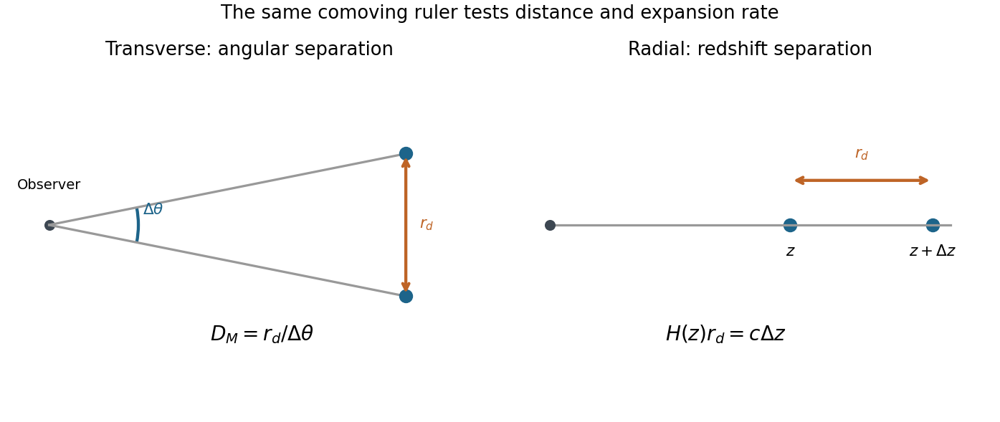

<h1 id="1/solution">Solution</h1>

↑ **Parent:** [1](../1.md)

**Cosmological variables and conventions.** The [scale factor](../../../../scale-factor-cosmology.md) $R(t)$ describes the relative separation of [comoving observers](../../../../comoving-observer.md); dots denote [derivatives](../../../../derivative.md) with respect to [cosmic time](../../../../cosmic-time.md) $t$. The [Hubble parameter](../../../../hubble-parameter.md) is $H(t)=\dot R/R$, usually time dependent; “[Hubble constant](../../../../hubble-constant.md)” conventionally means its present value. Here $\rho$ is mass-equivalent density, so $\epsilon=\rho c^2$ is [energy density](../../../../energy-density.md), while $P$ is isotropic [pressure](../../../../pressure-split.md). $G$ is the [gravitational constant](../../../../gravitational-constant.md) and $c$ the [speed of light](../../../../speed-of-light.md). The constant $K$ specifies [cosmological spatial curvature](../../../../spatial-curvature-of-an-flrw-universe.md): with $R$ a length, $K=kc^2$ and $k=+1,0,-1$ describe closed, flat and open spatial geometries. Alternative normalizations of $R$ move a constant factor into $K$. In the printed equations $\Lambda$ has units $\mathrm{s}^{-2}$: it is $c^2$ times a [cosmological constant](../../../../cosmological-constant.md) defined in inverse square metres. This [time-unit convention for the cosmological constant](../../../../time-unit-convention-for-the-cosmological-constant.md) prevents a missing factor of $c^2$.

**Continuity and the first law.** Differentiating the first [Friedmann equation](../../../../friedmann-equations.md) with constant $K$ and $\Lambda$, and then eliminating $\ddot R/R$ with the second, gives

$$
2H\left(\dot H-\frac{K}{R^2}\right)=\frac{8\pi G}{3}\dot\rho,\qquad
\dot H-\frac{K}{R^2}=-4\pi G\left(\rho+\frac{P}{c^2}\right).
$$

Thus, on an expanding or contracting branch,

$$
\boxed{\dot\rho=-3H\left(\rho+\frac{P}{c^2}\right).}
$$

The relation extends continuously to a regular turning point. For a physical volume $V(t)=V_*R^3(t)$ bounded by fixed [comoving coordinates](../../../../comoving-coordinate.md), $\dot V=3HV$. Multiplication by $c^2V$ gives

$$
\frac{d}{dt}(\rho c^2V)=-P\dot V,\qquad
\boxed{dU+P\,dV=0,\quad U=\rho c^2V.}
$$

This [adiabatic work in a comoving volume](../../../../adiabatic-work-in-a-comoving-volume.md) is the [first law of thermodynamics](../../../../first-law-of-thermodynamics-split.md) for adiabatic evolution with fixed [entropy](../../../../entropy-split.md) and no additional chemical work. It expresses local [energy](../../../../energy-split.md) conservation, including [pressure](../../../../pressure-split.md) work. **It does not assert that $U$ is constant:** [radiation](../../../../radiation.md) loses [internal energy](../../../../internal-energy-split.md) as it does work; negative [pressure](../../../../pressure-split.md) makes $U$ grow during expansion. A generic expanding spacetime has no global time-translation [symmetry](../../../../symmetry-physics.md) from which a conserved total [energy](../../../../energy-split.md) follows.

**Constant scalar-field [energy density](../../../../energy-density.md).** Setting $\dot\rho=0$ in the continuity equation, with $H\ne0$, gives

$$
\boxed{P=-\rho c^2,\qquad w=\frac{P}{\rho c^2}=-1.}
$$

For a homogeneous canonical [scalar field](../../../../scalar-field.md), in units $c=1$, $\epsilon=\dot\phi^2/2+V(\phi)$ and $P=\dot\phi^2/2-V(\phi)$. A stationary potential-dominated field has precisely this [equation of state](../../../../equation-of-state.md). A general evolving [scalar field](../../../../scalar-field.md) need not have $w=-1$; the constant-density assumption is essential.

**Expansion at the stipulated Higgs [energy density](../../../../energy-density.md).** With zero explicit $\Lambda$ and zero $K$, constant $\epsilon_H$ gives

$$
H_H=\sqrt{\frac{8\pi G\epsilon_H}{3c^2}},\qquad
\boxed{R(t)=R_i e^{H_H(t-t_i)}}.
$$

The plus sign selects the expanding branch; there is also a contracting solution. The scalar-field [energy](../../../../energy-split.md) is already included in $\rho$, so adding it again as an explicit [cosmological constant](../../../../cosmological-constant.md) would double count it. Using $1\ \mathrm{GeV}=1.602176634\times10^{-10}\ \mathrm{J}$ gives $\epsilon_H=2.4033\times10^{45}\ \mathrm{J\,m^{-3}}$, $\rho_H=2.6740\times10^{28}\ \mathrm{kg\,m^{-3}}$ and $H_H\simeq3.87\times10^9\ \mathrm{s^{-1}}$. Therefore

$$
\boxed{t_{\rm double}=\frac{\log2}{H_H}\simeq1.79\times10^{-10}\ \mathrm{s}.}
$$

This [vacuum-dominated doubling time](../../../../vacuum-dominated-doubling-time.md) describes accelerated expansion in [de Sitter spacetime](../../../../de-sitter-spacetime.md), with $\ddot R/R=H_H^2>0$. The stipulated [energy density](../../../../energy-density.md) exceeds the [critical density](../../../../critical-density.md) in [energy](../../../../energy-split.md) units used in Question 2 by $3\times10^{54}$, so it cannot persist as the dominant component of the present universe. The calculation exhibits the [cosmological constant problem](../../../../cosmological-constant-problem.md): the absolute gravitational [vacuum energy](../../../../vacuum-energy.md) must be enormously smaller than such a particle-physics scale today. It does not establish that the [Standard Model](../../../../standard-model-split.md) [Higgs field](../../../../higgs-field.md) actually remains constant or supplies a viable inflationary epoch.

**The acoustic ruler and accelerated expansion.** Before [baryon](../../../../baryon.md) drag becomes ineffective, [pressure](../../../../pressure-split.md) in the [photon-baryon fluid](../../../../photon-baryon-fluid.md) drives acoustic waves around initial [linear cosmological density perturbations](../../../../linear-cosmological-density-perturbation-split.md). Their comoving [sound horizon](../../../../sound-horizon.md) at the [baryon drag epoch](../../../../baryon-drag-epoch.md) is

$$
r_d=\int_{z_d}^{\infty}\frac{c_s(z)}{H(z)}\,dz.
$$

After decoupling, this preferred separation survives in [galaxy](../../../../galaxy-split.md) clustering as [baryon acoustic oscillations](../../../../baryon-acoustic-oscillation.md): a peak in the [two-point correlation function](../../../../two-point-correlation-function.md) and oscillations in the [matter power spectrum](../../../../matter-power-spectrum.md). Its value is calibrated by early-universe physics, commonly constrained by the [cosmic microwave background](../../../../cosmic-microwave-background-split.md). The SDSS luminous-red-galaxy measurement established a peak near $100h^{-1}\ \mathrm{Mpc}$; its use as a distance indicator depends on the ruler [calibration](../../../../calibration-differential-geometry.md) rather than the length of an individual [galaxy](../../../../galaxy-split.md).[Abstract and Sections 2–5, correlation-function peak and distance-scale interpretation](../../../../detection-of-the-baryon-acoustic-peak-in-the-large-scale-correlation-function-of-sdss-luminous-red-galaxies-by-daniel-eisenstein-and-others.md)

For a ruler perpendicular to the line of sight and one parallel to it,

$$
\boxed{\Delta\theta=\frac{r_d}{D_M(z)},\qquad
\Delta z=\frac{H(z)r_d}{c}},
$$

where $D_M=(1+z)D_A$ is the [transverse comoving distance](../../../../transverse-comoving-distance.md) and $D_A$ the [angular diameter distance](../../../../angular-diameter-distance.md). These measure $D_M/r_d$ and $H r_d$, respectively. Comparing multiple redshifts tests the distance–redshift relation and expansion history. In particular,

$$
q(z)=-\frac{\ddot R R}{\dot R^2}
=\frac{1+z}{H(z)}\frac{dH}{dz}-1,
$$

so sufficiently precise measurements of the shape of $H(z)$ can test $q<0$. In [general relativity](../../../../general-relativity-split.md), accelerated expansion requires a sufficiently negative total $\rho+3P/c^2$; a positive [cosmological constant](../../../../cosmological-constant.md) supplies it.

A single acoustic angular scale does not independently determine acceleration, [cosmological spatial curvature](../../../../spatial-curvature-of-an-flrw-universe.md), the absolute [sound horizon](../../../../sound-horizon.md) and the dark-energy [equation of state](../../../../equation-of-state.md). One combines redshift coverage with early-universe [calibration](../../../../calibration-differential-geometry.md) and independent matter-density or distance information, comparing accelerating and nonaccelerating models. The [galaxy](../../../../galaxy-split.md) selection function and redshift completeness must be modeled with random catalogues, survey covariance estimated with mock catalogues, and [redshift-space distortions](../../../../redshift-space-distortions.md), [galaxy bias](../../../../galaxy-bias.md) and nonlinear broadening controlled. These tests distinguish a cosmological feature from a survey artifact. **The evidence is the measured expansion history within an explicit cosmological framework, rather than the existence of an acoustic peak alone.**

**[Figure 1](#1/image-original-schematic-of-transverse-and-radial-acoustic-ruler-measurements). Original schematic of transverse and radial acoustic-ruler measurements**.

## ↑ Ancestors (13)

1. [1](../1.md)
2. [Paper 1](../../paper-1-split.md)
3. [2015](../../split.md)
4. [Past exam of the particle Astrophysics course of the University of Cambridge](../../../split.md)
5. [Particle Astrophysics course of the University of Cambridge](../../../../particle-astrophysics-course-of-the-university-of-cambridge.md)
6. [Physics course of the year 4 of the natural sciences course of the University of Cambridge](../../../../physics-course-of-the-year-4-of-the-natural-sciences-course-of-the-university-of-cambridge.md)
7. [Year 4 of the natural sciences course of the University of Cambridge](../../../../year-4-of-the-natural-sciences-course-of-the-university-of-cambridge.md)
8. [Year of the natural sciences course of the University of Cambridge](../../../../year-of-the-natural-sciences-course-of-the-university-of-cambridge.md)
9. [Natural sciences course of the University of Cambridge](../../../../natural-sciences-course-of-the-university-of-cambridge.md)
10. [Course of the University of Cambridge](../../../../course-of-the-university-of-cambridge.md)
11. [University of Cambridge](../../../../university-of-cambridge-split.md)
12. [List of universities](../../../../list-of-universities.md)
13. [Codex Wiki](../../../../split.md)
