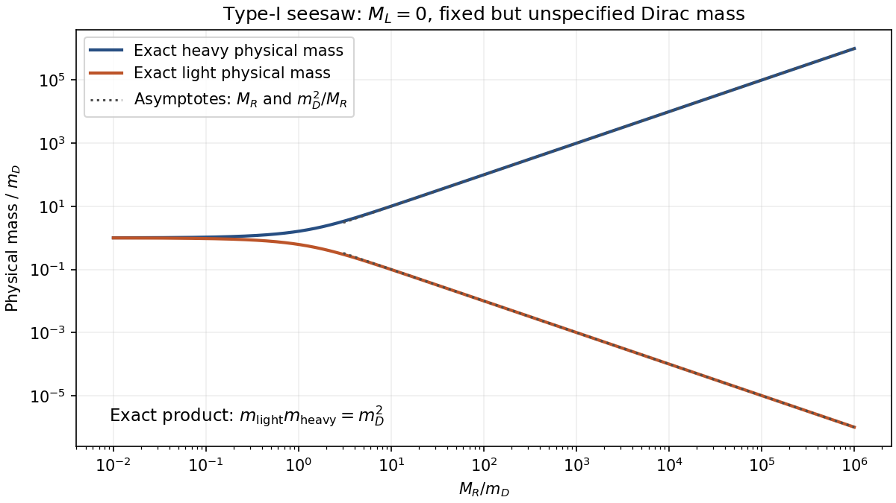
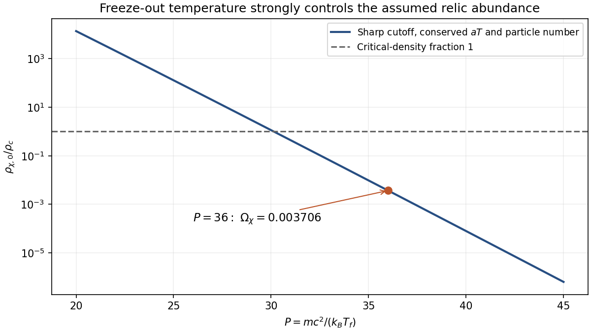
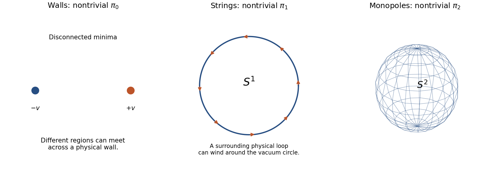

# Paper 1

↑ **Parent:** [2016](../2016.md)

Original source: [Released original, physical PDF pages 829–831](https://www.whatdotheyknow.com/request/natural_science_tripos_physics_e_2/response/2340776/attach/2/FOI%202023%20399%20Zahid%20materials.pdf?cookie_passthrough=1#page=829). All three questions and every essay option are covered.

**Table of contents**

- [1](#1)
  - [Solution](#1/solution)
- [2](#2)
  - [Solution](#2/solution)
- [3](#3)
  - [a](#3/a)
    - [Solution](#3/a/solution)
  - [b](#3/b)
    - [Solution](#3/b/solution)
  - [c](#3/c)
    - [Solution](#3/c/solution)

## 1

↑ **Parent:** [Paper 1](paper-1.md)

<h3 id="1/solution">Solution</h3>

↑ **Parent:** [1](#1)

The known active [neutrinos](../../standard-model.md#neutrino) are too light and too fast to supply the dominant [cold dark matter](../../cosmology.md#cold-dark-matter). Their relativistic decoupling leaves substantial [free streaming](../../linear-cosmological-density-perturbation.md#free-streaming), which erases rather than seeds sufficiently small-scale structure; their allowed [mass](../../classical-mechanics.md#mass) density is also inadequate for the dominant cold component. Changing a light active [neutrino](../../standard-model.md#neutrino) from Dirac to Majorana does not remove those problems. What can change the picture is an enlarged neutral-fermion sector containing sterile states with different [masses](../../classical-mechanics.md#mass), production and decay rates. A sufficiently long-lived [sterile neutrino](../../standard-model.md#sterile-neutrino) in a Majorana state can be a dark-matter candidate; Majorana character alone supplies neither stability nor the correct abundance.

For the [spinor](../../algebra-over-a-field.md#spinor) calculation, put $a=p_z/(E+m)$ and define $A=N(1-a)/2$, $B=N(1+a)/2$. Applying the given [chiral projectors](../../relativistic-quantum-field.md#chiral-projector) gives

$$
U_{1L}=A\begin{pmatrix}1\\0\\-1\\0\end{pmatrix},\qquad
U_{1R}=B\begin{pmatrix}1\\0\\1\\0\end{pmatrix},\qquad
V_{2R}=B\begin{pmatrix}1\\0\\1\\0\end{pmatrix}.
$$

Consequently

$$
\overline U_{1R}U_{1L}=2AB
=\frac{E+m}{2}\left(1-\frac{p_z^2}{(E+m)^2}\right)=m,
\qquad
\overline V_{2R}U_{1L}=2AB=m,
$$

where the last equality uses $E^2-p_z^2=m^2$. Same-chirality [Lorentz scalar](../../special-relativity.md#lorentz-scalar) products instead vanish: for example $\overline U_{1L}U_{1L}=0$. The nonzero overlaps demonstrate the [Lorentz scalar](../../special-relativity.md#lorentz-scalar) structures coupling left and right [chirality](../../relativistic-quantum-field.md#chirality-physics). For $U$ to $U$ this is a particle-number-preserving Dirac coupling; for $U$ to the charge-conjugate $V$ sector it can describe a lepton-number-violating Majorana coupling.

There is a normalization subtlety: both displayed overlaps equal the on-shell [mass](../../classical-mechanics.md#mass) parameter used to define the [spinors](../../algebra-over-a-field.md#spinor). A [chiral scalar spinor overlap](../../relativistic-quantum-field.md#chiral-scalar-spinor-overlap) verifies a coupling structure without fixing an independent Lagrangian coefficient $M_L$. Repeating the on-shell construction with mass parameter $M_L$ would instead give the corresponding overlap $M_L$; this is a different input, rather than a newly derived parameter. The independent coefficients of a [Dirac mass term](../../relativistic-quantum-field.md#dirac-mass-term) and a [Majorana mass term](../../relativistic-quantum-field.md#majorana-mass-term) are defined by

$$
\mathcal L_m=-m(\bar\nu_R\nu_L+\bar\nu_L\nu_R)
-\frac12\left(M_L\overline{\nu_L^c}\nu_L+
M_R\overline{\nu_R^c}\nu_R+\mathrm{h.c.}\right).
$$

The Majorana terms connect a field with its charge conjugate and violate the corresponding continuous [lepton](../../standard-model.md#lepton) phase symmetry by two units. With only unbroken [Standard Model](../../standard-model.md) [gauge symmetry](../../relativistic-quantum-field.md#gauge-invariance), a left-handed Majorana [mass](../../classical-mechanics.md#mass) also requires [electroweak symmetry breaking](../../standard-model.md#electroweak-symmetry-breaking) or an appropriate higher-dimensional operator; it is not an arbitrary gauge-invariant bare [mass](../../classical-mechanics.md#mass) for a [lepton](../../standard-model.md#lepton) doublet.

Use an all-left-handed Weyl [basis](../../vector-space.md#basis) $\mathbf n_L=(\nu_L,\nu_R^c)^T$. For real parameters the [one-family Dirac-Majorana mass matrix](../../standard-model.md#one-family-dirac-majorana-mass-matrix) is

$$
\boxed{\mathcal M=\begin{pmatrix}M_L&m\\m&M_R\end{pmatrix},\qquad
\mathcal L_m=-\frac12\overline{\mathbf n_L^{\,c}}\mathcal M\mathbf n_L+\mathrm{h.c.}}
$$

Writing $(\nu_{1L},\nu_{2L})^T=\begin{pmatrix}\cos\theta&-\sin\theta\\\sin\theta&\cos\theta\end{pmatrix}(\nu_L,\nu_R^c)^T$ gives an orthogonal diagonalization, with $\tan2\theta=2m/(M_R-M_L)$ up to the rotation-sign convention. Massive-particle [chirality](../../relativistic-quantum-field.md#chirality-physics) and [helicity](../../special-relativity.md#helicity) are not identical; the familiar left/right [helicity](../../special-relativity.md#helicity) language becomes an approximation in the relativistic regime.

The [characteristic polynomial](../../linear-operator-theory.md#characteristic-polynomial) is

$$
\det(\mathcal M-\lambda\mathbf1)
=\lambda^2-(M_L+M_R)\lambda+M_LM_R-m^2.
$$

Its roots are

$$
\boxed{\lambda_\pm=\frac12\left[M_R+M_L\pm
\sqrt{(M_R-M_L)^2+4m^2}\right].}
$$

For Majorana [fermions](../../tensor-product-of-quantum-systems.md#fermion) the nonnegative physical [masses](../../classical-mechanics.md#mass), as explained by [physical Majorana mass and signed eigenvalue](../../relativistic-quantum-field.md#physical-majorana-mass-and-signed-eigenvalue), are $|\lambda_\pm|$ after a possible field rephasing; a negative real [eigenvalue](../../linear-operator-theory.md#eigenvalue) is not a negative physical [rest mass](../../special-relativity.md#invariant-mass). When $M_R\gg |m|,|M_L|$,

$$
\lambda_{\rm light}\simeq M_L-\frac{m^2}{M_R},\qquad
\lambda_{\rm heavy}\simeq M_R+\frac{m^2}{M_R}.
$$

The light state is predominantly $\nu_L-(m/M_R)\nu_R^c$, while the heavy state is predominantly $\nu_R^c+(m/M_R)\nu_L$. Each [mass](../../classical-mechanics.md#mass) [eigenstate](../../energy-eigenvalue.md#eigenstate) combines its Weyl component and charge conjugate to form a Majorana field.

For $M_R=10^{12}\,\mathrm{GeV}$, **the heavy [mass](../../classical-mechanics.md#mass) is approximately $10^{12}\,\mathrm{GeV}$**. In the type-I limit $M_L\simeq0$,

$$
\boxed{m_{\rm light}\simeq10^{-3}
\left(\frac{m}{1\,\mathrm{GeV}}\right)^2\,\mathrm{eV}.}
$$

The [seesaw light-mass estimate needs a Dirac scale](../../standard-model.md#seesaw-light-mass-estimate-needs-a-dirac-scale): no unique numerical light [mass](../../classical-mechanics.md#mass) follows because the Dirac [mass](../../classical-mechanics.md#mass) and $M_L$ were not supplied. As an explicitly conditional illustration, choosing $m=100\,\mathrm{GeV}$ and $M_L=0$ gives $10\,\mathrm{eV}$; this is an assumed Dirac scale, not additional exam data or a prediction from $M_R$ alone. A heavy seesaw state is also not automatically stable enough to be [dark matter](../../cosmology.md#dark-matter).

**[Figure 1](#1/image-a-large-right-handed-mass-produces-reciprocal-light-and-heavy-scales). A large right-handed mass produces reciprocal light and heavy scales**. Original exact one-family [eigenvalues](../../linear-operator-theory.md#eigenvalue) for $M_L=0$, expressed relative to an unspecified fixed Dirac [mass](../../classical-mechanics.md#mass). Negative signed [eigenvalues](../../linear-operator-theory.md#eigenvalue) are shown by their positive physical [masses](../../classical-mechanics.md#mass); no numerical Dirac [mass](../../classical-mechanics.md#mass) is assumed.

The conventional minimal [Pati-Salam model](../../classical-field-theory.md#pati-salam-model) [gauge group](../../relativistic-quantum-field.md#gauge-group) is

$$
\boxed{SU(4)_C\times SU(2)_L\times SU(2)_R.}
$$

The group printed in this paper is different: it contains two $SU(4)$ factors and only one $SU(2)$. This is a discrepancy in the original PDF, not just in the transcription. The standard-model discussion below uses the conventional intended [Pati-Salam model](../../classical-field-theory.md#pati-salam-model) model. A literal theory with the printed product would require additional [fermion](../../tensor-product-of-quantum-systems.md#fermion) representations and symmetry-breaking data that are not specified.

The [Pati-Salam model](../../classical-field-theory.md#pati-salam-model) unifies the three [quark](../../standard-model.md#quark) [color charges](../../standard-model.md#color-charge) with [lepton number](../../standard-model.md#lepton-number) as a fourth [color charge](../../standard-model.md#color-charge). A family forms $(4,2,1)$ left-handed and $(4,1,2)$ right-handed multiplets, including a [right-handed neutrino](../../standard-model.md#right-handed-neutrino). The extended [color charge](../../standard-model.md#color-charge) group contains quark-lepton [gauge bosons](../../relativistic-quantum-field.md#gauge-boson), while the right-handed weak factor supplies right-handed charged currents after symmetry breaking. The [Pati-Salam charge embedding](../../classical-field-theory.md#pati-salam-charge-embedding) is

$$
Q=T_{3L}+T_{3R}+\frac{B-L}{2}.
$$

The original paper explicitly develops the smaller local subgroup $SU(2)_L\times SU(2)_R\times SU(4)_C$, as well as a larger underlying global structure; neither distinction licenses silently replacing the printed group.[§II.B, equation (2), printed p. 276; §II.C, charge assignments](../../physics-bibliography.md#lepton-number-as-the-fourth-color-by-jogesh-pati-and-abdus-salam) The product group is a quark-lepton unification scheme rather than a simple [gauge group](../../relativistic-quantum-field.md#gauge-group) with one automatically common coupling. Breaking the right-handed and $B-L$ symmetries can generate a large $M_R$ and light/heavy [Majorana neutrinos](../../standard-model.md#majorana-neutrino) through the seesaw. The [gauge group](../../relativistic-quantum-field.md#gauge-group) alone does not uniquely fix their [masses](../../classical-mechanics.md#mass) or guarantee a dark-matter lifetime.

The most important laboratory test of Majorana character is [neutrinoless double beta decay](../../physics.md#neutrinoless-double-beta-decay),

$$
(A,Z)\longrightarrow(A,Z+2)+e^-+e^-,
$$

with no outgoing [neutrinos](../../standard-model.md#neutrino). Under light-neutrino exchange, the amplitude involves

$$
m_{\beta\beta}=\left|\sum_iU_{ei}^{\,2}m_i\right|,\qquad
[T_{1/2}^{0\nu}]^{-1}=G_{0\nu}|\mathcal M_{0\nu}|^2
\left|\frac{m_{\beta\beta}}{m_e}\right|^2.
$$

The coherent squared mixing elements allow phase cancellations. A null result constrains this combination within the assumed mechanism, rather than proving that all [neutrinos](../../standard-model.md#neutrino) are Dirac.

The observable is a peak in summed electron [energy](../../energy.md) at the decay [Q value](../../energy.md#q-value), unlike the continuous two-neutrino spectrum. Enriched source material, large exposure, good [energy](../../energy.md) resolution, underground operation and radiopure construction suppress backgrounds. [germanium](../../chemical-substance.md#germanium) arrays use the source as a semiconductor detector; [xenon](../../chemical-substance.md#xenon) time-projection chambers combine [ionization](../../atomic-physics.md#ionization), light and event-position information; [bolometers](../../optical-instrument.md#bolometer) measure deposited [energy](../../energy.md) through a [temperature](../../temperature.md) rise. The GERDA collaboration's Phase-I study is a concrete example of an enriched-germanium source-detector search with background suppression.[Abstract and Phase-I source-detector method, arXiv:1307.4720](../../physics-bibliography.md#results-on-neutrinoless-double-beta-decay-of-76ge-from-gerda-phase-i-by-the-gerda-collaboration) [energy](../../energy.md) calibration, resolution tails, radon and material backgrounds, cosmic-ray vetoes, signal-like event [topology](../../topology.md) and sideband fits all need independent checks before a Q-value excess is convincing. Collider same-sign dilepton processes can test heavier Majorana states, but require a specified production and decay mechanism. **Lepton-number violation, absolute-mass measurements and oscillation data provide complementary information; oscillations alone do not settle Majorana character.**

## 2

↑ **Parent:** [Paper 1](paper-1.md)

<h3 id="2/solution">Solution</h3>

↑ **Parent:** [2](#2)

[supersymmetry](../../supersymmetry.md) relates [bosons](../../tensor-product-of-quantum-systems.md#boson) and [fermions](../../tensor-product-of-quantum-systems.md#fermion) through fermionic symmetry generators. A main motivation is the [Lorentz scalar](../../special-relativity.md#lorentz-scalar) [hierarchy problem](../../standard-model.md#hierarchy-problem): related [boson](../../tensor-product-of-quantum-systems.md#boson) and [fermion](../../tensor-product-of-quantum-systems.md#fermion) loop contributions cancel particular ultraviolet sensitivities in an exactly supersymmetric theory. [soft supersymmetry breaking](../../supersymmetry.md#soft-supersymmetry-breaking) leaves residual sensitivity to the [superpartner](../../supersymmetry.md#sparticle) scale, so a very heavy spectrum does not automatically solve naturalness. Supersymmetric matter content can also improve gauge-coupling unification, and a stable neutral lightest [superpartner](../../supersymmetry.md#sparticle) can be a dark-matter candidate. None of these motivations is itself experimental evidence; [supersymmetry](../../supersymmetry.md) must be broken if ordinary particles and their partners have different observed [masses](../../classical-mechanics.md#mass).

If [R-parity](../../supersymmetry.md#r-parity) is conserved, [superpartners](../../supersymmetry.md#sparticle) are produced in pairs and cascades end in a stable [lightest supersymmetric particle](../../supersymmetry.md#lightest-supersymmetric-particle). A [neutralino](../../supersymmetry.md#neutralino) LSP can escape the detector, giving [missing transverse momentum](../../particle-detection.md#missing-transverse-momentum). Colored [squarks](../../supersymmetry.md#squark) and [gluinos](../../supersymmetry.md#gluino) can generate energetic [jets](../../standard-model.md#jet-particle-physics), sometimes b-tagged [jets](../../standard-model.md#jet-particle-physics) and [leptons](../../standard-model.md#lepton), plus that imbalance. An [inclusive supersymmetry search](../../supersymmetry.md#inclusive-supersymmetry-search) classifies broad event samples by [jet](../../standard-model.md#jet-particle-physics) and [lepton](../../standard-model.md#lepton) multiplicities, [transverse momentum](../../particle-detection.md#transverse-momentum) sums and missing [momentum](../../momentum.md), without requiring a fully reconstructed decay chain.

Background controls are part of the physics argument. Lost-lepton W and top events can be constrained using [lepton](../../standard-model.md#lepton) [collider control regions](../../particle-detection.md#collider-control-region); invisible-Z production can be related to visible-Z or photon samples with appropriate transfer factors. Instrumental imbalance in multijet events needs detector-quality checks and data sidebands. An excess in a [collider signal region](../../particle-detection.md#collider-signal-region) should survive uncertainty in those extrapolations, efficiencies and [luminosity](../../astrophysics.md#luminosity), with independently defined validation regions and attention to the number of searches performed.

An [exclusive supersymmetry search](../../supersymmetry.md#exclusive-supersymmetry-search) targets a more specific production mode and decay pattern. Electroweak chargino-neutralino production can yield three [leptons](../../standard-model.md#lepton) plus missing [momentum](../../momentum.md); a cascade through a [slepton](../../supersymmetry.md#slepton) can yield a dilepton invariant-mass edge that constrains [mass](../../classical-mechanics.md#mass) combinations. Such searches often have cleaner backgrounds but depend more strongly on branching fractions and intermediate [masses](../../classical-mechanics.md#mass). An endpoint does not necessarily determine every absolute [mass](../../classical-mechanics.md#mass) without additional observables.

Different spectra require different strategies. For a [compressed supersymmetric spectrum](../../supersymmetry.md#compressed-supersymmetric-spectrum), small parent-daughter [mass](../../classical-mechanics.md#mass) differences make the visible decay products soft. [initial-state radiation](../../particle-detection.md#initial-state-radiation) can recoil against the pair and provide a trigger, supplemented by soft-lepton reconstruction. The ATLAS compressed-spectrum study explicitly uses small [neutralino](../../supersymmetry.md#neutralino) [mass](../../classical-mechanics.md#mass) differences and [initial-state radiation](../../particle-detection.md#initial-state-radiation) to define a dedicated search rather than applying a hard-lepton selection indiscriminately.[arXiv:1712.08119, abstract and compressed-spectrum search strategy; methodological illustration published after this exam](../../physics-bibliography.md#search-for-electroweak-production-of-supersymmetric-states-in-scenarios-with-compressed-mass-spectra-at-13-tev-with-the-atlas-detector-by-the-atlas-collaboration) If [R-parity](../../supersymmetry.md#r-parity) is violated, the LSP can decay visibly, so high-multiplicity [jet](../../standard-model.md#jet-particle-physics) or [lepton](../../standard-model.md#lepton) channels may matter more than large missing [momentum](../../momentum.md). CMS separately studied hadronic and leptonic final states for this reason.[CMS-SUS-14-003, abstract and independent lepton-multiplicity analyses](../../physics-bibliography.md#searches-for-r-parity-violating-supersymmetry-in-pp-collisions-at-8-tev-in-final-states-with-0-4-leptons-by-the-cms-collaboration) Long-lived particles instead motivate displaced vertices, disappearing tracks, abnormal [ionization](../../atomic-physics.md#ionization) or time-of-flight measurements. Thus **there is no single model-independent missing-energy cut that covers every supersymmetric spectrum**.

For the hypothetical relic-density calculation, use the supplied distribution and retain its prefactor exactly. Put $M=mc^2$, $\Theta=k_BT$ and $\Theta_0=k_BT_0$. Then

$$
n_f=6\left[\frac{M\Theta_f}{(\hbar c)^2}\right]^{3/2}e^{-P},\qquad
\Theta_f=\frac{M}{P}.
$$

[number density](../../statistical-physics.md#number-density), denoted $N$ in the paper, is written $n$ here to distinguish it from a total particle count. The [cosmological particle freeze-out](../../cosmology.md#cosmological-particle-freeze-out) [temperature](../../temperature.md) in [energy](../../energy.md) units is

$$
\boxed{\Theta_f=\frac{38}{36}\,\mathrm{GeV}=1.0556\,\mathrm{GeV}.}
$$

Assume a stable nonrelativistic relic, negligible further [annihilation](../../relativistic-quantum-field.md#annihilation) and $aT=\mathrm{constant}$ after [cosmological particle freeze-out](../../cosmology.md#cosmological-particle-freeze-out), using [sharp-freeze-out relic dilution](../../cosmology.md#sharp-freeze-out-relic-dilution). Its comoving particle number is conserved, so

$$
n_0=n_f\left(\frac{a_f}{a_0}\right)^3
=n_f\left(\frac{\Theta_0}{\Theta_f}\right)^3
=\boxed{6\left(\frac{\Theta_0}{\hbar c}\right)^3P^{3/2}e^{-P}.}
$$

The particle [mass](../../classical-mechanics.md#mass) cancels from this present [number density](../../statistical-physics.md#number-density) under the stated approximation. Its present rest-energy density is $Mn_0$, not merely $n_0$:

$$
n_f=4.4193\times10^{34}\,\mathrm{m}^{-3},\qquad
n_0=4.8766\times10^{-4}\,\mathrm{m}^{-3},
$$

$$
\boxed{\rho_0=38n_0=1.8531\times10^{-2}\,\mathrm{GeV\,m}^{-3},\qquad
\frac{\rho_0}{\rho_c}=3.7062\times10^{-3}.}
$$

This is only **0.371% of the [critical density](../../cosmology.md#critical-density)**, not a universe-closing component. The correct further comparison is with the measured dark-matter fraction, not an assumption that all [critical density](../../cosmology.md#critical-density) must be [dark matter](../../cosmology.md#dark-matter). In standard [cosmology](../../cosmology.md) this abundance would be a small subcomponent, despite a possible collider discovery.

The [exponential freeze-out sensitivity](../../cosmology.md#exponential-freeze-out-sensitivity) makes the result highly sensitive to $P$. Also, thermal [entropy](../../entropy.md) release means $aT$ is not exactly constant through the whole cosmic history. If total comoving [entropy](../../entropy.md) is conserved, the above [number density](../../statistical-physics.md#number-density) acquires a factor $g_{*s,0}/g_{*s,f}$, involving [entropy degrees of freedom](../../cosmology.md#entropy-degrees-of-freedom). Those degrees of freedom and a full [annihilation](../../relativistic-quantum-field.md#annihilation) history are not given, so no precise correction is justified from the supplied data.

**[Figure 2](#2/image-the-supplied-cosmological-particle-freeze-out-model-is-exponentially-sensitive-to-the-decoupling-parameter). The supplied cosmological particle freeze-out model is exponentially sensitive to the decoupling parameter**. Original calculation using only the stated [mass](../../classical-mechanics.md#mass), present [temperature](../../temperature.md), $\hbar c$ and [critical density](../../cosmology.md#critical-density). The marked point is $P=36$; the curve omits changes in [entropy degrees of freedom](../../cosmology.md#entropy-degrees-of-freedom) and residual [annihilation](../../relativistic-quantum-field.md#annihilation).

Establishing the nature of [dark matter](../../cosmology.md#dark-matter) would require more than measuring a missing particle's collider [mass](../../classical-mechanics.md#mass). Measure its spin, charges, interactions, decay lifetime or stability limits, and [annihilation](../../relativistic-quantum-field.md#annihilation) or coannihilation processes; compare the resulting relic calculation with cosmological observations. Seek compatible direct nuclear-recoil signals and indirect [annihilation](../../relativistic-quantum-field.md#annihilation) or decay products, while controlling astrophysical and detector backgrounds. A collider-invisible lifetime need not be cosmologically long, and nonthermal production could change the abundance. **A consistent particle identity, cosmological abundance and independent non-collider evidence are needed to connect the hypothetical discovery to the [dark matter](../../cosmology.md#dark-matter).**

## 3

↑ **Parent:** [Paper 1](paper-1.md)

<h3 id="3/a">a</h3>

↑ **Parent:** [3](#3)

<h4 id="3/a/solution">Solution</h4>

↑ **Parent:** [A](#3/a)

[gravitational lensing](../../gravitational-lensing.md) measures the gravitational influence of matter without requiring that matter to shine. In [general relativity](../../general-relativity.md) a [point mass](../../classical-mechanics.md#point-mass) produces small-angle deflection

$$
\hat\alpha=\frac{4GM}{bc^2}.
$$

For a thin lens, with angular-diameter distances $D_d,D_s,D_{ds}$,

$$
\boldsymbol\beta=\boldsymbol\theta-
\frac{D_{ds}}{D_s}\hat{\boldsymbol\alpha}(D_d\boldsymbol\theta).
$$

Image multiplicity, distortion and magnification therefore constrain projected gravitating [mass](../../classical-mechanics.md#mass), with source and lens geometry measured separately.

Strong lensing gives multiple images, arcs and [Einstein rings](../../gravitational-lensing.md#einstein-ring). Their positions and, where available, time delays constrain a central [mass](../../classical-mechanics.md#mass) distribution. Weak lensing measures correlated small image distortions over a larger field. Using the [critical surface density for gravitational lensing](../../gravitational-lensing.md#critical-surface-density-for-gravitational-lensing) and [reduced gravitational shear](../../gravitational-lensing.md#reduced-gravitational-shear), the convergence and shear satisfy

$$
\kappa=\frac{\Sigma}{\Sigma_{\rm crit}},\qquad
\Sigma_{\rm crit}=\frac{c^2}{4\pi G}\frac{D_s}{D_dD_{ds}},\qquad
g_{\rm red}=\frac{\gamma}{1-\kappa}.
$$

Because intrinsic galaxy shapes are unknown, weak shear is inferred statistically using many sources. Point-spread-function anisotropy, shear calibration, photometric redshifts, intrinsic alignments and foreground contamination must be controlled.

An inferred lensing [mass](../../classical-mechanics.md#mass) can be compared with the independently estimated stellar and hot-gas [mass](../../classical-mechanics.md#mass). The [bullet Cluster dark-matter separation](../../gravitational-lensing.md#bullet-cluster-dark-matter-separation) provides a particularly informative separation of components: the collisional X-ray-emitting gas is displaced from the galaxies, while lensing [mass](../../classical-mechanics.md#mass) peaks approximately follow the less-collisional galaxy component. The primary analysis combined wide-field and Hubble imaging rather than inferring lensing [mass](../../classical-mechanics.md#mass) from X-ray hydrostatic equilibrium.[arXiv:astro-ph/0608407, abstract and lensing/X-ray component comparison](../../physics-bibliography.md#a-direct-empirical-proof-of-the-existence-of-dark-matter-by-douglas-clowe-and-others) This favors a dominant relatively collisionless unseen component. Translating a merger offset into a particle self-interaction [cross section](../../physics.md#cross-section-physics) also requires a merger model and projection uncertainties; lensing does not directly reveal a [WIMP](../../cosmology.md#weakly-interacting-massive-particle)'s [mass](../../classical-mechanics.md#mass) or quantum numbers.

Microlensing tests a different possibility: [dark matter](../../cosmology.md#dark-matter) in compact objects. A compact foreground lens can create an unresolved, time-dependent magnification of a background star. Event frequency and duration constrain the abundance and [mass](../../classical-mechanics.md#mass) range of compact lenses only after survey cadence, detection efficiency, blending, source sizes and halo geometry are included. Achromaticity and the expected light-curve shape help distinguish simple lensing from intrinsic variability. A null survey result does not exclude every compact-object [mass](../../classical-mechanics.md#mass) at every location.

Weak-lensing correlations and small-scale strong-lens structure also test the [matter power spectrum](../../linear-cosmological-density-perturbation.md#matter-power-spectrum) and halo substructure, potentially distinguishing cold from warm free-streaming behavior. Baryonic feedback can change the same small-scale [mass](../../classical-mechanics.md#mass) distribution. There are intrinsic inversion ambiguities: the mass-sheet transformation

$$
\kappa\mapsto\lambda\kappa+(1-\lambda),\qquad
\gamma\mapsto\lambda\gamma
$$

leaves [reduced gravitational shear](../../gravitational-lensing.md#reduced-gravitational-shear) unchanged. Source-redshift information, absolute magnification or other data can restrict such degeneracies. **Lensing establishes where gravitating matter is and tests its distribution and interactions; identification of its particle species requires complementary evidence.**

<h3 id="3/b">b</h3>

↑ **Parent:** [3](#3)

<h4 id="3/b/solution">Solution</h4>

↑ **Parent:** [B](#3/b)

Extra spatial dimensions offer mechanisms for unification and for the large separation between weak and gravitational scales. They are hypotheses about geometry and fields, not observations established by the [hierarchy problem](../../standard-model.md#hierarchy-problem) itself.

In a [Kaluza-Klein theory](../../mathematical-physics.md#kaluza-klein-theory) construction, a compact extra coordinate can turn components of a higher-dimensional metric into four-dimensional gauge and [scalar fields](../../classical-field-theory.md#scalar-field). For a field periodic on a circle of radius $R$, [momentum](../../momentum.md) in that direction is quantized. In units $\hbar=c=1$,

$$
m_n^2=m_0^2+\frac{n^2}{R^2},\qquad n\in\mathbb Z.
$$

The resulting tower explains why a small compact dimension can be hard to see at low [energy](../../energy.md): nonzero modes need [energy](../../energy.md) of order $1/R$. A realistic model must also explain its matter representations, [chirality](../../relativistic-quantum-field.md#chirality-physics), internal geometry and stabilization of [Lorentz scalar](../../special-relativity.md#lorentz-scalar) moduli; a compact coordinate alone does not reproduce the [Standard Model](../../standard-model.md).

Large-extra-dimension models instead use volume to weaken effective gravity. With a fixed unwarped compact space of volume $V_d$, integrating the higher-dimensional [Einstein-Hilbert action](../../einstein-field-equations.md#einstein-hilbert-action) gives, in a consistent reduced-Planck-mass convention,

$$
\boxed{M_{\rm Pl}^2=M_D^{d+2}V_d.}
$$

The [Standard Model](../../standard-model.md) can be localized on a [brane](../../string-theory.md#brane) while gravity propagates in the bulk. A large $V_d$ makes the observed four-dimensional gravitational scale large even if the fundamental higher-dimensional scale is much smaller. The proposal identifies gravitational dilution as a possible hierarchy mechanism, with deviations from ordinary gravity at sufficiently short distance.[arXiv:hep-ph/9803315, abstract and volume-dilution mechanism](../../physics-bibliography.md#the-hierarchy-problem-and-new-dimensions-at-a-millimeter-by-nima-arkani-hamed-and-others) For approximately flat dimensions of common size $R$, gravity at distances much smaller than $R$ spreads through more directions and the force scales as $r^{-(2+d)}$, returning to $r^{-2}$ at large distance.

Warped models use a different mechanism. A five-dimensional metric

$$
ds^2=e^{-2k|y|}\eta_{\mu\nu}dx^\mu dx^\nu+dy^2
$$

redshifts a [mass](../../classical-mechanics.md#mass) on a distant [brane](../../string-theory.md#brane) by $m_{\rm IR}=e^{-kL}m_{\rm UV}$. An exponential hierarchy can therefore arise without a large flat compact volume. The original Randall–Sundrum construction makes this distinction explicit and predicts characteristic massive spin-two excitations.[arXiv:hep-ph/9905221, abstract and warped hierarchy mechanism](../../physics-bibliography.md#a-large-mass-hierarchy-from-a-small-extra-dimension-by-lisa-randall-and-raman-sundrum) It still needs a consistent stabilization and phenomenology; the flat-volume formula and the warped redshift should not be treated as interchangeable explanations.

Extra dimensions also occur in string-theory constructions, where consistency and [compactification](../../mathematical-physics.md#compactification-physics) can organize gravitational and gauge degrees of freedom. That is a framework motivation, not proof that a particular [compactification](../../mathematical-physics.md#compactification-physics) describes nature. Laboratory inverse-square-law tests, collider missing-momentum channels from escaping bulk modes, massive-mode resonances, and astrophysical or cosmological energy-loss constraints probe different parameter ranges. Background estimates and dependence on field localization matter: a [brane](../../string-theory.md#brane) model with invisible bulk emission need not share the signatures of a model with visible resonant decays. **The useful claim is a testable mechanism for a specified hierarchy or unification problem, with [compactification](../../mathematical-physics.md#compactification-physics) and stabilization assumptions stated.**

<h3 id="3/c">c</h3>

↑ **Parent:** [3](#3)

<h4 id="3/c/solution">Solution</h4>

↑ **Parent:** [C](#3/c)

A [topological defect](../../critical-phenomenon.md#topological-defect) can remain after [spontaneous symmetry breaking](../../quantum-field-theory.md#spontaneous-symmetry-breaking) when the field cannot be continuously put into the vacuum everywhere. If the [vacuum manifold](../../quantum-field-theory.md#vacuum-manifold) is $\mathcal M=G/H$, its [topology](../../topology.md) classifies possible obstructions. Causally separated regions can settle into different local order-parameter configurations; joining them during a [phase transition](../../critical-phenomenon.md#phase-transition) can trap defects. This is a formation mechanism, not an assertion that every transition creates every possible defect.

In three spatial dimensions the [homotopy classification of cosmological defects](../../critical-phenomenon.md#homotopy-classification-of-cosmological-defects) gives are

$$
\begin{array}{c|c|c}
\text{vacuum topology}&\text{configuration}&\text{spatial character}\\ \hline
\pi_0(\mathcal M)\ne0&\text{domain walls}&\text{surfaces}\\
\pi_1(\mathcal M)\ne0&\text{strings}&\text{lines}\\
\pi_2(\mathcal M)\ne0&\text{monopoles}&\text{points}\\
\pi_3(\mathcal M)\ne0&\text{textures}&\text{extended winding}
\end{array}
$$

Disconnected vacua can meet across a wall; winding around a line can obstruct filling its core; a sphere around a point can carry monopole charge. Textures differ from permanent localized cores: they can collapse and unwind when the field leaves the [vacuum manifold](../../quantum-field-theory.md#vacuum-manifold). Local gauge and global symmetry breaking also differ in their long-range fields and [radiation](../../physics.md#radiation). The original cosmological analysis connects vacuum [topology](../../topology.md) with domain and string formation and their subsequent evolution.[J. Phys. A 9, pp. 1387–1398 (1976), vacuum topology and domain/string evolution](../../physics-bibliography.md#topology-of-cosmic-domains-and-strings-by-thomas-walter-bannerman-kibble)

**[Figure 3](#3/c/image-disconnected-circular-and-spherical-vacuum-manifolds-support-different-defects). Disconnected, circular and spherical vacuum manifolds support different defects**. Original schematic vacuum spaces, not pictures of astronomical objects. The main text specifies the physical-space loops or spheres whose mappings classify walls, strings and monopoles.

The [energy](../../energy.md) budget determines cosmological importance. Nonrelativistic monopoles dilute approximately as $a^{-3}$, so a large primordial abundance can become unacceptable as [radiation](../../physics.md#radiation) falls faster. Inflation can dilute an earlier population, provided the same defect-producing transition is not repeated afterwards. A slowly evolving wall network dilutes especially slowly and can dominate the [energy](../../energy.md) budget or create excessive anisotropy.

Strings can lose [energy](../../energy.md) by intercommutation and loop formation, with loops radiating [gravitational waves](../../gravitational-wave.md) or field quanta. A [horizon-scaling cosmic string network](../../cosmology.md#horizon-scaling-cosmic-string-network) whose characteristic separation is of order the horizon can have density $\rho_{\rm string}\sim\mu/t^2$ in natural units, keeping a limited fraction of the total rather than accumulating indefinitely. This differs from an ideal frozen noninteracting network's simple $a^{-2}$ dilution law. Similarly, a [horizon-scaling domain wall network](../../critical-phenomenon.md#horizon-scaling-domain-wall-network) has $\rho_{\rm wall}\sim\sigma/t$, while a frozen wall network follows $a^{-1}$. The evolutionary assumptions must accompany any quoted scaling.

Defects can seed density wakes and other inhomogeneities, perturb the microwave background and generate non-Gaussian signatures. A sufficiently straight ideal [cosmic string](../../cosmology.md#cosmic-string) has conical spacetime and can create doubled background images; a cosmic-string network can generate gravitational-wave bursts and a stochastic background. Textures can produce localized microwave-background [temperature](../../temperature.md) features while collapsing. These signatures constrain defect abundance and symmetry-breaking scale; an isolated suggestive feature is not a unique defect detection.

The predictions depend on network evolution, reconnection, loop sizes, [radiation](../../physics.md#radiation) channels and the relation between symmetry breaking and inflation. **[topology](../../topology.md) identifies which configurations are possible; formation and evolution determine whether they survive and whether their gravitational or radiative effects are observable.** A defect's unseen [energy](../../energy.md) does not automatically make it the dominant [cold dark matter](../../cosmology.md#cold-dark-matter).

## ↑ Ancestors (11)

1. [2016](../2016.md)
2. [Past exam of the particle Astrophysics course of the University of Cambridge](../../past-exam-of-the-particle-astrophysics-course-of-the-university-of-cambridge.md)
3. [Particle Astrophysics course of the University of Cambridge](../../university-of-cambridge.md#particle-astrophysics-course-of-the-university-of-cambridge)
4. [Physics course of the year 4 of the natural sciences course of the University of Cambridge](../../university-of-cambridge.md#physics-course-of-the-year-4-of-the-natural-sciences-course-of-the-university-of-cambridge)
5. [Year 4 of the natural sciences course of the University of Cambridge](../../university-of-cambridge.md#year-4-of-the-natural-sciences-course-of-the-university-of-cambridge)
6. [Year of the natural sciences course of the University of Cambridge](../../university-of-cambridge.md#year-of-the-natural-sciences-course-of-the-university-of-cambridge)
7. [Natural sciences course of the University of Cambridge](../../university-of-cambridge.md#natural-sciences-course-of-the-university-of-cambridge)
8. [Course of the University of Cambridge](../../university-of-cambridge.md#course-of-the-university-of-cambridge)
9. [University of Cambridge](../../university-of-cambridge.md)
10. [List of universities](../../README.md#list-of-universities)
11. [Codex Wiki](../../README.md)
