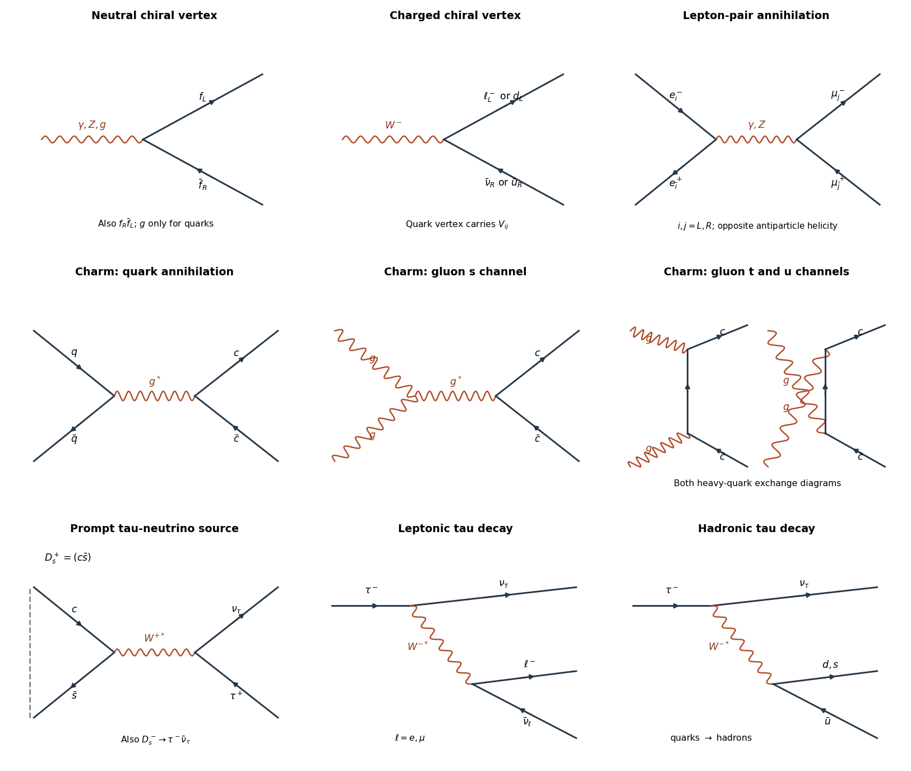
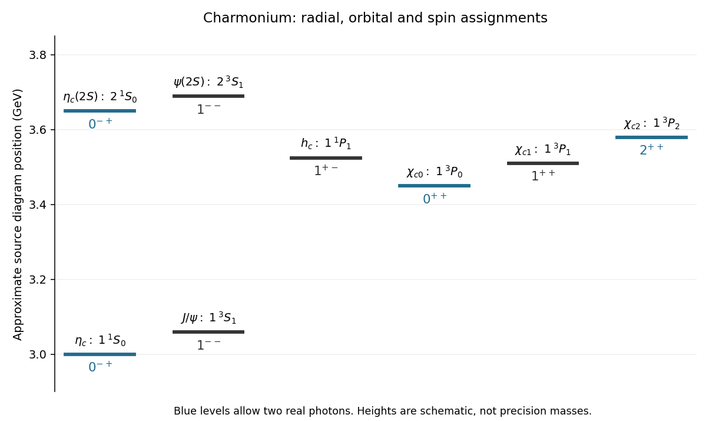
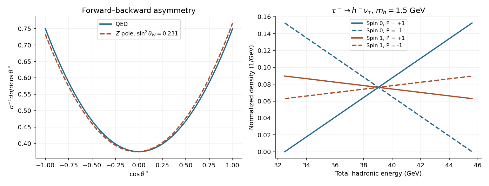

# 2015

↑ **Parent:** [Past exam of the particle physics course of the University of Oxford](../past-exam-of-the-particle-physics-course-of-the-university-of-oxford.md)

Source paper: [https://www.whatdotheyknow.com/request/oxford_physics_past_papers_2/response/2340696/attach/3/Physics%20Papers%202014.pdf?cookie_passthrough=1](https://www.whatdotheyknow.com/request/oxford_physics_past_papers_2/response/2340696/attach/3/Physics%20Papers%202014.pdf?cookie_passthrough=1)

Solutions use [natural units](../mathematical-physics.md#natural-units) unless a conversion is displayed. The surviving paper has damaged source illustrations in [c](#3/c) and [c](#4/c); the corresponding numerical readings remain explicit TODOs. All eight questions, including all five alternatives in [8](#8), are treated.

**Table of contents**

- [1](#1)
  - [a](#1/a)
    - [Solution](#1/a/solution)
  - [b](#1/b)
    - [Solution](#1/b/solution)
  - [c](#1/c)
    - [Solution](#1/c/solution)
- [2](#2)
  - [a](#2/a)
    - [Solution](#2/a/solution)
  - [b](#2/b)
    - [Solution](#2/b/solution)
  - [c](#2/c)
    - [Solution](#2/c/solution)
- [3](#3)
  - [a](#3/a)
    - [Solution](#3/a/solution)
  - [b](#3/b)
    - [Solution](#3/b/solution)
  - [c](#3/c)
    - [Solution](#3/c/solution)
  - [d](#3/d)
    - [Solution](#3/d/solution)
  - [e](#3/e)
    - [Solution](#3/e/solution)
- [4](#4)
  - [a](#4/a)
    - [Solution](#4/a/solution)
  - [b](#4/b)
    - [Solution](#4/b/solution)
  - [c](#4/c)
    - [Solution](#4/c/solution)
- [5](#5)
  - [a](#5/a)
    - [Solution](#5/a/solution)
  - [b](#5/b)
    - [Solution](#5/b/solution)
  - [c](#5/c)
    - [Solution](#5/c/solution)
- [6](#6)
  - [a](#6/a)
    - [Solution](#6/a/solution)
  - [b](#6/b)
    - [Solution](#6/b/solution)
  - [c](#6/c)
    - [Solution](#6/c/solution)
  - [d](#6/d)
    - [Solution](#6/d/solution)
- [7](#7)
  - [a](#7/a)
    - [Solution](#7/a/solution)
  - [b](#7/b)
    - [Solution](#7/b/solution)
  - [c](#7/c)
    - [i](#7/c/i)
      - [Solution](#7/c/i/solution)
    - [ii](#7/c/ii)
      - [Solution](#7/c/ii/solution)
    - [iii](#7/c/iii)
      - [Solution](#7/c/iii/solution)
  - [d](#7/d)
    - [Solution](#7/d/solution)
- [8](#8)
  - [a](#8/a)
    - [Solution](#8/a/solution)
  - [b](#8/b)
    - [Solution](#8/b/solution)
  - [c](#8/c)
    - [Solution](#8/c/solution)
  - [d](#8/d)
    - [Solution](#8/d/solution)
  - [e](#8/e)
    - [Solution](#8/e/solution)

## 1

↑ **Parent:** [2015](2015.md)

<h3 id="1/a">a</h3>

↑ **Parent:** [1](#1)

<h4 id="1/a/solution">Solution</h4>

↑ **Parent:** [A](#1/a)

Treat the [electron](../physics.md#electron) and [electron antineutrino](../standard-model.md#electron-antineutrino) as effectively [massless particles](../physics.md#massless-particle) in the [centre-of-momentum frame](../special-relativity.md#center-of-momentum-frame), retain only the [charged current](../standard-model.md#charged-current), and use the [Fermi interaction](../quantum-field-theory.md#fermi-interaction): $m_e^2\ll s\ll M_W^2$. Take $\theta^*$ between incoming and outgoing [electron antineutrino](../standard-model.md#electron-antineutrino) directions. The [V-A interaction](../standard-model.md#v-a-interaction) selects a right-helicity [electron antineutrino](../standard-model.md#electron-antineutrino) and a left-helicity [electron](../physics.md#electron). Their opposite incoming directions give total [angular momentum](../momentum.md#angular-momentum) projection one. The outgoing pair has the same projection along its own axis. The [Wigner D-matrix](../angular-momentum-operator.md#wigner-d-matrix) element is $d^1_{11}(\theta^*)=(1+\cos\theta^*)/2$, so the squared [helicity amplitude](../quantum-scattering.md#helicity-amplitude) is proportional to $(1+\cos\theta^*)^2$. The inactive initial [electron](../physics.md#electron) [helicity](../special-relativity.md#helicity) is included in the unpolarized normalization supplied by the paper.

The boost from the [centre-of-momentum frame](../special-relativity.md#center-of-momentum-frame) to the [laboratory frame](../mathematical-physics.md#laboratory-frame) has $\beta=E/(E+m_e)$, while the incoming [electron antineutrino](../standard-model.md#electron-antineutrino) has $E_*=(s-m_e^2)/(2\sqrt s)=m_eE/\sqrt s$ and $s=m_e^2+2m_eE$. Thus

$$
\frac{E'}E=\frac{E+m_e+E\cos\theta^*}{2E+m_e},\qquad y=\frac{E(1-\cos\theta^*)}{2E+m_e}\simeq\frac{1-\cos\theta^*}{2}.
$$

The requested identity therefore uses $E\gg m_e$; it is not exact at finite target [mass](../classical-mechanics.md#mass). With $c_*=\cos\theta^*$, the absolute [Jacobian determinant](../multivariable-calculus.md#jacobian-determinant) is $|dy/dc_*|=1/2$, giving

$$
\frac{d\sigma}{dc_*}=\frac{G_F^2s}{8\pi}(1+c_*)^2,\qquad
\frac{d\sigma}{d\Omega_*}=\frac{G_F^2s}{16\pi^2}(1+c_*)^2,\qquad
\sigma=\frac{G_F^2s}{3\pi}.
$$

The suppression at backward [scattering](../physics.md#scattering) follows from [angular momentum](../momentum.md#angular-momentum) conservation: rotating projection $+1$ through $\pi$ cannot leave projection $+1$ along the original axis. Replacing $1+c_*$ by $2(1-y)$ gives the supplied $(1-y)^2$ dependence.

<h3 id="1/b">b</h3>

↑ **Parent:** [1](#1)

<h4 id="1/b/solution">Solution</h4>

↑ **Parent:** [B](#1/b)

Use the [parton model](../standard-model.md#parton-model), neglect [antiquarks](../standard-model.md#antiquark), binding and target [mass](../classical-mechanics.md#mass) corrections, [quark masses](../standard-model.md#quark-mass), [muon mass](../standard-model.md#muon-mass), [QCD scaling violation](../standard-model.md#qcd-scaling-violation) and the [W boson](../standard-model.md#w-boson) propagator correction. The struck [quark](../standard-model.md#quark) is effectively free during the short interaction and carries [parton momentum fraction](../standard-model.md#parton-momentum-fraction) $x$, giving $\hat s\simeq xs$. The [charged current](../standard-model.md#charged-current) reaction is $\bar\nu_\mu u_i\to\mu^+d_j$. Its [helicity amplitude](../quantum-scattering.md#helicity-amplitude) has the same $(1-y)$ factor as in [a](#1/a). Define the effective [parton distribution function](../standard-model.md#parton-distribution-function) by $q(x)=\sum_{i,j}|V_{ij}|^2u_i(x)$, summing only kinematically accessible final [quarks](../standard-model.md#quark); for valence-only [protons](../physics.md#proton) and accessible $d,s$ this is approximately $u(x)$. It is not the unweighted sum $u+d$.

$$
\frac{d^2\sigma}{dx\,dy}=\sum_{i,j}u_i(x)|V_{ij}|^2\frac{G_F^2xs}{\pi}(1-y)^2=\frac{G_F^2sx}{\pi}(1-y)^2q(x).
$$

Here $y=p\cdot(k-k')/(p\cdot k)$ is the inclusive [deep inelastic scattering](../standard-model.md#deep-inelastic-scattering) variable, and $x=Q^2/(2p\cdot(k-k'))$ in the scaling limit. Integrating $0<y<1$ gives $1/3$, hence

$$
\sigma(\bar\nu_\mu p)=\frac{G_F^2s}{3\pi}\int_0^1xq(x)\,dx\simeq\frac{2G_F^2m_pE}{3\pi}\int_0^1xq(x)\,dx\propto E.
$$

The moment measures the [momentum](../momentum.md) fraction in the active [quarks](../standard-model.md#quark). Approximate linearity is evidence for scattering from pointlike spin-one-half constituents with approximately scale-independent [parton distribution functions](../standard-model.md#parton-distribution-function), rather than coherent scattering from an extended [proton](../physics.md#proton). It is an intermediate-energy prediction: thresholds, experimental [deep inelastic scattering](../standard-model.md#deep-inelastic-scattering) cuts, [QCD scaling violation](../standard-model.md#qcd-scaling-violation) and eventually the finite [W boson](../standard-model.md#w-boson) propagator modify it.

<h3 id="1/c">c</h3>

↑ **Parent:** [1](#1)

<h4 id="1/c/solution">Solution</h4>

↑ **Parent:** [C](#1/c)

Strike a target with high-energy [protons](../physics.md#proton), collect negative [pions](../standard-model.md#pion) and [kaons](../physics.md#kaon) with magnetic horns, and let them decay in a long evacuated [decay tunnel](../physics.md#decay-tunnel): $\pi^-\to\mu^-\bar\nu_\mu$ and $K^-\to\mu^-\bar\nu_\mu$. Absorb residual [hadrons](../physics.md#hadron) and range out [muons](../standard-model.md#muon) in shielding. Focusing selects the negative parent sign and therefore enriches [muon antineutrinos](../standard-model.md#muon-antineutrino); other parent decays leave a finite contamination. Monitor the parent flux and use a near detector to constrain the unoscillated spectrum.

A massive segmented [calorimeter](../calorimetry.md#calorimeter) supplies interaction probability and measures the [hadronic shower](../particle-detection.md#hadronic-shower). Alternate dense absorber plates with [scintillation counters](../particle-detection.md#scintillation-counter) or tracking planes, and magnetize the iron or add a downstream magnetic [muon detector](../particle-detection.md#muon-detector). The signal is a positive [muon](../standard-model.md#muon) plus a [hadronic shower](../particle-detection.md#hadronic-shower); the sign rejects much of the [muon neutrino](../standard-model.md#muon-neutrino) contamination. For a contained [muon](../standard-model.md#muon), its range gives [energy](../energy.md); for a penetrating track, curvature gives $p_\perp[\mathrm{GeV}]=0.2998 B[\mathrm T]R[\mathrm m]$. Multiple measurements and a field map determine the fitted [momentum](../momentum.md) and sign. Summed calibrated shower response estimates the struck [quark](../standard-model.md#quark)'s visible [hadronization](../standard-model.md#hadronization) energy, not the energy of a free observable [quark](../standard-model.md#quark). Correct for invisible nuclear losses, noncompensating response, leakage and acceptance. Neglecting target recoil corrections, $E_\nu\simeq E_\mu+E_{\rm had}$ and $y\simeq E_{\rm had}/E_\nu$.

## 2

↑ **Parent:** [2015](2015.md)

<h3 id="2/a">a</h3>

↑ **Parent:** [2](#2)

<h4 id="2/a/solution">Solution</h4>

↑ **Parent:** [A](#2/a)

At [energies](../energy.md) large compared with [fermion masses](../standard-model.md#fermion-mass), the [gauge interactions](../classical-field-theory.md#gauge-interaction) preserve [chirality](../relativistic-quantum-field.md#chirality-physics) on each [fermion](../tensor-product-of-quantum-systems.md#fermion) line. A [photon](../quantum-mechanics.md#photon) couples to charged [fermions](../tensor-product-of-quantum-systems.md#fermion) with equal left and right coefficients $eQ_f$. A [gluon](../standard-model.md#gluon) couples to either [quark](../standard-model.md#quark) [chirality](../relativistic-quantum-field.md#chirality-physics) with coefficient $g_sT^a$. A [Z boson](../standard-model.md#z-boson) couples to both, with coefficients $(g/\cos\theta_W)(T_3-Q_f\sin^2\theta_W)$ on left-chiral fields and $(g/\cos\theta_W)(-Q_f\sin^2\theta_W)$ on right-chiral fields. A [W boson](../standard-model.md#w-boson) couples only to left-chiral [fermions](../tensor-product-of-quantum-systems.md#fermion) and the associated right-helicity [antifermions](../relativistic-quantum-field.md#antifermion): $W^-\to\ell^-_L\bar\nu_R$ or $d_L\bar u_R$, and the charge-conjugate $W^+$ channels. For [quarks](../standard-model.md#quark) the coefficient includes the [CKM matrix](../standard-model.md#cabibbo-kobayashi-maskawa-matrix). There is no [Standard Model](../standard-model.md) right-chiral [neutrino](../standard-model.md#neutrino) gauge vertex.

For outgoing pairs at a neutral vertex, the allowed [helicities](../special-relativity.md#helicity) are $f^-_L\bar f^+_R$ and $f^-_R\bar f^+_L$; the latter labels [helicity](../special-relativity.md#helicity), not the [chirality](../relativistic-quantum-field.md#chirality-physics) of the corresponding antifield. Only the $s$-channel [photon](../quantum-mechanics.md#photon) and [Z boson](../standard-model.md#z-boson) diagrams contribute to $e^+e^-\to\mu^+\mu^-$ at tree level among these gauge exchanges. A [W boson](../standard-model.md#w-boson) changes charged [leptons](../standard-model.md#lepton) into [neutrinos](../standard-model.md#neutrino), and [gluons](../standard-model.md#gluon) do not couple to [leptons](../standard-model.md#lepton).

**[Figure 1](#2/a/image-feynman-diagrams-for-chiral-gauge-vertices-annihilation-charm-production-and-tau-decay). Feynman diagrams for chiral gauge vertices, annihilation, charm production and tau decay**. Original diagrams. Fermion arrows denote fermion-number flow; dashed binding brackets indicate a meson projection, not a perturbative vertex. Neutral vertices allow the two opposite-helicity outgoing pairs listed in the solution.

<h3 id="2/b">b</h3>

↑ **Parent:** [2](#2)

<h4 id="2/b/solution">Solution</h4>

↑ **Parent:** [B](#2/b)

Assume unpolarized beams, $s\gg m_\mu^2$, a single exchanged [photon](../quantum-mechanics.md#photon), full azimuthal coverage and no radiative corrections. Take $c_*=\cos\theta^*$ between incoming $e^-$ and outgoing $\mu^-$. The four nonzero [helicity amplitudes](../quantum-scattering.md#helicity-amplitude) have magnitudes $e^2(1+c_*)$ for equal incoming/outgoing negative-particle [helicities](../special-relativity.md#helicity), and $e^2(1-c_*)$ for opposite ones. Averaging four initial spin states and summing the final ones gives

$$
\overline{|\mathcal M|^2}=\frac{e^4}{4}\{2(1+c_*)^2+2(1-c_*)^2\}=e^4(1+c_*^2).
$$

The massless two-body [phase space](../hamiltonian-mechanics.md#phase-space) gives

$$
\frac{d\sigma}{d\Omega_*}=\frac{\alpha^2}{4s}(1+c_*^2),\qquad
\frac{d\sigma}{dc_*}=\frac{\pi\alpha^2}{2s}(1+c_*^2),\qquad
\sigma=\frac{4\pi\alpha^2}{3s}.
$$

The even distribution reflects the equal left/right [photon](../quantum-mechanics.md#photon) couplings and is symmetric under interchange of forward and backward directions.

<h3 id="2/c">c</h3>

↑ **Parent:** [2](#2)

<h4 id="2/c/solution">Solution</h4>

↑ **Parent:** [C](#2/c)

Include the [Z boson](../standard-model.md#z-boson) amplitude and its [quantum interference](../quantum-system.md#quantum-interference) with the [photon](../quantum-mechanics.md#photon) amplitude. Define $s_W=\sin\theta_W$, $c_W=\cos\theta_W$, $e=gs_W$, $g_L^f=T_3^f-Q_fs_W^2$, $g_R^f=-Q_fs_W^2$, and

$$
C_{ij}(s)=\frac{e^2Q_eQ_\mu}{s}+\frac{g^2}{c_W^2}\frac{g_i^eg_j^\mu}{s-M_Z^2+iM_Z\Gamma_Z},\qquad i,j=L,R.
$$

For the same unpolarized and massless approximations as [b](#2/b), the complete tree-level [angular distribution](../quantum-scattering.md#angular-distribution) is

$$
\frac{d\sigma}{dc_*}=\frac{s}{128\pi}\left[(|C_{LL}|^2+|C_{RR}|^2)(1+c_*)^2+(|C_{LR}|^2+|C_{RL}|^2)(1-c_*)^2\right].
$$

The absolute squares include the pure terms and their interference. Put $A=|C_{LL}|^2+|C_{RR}|^2$ and $B=|C_{LR}|^2+|C_{RL}|^2$. The even part is $(A+B)(1+c_*^2)$ and the odd part is $2(A-B)c_*$. Thus the [forward-backward asymmetry](../quantum-scattering.md#forward-backward-asymmetry) is $A_{\rm FB}=3(A-B)/(4(A+B))$.

At the [Z boson](../standard-model.md#z-boson) pole, neglect the small [photon](../quantum-mechanics.md#photon) contribution and use real tree-level couplings. Then

$$
\frac1\sigma\frac{d\sigma}{dc_*}=\frac38\left[1+c_*^2+2\mathcal A_e\mathcal A_\mu c_*\right],\quad
\mathcal A_f=\frac{(g_L^f)^2-(g_R^f)^2}{(g_L^f)^2+(g_R^f)^2}=\frac{2g_V^fg_A^f}{(g_V^f)^2+(g_A^f)^2},\quad
A_{\rm FB}^0=\frac34\mathcal A_e\mathcal A_\mu,
$$

where $g_V=g_L+g_R$, $g_A=g_L-g_R$. For charged [leptons](../standard-model.md#lepton), $g_V/g_A=1-4\sin^2\theta_W$. Fitting the forward/backward counts, after detector and radiation corrections, therefore measures the [weak mixing angle](../standard-model.md#weinberg-angle), conventionally an effective leptonic angle once electroweak corrections are included. For illustration $\sin^2\theta_W=0.231$ gives $\mathcal A_\ell\simeq0.151$ and $A_{\rm FB}^0\simeq0.0171$. This illustrative parameter choice is not extracted from this paper's data. The real tree-level [photon](../quantum-mechanics.md#photon)-[Z boson](../standard-model.md#z-boson) interference vanishes exactly at the pole but matters away from it.

## 3

↑ **Parent:** [2015](2015.md)

<h3 id="3/a">a</h3>

↑ **Parent:** [3](#3)

<h4 id="3/a/solution">Solution</h4>

↑ **Parent:** [A](#3/a)

Direct formation in $e^+e^-$ through one virtual [photon](../quantum-mechanics.md#photon) selects the [vector meson](../physics.md#vector-meson) quantum numbers $J^{PC}=1^{--}$. The nonzero $K_S^0K_L^0$ mode and absence of $K_S^0K_S^0$ are consistent with this assignment: the two spin-zero [kaons](../physics.md#kaon) require odd [orbital angular momentum](../quantum-mechanics.md#orbital-angular-momentum) for negative [parity](../quantum-mechanics.md#parity), whereas identical $K_S^0$ [bosons](../tensor-product-of-quantum-systems.md#boson) cannot have an odd relative wave. This argument neglects the tiny [CP violation](../quantum-field-theory.md#cp-violation) in neutral [kaons](../physics.md#kaon).

Assuming the $\rho\pi$ decays conserve [isospin](../standard-model.md#isospin), their equal rates indicate $I=0$. The [Clebsch-Gordan coefficients](../representation-theory.md#clebsch-gordan-coefficients) give

$$
|0,0\rangle=\frac{|\rho^+\pi^-\rangle-|\rho^0\pi^0\rangle+|\rho^-\pi^+\rangle}{\sqrt3}.
$$

An $I=1,I_3=0$ state lacks $\rho^0\pi^0$, while $I=2,I_3=0$ has squared coefficients $1:4:1$ rather than $1:1:1$. The branching fractions alone determine neither $J$ nor these relative phases; the single-[photon](../quantum-mechanics.md#photon) formation and approximate [strong interaction](../standard-model.md#strong-interaction) [isospin](../standard-model.md#isospin) conservation are essential additional inputs.

<h3 id="3/b">b</h3>

↑ **Parent:** [3](#3)

<h4 id="3/b/solution">Solution</h4>

↑ **Parent:** [B](#3/b)

For the resonant contribution only, subtract nonresonant [Bhabha scattering](../perturbative-quantum-field-theory.md#bhabha-scattering) and its interference before interpreting a fitted area. The [integrated narrow vector resonance area](../quantum-scattering.md#integrated-narrow-vector-resonance-area) follows from the [Breit-Wigner resonance cross section](../quantum-scattering.md#breit-wigner-resonance-cross-section), with $J=1$, $s_{e^-}=s_{e^+}=1/2$, and $p\simeq M/2$, becomes

$$
\sigma_{ee}(E)=\frac{3\pi}{M^2}\frac{\Gamma_{ee}^2}{(E-M)^2+\Gamma^2/4}.
$$

Across a narrow [scattering resonance](../quantum-scattering.md#scattering-resonance), treat the prefactor and partial [decay widths](../relativistic-quantum-field.md#decay-width) as constant and extend the integral over $E-M$ to the real line. Since $\int_{-\infty}^{\infty}du/(u^2+a^2)=\pi/a$,

$$
\mathcal I_{ee}\equiv\int\sigma_{ee}(E)\,dE=\frac{6\pi^2}{M^2}\frac{\Gamma_{ee}^2}{\Gamma}=\frac{6\pi^2}{M^2}B_{ee}^2\Gamma,\qquad
\Gamma=\frac{M^2\mathcal I_{ee}}{6\pi^2B_{ee}^2}.
$$

A normalized beam-energy response convolves the line shape without changing this full area. It can completely change the observed peak height and apparent width. If a uniform acceptance $\epsilon$ is not already unfolded, use $\mathcal I_{ee}=\mathcal I_{ee}^{\rm obs}/\epsilon$. The distinction between $B_{ee}^2$ for this exclusive final state and $B_{ee}$ for an inclusive final state is essential.

<h3 id="3/c">c</h3>

↑ **Parent:** [3](#3)

<h4 id="3/c/solution">Solution</h4>

↑ **Parent:** [C](#3/c)

**TODO: the numerical resonance-area reading is unavailable from the retained source.** Page 6 retains the upper data panels but loses the lower part of the scanned data image, including the numerical horizontal [energy](../energy.md) calibration. A vertical [cross section](../physics.md#cross-section-physics) scale and an apparent peak cannot supply $\int\sigma\,dE$ without that calibration. The decoded image contains 2,834,898 of 4,437,216 required RGB bytes; the archived bundle has the same truncation. No horizontal scale or natural [decay width](../relativistic-quantum-field.md#decay-width) is inferred from the display width.

The recoverable numerical conversion is nevertheless definite. With $M\simeq3.1\,\mathrm{GeV}$, $B_{ee}=0.060$, $\epsilon=0.50$, and $1\,\mathrm{GeV}^{-2}=389400\,\mathrm{nb}$, [b](#3/b) gives

$$
\Gamma[\mathrm{keV}]=0.2315\,\mathcal I_{ee}^{\rm obs}[\mathrm{nb\,MeV}].
$$

This coefficient assumes the plotted exclusive electronic sample has not already been corrected for acceptance. A restored area, with continuum subtraction and acceptance convention checked, would complete the estimate. A tabulated modern [J/psi meson](../physics.md#j-psi-meson) width would be external information rather than a reading of these data.

The narrow [scattering resonance](../quantum-scattering.md#scattering-resonance) indicates suppressed [strong interaction](../standard-model.md#strong-interaction) decay. In the [quark model](../physics.md#quark-model), $c\bar c$ is below the open-[charm quark](../standard-model.md#charm-quark) $D\bar D$ threshold, so its constituents cannot simply emerge in separate charmed [mesons](../physics.md#meson). The [OZI rule](../standard-model.md#ozi-rule) suppresses annihilation into light [hadrons](../physics.md#hadron); for a $1^{--}$ color-singlet state the leading purely gluonic channel needs three [gluons](../standard-model.md#gluon). The observed leptonic channels remain competitive. Its mass and $I=0$ fit [charmonium](../physics.md#charmonium); the small width alone would not uniquely identify the new [quark flavour](../standard-model.md#quark-flavor) without the wider spectrum and threshold evidence.

<h3 id="3/d">d</h3>

↑ **Parent:** [3](#3)

<h4 id="3/d/solution">Solution</h4>

↑ **Parent:** [D](#3/d)

For a neutral $c\bar c$ [bound state](../quantum-system.md#bound-state), [meson parity and charge conjugation](../physics.md#meson-parity-and-charge-conjugation) give $P=(-1)^{L+1}$ and $C=(-1)^{L+S}$. In spectroscopic notation $n\,{}^{2S+1}L_J$, the integer $n$ labels radial excitation, $L$ is [orbital angular momentum](../quantum-mechanics.md#orbital-angular-momentum), $S$ the total constituent [spin](../angular-momentum-operator.md#spin), and $J$ their total [angular momentum](../momentum.md#angular-momentum). The surviving level diagram contains eight states:

- $\eta_c$: $1\,{}^1S_0$, $(L,S,J)=(0,0,0)$, $0^{-+}$.
- $J/\psi$: $1\,{}^3S_1$, $(0,1,1)$, $1^{--}$.
- $h_c$: $1\,{}^1P_1$, $(1,0,1)$, $1^{+-}$.
- $\chi_{c0}$: $1\,{}^3P_0$, $(1,1,0)$, $0^{++}$.
- $\chi_{c1}$: $1\,{}^3P_1$, $(1,1,1)$, $1^{++}$.
- $\chi_{c2}$: $1\,{}^3P_2$, $(1,1,2)$, $2^{++}$.
- $\eta_c(2S)$: $2\,{}^1S_0$, $(0,0,0)$, $0^{-+}$.
- $\psi(2S)$: $2\,{}^3S_1$, $(0,1,1)$, $1^{--}$.

The [spin](../angular-momentum-operator.md#spin)-dependent splittings distinguish the singlet and triplet levels and the three triplet P levels. The radial excitation changes neither [parity](../quantum-mechanics.md#parity) nor [charge conjugation](../quantum-field-theory.md#charge-conjugation).

**[Figure 2](#3/d/image-charmonium-assignments-for-the-eight-surviving-source-levels). Charmonium assignments for the eight surviving source levels**. Original redraw with approximate vertical positions from the intact right-hand source diagram. Positions are schematic; labels and quantum-number assignments, rather than precision masses, are the content.

<h3 id="3/e">e</h3>

↑ **Parent:** [3](#3)

<h4 id="3/e/solution">Solution</h4>

↑ **Parent:** [E](#3/e)

The four allowed two-real-[photon](../quantum-mechanics.md#photon) states are $\eta_c$, $\eta_c(2S)$, $\chi_{c0}$ and $\chi_{c2}$. Two [photons](../quantum-mechanics.md#photon) have $C=+1$, excluding $J/\psi$, $\psi(2S)$ and $h_c$; the [Landau-Yang theorem](../quantum-mechanics.md#landau-yang-theorem) excludes $\chi_{c1}$ because $J=1$. Both scalar and pseudoscalar two-[photon](../quantum-mechanics.md#photon) amplitudes exist, so $0^{++}$ and $0^{-+}$ are allowed. The [J/psi meson](../physics.md#j-psi-meson) was discovered first because its $1^{--}$ assignment permits direct, resonantly enhanced single-[photon](../quantum-mechanics.md#photon) formation in $e^+e^-$ and a clean dilepton peak in hadron production. The lighter $\eta_c$ cannot be formed by one [photon](../quantum-mechanics.md#photon); it needs less favorable production channels and has a broader two-[gluon](../standard-model.md#gluon) decay.

A spin-zero $\eta_c$ at rest has no preferred axis, so $d\Gamma/d\Omega_p$ is isotropic after summing final [spins](../angular-momentum-operator.md#spin). A [J/psi meson](../physics.md#j-psi-meson) formed in unpolarized high-energy $e^+e^-$ has transverse $m=\pm1$ alignment. Its $p\bar p$ distribution can be written

$$
\frac{d\Gamma}{d\cos\theta_p}\propto a(1+\cos^2\theta_p)+b\sin^2\theta_p,\qquad a,b\geq0,
$$

where $a,b$ contain the two independent [helicity amplitudes](../quantum-scattering.md#helicity-amplitude). It is generally anisotropic; the approximate massless, helicity-conserving limit has $b\to0$. The tabulated branching fraction does not fix $a/b$. An ensemble equally populated in all three [spin](../angular-momentum-operator.md#spin) projections would instead be isotropic: alignment of the production ensemble matters.

## 4

↑ **Parent:** [2015](2015.md)

<h3 id="4/a">a</h3>

↑ **Parent:** [4](#4)

<h4 id="4/a/solution">Solution</h4>

↑ **Parent:** [A](#4/a)

Assume coherent production and detection, relativistic [neutrinos](../standard-model.md#neutrino), two active [neutrino flavours](../standard-model.md#neutrino-flavor), propagation in vacuum, negligible packet separation and no absorption. Invert the given real [lepton mixing matrix](../standard-model.md#lepton-mixing-matrix) to obtain $|\nu_\mu\rangle=c|\nu_2\rangle-s|\nu_3\rangle$ and $|\nu_\tau\rangle=s|\nu_2\rangle+c|\nu_3\rangle$, where $c=\cos\theta$, $s=\sin\theta$. With phases $\phi_a=E_at-\mathbf p_a\cdot\mathbf x$ in [natural units](../mathematical-physics.md#natural-units),

$$
|\nu(L)\rangle=c e^{-i\phi_2}|\nu_2\rangle-s e^{-i\phi_3}|\nu_3\rangle,\qquad
\langle\nu_\tau|\nu(L)\rangle=cs(e^{-i\phi_2}-e^{-i\phi_3}).
$$

Using the paper's opposite sign convention conjugates this [probability amplitude](../wave-function.md#probability-amplitude) and leaves the [probability](../probability-theory.md#probability) unchanged. For equal [momentum](../momentum.md), $E_a\simeq p+m_a^2/(2p)$ and $t\simeq L$, so $\Delta\phi=\Delta m^2L/(2E)$. The equal-[energy](../energy.md) convention gives the same leading result from the [momentum](../momentum.md) difference; evaluating each component at a different arrival time would incorrectly double the phase.

$$
P_{\mu\tau}=4c^2s^2\sin^2\frac{\Delta\phi}{2}=\sin^2(2\theta)\sin^2\frac{\Delta m^2L}{4E},\qquad P_{\mu\mu}=1-P_{\mu\tau}.
$$

Since $\hbar c=1.97327\times10^{-7}\,\mathrm{eV\,m}$,

$$
\frac{\Delta m^2L}{4E\hbar c}=1.26693\frac{\Delta m^2[\mathrm{eV}^2]L[\mathrm{km}]}{E[\mathrm{GeV}]}.
$$

This gives the stated factor $1.27$. [Neutrino oscillation](../standard-model.md#neutrino-oscillation) in this approximation measures $|\Delta m^2|$, not the absolute [neutrino mass](../standard-model.md#neutrino-mass) or its ordering.

<h3 id="4/b">b</h3>

↑ **Parent:** [4](#4)

<h4 id="4/b/solution">Solution</h4>

↑ **Parent:** [B](#4/b)

The Fermilab primary [proton](../physics.md#proton) beam strikes a target, producing secondary [pions](../standard-model.md#pion) and [kaons](../physics.md#kaon). Horn focusing selects positive parents; their decays $\pi^+\to\mu^+\nu_\mu$ and $K^+\to\mu^+\nu_\mu$ produce a predominantly [muon neutrino](../standard-model.md#muon-neutrino) beam. A [decay tunnel](../physics.md#decay-tunnel) permits decay before the remaining charged secondaries encounter an absorber. A near detector constrains the flux and interaction spectrum, while the distant [MINOS](../standard-model.md#minos) detector measures its change.

The alternating [scintillation counters](../particle-detection.md#scintillation-counter) and magnetized iron give a sampling [calorimeter](../calorimetry.md#calorimeter) and a magnetic tracking volume. A [charged current](../standard-model.md#charged-current) $\nu_\mu N\to\mu^-X$ event has a long negative [muon](../standard-model.md#muon) track and a localized [hadronic shower](../particle-detection.md#hadronic-shower). Estimate $E_\mu$ by range if contained or magnetic curvature if exiting, and $E_X$ by the calibrated scintillator pulse-height sum. Reconstruct $E_\nu\simeq E_\mu+E_X$, with corrections for nuclear binding, invisible [energy](../energy.md) and detector response. The [muon](../standard-model.md#muon) charge separates most wrong-sign [muon antineutrino](../standard-model.md#muon-antineutrino) events; short showers without the track are primarily [neutral current](../standard-model.md#neutral-current) candidates. The source's $730\,\mathrm{km}$ baseline is used in the calculations below.

<h3 id="4/c">c</h3>

↑ **Parent:** [4](#4)

<h4 id="4/c/solution">Solution</h4>

↑ **Parent:** [C](#4/c)

**TODO: a numerical estimate from the missing MINOS spectrum cannot be supplied.** On source page 7 the graph is absent: PDF Form /Im3 invokes undefined image /Im1 with no image resources, and the archived bundle has the same defect. In particular, no measured minimum [energy](../energy.md) survives. For maximal [mixing angle](../standard-model.md#mixing-angle), the first minimum of [muon neutrino](../standard-model.md#muon-neutrino) survival obeys

$$
1.27|\Delta m^2|\frac{730}{E_{\min}}=\frac\pi2,\qquad
|\Delta m^2|[\mathrm{eV}^2]=1.6943\times10^{-3}E_{\min}[\mathrm{GeV}].
$$

A restored spectrum or fitted data are needed to choose $E_{\min}$. This is a relation for the survival minimum; a minimum in the raw event spectrum also depends on flux, [cross section](../physics.md#cross-section-physics) and smearing. For context only, accelerator and atmospheric results put the splitting at a few $10^{-3}\,\mathrm{eV}^2$, versus the solar splitting about $7.5\times10^{-5}\,\mathrm{eV}^2$, roughly thirty times smaller. This known scale is not a reconstruction of the absent graph. [MINOS combined three-flavour analysis, 2014](../physics-bibliography.md#combined-analysis-of-muon-neutrino-disappearance-and-electron-neutrino-appearance-by-minos-collaboration)

Finite event statistics, [hadronic shower](../particle-detection.md#hadronic-shower) [energy resolution](../physics.md#energy-resolution), the [muon](../standard-model.md#muon) scale, near-to-far flux extrapolation, interaction and nuclear modeling, backgrounds and detector calibration limit the precision; the baseline itself is comparatively well known. In a two-flavour vacuum fit the sign of $\Delta m^2$ is inaccessible. Evidence for dominant $\nu_\mu\to\nu_\tau$ includes the zenith-angle-dependent atmospheric deficit in [Super-Kamiokande](../particle-detection.md#super-kamiokande), approximately preserved active [neutral current](../standard-model.md#neutral-current) rates, small electron-flavour appearance at this scale, atmospheric tau appearance and direct tau appearance in [OPERA](../standard-model.md#opera-experiment). The latter had already reported four candidates and $4.2\sigma$ evidence in 2014; a later five-candidate discovery result is not needed for this June 2015 answer. [OPERA tau-appearance result, 2014](../physics-bibliography.md#observation-of-tau-neutrino-appearance-in-the-cngs-beam-by-opera-collaboration) These tests constrain a dominant sterile conversion as well as conversion into [electron neutrinos](../standard-model.md#electron-neutrino).

## 5

↑ **Parent:** [2015](2015.md)

<h3 id="5/a">a</h3>

↑ **Parent:** [5](#5)

<h4 id="5/a/solution">Solution</h4>

↑ **Parent:** [A](#5/a)

The [tau-neutrino charged-current threshold](../standard-model.md#tau-neutrino-charged-current-threshold) requires specifying the stationary target and the lightest allowed final state. For a free [neutron](../neutron.md), the lowest [charged current](../standard-model.md#charged-current) channel is $\nu_\tau n\to\tau^-p$. At threshold both final particles are at rest relative to one another in the [centre-of-momentum frame](../special-relativity.md#center-of-momentum-frame), so

$$
s=m_n^2+2m_nE_\nu=(m_p+m_\tau)^2,\qquad
E_\nu^{\rm thr}=\frac{(m_p+m_\tau)^2-m_n^2}{2m_n}\simeq3.45\,\mathrm{GeV}.
$$

The equal-[nucleon](../physics.md#nucleon)-mass approximation gives $m_\tau+m_\tau^2/(2m_N)\simeq3.46\,\mathrm{GeV}$. More generally $E_\nu^{\rm thr}=[(m_\tau+M_X)^2-M_T^2]/(2M_T)$ for a target of [mass](../classical-mechanics.md#mass) $M_T$ and a recoil system with minimum allowed [invariant mass](../special-relativity.md#invariant-mass) $M_X$. A stationary [electron](../physics.md#electron) in $\nu_\tau e^-\to\tau^-\nu_e$ instead gives $(m_\tau^2-m_e^2)/(2m_e)\simeq3.09\,\mathrm{TeV}$. The customary $3.5\,\mathrm{GeV}$ answer therefore presumes a [nucleon](../physics.md#nucleon) target; nuclear thresholds and practical [deep inelastic scattering](../standard-model.md#deep-inelastic-scattering) thresholds differ.

<h3 id="5/b">b</h3>

↑ **Parent:** [5](#5)

<h4 id="5/b/solution">Solution</h4>

↑ **Parent:** [B](#5/b)

In a dense beam dump, long-lived [pions](../standard-model.md#pion) and [kaons](../physics.md#kaon) usually interact and lose [energy](../energy.md) before decaying. Their residual stopped decays yield low-energy [neutrinos](../standard-model.md#neutrino), below the useful high-energy tau-interaction sample. Prompt charmed [mesons](../physics.md#meson) have much shorter lifetimes and can decay before reinteraction. This suppresses the conventional [muon neutrino](../standard-model.md#muon-neutrino) background relative to the prompt component. The production sequence is [Quantum chromodynamics](../standard-model.md#quantum-chromodynamics) creation of $c\bar c$, principally $gg\to c\bar c$ with $q\bar q\to g^*\to c\bar c$ also allowed, followed by [hadronization](../standard-model.md#hadronization) $c\bar s\to D_s^+$ and its charge conjugate. The $gg$ process includes both quark-exchange diagrams and the three-[gluon](../standard-model.md#gluon) diagram. Fragmentation also produces other [hadrons](../physics.md#hadron); the [proton](../physics.md#proton) does not turn directly into one isolated [Ds meson](../physics.md#ds-meson).

$$
D_s^+(c\bar s)\to W^{+*}\to\tau^+\nu_\tau,\qquad
\tau^+\to\bar\nu_\tau W^{+*}\to\bar\nu_\tau(\ell^+\nu_\ell\ \text{or}\ u\bar d,u\bar s).
$$

The charge-conjugate chain gives a prompt [tau antineutrino](../standard-model.md#tau-antineutrino) and a secondary [tau neutrino](../standard-model.md#tau-neutrino). Thus each leptonic [Ds meson](../physics.md#ds-meson) chain produces both tau-flavour signs. The corresponding [Feynman diagrams](../perturbative-quantum-field-theory.md#feynman-diagram) are shown in [a](#2/a).

For the [CKM matrix](../standard-model.md#cabibbo-kobayashi-maskawa-matrix), diagonalizing the up/down [quark mass](../standard-model.md#quark-mass) matrices by $U_{uL},U_{dL}$ leaves $V=U_{uL}^\dagger U_{dL}$ in the [charged current](../standard-model.md#charged-current):

$$
\mathcal L_{\rm cc}=-\frac g{\sqrt2}\bar u_{Li}\gamma^\mu V_{ij}d_{Lj}W^+_\mu+\mathrm{h.c.},\qquad V^\dagger V=I.
$$

The three-generation [unitary matrix](../linear-operator-theory.md#unitary-matrix) has three physical [mixing angles](../standard-model.md#mixing-angle) and one [CP violation](../quantum-field-theory.md#cp-violation) phase after field rephasings. At fixed kinematics and [hadronic matrix element](../vector-space.md#hadronic-matrix-element), rates are proportional to $|V_{ij}|^2$; [phase space](../hamiltonian-mechanics.md#phase-space), parent lifetimes, form factors and [helicity suppression](../standard-model.md#helicity-suppression) must also be included when comparing [branching fractions](../relativistic-quantum-field.md#branching-fraction).

For a charged [pseudoscalar meson](../physics.md#pseudoscalar-meson) $P^+=(c\bar q)$, [leptonic pseudoscalar decay width](../standard-model.md#leptonic-pseudoscalar-decay-width) gives

$$
\Gamma(P^+\to\tau^+\nu_\tau)=\frac{G_F^2f_P^2|V_{cq}|^2m_Pm_\tau^2}{8\pi}\left(1-\frac{m_\tau^2}{m_P^2}\right)^2.
$$

The [Ds meson](../physics.md#ds-meson) channel is Cabibbo-favoured, $|V_{cs}|\simeq0.974$, whereas the charged [D meson](../physics.md#d-meson) channel uses $|V_{cd}|\simeq0.224$. Taking $m_{D_s}\simeq1.968$, $m_D\simeq1.870$ and $m_\tau\simeq1.777$ in GeV gives

$$
\frac{\Gamma(D_s^+\to\tau^+\nu)}{\Gamma(D^+\to\tau^+\nu)}\simeq75\left(\frac{f_{D_s}}{f_D}\right)^2.
$$

Including the approximate lifetime ratio $\tau_{D_s}/\tau_D\simeq0.48$ and the given production ratio $5.2/11$ gives a tau yield ratio about $17(f_{D_s}/f_D)^2$, already much greater than one even with equal decay constants. This is an illustrative estimate using approximate additional mass/lifetime inputs, not a determination from the production [cross sections](../physics.md#cross-section-physics) alone. A neutral [D meson](../physics.md#d-meson) cannot annihilate to the charged $\tau\nu$ pair by [electric charge](../electric-charge.md) conservation; its semileptonic tau modes have insufficient [phase space](../hamiltonian-mechanics.md#phase-space) once the required strange or nonstrange recoil [hadron](../physics.md#hadron) is included. Light [mesons](../physics.md#meson) are below threshold; bottom production is much smaller at this fixed-target [energy](../energy.md). Consequently neither the larger $D^0$ production rate nor ordinary light-hadron production outweighs the [Ds meson](../physics.md#ds-meson) tau source. [DONuT final analysis: prompt beam production and tau-neutrino flux model](../physics-bibliography.md#final-tau-neutrino-results-from-the-donut-experiment-by-donut-collaboration)

<h3 id="5/c">c</h3>

↑ **Parent:** [5](#5)

<h4 id="5/c/solution">Solution</h4>

↑ **Parent:** [C](#5/c)

For this dump scheme, there is no practical parent-sign or lifetime selection that isolates only the relatively rare [Ds meson](../physics.md#ds-meson) tau channel: other charmed [hadrons](../physics.md#hadron) promptly produce [electron neutrinos](../standard-model.md#electron-neutrino) and [muon neutrinos](../standard-model.md#muon-neutrino) by semileptonic decay. Both electron and muon modes have the same [charged current](../standard-model.md#charged-current) couplings and similar available [phase space](../hamiltonian-mechanics.md#phase-space), so comparable $\nu_e$ and $\nu_\mu$ fluxes are plausible. The [tau lepton](../standard-model.md#tau-particle) also decays into electron and muon channels. A rare tau-producing channel cannot remove the abundant prompt backgrounds, and its two-step chain emits both tau-flavour signs.

The quoted fractions are beam-composition inputs, not calculable from the three supplied charm production [cross sections](../physics.md#cross-section-physics) alone: spectra, [branching fractions](../relativistic-quantum-field.md#branching-fraction), geometric acceptance and interaction weighting matter. Impossibility of a pure tau source is a practical statement about this production method, not a fundamental prohibition on selecting tau flavour at an oscillation maximum.

Nearly pure [electron neutrino](../standard-model.md#electron-neutrino) sources can use selected radioactive [beta-plus decay](../physics.md#beta-plus-decay) or [electron capture](../physics.md#electron-capture) parents; [beta-minus decay](../physics.md#beta-minus-decay) and reactors instead produce [electron antineutrinos](../standard-model.md#electron-antineutrino). A boosted radioactive-ion beam gives directional electron-flavour flux. Nearly pure [muon neutrino](../standard-model.md#muon-neutrino) sources use sign-selected [pion](../standard-model.md#pion) two-body decays, a tuned decay-pipe length and removal of undecayed parents and [muons](../standard-model.md#muon), reducing contamination from [muon decay](../standard-model.md#muon-decay) and [kaon](../physics.md#kaon) modes. Stored [muons](../standard-model.md#muon) themselves give a known two-flavour beam, not a single-flavour source.

## 6

↑ **Parent:** [2015](2015.md)

<h3 id="6/a">a</h3>

↑ **Parent:** [6](#6)

<h4 id="6/a/solution">Solution</h4>

↑ **Parent:** [A](#6/a)

Use $g^{\mu\nu}=\operatorname{diag}(1,-1,-1,-1)$ and restore $\hbar$ temporarily. The free [Dirac equation](../relativistic-quantum-field.md#dirac-equation) is $(i\hbar\gamma^\mu\partial_\mu-m)\psi=0$, with $c=1$. Its Hermitian conjugate is $-i\hbar(\partial_\mu\psi^\dagger)(\gamma^\mu)^\dagger-m\psi^\dagger=0$. Multiplying on the right by $\gamma^0$ and using $(\gamma^\mu)^\dagger\gamma^0=\gamma^0\gamma^\mu$ gives the adjoint equation

$$
i\hbar(\partial_\mu\bar\psi)\gamma^\mu+m\bar\psi=0,\qquad \bar\psi=\psi^\dagger\gamma^0.
$$

The [Dirac adjoint](../relativistic-quantum-field.md#dirac-adjoint) and original equations give $(\partial_\mu\bar\psi)\gamma^\mu\psi=im\bar\psi\psi/\hbar$ and $\bar\psi\gamma^\mu\partial_\mu\psi=-im\bar\psi\psi/\hbar$. Adding gives the [continuity equation](../mathematical-physics.md#continuity-equation)

$$
\partial_\mu j^\mu=0,\qquad j^\mu=\bar\psi\gamma^\mu\psi,\qquad j^0=\psi^\dagger\psi\geq0,\qquad \mathbf j=\psi^\dagger\boldsymbol\alpha\psi.
$$

The [Dirac current](../classical-field-theory.md#dirac-current) transforms as a [four-vector](../special-relativity.md#four-vector); the positive density is the time component, not a [Lorentz scalar](../special-relativity.md#lorentz-scalar). With ordinary units the number current is $c\bar\psi\gamma^\mu\psi$ and the [electron](../physics.md#electron) charge current is $-e$ times it.

<h3 id="6/b">b</h3>

↑ **Parent:** [6](#6)

<h4 id="6/b/solution">Solution</h4>

↑ **Parent:** [B](#6/b)

For either normalized two-spinor $\chi^s$, $(\boldsymbol\sigma\cdot\mathbf p)^2=p^2I$ gives

$$
\psi_s^\dagger\psi_s=|N|^2\left(1+\frac{p^2}{(E+m)^2}\right)=|N|^2\frac{2E}{E+m},\qquad
\bar\psi_s\psi_s=|N|^2\frac{2m}{E+m}.
$$

The [Dirac equation](../relativistic-quantum-field.md#dirac-equation) alone does not fix $N$: a normalization convention is needed. In the usual covariant external-spinor convention $\bar u_ru_s=2m\delta_{rs}$, choose real positive $N=\sqrt{E+m}$. Then $u_r^\dagger u_s=2E\delta_{rs}$ and $\bar u_s\gamma^\mu u_s=2p^\mu$. A second common convention is unit rest density, $\bar uu=1$, giving $N=\sqrt{(E+m)/(2m)}$ and density $E/m$. Both explain why the boosted density is not one particle per unit coordinate volume: the density is a [four-current](../electric-charge.md#four-current) component and changes under a [Lorentz transformation](../special-relativity.md#lorentz-transformation).

One may instead choose unit laboratory density, $N=\sqrt{(E+m)/(2E)}$, or box normalization $N=\sqrt{(E+m)/(2EV)}$ for one particle in volume $V$. An infinite plane wave is not normalizable to one particle over all space; a localized [wave packet](../dispersion-relation.md#wave-packet) is required for that. Thus a unique $N$ cannot be inferred from the prompt without specifying which of these conventions is intended.

<h3 id="6/c">c</h3>

↑ **Parent:** [6](#6)

<h4 id="6/c/solution">Solution</h4>

↑ **Parent:** [C](#6/c)

Let $\chi_\pm=(1,\pm1)^T/\sqrt2$. The [eigenvalues](../linear-operator-theory.md#eigenvalue) of $\Sigma_1$ are $\pm1/2$, each with multiplicity two, and orthonormal bases for their [eigenspaces](../linear-operator-theory.md#eigenspace) are

$$
v_{\pm,1}=\frac1{\sqrt2}(1,\pm1,0,0)^T,\qquad
v_{\pm,2}=\frac1{\sqrt2}(0,0,1,\pm1)^T.
$$

A general linear combination of the two positive-energy solutions has upper spinor $\xi=a\chi^1+b\chi^2$ and lower spinor $(\boldsymbol\sigma\cdot\mathbf p)\xi/(E+m)$. An x-spin [eigenvector](../linear-operator-theory.md#eigenvector) needs $\xi\propto\chi_\pm$ and the lower spinor to have the same $\sigma_1$ eigenvalue. The [Fixed-axis spin obstruction for positive-energy Dirac spinors](../relativistic-quantum-field.md#fixed-axis-spin-obstruction-for-positive-energy-dirac-spinors) is

$$
[\sigma_1,\boldsymbol\sigma\cdot\mathbf p]\chi_\pm=2i(p_y\sigma_3-p_z\sigma_2)\chi_\pm.
$$

Its norm is $2\sqrt{p_y^2+p_z^2}$, so it vanishes exactly when $p_y=p_z=0$. For example with $\mathbf p=p\hat z$, the upper $\chi_+$ produces lower $\chi_-$, excluding a common [eigenvector](../linear-operator-theory.md#eigenvector) for every $p\ne0$. In the [nonrelativistic limit](../special-relativity.md#nonrelativistic-limit), the lower components are $O(p/m)$, and $(\psi_1\pm\psi_2)/\sqrt2$ approach x-spin [eigenvectors](../linear-operator-theory.md#eigenvector). At rest they are exact.

The prompt's unrestricted claim of impossibility at relativistic [energies](../energy.md) needs qualification: for [momentum](../momentum.md) parallel to x these combinations remain exact [eigenvectors](../linear-operator-theory.md#eigenvector) at any [energy](../energy.md). For a beam transverse to x, such as the conventional z-directed beam, the intended impossibility holds, and the lower components are no longer negligible. A transported relativistic [spin](../angular-momentum-operator.md#spin) observable differs from this fixed matrix; [helicity](../special-relativity.md#helicity) is the conserved projection along [momentum](../momentum.md) for a free particle.

<h3 id="6/d">d</h3>

↑ **Parent:** [6](#6)

<h4 id="6/d/solution">Solution</h4>

↑ **Parent:** [D](#6/d)

An [electron gun](../physics.md#electron-gun) releases [electrons](../physics.md#electron) by [thermionic emission](../thermionic-emission.md), field emission or [photoelectric effect](../quantum-mechanics.md#photoelectric-effect), accelerates them through an electric potential, and uses electrostatic or magnetic lenses to form a beam in vacuum. A hot unpolarized cathode does not by itself select [spin](../angular-momentum-operator.md#spin).

For a polarized source, illuminate a suitable semiconductor photocathode, commonly strained GaAs, with circularly polarized light near its band-gap threshold. Optical angular-momentum selection rules preferentially populate one conduction-electron [spin](../angular-momentum-operator.md#spin); emission from a negative-electron-affinity surface extracts the selected population. Reversing the light's [circular polarization](../electromagnetic-wave.md#circular-polarization) reverses the beam polarization. Strain and a suitable excitation wavelength suppress transitions that dilute the selection. Solenoids and spin rotators orient the [spin](../angular-momentum-operator.md#spin) after acceleration, and a scattering polarimeter measures the achieved polarization; it need not be $100\%$.

## 7

↑ **Parent:** [2015](2015.md)

<h3 id="7/a">a</h3>

↑ **Parent:** [7](#7)

<h4 id="7/a/solution">Solution</h4>

↑ **Parent:** [A](#7/a)

The basic [Feynman diagrams](../perturbative-quantum-field-theory.md#feynman-diagram) have $\tau^-\to\nu_\tau W^{-*}$ followed by $W^{-*}\to e^-\bar\nu_e$, $\mu^-\bar\nu_\mu$, or $d\bar u,s\bar u$, with the latter pairs undergoing [hadronization](../standard-model.md#hadronization). See the charged-current diagrams in [a](#2/a). Neglect all daughter [masses](../classical-mechanics.md#mass), [QCD](../standard-model.md#quantum-chromodynamics) corrections and inaccessible charm final states, and assume [lepton universality](../standard-model.md#lepton-universality). Each leptonic mode then has one unit of [decay width](../relativistic-quantum-field.md#decay-width); the two accessible [quark](../standard-model.md#quark) combinations have three [color charge](../standard-model.md#color-charge) states and total CKM weight $|V_{ud}|^2+|V_{us}|^2\simeq1$. Therefore

$$
\Gamma_e:\Gamma_\mu:\Gamma_{\rm had}=1:1:3,\qquad B_{\rm had}=\frac35=0.60.
$$

The result is an inclusive [parton model](../standard-model.md#parton-model) estimate. Perturbative [QCD](../standard-model.md#quantum-chromodynamics) corrections increase the hadronic contribution, while [muon mass](../standard-model.md#muon-mass), nonperturbative dynamics and radiative corrections also matter; the physical fraction is roughly $0.65$.

Every ordinary hadronic mode already contains a [tau neutrino](../standard-model.md#tau-neutrino), so it contains a [lepton](../standard-model.md#lepton) as well as [hadrons](../physics.md#hadron) if invisible particles are counted. For an additional visible charged [lepton](../standard-model.md#lepton), a virtual [photon](../quantum-mechanics.md#photon) can internally convert in a hadronic mode, for example $\tau^-\to\nu_\tau\pi^-\gamma^*\to\nu_\tau\pi^-e^+e^-$. The extra electromagnetic vertices suppress such modes; they are not a large fraction of the inclusive width. Alternatively a daughter [pion](../standard-model.md#pion) or [kaon](../physics.md#kaon) can decay semileptonically or leptonically in flight, for example $\tau^-\to\nu_\tau\pi^-K^0$ followed by a semileptonic neutral-[kaon](../physics.md#kaon) decay. Those are secondary [decay chains](../physics.md#decay-chain), not independent primary [tau lepton](../standard-model.md#tau-particle) branching fractions. Lepton-flavour-violating neutrinoless modes such as $\tau^-\to\mu^-\pi^+\pi^-$ do not contribute appreciably in the [Standard Model](../standard-model.md).

<h3 id="7/b">b</h3>

↑ **Parent:** [7](#7)

<h4 id="7/b/solution">Solution</h4>

↑ **Parent:** [B](#7/b)

At the [Z boson](../standard-model.md#z-boson) pole, the accessible primary [fermion](../tensor-product-of-quantum-systems.md#fermion) pairs are $e^+e^-$, $\mu^+\mu^-$, $\tau^+\tau^-$, the three $\nu_i\bar\nu_i$ channels, and $u\bar u,d\bar d,s\bar s,c\bar c,b\bar b$. The [top quark](../standard-model.md#top-quark) is too heavy. The charged channels also have [photon](../quantum-mechanics.md#photon) exchange, and the electronic channel has a substantial nonresonant [Bhabha scattering](../perturbative-quantum-field-theory.md#bhabha-scattering) contribution. On-shell [W boson](../standard-model.md#w-boson) pairs are above threshold; they are not primary $Z$ decays.

A [tau lepton](../standard-model.md#tau-particle) pair gives two approximately back-to-back narrow low-multiplicity cones, usually one or three charged tracks per cone, with overall charge zero and missing [energy](../energy.md) and [momentum](../momentum.md) from [neutrinos](../standard-model.md#neutrino). Opposite hemispheres can show electron, muon or hadronic tags. A [decay vertex](../particle-detection.md#decay-vertex) or track impact-parameter information helps establish the short [tau lepton](../standard-model.md#tau-particle) flight. Reject [Bhabha scattering](../perturbative-quantum-field-theory.md#bhabha-scattering) and dimuon events by their nearly full visible beam [energy](../energy.md), particle identification and little missing [momentum](../momentum.md); reject ordinary [quark](../standard-model.md#quark) multijets by their broader high-multiplicity activity and larger visible [invariant masses](../special-relativity.md#invariant-mass). Control two-[photon](../quantum-mechanics.md#photon) backgrounds with visible transverse [momentum](../momentum.md), forward activity and event geometry. Selection efficiencies depend on decay mode and must be calibrated.

<h3 id="7/c">c</h3>

↑ **Parent:** [7](#7)

<h4 id="7/c/i">i</h4>

↑ **Parent:** [C](#7/c)

<h5 id="7/c/i/solution">Solution</h5>

↑ **Parent:** [I](#7/c/i)

In $\tau^-\to\ell^-\bar\nu_\ell\nu_\tau$, charge and missing [four-momentum](../special-relativity.md#four-momentum) show an invisible neutral component beyond the visible charged [lepton](../standard-model.md#lepton). The distributions are consistent with three-body [V-A interaction](../standard-model.md#v-a-interaction) decay; hadronic modes such as $\tau^-\to\pi^-\nu_\tau$ instead have two-body missing-mass kinematics. Production and decay accounting assigns $L_\tau(\tau^-)=L_\tau(\nu_\tau)=1$ and their antiparticles minus one. Searches for wrong-flavour and neutrinoless channels constrain violations. These observations establish a useful approximately conserved tau-family number in ordinary interactions, rather than proving an exact law from missing [energy](../energy.md) alone.

To establish that the invisible particle is distinct from $\nu_e$ and $\nu_\mu$, combine decay evidence with the absence of unsuppressed tau production by conventional electron- and muon-flavour beams, and direct [tau neutrino](../standard-model.md#tau-neutrino) [charged current](../standard-model.md#charged-current) interactions. [DONUT](../standard-model.md#donut) observed the short displaced [tau lepton](../standard-model.md#tau-particle) decay in nuclear emulsion after a neutrino interaction. [DONUT first direct tau-neutrino interaction report](../physics-bibliography.md#observation-of-tau-neutrino-interactions-by-donut-collaboration) [Neutrino oscillation](../standard-model.md#neutrino-oscillation) means individual family numbers are not exact conserved quantities during propagation, even though they are an excellent approximation for these local decay assignments.

<h4 id="7/c/ii">ii</h4>

↑ **Parent:** [C](#7/c)

<h5 id="7/c/ii/solution">Solution</h5>

↑ **Parent:** [Ii](#7/c/ii)

Write the leptonic partial [decay width](../relativistic-quantum-field.md#decay-width) as

$$
\Gamma(\tau\to\ell\bar\nu_\ell\nu_\tau)=\frac{G_F^2m_\tau^5}{192\pi^3}\left|\frac{g_\tau g_\ell}{g_\mu g_e}\right|^2 f(r_\ell)(1+\delta_\ell),\quad
f(r)=1-8r+8r^3-r^4-12r^2\ln r,\quad r_\ell=\frac{m_\ell^2}{m_\tau^2}.
$$

Here $G_F$ is defined from [muon decay](../standard-model.md#muon-decay), so the coupling denominator fixes the convention. Measure $\Gamma_\ell=B_\ell/\tau_\tau$. The ratio $B_\mu/B_e$ tests $|g_\mu/g_e|^2$ after the known [phase space](../hamiltonian-mechanics.md#phase-space) and radiative corrections. Comparing $B_e/\tau_\tau$ with the [muon](../standard-model.md#muon) lifetime and the fifth power of the [mass](../classical-mechanics.md#mass) ratio tests $|g_\tau/g_\mu|^2$. Hadronic comparisons such as tau-to-pion versus pion-to-muon decay supply additional universality tests with their own hadronic and electromagnetic corrections.

<h4 id="7/c/iii">iii</h4>

↑ **Parent:** [C](#7/c)

<h5 id="7/c/iii/solution">Solution</h5>

↑ **Parent:** [Iii](#7/c/iii)

Use a high-multiplicity hadronic mode with only one invisible [neutrino](../standard-model.md#neutrino), and reconstruct the total visible [four-momentum](../special-relativity.md#four-momentum) $p_h$. In the [tau lepton](../standard-model.md#tau-particle) rest frame,

$$
E_h^*=\frac{m_\tau^2+m_h^2-m_{\nu_\tau}^2}{2m_\tau},\qquad m_h\leq m_\tau-m_{\nu_\tau}.
$$

Fit the endpoint of the hadronic [invariant mass](../special-relativity.md#invariant-mass) distribution, preferably together with its laboratory [energy](../energy.md) boundary at known beam [energy](../energy.md). The two-dimensional boundary uses more information than the single largest observed [mass](../classical-mechanics.md#mass). Detector smearing, unseen neutral products, backgrounds, beam radiation and hadronic spectral modeling must be included. Absence of a displaced endpoint generally sets an upper bound rather than a positive [neutrino mass](../standard-model.md#neutrino-mass) measurement. Strictly the flavour state contains several [mass eigenstates](../finite-element-method.md#mass-eigenstate); an unresolved endpoint constrains the corresponding weighted mass spectrum.

<h3 id="7/d">d</h3>

↑ **Parent:** [7](#7)

<h4 id="7/d/solution">Solution</h4>

↑ **Parent:** [D](#7/d)

Neglect radiation, take $E_\tau=M_Z/2\simeq45.6\,\mathrm{GeV}$, $m_\tau\simeq1.777\,\mathrm{GeV}$, and treat a fixed hadronic [invariant mass](../special-relativity.md#invariant-mass) $m_h=1.5\,\mathrm{GeV}$ as a single recoil system in $\tau^-\to h^-\nu_\tau$. With negligible [neutrino mass](../standard-model.md#neutrino-mass),

$$
E_h^*=\frac{m_\tau^2+m_h^2}{2m_\tau},\quad p_h^*=\frac{m_\tau^2-m_h^2}{2m_\tau},\quad
E_h=\gamma(E_h^*+\beta p_h^*\cos\vartheta),\quad
\gamma=\frac{E_\tau}{m_\tau}.
$$

Thus $E_h^{\min,\max}=\gamma(E_h^*\mp\beta p_h^*)$, numerically approximately $32.50$ to $45.60\,\mathrm{GeV}$. In the ultrarelativistic limit the range is $E_\tau m_h^2/m_\tau^2\leq E_h\leq E_\tau$. A spread of hadronic [invariant masses](../special-relativity.md#invariant-mass) broadens these endpoints; an average [mass](../classical-mechanics.md#mass) alone is not a strict endpoint specification for the whole sample.

Let $P_\tau=+1$ denote a positive-helicity $\tau^-$, and measure $\vartheta$ from its laboratory flight direction in its rest frame. For a spin-zero hadronic recoil, the left-helicity [tau neutrino](../standard-model.md#tau-neutrino) and [angular momentum](../momentum.md#angular-momentum) conservation give

$$
\frac1\Gamma\frac{d\Gamma}{d\cos\vartheta}=\frac12(1+P_\tau\cos\vartheta).
$$

For example a [tau lepton](../standard-model.md#tau-particle) with [spin](../angular-momentum-operator.md#spin) along $+z$ can emit a left-helicity [neutrino](../standard-model.md#neutrino) along $-z$, carrying [spin](../angular-momentum-operator.md#spin) along $+z$, with the spin-zero recoil along $+z$. A positive-helicity [tau lepton](../standard-model.md#tau-particle) then gives a harder visible recoil. If $x_h=E_h/E_\tau$, $r=m_h^2/m_\tau^2$ and $\beta\simeq1$, the more general [tau hadronic polarimetry](../standard-model.md#tau-hadronic-polarimetry) formula is

$$
\frac1\Gamma\frac{d\Gamma}{dx_h}=\frac1{1-r}\left[1+\alpha_hP_\tau\frac{2x_h-1-r}{1-r}\right],\quad r<x_h<1,\qquad
\langle E_h\rangle=\gamma E_h^*+\frac{\gamma\beta p_h^*}{3}\alpha_hP_\tau.
$$

For spin-zero recoil $\alpha_h=1$. For a spin-one system produced by the [V-A interaction](../standard-model.md#v-a-interaction), the longitudinal and transverse weights are $m_\tau^2:2m_h^2$, with opposite angular slopes; summing gives $\alpha_h=(m_\tau^2-2m_h^2)/(m_\tau^2+2m_h^2)$. At $m_h=1.5\,\mathrm{GeV}$ this is about $-0.175$, so the negative-helicity [tau lepton](../standard-model.md#tau-particle) has the higher mean total hadronic [energy](../energy.md), about $39.43$ versus $38.67\,\mathrm{GeV}$, within that spin-one model. [Polarized tau decay: longitudinal and transverse spin-one recoil distributions, Eqs. (5)–(6)](../physics-bibliography.md#tau-polarization-and-correlated-decays-in-neutrino-experiments-2023)

The supplied mean [invariant mass](../special-relativity.md#invariant-mass) does not specify the recoil's [spin](../angular-momentum-operator.md#spin) composition or its [helicity amplitudes](../quantum-scattering.md#helicity-amplitude). Consequently the last sign cannot be universal: positive helicity is harder for a spin-zero recoil, negative helicity is harder for the specified $1.5\,\mathrm{GeV}$ spin-one recoil, and a mixture requires its measured spectral weights. Polarization of an intermediate vector or axial-vector [meson](../physics.md#meson) also changes the division of [energy](../energy.md) among its daughter [hadrons](../physics.md#hadron); that information is not fixed by the total jet [invariant mass](../special-relativity.md#invariant-mass) alone.

**[Figure 3](#7/d/image-chiral-annihilation-and-tau-lepton-recoil-energy-distributions). Chiral annihilation and tau lepton recoil energy distributions**. Original theoretical curves. Left: normalized pure-QED and illustrative Z-pole distributions for sin-squared weak angle 0.231. Right: spin-zero and spin-one recoil models at fixed hadronic mass 1.5 GeV; the opposite polarization slopes show why the spin assumption matters. These are not reconstructions of either damaged source graph.

## 8

↑ **Parent:** [2015](2015.md)

<h3 id="8/a">a</h3>

↑ **Parent:** [8](#8)

<h4 id="8/a/solution">Solution</h4>

↑ **Parent:** [A](#8/a)

The [Goldhaber experiment](../standard-model.md#goldhaber-experiment) inferred [neutrino helicity](../special-relativity.md#neutrino-helicity) from the [circular polarization](../electromagnetic-wave.md#circular-polarization) of a nuclear [gamma ray](../quantum-mechanics.md#gamma-ray). A spin-zero metastable europium-152 nucleus captures an inner-shell [electron](../physics.md#electron), producing a spin-one excited samarium-152 daughter and an [electron neutrino](../standard-model.md#electron-neutrino); the daughter promptly emits a roughly $960\,\mathrm{keV}$ [gamma ray](../quantum-mechanics.md#gamma-ray) to its spin-zero ground state. For a nearly stationary initial atom, the daughter recoils opposite the [neutrino](../standard-model.md#neutrino). Selecting [photons](../quantum-mechanics.md#photon) emitted along that recoil relates the daughter [spin](../angular-momentum-operator.md#spin) projection, the [photon helicity](../special-relativity.md#photon-helicity) and the [neutrino helicity](../special-relativity.md#neutrino-helicity).

The selection used resonant absorption and scattering in samarium. Nuclear recoil normally shifts an emitted [gamma ray](../quantum-mechanics.md#gamma-ray) below the absorption resonance; the daughter recoil from [electron capture](../physics.md#electron-capture) supplies a compensating forward Doppler shift. Resonant scattering therefore preferentially selects forward photons, fixing their direction relative to the otherwise invisible [neutrino](../standard-model.md#neutrino). A samarium scatterer and scintillation counting identify this resonant component. Transmission through magnetized iron, whose [Compton scattering](../mathematical-physics.md#compton-scattering) depends on the relative electron and photon [spins](../angular-momentum-operator.md#spin), then analyzes the [circular polarization](../electromagnetic-wave.md#circular-polarization). Reversing the magnetization reverses the analyzing asymmetry and helps control instrumental offsets.

The selected [photon](../quantum-mechanics.md#photon) and [neutrino](../standard-model.md#neutrino) normalized helicities have the same sign: their [momenta](../momentum.md) are opposite, while the daughter angular-momentum accounting gives opposite spin projections along the recoil axis. The observed negative photon helicity therefore establishes predominantly left-helicity [neutrinos](../standard-model.md#neutrino), consistent with the [V-A interaction](../standard-model.md#v-a-interaction). It measures a helicity correlation, not a tiny [neutrino mass](../standard-model.md#neutrino-mass) or a literal observation of the neutral particle's trajectory.[1958, pp. 1015–1017: capture cascade, resonant selection and polarization measurement](../physics-bibliography.md#helicity-of-neutrinos-by-maurice-goldhaber-and-others)

<h3 id="8/b">b</h3>

↑ **Parent:** [8](#8)

<h4 id="8/b/solution">Solution</h4>

↑ **Parent:** [B](#8/b)

Nuclear fusion in the [Sun](../stellar-astrophysics.md#sun) produces predominantly [electron neutrinos](../standard-model.md#electron-neutrino), through the pp chain and subsidiary reactions. The historical solar-neutrino deficit could have reflected either a source-model error or flavour transformation. In a two-flavour approximation, mixing gives the vacuum survival law derived in [a](#4/a). In matter the additional [electron neutrino](../standard-model.md#electron-neutrino) [charged current](../standard-model.md#charged-current) potential is $V_e=\sqrt2G_FN_e$. Dropping a common diagonal term, the flavour Hamiltonian is

$$
H_f=\frac{\Delta m^2}{4E}\begin{pmatrix}-\cos2\theta&\sin2\theta\\\sin2\theta&\cos2\theta\end{pmatrix}+\begin{pmatrix}V_e&0\\0&0\end{pmatrix}.
$$

The [MSW effect](../standard-model.md#msw-effect) enhances mixing near $2EV_e=\Delta m^2\cos2\theta$. An initially electron-like high-density state follows its instantaneous [mass eigenstate](../finite-element-method.md#mass-eigenstate) approximately adiabatically as solar density falls. After phase averaging, high-energy solar survival approaches $\sin^2\theta_{12}$, while low-energy vacuum-averaged survival approaches $1-\tfrac12\sin^22\theta_{12}$, neglecting the small third-angle correction.

The [Sudbury Neutrino Observatory](../particle-detection.md#sudbury-neutrino-observatory) used about a kilotonne of heavy water viewed by photomultipliers. Its three channels separate flavour from total active flux:

$$
\nu_e+d\to p+p+e^-\quad(\mathrm{CC}),\qquad
\nu_x+d\to p+n+\nu_x\quad(\mathrm{NC}),\qquad
\nu_x+e^-\to\nu_x+e^-\quad(\mathrm{ES}).
$$

The [charged current](../standard-model.md#charged-current) channel measures electron flavour, the [neutral current](../standard-model.md#neutral-current) channel measures all active flavours nearly equally, and elastic [scattering](../physics.md#scattering) is more sensitive to electron flavour but also detects the others. [Cherenkov radiation](../electromagnetic-wave.md#cherenkov-radiation) gives the charged-particle [energy](../energy.md) and direction. Neutrons were detected through capture [gamma rays](../quantum-mechanics.md#gamma-ray), with later salt loading and dedicated counters improving the neutral-current separation. The different angular patterns, light isotropy and [energy](../energy.md) spectra permit a combined channel fit, with radioactive backgrounds and calibrations controlled.

The measured electron flux was lower than the total active flux, while the latter agreed with solar fusion expectations. This directly established a non-electron component and removed a simple overall source-flux error as the explanation. [SNO neutral-current flavour-transformation report, 2002](../physics-bibliography.md#direct-evidence-for-neutrino-flavor-transformation-from-neutral-current-interactions-by-sno-collaboration) [Super-Kamiokande](../particle-detection.md#super-kamiokande) supplied high-statistics directional elastic-scattering data; radiochemical chlorine/gallium experiments supplied complementary thresholds, and reactor antineutrino disappearance independently confirmed the solar [mass-squared difference](../standard-model.md#mass-squared-difference). Together these support large-angle mixing at $\Delta m_{21}^2\sim7.5\times10^{-5}\,\mathrm{eV}^2$ rather than the atmospheric splitting in [c](#4/c).

<h3 id="8/c">c</h3>

↑ **Parent:** [8](#8)

<h4 id="8/c/solution">Solution</h4>

↑ **Parent:** [C](#8/c)

The [bottom quark](../standard-model.md#bottom-quark) has charge $-1/3$ and left-handed weak isospin $-1/2$, requiring a charge-$+2/3$ partner in a complete [Standard Model](../standard-model.md) weak doublet. Completing the third [quark generation](../standard-model.md#quark-generation) also maintains the quark/lepton cancellation of [gauge anomalies](../relativistic-quantum-field.md#gauge-anomaly). A three-generation [CKM matrix](../standard-model.md#cabibbo-kobayashi-maskawa-matrix) permits an irreducible [CP violation](../quantum-field-theory.md#cp-violation) phase. Flavour constraints and loop corrections, including their strong top-[mass](../classical-mechanics.md#mass) dependence in electroweak precision observables, provided indirect evidence before direct production. These arguments identify the required partner and its interactions; they do not by themselves fix its [mass](../classical-mechanics.md#mass).

The Tevatron collided [protons](../physics.md#proton) and [antiprotons](../relativistic-quantum-field.md#antiproton) at $\sqrt s=1.8\,\mathrm{TeV}$. [Quantum chromodynamics](../standard-model.md#quantum-chromodynamics) produces $t\bar t$, mainly through $q\bar q$ annihilation there. Each [top quark](../standard-model.md#top-quark) decays predominantly to $Wb$ before [hadronization](../standard-model.md#hadronization), giving $W^+W^-b\bar b$. The dilepton channel has two isolated oppositely charged [leptons](../standard-model.md#lepton), missing transverse [momentum](../momentum.md) from [neutrinos](../standard-model.md#neutrino), and bottom [jets](../standard-model.md#jet-particle-physics). The single-lepton channel has an isolated [electron](../physics.md#electron) or [muon](../standard-model.md#muon), missing transverse [momentum](../momentum.md), and four leading [jets](../standard-model.md#jet-particle-physics), two consistent with bottom decay. The all-hadronic channel has more background. Secondary-vertex and soft-lepton tags identify bottom [hadrons](../physics.md#hadron).

CDF and D0 reported independent excesses in 1995, with event kinematics and reconstructed [masses](../classical-mechanics.md#mass) consistent with a common very heavy [quark](../standard-model.md#quark). Fits assign [jets](../standard-model.md#jet-particle-physics) to the two decay chains and compare with expected $W+$jets, multijet and instrumental backgrounds. Agreement of counts, bottom content and reconstruction across channels is stronger evidence than an excess in one event class alone. [CDF top-quark observation, 1995](../physics-bibliography.md#observation-of-top-quark-production-in-pbar-p-collisions-by-cdf-collaboration) [D0 top-quark observation, 1995](../physics-bibliography.md#observation-of-the-top-quark-by-d0-collaboration)

<h3 id="8/d">d</h3>

↑ **Parent:** [8](#8)

<h4 id="8/d/solution">Solution</h4>

↑ **Parent:** [D](#8/d)

The [CKM matrix](../standard-model.md#cabibbo-kobayashi-maskawa-matrix) appears in the [charged current](../standard-model.md#charged-current) of [b](#5/b). For a tree semileptonic transition, a schematic extraction is $\Gamma=G_F^2|V_{ij}|^2\times\text{phase space}\times\text{hadronic factor}\times(1+\text{corrections})$. Measure an absolute rate or differential spectrum, calculate or independently determine the hadronic factor, and solve for the modulus. The process is not a direct count of [quark](../standard-model.md#quark) flavours in a detector: form factors, decay constants, nuclear structure and radiation can limit the result.

- $|V_{ud}|$: superallowed nuclear $0^+\to0^+$ [beta decay](../physics.md#beta-decay), with neutron and pion [beta decay](../physics.md#beta-decay) cross-checks; correct for nuclear and radiative effects.
- $|V_{us}|$: $K\to\pi\ell\nu$ spectra with the $K\pi$ form factor; compare $K\to\mu\nu$ and $\pi\to\mu\nu$ using decay constants.
- $|V_{ub}|$ and $|V_{cb}|$: exclusive $B\to\pi\ell\nu$ and $B\to D^{(*)}\ell\nu$, or inclusive charmless/charmed semileptonic spectra; separate the rare charmless component and control the hadronic calculation.
- $|V_{cd}|$ and $|V_{cs}|$: charm semileptonic or leptonic decays with form factors or decay constants, and charm production by [neutrinos](../standard-model.md#neutrino); charm-tagged [W boson](../standard-model.md#w-boson) decays give a complementary constraint.
- $|V_{tb}|$: single-[top quark](../standard-model.md#top-quark) production and the ratio of $t\to Wb$ to all $t\to Wq$ decays, under stated assumptions about allowed interactions.
- $|V_{td}|$ and $|V_{ts}|$: neutral B-[meson](../physics.md#meson) mixing frequencies and rare loop-induced decays, with loop dynamics and hadronic inputs. Mixing-frequency ratios cancel some common uncertainties.

Rate moduli alone do not determine the complex phase. CP-asymmetric decay distributions and interference in neutral-[meson](../physics.md#meson) systems, or tree-level $B\to DK$ interference, constrain the phase and the [CKM unitarity triangle](../standard-model.md#ckm-unitarity-triangle). [Unitarity](../vector-space.md#unitary-operator) supplies consistency checks and indirect determinations, but a fit that imposes it must be distinguished from a direct measurement of an element.

<h3 id="8/e">e</h3>

↑ **Parent:** [8](#8)

<h4 id="8/e/solution">Solution</h4>

↑ **Parent:** [E](#8/e)

A general-purpose collider detector surrounds the interaction region with complementary layers. The layout makes the measured signals useful together: tracks establish charged trajectories, calorimeters sum deposited [energy](../energy.md), and outer detectors identify penetrating [muons](../standard-model.md#muon).

- An inner vertex detector, usually fine silicon pixels or strips, measures precise hits and displaced [decay vertices](../particle-detection.md#decay-vertex). A larger tracking volume follows charged trajectories through a magnetic field. Curvature supplies transverse [momentum](../momentum.md) and charge sign; hit geometry and known field determine the track. Neutral particles leave no direct ionization track.
- An electromagnetic [calorimeter](../calorimetry.md#calorimeter), using dense crystals or absorber/sampling layers, measures [electrons](../physics.md#electron) and [photons](../quantum-mechanics.md#photon) through electromagnetic [particle showers](../particle-detection.md#particle-shower). Electrons have matching tracks; unconverted [photons](../quantum-mechanics.md#photon) ordinarily do not. Segmentation provides position and shower-shape discrimination.
- A deeper hadronic [calorimeter](../calorimetry.md#calorimeter) samples [hadronic showers](../particle-detection.md#hadronic-shower) from [hadrons](../physics.md#hadron) and measures [jet](../standard-model.md#jet-particle-physics) [energy](../energy.md). Its larger depth contains nuclear cascades; invisible binding losses, leakage and differing electromagnetic/hadronic response require calibration.
- An external [muon detector](../particle-detection.md#muon-detector), behind most of the absorber, records long penetrating tracks. Matching them to inner tracks identifies [muons](../standard-model.md#muon); magnetic instrumentation can give an additional [momentum](../momentum.md) measurement. Hadron punch-through and decays in flight are backgrounds.
- Dedicated [particle identification](../particle-detection.md#particle-identification) uses specific ionization, time of flight, [Cherenkov radiation](../electromagnetic-wave.md#cherenkov-radiation) or transition radiation to distinguish species over appropriate [momentum](../momentum.md) ranges. The choice depends on the collider and physics goals.
- Forward detectors and luminosity monitors cover small polar angles and constrain normalization. Fast trigger and data-acquisition systems select useful collisions within bandwidth limits while recording efficiencies and timing.

Near-hermetic coverage permits a missing transverse [momentum](../momentum.md) estimate from the calibrated vector sum, signaling [neutrinos](../standard-model.md#neutrino) or other invisible particles but also sensitive to detector failures and escaping [jets](../standard-model.md#jet-particle-physics). At a hadron collider the initial parton longitudinal [momenta](../momentum.md) are unknown, so missing longitudinal [energy](../energy.md) cannot be inferred in the same way; an $e^+e^-$ collider supplies stronger initial-state constraints. Every subsystem needs alignment, calibration and independent control samples for reliable combined reconstruction.

## ↑ Ancestors (9)

1. [Past exam of the particle physics course of the University of Oxford](../past-exam-of-the-particle-physics-course-of-the-university-of-oxford.md)
2. [Particle physics course of the University of Oxford](../university-of-oxford.md#particle-physics-course-of-the-university-of-oxford)
3. [Year 4 of the physics course of the University of Oxford](../university-of-oxford.md#year-4-of-the-physics-course-of-the-university-of-oxford)
4. [Physics course of the University of Oxford](../university-of-oxford.md#physics-course-of-the-university-of-oxford)
5. [Undergraduate course of the University of Oxford](../university-of-oxford.md#undergraduate-course-of-the-university-of-oxford)
6. [Course of the University of Oxford](../university-of-oxford.md#course-of-the-university-of-oxford)
7. [University of Oxford](../university-of-oxford.md)
8. [List of universities](../README.md#list-of-universities)
9. [Codex Wiki](../README.md)
