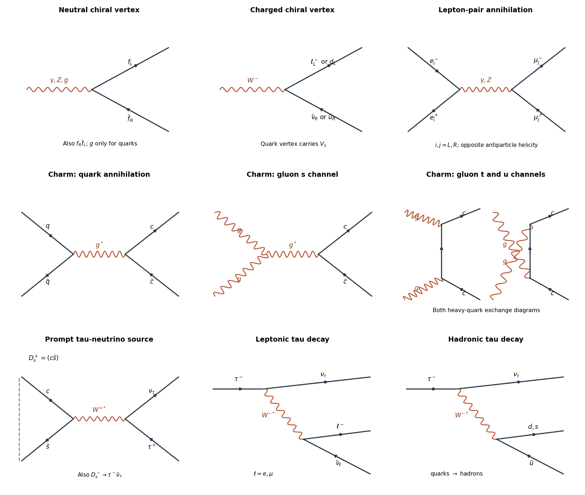

<h1 id="2/a/solution">Solution</h1>

↑ **Parent:** [A](../a.md)

At [energies](../../../../energy-split.md) large compared with [fermion masses](../../../../fermion-mass.md), the [gauge interactions](../../../../gauge-interaction.md) preserve [chirality](../../../../chirality-physics.md) on each [fermion](../../../../fermion.md) line. A [photon](../../../../photon.md) couples to charged [fermions](../../../../fermion.md) with equal left and right coefficients $eQ_f$. A [gluon](../../../../gluon.md) couples to either [quark](../../../../quark.md) [chirality](../../../../chirality-physics.md) with coefficient $g_sT^a$. A [Z boson](../../../../z-boson.md) couples to both, with coefficients $(g/\cos\theta_W)(T_3-Q_f\sin^2\theta_W)$ on left-chiral fields and $(g/\cos\theta_W)(-Q_f\sin^2\theta_W)$ on right-chiral fields. A [W boson](../../../../w-boson.md) couples only to left-chiral [fermions](../../../../fermion.md) and the associated right-helicity [antifermions](../../../../antifermion.md): $W^-\to\ell^-_L\bar\nu_R$ or $d_L\bar u_R$, and the charge-conjugate $W^+$ channels. For [quarks](../../../../quark.md) the coefficient includes the [CKM matrix](../../../../cabibbo-kobayashi-maskawa-matrix.md). There is no [Standard Model](../../../../standard-model-split.md) right-chiral [neutrino](../../../../neutrino.md) gauge vertex.

For outgoing pairs at a neutral vertex, the allowed [helicities](../../../../helicity.md) are $f^-_L\bar f^+_R$ and $f^-_R\bar f^+_L$; the latter labels [helicity](../../../../helicity.md), not the [chirality](../../../../chirality-physics.md) of the corresponding antifield. Only the $s$-channel [photon](../../../../photon.md) and [Z boson](../../../../z-boson.md) diagrams contribute to $e^+e^-\to\mu^+\mu^-$ at tree level among these gauge exchanges. A [W boson](../../../../w-boson.md) changes charged [leptons](../../../../lepton.md) into [neutrinos](../../../../neutrino.md), and [gluons](../../../../gluon.md) do not couple to [leptons](../../../../lepton.md).

**[Figure 1](#2/a/image-feynman-diagrams-for-chiral-gauge-vertices-annihilation-charm-production-and-tau-decay). Feynman diagrams for chiral gauge vertices, annihilation, charm production and tau decay**. Original diagrams. Fermion arrows denote fermion-number flow; dashed binding brackets indicate a meson projection, not a perturbative vertex. Neutral vertices allow the two opposite-helicity outgoing pairs listed in the solution.

## ↑ Ancestors (12)

1. [A](../a.md)
2. [2](../../2.md)
3. [2015](../../../2015-split.md)
4. [Past exam of the particle physics course of the University of Oxford](../../../split.md)
5. [Particle physics course of the University of Oxford](../../../../particle-physics-course-of-the-university-of-oxford.md)
6. [Year 4 of the physics course of the University of Oxford](../../../../year-4-of-the-physics-course-of-the-university-of-oxford.md)
7. [Physics course of the University of Oxford](../../../../physics-course-of-the-university-of-oxford.md)
8. [Undergraduate course of the University of Oxford](../../../../undergraduate-course-of-the-university-of-oxford.md)
9. [Course of the University of Oxford](../../../../course-of-the-university-of-oxford.md)
10. [University of Oxford](../../../../university-of-oxford-split.md)
11. [List of universities](../../../../list-of-universities.md)
12. [Codex Wiki](../../../../split.md)
