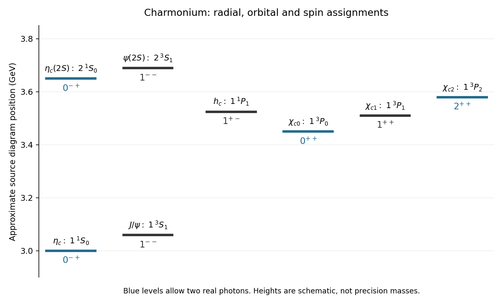

<h1 id="3/d/solution">Solution</h1>

↑ **Parent:** [D](../d.md)

For a neutral $c\bar c$ [bound state](../../../../bound-state.md), [meson parity and charge conjugation](../../../../meson-parity-and-charge-conjugation.md) give $P=(-1)^{L+1}$ and $C=(-1)^{L+S}$. In spectroscopic notation $n\,{}^{2S+1}L_J$, the integer $n$ labels radial excitation, $L$ is [orbital angular momentum](../../../../orbital-angular-momentum.md), $S$ the total constituent [spin](../../../../spin.md), and $J$ their total [angular momentum](../../../../angular-momentum.md). The surviving level diagram contains eight states:

- $\eta_c$: $1\,{}^1S_0$, $(L,S,J)=(0,0,0)$, $0^{-+}$.
- $J/\psi$: $1\,{}^3S_1$, $(0,1,1)$, $1^{--}$.
- $h_c$: $1\,{}^1P_1$, $(1,0,1)$, $1^{+-}$.
- $\chi_{c0}$: $1\,{}^3P_0$, $(1,1,0)$, $0^{++}$.
- $\chi_{c1}$: $1\,{}^3P_1$, $(1,1,1)$, $1^{++}$.
- $\chi_{c2}$: $1\,{}^3P_2$, $(1,1,2)$, $2^{++}$.
- $\eta_c(2S)$: $2\,{}^1S_0$, $(0,0,0)$, $0^{-+}$.
- $\psi(2S)$: $2\,{}^3S_1$, $(0,1,1)$, $1^{--}$.

The [spin](../../../../spin.md)-dependent splittings distinguish the singlet and triplet levels and the three triplet P levels. The radial excitation changes neither [parity](../../../../parity.md) nor [charge conjugation](../../../../charge-conjugation.md).

**[Figure 2](#3/d/image-charmonium-assignments-for-the-eight-surviving-source-levels). Charmonium assignments for the eight surviving source levels**. Original redraw with approximate vertical positions from the intact right-hand source diagram. Positions are schematic; labels and quantum-number assignments, rather than precision masses, are the content.

## ↑ Ancestors (12)

1. [D](../d.md)
2. [3](../../3.md)
3. [2015](../../../2015-split.md)
4. [Past exam of the particle physics course of the University of Oxford](../../../split.md)
5. [Particle physics course of the University of Oxford](../../../../particle-physics-course-of-the-university-of-oxford.md)
6. [Year 4 of the physics course of the University of Oxford](../../../../year-4-of-the-physics-course-of-the-university-of-oxford.md)
7. [Physics course of the University of Oxford](../../../../physics-course-of-the-university-of-oxford.md)
8. [Undergraduate course of the University of Oxford](../../../../undergraduate-course-of-the-university-of-oxford.md)
9. [Course of the University of Oxford](../../../../course-of-the-university-of-oxford.md)
10. [University of Oxford](../../../../university-of-oxford-split.md)
11. [List of universities](../../../../list-of-universities.md)
12. [Codex Wiki](../../../../split.md)
