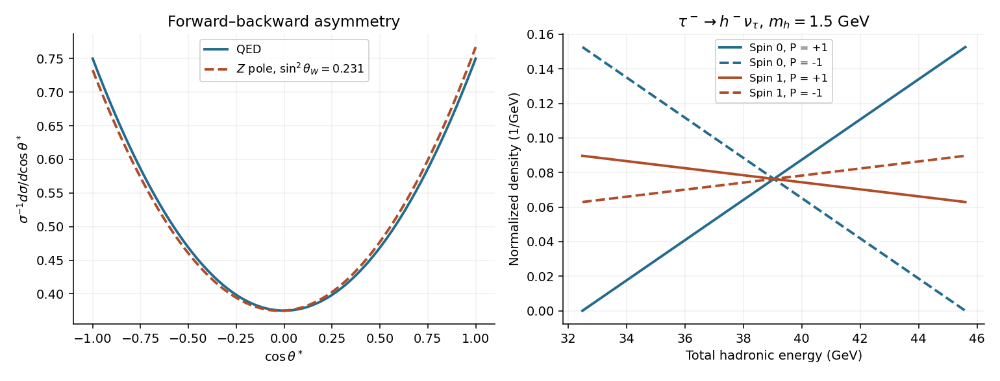

<h1 id="7/d/solution">Solution</h1>

↑ **Parent:** [D](../d.md)

Neglect radiation, take $E_\tau=M_Z/2\simeq45.6\,\mathrm{GeV}$, $m_\tau\simeq1.777\,\mathrm{GeV}$, and treat a fixed hadronic [invariant mass](../../../../invariant-mass.md) $m_h=1.5\,\mathrm{GeV}$ as a single recoil system in $\tau^-\to h^-\nu_\tau$. With negligible [neutrino mass](../../../../neutrino-mass.md),

$$
E_h^*=\frac{m_\tau^2+m_h^2}{2m_\tau},\quad p_h^*=\frac{m_\tau^2-m_h^2}{2m_\tau},\quad
E_h=\gamma(E_h^*+\beta p_h^*\cos\vartheta),\quad
\gamma=\frac{E_\tau}{m_\tau}.
$$

Thus $E_h^{\min,\max}=\gamma(E_h^*\mp\beta p_h^*)$, numerically approximately $32.50$ to $45.60\,\mathrm{GeV}$. In the ultrarelativistic limit the range is $E_\tau m_h^2/m_\tau^2\leq E_h\leq E_\tau$. A spread of hadronic [invariant masses](../../../../invariant-mass.md) broadens these endpoints; an average [mass](../../../../mass.md) alone is not a strict endpoint specification for the whole sample.

Let $P_\tau=+1$ denote a positive-helicity $\tau^-$, and measure $\vartheta$ from its laboratory flight direction in its rest frame. For a spin-zero hadronic recoil, the left-helicity [tau neutrino](../../../../tau-neutrino.md) and [angular momentum](../../../../angular-momentum.md) conservation give

$$
\frac1\Gamma\frac{d\Gamma}{d\cos\vartheta}=\frac12(1+P_\tau\cos\vartheta).
$$

For example a [tau lepton](../../../../tau-particle.md) with [spin](../../../../spin.md) along $+z$ can emit a left-helicity [neutrino](../../../../neutrino.md) along $-z$, carrying [spin](../../../../spin.md) along $+z$, with the spin-zero recoil along $+z$. A positive-helicity [tau lepton](../../../../tau-particle.md) then gives a harder visible recoil. If $x_h=E_h/E_\tau$, $r=m_h^2/m_\tau^2$ and $\beta\simeq1$, the more general [tau hadronic polarimetry](../../../../tau-hadronic-polarimetry.md) formula is

$$
\frac1\Gamma\frac{d\Gamma}{dx_h}=\frac1{1-r}\left[1+\alpha_hP_\tau\frac{2x_h-1-r}{1-r}\right],\quad r<x_h<1,\qquad
\langle E_h\rangle=\gamma E_h^*+\frac{\gamma\beta p_h^*}{3}\alpha_hP_\tau.
$$

For spin-zero recoil $\alpha_h=1$. For a spin-one system produced by the [V-A interaction](../../../../v-a-interaction.md), the longitudinal and transverse weights are $m_\tau^2:2m_h^2$, with opposite angular slopes; summing gives $\alpha_h=(m_\tau^2-2m_h^2)/(m_\tau^2+2m_h^2)$. At $m_h=1.5\,\mathrm{GeV}$ this is about $-0.175$, so the negative-helicity [tau lepton](../../../../tau-particle.md) has the higher mean total hadronic [energy](../../../../energy-split.md), about $39.43$ versus $38.67\,\mathrm{GeV}$, within that spin-one model. [Polarized tau decay: longitudinal and transverse spin-one recoil distributions, Eqs. (5)–(6)](../../../../tau-polarization-and-correlated-decays-in-neutrino-experiments-2023.md)

The supplied mean [invariant mass](../../../../invariant-mass.md) does not specify the recoil's [spin](../../../../spin.md) composition or its [helicity amplitudes](../../../../helicity-amplitude.md). Consequently the last sign cannot be universal: positive helicity is harder for a spin-zero recoil, negative helicity is harder for the specified $1.5\,\mathrm{GeV}$ spin-one recoil, and a mixture requires its measured spectral weights. Polarization of an intermediate vector or axial-vector [meson](../../../../meson.md) also changes the division of [energy](../../../../energy-split.md) among its daughter [hadrons](../../../../hadron.md); that information is not fixed by the total jet [invariant mass](../../../../invariant-mass.md) alone.

**[Figure 3](#7/d/image-chiral-annihilation-and-tau-lepton-recoil-energy-distributions). Chiral annihilation and tau lepton recoil energy distributions**. Original theoretical curves. Left: normalized pure-QED and illustrative Z-pole distributions for sin-squared weak angle 0.231. Right: spin-zero and spin-one recoil models at fixed hadronic mass 1.5 GeV; the opposite polarization slopes show why the spin assumption matters. These are not reconstructions of either damaged source graph.

## ↑ Ancestors (12)

1. [D](../d.md)
2. [7](../../7.md)
3. [2015](../../../2015-split.md)
4. [Past exam of the particle physics course of the University of Oxford](../../../split.md)
5. [Particle physics course of the University of Oxford](../../../../particle-physics-course-of-the-university-of-oxford.md)
6. [Year 4 of the physics course of the University of Oxford](../../../../year-4-of-the-physics-course-of-the-university-of-oxford.md)
7. [Physics course of the University of Oxford](../../../../physics-course-of-the-university-of-oxford.md)
8. [Undergraduate course of the University of Oxford](../../../../undergraduate-course-of-the-university-of-oxford.md)
9. [Course of the University of Oxford](../../../../course-of-the-university-of-oxford.md)
10. [University of Oxford](../../../../university-of-oxford-split.md)
11. [List of universities](../../../../list-of-universities.md)
12. [Codex Wiki](../../../../split.md)
