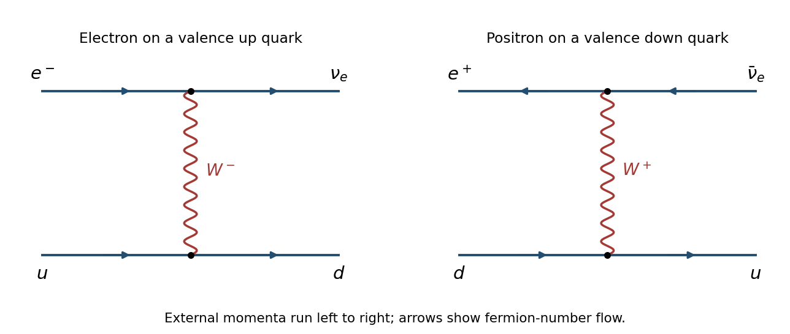
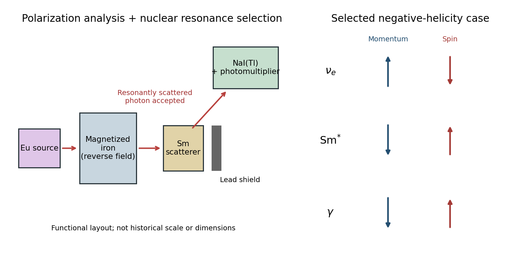
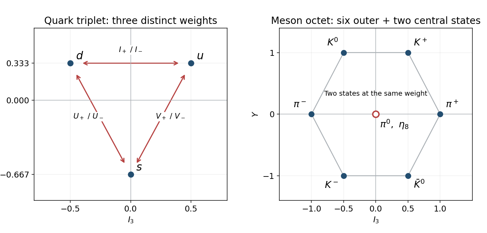
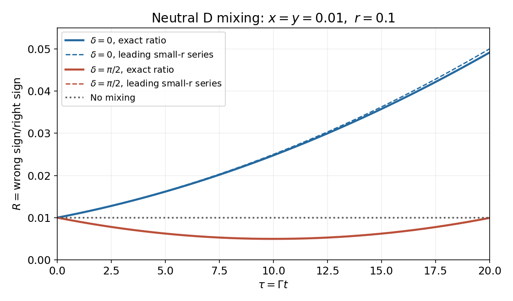
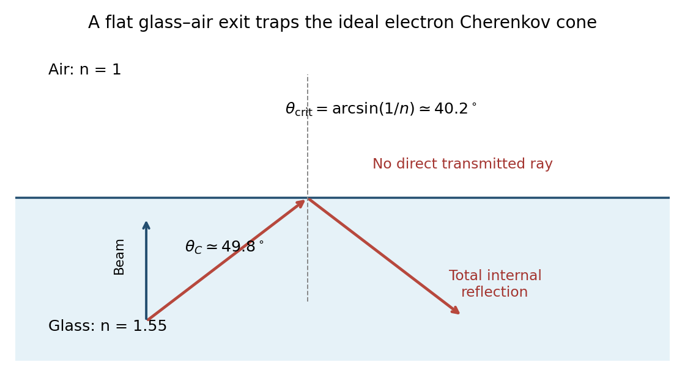
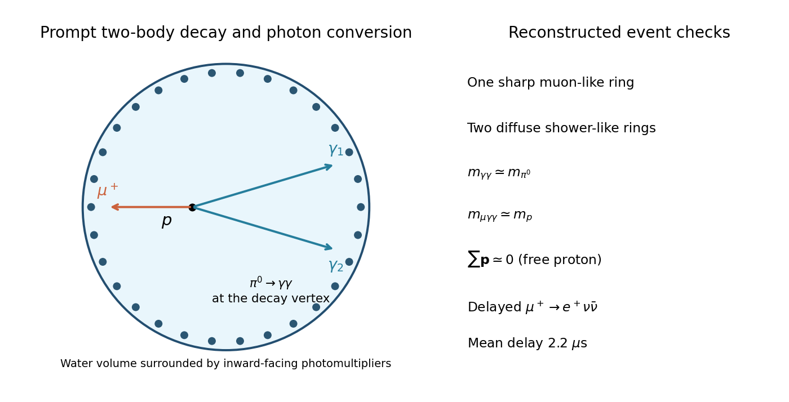

# 2016

↑ **Parent:** [Past exam of the particle physics course of the University of Oxford](../past-exam-of-the-particle-physics-course-of-the-university-of-oxford.md)

Source paper: [Oxford source archive](https://www.whatdotheyknow.com/request/physics_past_exam_papers_2015_16/response/973997/attach/3/Cowell%20Attachment.zip?cookie_passthrough=1), member `Finals papers/A11047W1_C4_2016.pdf`. The cover establishes 2016; the alternative annual bundle is named for 2015.

**Table of contents**

- [1](#1)
  - [1](#1/1)
    - [Solution](#1/1/solution)
  - [2](#1/2)
    - [Solution](#1/2/solution)
  - [3](#1/3)
    - [Solution](#1/3/solution)
- [2](#2)
  - [1](#2/1)
    - [Solution](#2/1/solution)
  - [2](#2/2)
    - [Solution](#2/2/solution)
  - [3](#2/3)
    - [Solution](#2/3/solution)
  - [4](#2/4)
    - [Solution](#2/4/solution)
- [3](#3)
  - [1](#3/1)
    - [Solution](#3/1/solution)
  - [2](#3/2)
    - [Solution](#3/2/solution)
  - [3](#3/3)
    - [Solution](#3/3/solution)
  - [4](#3/4)
    - [Solution](#3/4/solution)
  - [5](#3/5)
    - [Solution](#3/5/solution)
- [4](#4)
  - [1](#4/1)
    - [Solution](#4/1/solution)
  - [2](#4/2)
    - [Solution](#4/2/solution)
  - [3](#4/3)
    - [Solution](#4/3/solution)
  - [4](#4/4)
    - [Solution](#4/4/solution)
- [5](#5)
  - [1](#5/1)
    - [Solution](#5/1/solution)
  - [2](#5/2)
    - [Solution](#5/2/solution)
  - [3](#5/3)
    - [a](#5/3/a)
      - [Solution](#5/3/a/solution)
    - [b](#5/3/b)
      - [Solution](#5/3/b/solution)
    - [c](#5/3/c)
      - [Solution](#5/3/c/solution)
  - [4](#5/4)
    - [Solution](#5/4/solution)
- [6](#6)
  - [1](#6/1)
    - [Solution](#6/1/solution)
  - [2](#6/2)
    - [Solution](#6/2/solution)
  - [3](#6/3)
    - [Solution](#6/3/solution)
- [7](#7)
  - [1](#7/1)
    - [Solution](#7/1/solution)
  - [2](#7/2)
    - [Solution](#7/2/solution)
  - [3](#7/3)
    - [Solution](#7/3/solution)
  - [4](#7/4)
    - [Solution](#7/4/solution)
- [8](#8)
  - [1](#8/1)
    - [Solution](#8/1/solution)
  - [2](#8/2)
    - [Solution](#8/2/solution)
  - [3](#8/3)
    - [Solution](#8/3/solution)
  - [4](#8/4)
    - [Solution](#8/4/solution)

## 1

↑ **Parent:** [2016](2016.md)

<h3 id="1/1">1</h3>

↑ **Parent:** [1](#1)

<h4 id="1/1/solution">Solution</h4>

↑ **Parent:** [1](#1/1)

The [parton model](../standard-model.md#parton-model) treats a fast [proton](../physics.md#proton) as an ensemble of approximately collinear, nearly free [quarks](../standard-model.md#quark) and [antiquarks](../standard-model.md#antiquark). A hard [deep inelastic scattering](../standard-model.md#deep-inelastic-scattering) collision resolves one [parton](../standard-model.md#parton) on a time scale short compared with its binding motion. The probabilities are [parton distribution functions](../standard-model.md#parton-distribution-function); the simplest approximation neglects intrinsic transverse [momentum](../momentum.md), [quark masses](../standard-model.md#quark-mass) and the [proton](../physics.md#proton) [mass](../classical-mechanics.md#mass) in the hard collision. [Quantum chromodynamics](../standard-model.md#quantum-chromodynamics) introduces logarithmic violations of [Bjorken scaling](../standard-model.md#bjorken-scaling), so the [parton distribution functions](../standard-model.md#parton-distribution-function) depend on a resolution scale as well as a [parton momentum fraction](../standard-model.md#parton-momentum-fraction).

Write the incident [electron](../physics.md#electron) and [proton](../physics.md#proton) [four-momenta](../special-relativity.md#four-momentum) as $k,P$, the scattered [electron](../physics.md#electron) [four-momentum](../special-relativity.md#four-momentum) as $k'$, and set $q=k-k'$. With the $(+---)$ [Minkowski metric](../special-relativity.md#minkowski-metric), the [Bjorken scaling variable](../standard-model.md#bjorken-scaling-variable) and the inelasticity are

$$
Q^2=-q^2>0,\qquad y=\frac{P\cdot q}{P\cdot k},\qquad x_B=\frac{Q^2}{2P\cdot q}=\frac{Q^2}{sy},\qquad s\simeq4E_eE_p.
$$

An incident [parton](../standard-model.md#parton) with [four-momentum](../special-relativity.md#four-momentum) $\xi P$ emerges on shell, giving $(\xi P+q)^2\simeq2\xi P\cdot q-Q^2=0$. Thus $\xi=x_B$: the observable [Bjorken scaling variable](../standard-model.md#bjorken-scaling-variable) measures the struck [parton momentum fraction](../standard-model.md#parton-momentum-fraction) in this approximation.

For clarity, measure the [scattering angle](../quantum-scattering.md#scattering-angle) $\vartheta$ from the **incoming electron direction**, and denote the outgoing [electron](../physics.md#electron) [energy](../energy.md) by $E'_e$. Direct [four-momentum](../special-relativity.md#four-momentum) products give

$$
Q^2=4E_eE'_e\sin^2\frac{\vartheta}{2},\qquad y=1-\frac{E'_e}{E_e}\cos^2\frac{\vartheta}{2},\qquad \boxed{x_B=\frac{E_eE'_e\sin^2(\vartheta/2)}{E_eE_p\left[1-(E'_e/E_e)\cos^2(\vartheta/2)\right]}}.
$$

The expression uses the known beam [energies](../energy.md) and two measured quantities. An [electromagnetic calorimeter](../particle-detection.md#electromagnetic-calorimeter) measures $E'_e$; a [tracking detector](../particle-detection.md#tracking-detector), the collision [interaction vertex](../perturbative-quantum-field-theory.md#interaction-vertex) and the position of the [electromagnetic shower](../particle-detection.md#electromagnetic-shower) determine $\vartheta$. Coverage close to the incoming [electron](../physics.md#electron) direction matters at small $Q^2$. A [hadronic calorimeter](../particle-detection.md#hadronic-calorimeter) supplies an independent consistency check and rejects backgrounds. If the angle is instead measured from the incoming [proton](../physics.md#proton), its sine and cosine half-angle factors interchange.

<h3 id="1/2">2</h3>

↑ **Parent:** [1](#1)

<h4 id="1/2/solution">Solution</h4>

↑ **Parent:** [2](#1/2)

At the [parton](../standard-model.md#parton) level, the dominant valence reactions are $e^-u\to\nu_e d$ through [W boson](../standard-model.md#w-boson) exchange and $e^+d\to\bar\nu_e u$ through [W boson](../standard-model.md#w-boson) exchange. The first also acts on $c$, while the second acts on $s$ with the appropriate [Cabibbo-Kobayashi-Maskawa matrix](../standard-model.md#cabibbo-kobayashi-maskawa-matrix) factors; crossing supplies the [antiquark](../standard-model.md#antiquark) reactions. The lines in the figure show [fermion number](../relativistic-quantum-field.md#fermion-number) flow; the [Positron](../physics.md#positron) and [antineutrino](../standard-model.md#antineutrino) arrows point opposite to their [momenta](../momentum.md).

**[Figure 1](#1/2/image-leading-charged-current-electron-quark-and-positron-quark-diagrams). Leading charged-current electron-quark and positron-quark diagrams**.

For unpolarized beams, the leading [charged current](../standard-model.md#charged-current) [cross sections](../physics.md#cross-section-physics), suppressing [Cabibbo-Kobayashi-Maskawa matrix](../standard-model.md#cabibbo-kobayashi-maskawa-matrix) factors, have the form

$$
\begin{aligned}
\frac{d^2\sigma(e^-p)}{dx\,dQ^2}&=\frac{G_F^2}{2\pi}\left(\frac{M_W^2}{M_W^2+Q^2}\right)^2\left[u+c+(1-y)^2(\bar d+\bar s)\right],\\
\frac{d^2\sigma(e^+p)}{dx\,dQ^2}&=\frac{G_F^2}{2\pi}\left(\frac{M_W^2}{M_W^2+Q^2}\right)^2\left[\bar u+\bar c+(1-y)^2(d+s)\right].
\end{aligned}
$$

Here each [parton distribution function](../standard-model.md#parton-distribution-function) is evaluated at $(x,Q^2)$. The [proton](../physics.md#proton) has two valence [up quarks](../standard-model.md#up-quark) and one valence [down quark](../standard-model.md#down-quark); moreover, its valence contribution in the [Positron](../physics.md#positron) reaction carries the chiral angular factor $(1-y)^2$. Both effects favour $e^-p$. Increasing $Q^2$ at fixed collider [energy](../energy.md) enforces $x\ge Q^2/s$, progressively suppressing the sea relative to the valence [quarks](../standard-model.md#quark); large $y$ further suppresses the [Positron](../physics.md#positron) valence term. There is no universal factor of two valid at every $(x,y)$.

The escaping [neutrino](../standard-model.md#neutrino) prevents direct reconstruction from a scattered charged [lepton](../standard-model.md#lepton). Instead use the [Jacquet-Blondel reconstruction](../standard-model.md#jacquet-blondel-reconstruction). With the $+z$ axis along the [proton](../physics.md#proton) beam, measure the complete hadronic final state and form

$$
\delta_h=\sum_h(E_h-p_{zh}),\quad y_h=\frac{\delta_h}{2E_e},\quad Q_h^2=\frac{|\sum_h\mathbf p_{Th}|^2}{1-y_h},\quad \boxed{x_h=\frac{Q_h^2}{sy_h}}.
$$

These relations follow from [four-momentum conservation](../special-relativity.md#four-momentum-conservation), with the unobserved [neutrino](../standard-model.md#neutrino) transverse [momentum](../momentum.md) opposite to the measured hadronic sum. A nearly hermetic [hadronic calorimeter](../particle-detection.md#hadronic-calorimeter), supplemented by [tracking detectors](../particle-detection.md#tracking-detector), must measure [jets](../standard-model.md#jet-particle-physics), their [energies](../energy.md) and their directions. Forward losses, initial-state [radiation](../physics.md#radiation) and small $y_h$ cause significant reconstruction uncertainties.

<h3 id="1/3">3</h3>

↑ **Parent:** [1](#1)

<h4 id="1/3/solution">Solution</h4>

↑ **Parent:** [3](#1/3)

The [photon propagator](../quantum-field-theory.md#photon-propagator) gives approximately $d\sigma_{\mathrm{NC}}/dQ^2\propto1/(Q^2)^2$, whereas a massive [W boson](../standard-model.md#w-boson) gives $d\sigma_{\mathrm{CC}}/dQ^2\propto1/(Q^2+M_W^2)^2$. Up to different [coupling physics](../statistical-model.md#coupling-constant-physics) values, [parton distribution functions](../standard-model.md#parton-distribution-function) and angular factors,

$$
\frac{\sigma_{\mathrm{CC}}}{\sigma_{\mathrm{NC}}}\simeq C(Q^2)\left(\frac{Q^2}{Q^2+M_W^2}\right)^2.
$$

Consequently the low-$Q^2$ [charged current](../standard-model.md#charged-current) suppression disappears as $Q^2$ approaches $M_W^2$. The source graph shows comparable [cross sections](../physics.md#cross-section-physics) at $Q^2$ of order $10^4\ \mathrm{GeV}^2$, so the relevant [mass](../classical-mechanics.md#mass) scale is of order $10^2\ \mathrm{GeV}$.

A more quantitative, still rough reading uses the $e^-p$ ratio $R_1\simeq0.006$ near $q_1=300\ \mathrm{GeV}^2$ and $R_2\simeq0.17$ near $q_2=2000\ \mathrm{GeV}^2$, where $q_i$ denotes $Q^2$, not $Q$. If $C$ varies slowly over this interval, set $\kappa=\sqrt{R_2/R_1}\,q_1/q_2$. Then

$$
\kappa=\frac{q_1+M_W^2}{q_2+M_W^2},\qquad \boxed{M_W=\sqrt{\frac{\kappa q_2-q_1}{1-\kappa}}\simeq80\ \mathrm{GeV}}.
$$

The reading is compatible with roughly $70$–$100\ \mathrm{GeV}$; it is not a precision [mass](../classical-mechanics.md#mass) determination. In particular, [Z boson](../standard-model.md#z-boson) exchange contributes to the [neutral current](../standard-model.md#neutral-current) at high $Q^2$, and the [parton distribution functions](../standard-model.md#parton-distribution-function) do not cancel exactly. Equality of two inclusive [cross sections](../physics.md#cross-section-physics) alone does not define $M_W$.

<h2 id="2">2</h2>

↑ **Parent:** [2016](2016.md)

<h3 id="2/1">1</h3>

↑ **Parent:** [2](#2)

<h4 id="2/1/solution">Solution</h4>

↑ **Parent:** [1](#2/1)

An observable that reverses sign under [parity](../quantum-mechanics.md#parity) but has a nonzero expectation in a suitably prepared experiment tests [parity violation](../standard-model.md#parity-violation). A polar [momentum](../momentum.md) reverses, whereas an axial [spin angular momentum](../angular-momentum-operator.md#spin) does not. Thus $\mathbf J\cdot\mathbf p$ and [helicity](../special-relativity.md#helicity) are parity-odd; an apparatus asymmetry must be separated from a physical asymmetry by reversing the preparation or analyser.

In the [Wu experiment](../standard-model.md#wu-experiment), polarized [cobalt-60](../chemical-substance.md#cobalt-60) nuclei preferentially emit [beta decay](../physics.md#beta-decay) [electrons](../physics.md#electron) in one direction relative to the nuclear [spin angular momentum](../angular-momentum-operator.md#spin). The distribution contains $A\mathbf P\cdot\mathbf p_e/E_e$; its sign changes under spatial inversion. Reversing the nuclear polarization reverses the observed asymmetry.[Nuclear polarization and the beta angular asymmetry](../physics-bibliography.md#experimental-test-of-parity-conservation-in-beta-decay-by-chien-shiung-wu-and-others)

In the [Goldhaber experiment](../standard-model.md#goldhaber-experiment), the sign of the circular polarization of selected [gamma rays](../quantum-mechanics.md#gamma-ray) determines the sign of the [neutrino](../standard-model.md#neutrino) [helicity](../special-relativity.md#helicity). A preference for negative [helicity](../special-relativity.md#helicity) is parity-odd because spatial inversion would produce the positive-[helicity](../special-relativity.md#helicity) state. This provides a different experimental observable from the [electron](../physics.md#electron) angular distribution.

<h3 id="2/2">2</h3>

↑ **Parent:** [2](#2)

<h4 id="2/2/solution">Solution</h4>

↑ **Parent:** [2](#2/2)

The relevant sequence is [electron capture](../physics.md#electron-capture) followed by nuclear [gamma decay](../atomic-nucleus.md#gamma-decay):

$$
{}^{152m}_{63}\mathrm{Eu}+e^-_K\longrightarrow{}^{152}_{62}\mathrm{Sm}^{*}+\nu_e,\qquad{}^{152}\mathrm{Sm}^{*}\longrightarrow{}^{152}\mathrm{Sm}+\gamma.
$$

The nuclear [spin angular momenta](../angular-momentum-operator.md#spin) are $0\to1\to0$. The captured [K-shell electron](../chemistry.md#k-shell-electron) has total [angular momentum](../momentum.md#angular-momentum) $1/2$, so the initial atom-plus-[electron](../physics.md#electron) system cannot be treated as having zero [angular momentum](../momentum.md#angular-momentum). The atomic vacancy also produces subsequent [X-rays](../electromagnetic-radiation.md#x-ray) or [Auger electrons](../atomic-physics.md#auger-electron); these are not the selected nuclear transition.

Choose the [neutrino](../standard-model.md#neutrino) [momentum](../momentum.md) along $+z$ and the recoil [momentum](../momentum.md) along $-z$. For a negative-[helicity](../special-relativity.md#helicity) [neutrino](../standard-model.md#neutrino), $s_{\nu z}=-1/2$. With the two initial [electron spin](../angular-momentum-operator.md#electron-spin) projections, [angular momentum conservation](../momentum.md#conservation-of-angular-momentum) allows the daughter to have $m_z=0$ or $+1$. A [photon](../quantum-mechanics.md#photon) emitted exactly along the recoil direction is transverse, and the $1\to0$ transition selects the $m_z=+1$ component. Its [spin angular momentum](../angular-momentum-operator.md#spin) points along $+z$, opposite to its [momentum](../momentum.md).

Thus in the selected collinear geometry the daughter and [photon](../quantum-mechanics.md#photon) have the same negative [helicity](../special-relativity.md#helicity) as the [neutrino](../standard-model.md#neutrino), while their [spin angular momenta](../angular-momentum-operator.md#spin) point opposite to the [neutrino spin](../standard-model.md#neutrino-spin). Reversing all these [spin](../angular-momentum-operator.md#spin) projections gives the positive-[helicity](../special-relativity.md#helicity) alternative. In normalized notation,

$$
\boxed{h_\gamma=h_{\mathrm{Sm}^{*}}=h_\nu},\qquad h=\frac{\mathbf S\cdot\widehat{\mathbf p}}{s}.
$$

The actual eigenvalues of $\mathbf S\cdot\widehat{\mathbf p}$ are $\pm1/2$ for the [neutrino](../standard-model.md#neutrino) and $\pm1$ for the [photon](../quantum-mechanics.md#photon); the equality concerns their normalized signs.

<h3 id="2/3">3</h3>

↑ **Parent:** [2](#2)

<h4 id="2/3/solution">Solution</h4>

↑ **Parent:** [3](#2/3)

The nuclear [gamma ray](../quantum-mechanics.md#gamma-ray) can be absorbed by ground-state [samarium-152](../chemical-substance.md#samarium-152), excite the same level and be re-emitted: nuclear [nuclear resonance fluorescence](../quantum-mechanics.md#nuclear-resonance-fluorescence). Its [energy](../energy.md) in the absorber rest frame must overlap the nuclear absorption line within the relevant natural and thermal broadening. Atomic radiation from refilling the [K shell](../chemistry.md#k-shell) does not have the required transition [energy](../energy.md).

Let the excitation [energy](../energy.md) be $E_0$ and the nuclear [mass](../classical-mechanics.md#mass) be $M$. A free stationary emitter loses recoil [energy](../energy.md) while a free stationary absorber requires recoil [energy](../energy.md):

$$
E_{\mathrm{em}}\simeq E_0-\frac{E_0^2}{2Mc^2},\quad E_{\mathrm{abs}}\simeq E_0+\frac{E_0^2}{2Mc^2},\quad E_{\mathrm{abs}}-E_{\mathrm{em}}\simeq\frac{E_0^2}{Mc^2}.
$$

For $E_0\simeq0.96\ \mathrm{MeV}$ the gap is about $6.5\ \mathrm{eV}$. A [photon](../quantum-mechanics.md#photon) emitted along the daughter recoil receives a positive [Doppler shift](../wave.md#doppler-effect) of approximately $E_0p_\nu/(Mc)$, whereas one emitted opposite the recoil is redshifted. Emission before the daughter slows down therefore selects [photons](../quantum-mechanics.md#photon) roughly opposite to the [neutrino](../standard-model.md#neutrino). Comparable [neutrino](../standard-model.md#neutrino) and [photon energies](../quantum-mechanics.md#photon-energy) nearly compensate the recoil mismatch; finite line widths and thermal motion permit overlap. Exact compensation need not hold for every atom, and this is not an assumption of recoil-free emission.

Magnetized iron supplies polarized [electrons](../physics.md#electron). Their [Compton scattering](../mathematical-physics.md#compton-scattering) [cross section](../physics.md#cross-section-physics) depends on the relative [electron spin](../angular-momentum-operator.md#electron-spin) and [photon helicity](../special-relativity.md#photon-helicity), so the iron attenuates the two circular polarizations differently. Reverse the magnetization and measure the resonance-selected count asymmetry $A=(N_+-N_-)/(N_++N_-)$. With a calibrated analysing power $a$ and background correction, $A=aP_\gamma$ determines the sign and magnitude of the circular polarization. A [scintillation counter](../particle-detection.md#scintillation-counter) such as NaI(Tl), coupled to a [photomultiplier](../particle-detection.md#photomultiplier), determines the [gamma ray](../quantum-mechanics.md#gamma-ray) [energy](../energy.md) from calibrated pulse height; a [semiconductor detector](../particle-detection.md#semiconductor-detector) could perform the same spectroscopic function.

<h3 id="2/4">4</h3>

↑ **Parent:** [2](#2)

<h4 id="2/4/solution">Solution</h4>

↑ **Parent:** [4](#2/4)

The functional arrangement below separates the polarization analysis from the resonance selection. The shield prevents the direct source beam from overwhelming the detector; the off-axis detector accepts [gamma rays](../quantum-mechanics.md#gamma-ray) re-emitted by the [samarium](../chemical-substance.md#samarium) scatterer.

**[Figure 2](#2/4/image-functional-goldhaber-helicity-measurement-and-the-selected-spin-geometry). Functional Goldhaber helicity measurement and the selected spin geometry**.

The [europium](../chemical-substance.md#europium) source emits into magnetized iron, whose magnetization is alternated. A [samarium](../chemical-substance.md#samarium) scatterer selects nuclear [nuclear resonance fluorescence](../quantum-mechanics.md#nuclear-resonance-fluorescence), favouring [photons](../quantum-mechanics.md#photon) emitted along the daughter recoil. A shielded NaI(Tl) [scintillation counter](../particle-detection.md#scintillation-counter) records the scattered nuclear line. Compare the background-subtracted line rates for the two iron magnetizations, and use the calibrated sign of the analysing power to identify the [photon helicity](../special-relativity.md#photon-helicity).

The measured circular polarization was negative, compatible after angular acceptance corrections with negative [neutrino helicity](../special-relativity.md#neutrino-helicity). By the [angular momentum conservation](../momentum.md#conservation-of-angular-momentum) argument, the selected [photon helicity](../special-relativity.md#photon-helicity) and [neutrino helicity](../special-relativity.md#neutrino-helicity) have the same sign. Thus the experiment concludes

$$
\boxed{\mathbf S_\nu\cdot\widehat{\mathbf p}_\nu=-\frac12}
$$

for the emitted relativistic [electron neutrino](../standard-model.md#electron-neutrino). Finite acceptance dilutes the measured polarization; it does not justify equating the raw count asymmetry to $-1$.[Pages 1016–1017, apparatus, reversal calibration and negative circular polarization](../physics-bibliography.md#helicity-of-neutrinos-by-maurice-goldhaber-and-others)

<h2 id="3">3</h2>

↑ **Parent:** [2016](2016.md)

<h3 id="3/1">1</h3>

↑ **Parent:** [3](#3)

<h4 id="3/1/solution">Solution</h4>

↑ **Parent:** [1](#3/1)

Strictly, it is the infinitesimal generators, not every [unitary matrix](../linear-operator-theory.md#unitary-matrix) with unit [determinant](../multilinear-algebra.md#determinant), that are traceless. For a continuous one-parameter family $U(\epsilon)=\exp(i\epsilon T)$, [unitarity](../vector-space.md#unitary-operator) requires the generator $T$ to be [Hermitian](../hilbert-space.md#hermitian-operator). The [determinant](../multilinear-algebra.md#determinant) condition gives

$$
1=\det U(\epsilon)=\exp\left(i\epsilon\operatorname{tr}T\right)\quad\hbox{for every real }\epsilon.
$$

Differentiating at $\epsilon=0$ yields $\operatorname{tr}T=0$. A [Hermitian matrix](../hilbert-space.md#hermitian-operator) has $n$ real diagonal parameters and $n(n-1)$ real off-diagonal parameters; one real trace constraint leaves $n^2-1$ independent generators. Thus

$$
\boxed{\dim SU(n)=n^2-1}.
$$

The identity matrix supplies a concrete counterexample to interpreting the claim as one about arbitrary group elements: $I_n\in SU(n)$ but $\operatorname{tr}I_n=n$. Also, $e^{i\operatorname{tr}T}=1$ at a single parameter value only fixes the trace modulo $2\pi$; the continuous neighbourhood is essential.

<h3 id="3/2">2</h3>

↑ **Parent:** [3](#3)

<h4 id="3/2/solution">Solution</h4>

↑ **Parent:** [2](#3/2)

Embed the two off-diagonal [Pauli matrices](../algebra.md#pauli-matrices) in each of the $(u,d)$, $(u,s)$ and $(d,s)$ two-dimensional subspaces. Together with two independent embedded diagonal [Pauli matrices](../algebra.md#pauli-matrices), this produces the [Gell-Mann matrices](../algebra.md#gell-mann-matrices):

$$
\begin{aligned}
\lambda_1&=\begin{pmatrix}0&1&0\\1&0&0\\0&0&0\end{pmatrix},&
\lambda_2&=\begin{pmatrix}0&-i&0\\i&0&0\\0&0&0\end{pmatrix},&
\lambda_3&=\begin{pmatrix}1&0&0\\0&-1&0\\0&0&0\end{pmatrix},\\
\lambda_4&=\begin{pmatrix}0&0&1\\0&0&0\\1&0&0\end{pmatrix},&
\lambda_5&=\begin{pmatrix}0&0&-i\\0&0&0\\i&0&0\end{pmatrix},&
\lambda_6&=\begin{pmatrix}0&0&0\\0&0&1\\0&1&0\end{pmatrix},\\
\lambda_7&=\begin{pmatrix}0&0&0\\0&0&-i\\0&i&0\end{pmatrix},&
\lambda_8&=\frac1{\sqrt3}\begin{pmatrix}1&0&0\\0&1&0\\0&0&-2\end{pmatrix}.&&
\end{aligned}
$$

To construct the last matrix explicitly, the $(u,s)$ diagonal embedding is $D_{us}=\operatorname{diag}(1,0,-1)$ and the $(d,s)$ embedding is $D_{ds}=\operatorname{diag}(0,1,-1)$. Their difference is $\lambda_3$, and their sum divided by $\sqrt3$ is $\lambda_8$. There are only two independent diagonal generators.

Each matrix is [Hermitian](../hilbert-space.md#hermitian-operator) and traceless. Their inner products satisfy $\operatorname{tr}(\lambda_a\lambda_b)=2\delta_{ab}$, proving [linear independence](../vector-space.md#linear-independence). With $T_a=\lambda_a/2$, arbitrary transformations near the identity have $U=\exp(i\theta_aT_a)$. The eight matrices span the generators; they are not a vector-space basis of group elements themselves.

<h3 id="3/3">3</h3>

↑ **Parent:** [3](#3)

<h4 id="3/3/solution">Solution</h4>

↑ **Parent:** [3](#3/3)

Writing $E_{ij}=|i\rangle\langle j|$, the [ladder operators](../semisimple-lie-algebra.md#ladder-operator) are

$$
I_\pm=\frac{\lambda_1\pm i\lambda_2}{2}=E_{ud},E_{du},\quad V_\pm=\frac{\lambda_4\pm i\lambda_5}{2}=E_{us},E_{su},\quad U_\pm=\frac{\lambda_6\pm i\lambda_7}{2}=E_{ds},E_{sd}.
$$

The ordered pair on each right-hand side gives the plus and minus operators respectively. Thus $I_+d=u$, $V_+s=u$ and $U_+s=d$, with reverse actions for the minus operators; their other actions on the fundamental triplet vanish.

The remaining [Flavor SU(3) Cartan generators](../standard-model.md#flavor-su-3-cartan-generators) can be chosen as $I_3=\lambda_3/2$ and $Y=\lambda_8/\sqrt3$. Their eigenvalues label [isospin](../standard-model.md#isospin) and [flavor hypercharge](../standard-model.md#flavor-hypercharge):

$$
\begin{array}{c|ccc}
&u&d&s\\\hline I_3&1/2&-1/2&0\\Y&1/3&1/3&-2/3
\end{array}
$$

These diagonal operators multiply a [flavor eigenstate](../quantum-system.md#flavor-eigenstate) by an eigenvalue; exponentiating them changes relative phases rather than converting one [quark flavour](../standard-model.md#quark-flavor) into another. The [weight diagram](../semisimple-lie-algebra.md#weight-diagram) makes the distinction visible: the [ladder operators](../semisimple-lie-algebra.md#ladder-operator) connect different points, while the diagonal eigenvalues supply the axes.

**[Figure 3](#3/3/image-fundamental-flavour-weights-and-the-meson-octet-in-the-isospin-hypercharge-plane). Fundamental flavour weights and the meson octet in the isospin-hypercharge plane**.

<h3 id="3/4">4</h3>

↑ **Parent:** [3](#3)

<h4 id="3/4/solution">Solution</h4>

↑ **Parent:** [4](#3/4)

Represent a [quark](../standard-model.md#quark)-[antiquark](../standard-model.md#antiquark) state by a matrix $F$ with $q_i\bar q_j\leftrightarrow E_{ij}$. Under [flavor symmetry](../standard-model.md#flavor-symmetry), $F\mapsto UFU^\dagger$, so an infinitesimal generator acts by $[T,F]$. The minus sign in this [commutator](../lie-algebra.md#commutator) is the [antiquark](../standard-model.md#antiquark) transformation law; acting on the [quark](../standard-model.md#quark) alone would miss states.

Start from $\pi^+=E_{ud}$. Three useful first steps are

$$
[I_-,E_{ud}]=E_{dd}-E_{uu}=-\sqrt2\,\pi^0,\quad [U_+,E_{ud}]=-E_{us}=-K^+,\quad [V_-,E_{ud}]=E_{sd}=\bar K^0.
$$

Further actions give $[I_-,E_{us}]=E_{ds}=K^0$, $[I_-,E_{sd}]=-E_{su}=-K^-$ and $[I_-,\pi^0]=\sqrt2E_{du}=\sqrt2\pi^-$. Overall phases are conventional. Finally

$$
[V_-,E_{us}]=E_{ss}-E_{uu}=-\frac{\pi^0}{\sqrt2}-\sqrt{\frac32}\,\eta_8.
$$

Thus the second neutral octet state is obtained by removing the known $\pi^0$ component. Equivalently it is the normalized diagonal state orthogonal to both $\pi^0$ and the singlet. The full [meson octet](../standard-model.md#meson-octet) is

$$
\boxed{\begin{aligned}
\pi^+&=u\bar d,&\pi^-&=d\bar u,&\pi^0&=(u\bar u-d\bar d)/\sqrt2,\\
K^+&=u\bar s,&K^0&=d\bar s,&K^-&=s\bar u,&\bar K^0&=s\bar d,\\
\eta_8&=(u\bar u+d\bar d-2s\bar s)/\sqrt6.
\end{aligned}}
$$

Their flavour matrices are traceless; the independent singlet is $\eta_1=(u\bar u+d\bar d+s\bar s)/\sqrt3$. The source uses $\eta'$ for this ideal singlet. That notation is a basis convention here: the physical [eta and eta prime mesons](../physics.md#eta-and-eta-prime-mesons) is not an exactly pure singlet because physical neutral [pseudoscalar mesons](../physics.md#pseudoscalar-meson) mix.[Section 15.3, singlet-octet wave functions and physical pseudoscalar mixing](../physics-bibliography.md#quark-model-in-the-2024-review-of-particle-physics)

<h3 id="3/5">5</h3>

↑ **Parent:** [3](#3)

<h4 id="3/5/solution">Solution</h4>

↑ **Parent:** [5](#3/5)

The neutral [vector mesons](../physics.md#vector-meson) with [isospin](../standard-model.md#isospin) zero have the same conserved quantum numbers, so an off-diagonal [mass matrix](../finite-element-method.md#mass-matrix) can mix the singlet $V_1=(u\bar u+d\bar d+s\bar s)/\sqrt3$ and octet $V_8=(u\bar u+d\bar d-2s\bar s)/\sqrt6$. Choose phases such that

$$
\omega=\cos\theta\,V_1+\sin\theta\,V_8,\qquad \phi=\sin\theta\,V_1-\cos\theta\,V_8.
$$

At the ideal [mixing angle](../standard-model.md#mixing-angle) $\tan\theta=1/\sqrt2$, or $\theta\simeq35.3^\circ$, these become

$$
\boxed{\omega\simeq(u\bar u+d\bar d)/\sqrt2,\qquad\phi\simeq s\bar s}.
$$

The overall sign of $\phi$ is unobservable. The [omega meson](../physics.md#omega-meson) near $782\ \mathrm{MeV}$ decays predominantly to three [pions](../standard-model.md#pion), whereas the [phi meson](../physics.md#phi-meson) near $1020\ \mathrm{MeV}$ strongly favours [kaon](../physics.md#kaon)-[antikaon](../physics.md#antikaon) channels when they are open. Suppression of its nonstrange channels agrees with the [OZI rule](../standard-model.md#ozi-rule) and a predominantly strange state. The [omega meson](../physics.md#omega-meson) is below the two-[kaon](../physics.md#kaon) threshold, so its absence of that channel alone would not establish the [mixing angle](../standard-model.md#mixing-angle); masses and the broader decay pattern provide the evidence together.[Section 15.3, vector mixing near the ideal angle and identification of omega and phi](../physics-bibliography.md#quark-model-in-the-2024-review-of-particle-physics)

<h2 id="4">4</h2>

↑ **Parent:** [2016](2016.md)

<h3 id="4/1">1</h3>

↑ **Parent:** [4](#4)

<h4 id="4/1/solution">Solution</h4>

↑ **Parent:** [1](#4/1)

In [neutral meson mixing](../physics.md#neutral-meson-mixing), the [mass eigenstates](../finite-element-method.md#mass-eigenstate) and [flavor eigenstates](../quantum-system.md#flavor-eigenstate) differ. A state prepared as $D^0=c\bar u$ develops a $\bar D^0=u\bar c$ component because the effective [Hamiltonian operator](../quantum-system.md#hamiltonian-quantum-mechanics) has off-diagonal [mass](../classical-mechanics.md#mass) and [decay width](../relativistic-quantum-field.md#decay-width) entries. In the [CP symmetry](../quantum-field-theory.md#cp-symmetry) limit implicit in the source, the propagating states are equal superpositions, with average [mass](../classical-mechanics.md#mass) $M=(M_1+M_2)/2$ and average [decay width](../relativistic-quantum-field.md#decay-width) $\Gamma=(\Gamma_1+\Gamma_2)/2$.

To retain the source's **positive** $i\sin$ convention for $g_-$, take $M_2-M_1=\Delta M$ and $\Gamma_2-\Gamma_1=\Delta\Gamma$, with $g_\pm=(e_1\pm e_2)/2$, where $e_j=\exp(-iM_jt-\Gamma_jt/2)$. Then $x=\Delta M/\Gamma$ and $y=\Delta\Gamma/(2\Gamma)$ reproduce the given functions. Reversing an eigenstate label changes signs in intermediate formulae; it must also change the phase conventions consistently.

For equal widths, the mixed probability is proportional to $e^{-\Gamma t}\sin^2(\Delta M t/2)$. Thus the angular [angular frequency](../lagrangian-mechanics.md#angular-frequency) is $|\Delta M|$ in natural units, or $|\Delta M|/\hbar$ with units restored; the period is $2\pi\hbar/|\Delta M|$. A nonzero difference of [decay widths](../relativistic-quantum-field.md#decay-width) adds hyperbolic time dependence.

The ordinary neutral flavour-carrying [mesons](../physics.md#meson) that mix are $K^0$, $D^0$, $B_d^0$ and $B_s^0$ with their [antiparticles](../relativistic-quantum-field.md#antiparticle). A self-conjugate $\pi^0$ has no distinct antiparticle flavour to oscillate into. There are no long-lived top-flavoured [mesons](../physics.md#meson), since the [top quark](../standard-model.md#top-quark) decays before [hadronization](../standard-model.md#hadronization).

<h3 id="4/2">2</h3>

↑ **Parent:** [4](#4)

<h4 id="4/2/solution">Solution</h4>

↑ **Parent:** [2](#4/2)

Put $\tau=\Gamma t$, $r=r_D$ and $\delta=\delta_D$. Two indistinguishable paths reach the wrong-sign [kaon](../physics.md#kaon)-[pion](../standard-model.md#pion) final state: a direct doubly [Cabibbo suppressed](../standard-model.md#cabibbo-suppression) [decay amplitude](../relativistic-quantum-field.md#decay-amplitude) $r e^{-i\delta}g_+$ and a [neutral meson mixing](../physics.md#neutral-meson-mixing) amplitude followed by the favoured decay, $g_-$. They must be added before taking the absolute square:

$$
\mathcal A_{\mathrm{WS}}=r e^{-i\delta}g_++g_-.
$$

Direct complex-trigonometric multiplication gives

$$
|g_+|^2=\frac{e^{-\tau}}2(\cosh y\tau+\cos x\tau),\quad |g_-|^2=\frac{e^{-\tau}}2(\cosh y\tau-\cos x\tau),\quad g_+^*g_-=\frac{e^{-\tau}}2(\sinh y\tau+i\sin x\tau).
$$

Therefore

$$
\boxed{|\mathcal A_{\mathrm{WS}}|^2=e^{-\tau}\left[\frac{r^2}{2}(\cosh y\tau+\cos x\tau)+r(\cos\delta\sinh y\tau-\sin\delta\sin x\tau)+\frac12(\cosh y\tau-\cos x\tau)\right]}.
$$

The three terms are direct decay, [quantum interference](../quantum-system.md#quantum-interference) and decay after mixing. In particular, the minus sign multiplying $\sin\delta\sin x\tau$ follows from the source's $+i\sin$ convention and its definition $r e^{-i\delta}$; importing another convention without transforming $\delta$ would change a physical prediction incorrectly. The common exponential accounts for survival before decay. The expression is a decay-rate density up to an overall normalization, rather than a normalized cumulative probability.

<h3 id="4/3">3</h3>

↑ **Parent:** [4](#4)

<h4 id="4/3/solution">Solution</h4>

↑ **Parent:** [3](#4/3)

The right-sign denominator has its own small mixing contribution. In the same [CP symmetry](../quantum-field-theory.md#cp-symmetry) convention its [decay amplitude](../relativistic-quantum-field.md#decay-amplitude) is $\mathcal A_{\mathrm{RS}}=g_++r e^{-i\delta}g_-$. After cancelling $e^{-\tau}$, the exact numerator and denominator are

$$
\begin{aligned}
N&=\tfrac12r^2(\cosh y\tau+\cos x\tau)+r(\cos\delta\sinh y\tau-\sin\delta\sin x\tau)+\tfrac12(\cosh y\tau-\cos x\tau),\\
D&=\tfrac12(\cosh y\tau+\cos x\tau)+r(\cos\delta\sinh y\tau+\sin\delta\sin x\tau)+\tfrac12r^2(\cosh y\tau-\cos x\tau),\qquad R=N/D.
\end{aligned}
$$

Define $u=y\cos\delta$ and $v=x\sin\delta$. Their [Taylor expansions](../calculus.md#taylor-expansion) are $N=r^2+r(u-v)\tau+\{x^2+y^2+r^2(y^2-x^2)\}\tau^2/4+O(\tau^3)$ and $D=1+r(u+v)\tau+\{y^2-x^2+r^2(x^2+y^2)\}\tau^2/4+O(\tau^3)$. Dividing the series gives the strict second-order answer

$$
\boxed{\begin{aligned}
R&=r^2+C_1\tau+C_2\tau^2+O(\tau^3),\\
C_1&=r[(1-r^2)u-(1+r^2)v],\\
C_2&=\frac{(1-r^4)(x^2+y^2)}4-r^2(u^2-v^2)+r^4(u+v)^2.
\end{aligned}}
$$

The usually quoted approximation additionally drops terms suppressed by powers of $r$ in the right-sign denominator:

$$
R\simeq r^2+r(y\cos\delta-x\sin\delta)\tau+\frac{x^2+y^2}{4}\tau^2.
$$

For $r=0.1$ and $x=y=0.01$, this is $0.01+0.001\tau+0.00005\tau^2$ for $\delta=0$, and $0.01-0.001\tau+0.00005\tau^2$ for $\delta=\pi/2$. The first increases; the second initially decreases, reaches approximately $0.005$ at $\tau=10$, then rises. The strict series instead has $(C_1,C_2)=(0.00099,0.000049005)$ and $(-0.00101,0.000051005)$. At $\tau=20$ the exact ratios are approximately $0.04913$ and $0.009934$; the leading approximations give $0.05$ and $0.01$.

**[Figure 4](#4/3/image-wrong-sign-to-right-sign-d-decay-ratio-with-two-strong-phases). Wrong-sign to right-sign D decay ratio with two strong phases**.

With no [neutral meson mixing](../physics.md#neutral-meson-mixing), $x=y=0$ and $g_-=0$, so $\boxed{R=r^2=0.01}$ at all decay times. The wrong-sign signal then remains through direct doubly [Cabibbo suppressed](../standard-model.md#cabibbo-suppression) decay.

<h3 id="4/4">4</h3>

↑ **Parent:** [4](#4)

<h4 id="4/4/solution">Solution</h4>

↑ **Parent:** [4](#4/4)

A charged [lepton](../standard-model.md#lepton) in a [semileptonic decay](../physics.md#semileptonic-decay) directly identifies the decaying charm [quark flavour](../standard-model.md#quark-flavor): ordinarily $D^0\to K^-\mu^+\nu_\mu$ and $\bar D^0\to K^+\mu^-\bar\nu_\mu$. With an independently tagged initial [quark flavour](../standard-model.md#quark-flavor), the wrong-sign charged [lepton](../standard-model.md#lepton) requires [neutral meson mixing](../physics.md#neutral-meson-mixing), rather than a competing doubly [Cabibbo suppressed](../standard-model.md#cabibbo-suppression) amplitude. Its leading time dependence is $e^{-\tau}(x^2+y^2)\tau^2/4$, which looks theoretically cleaner.

That method measures only the quadratic combination $x^2+y^2$ at leading order, with no direct access to their signs. The missing [neutrino](../standard-model.md#neutrino) also worsens kinematic and decay-time reconstruction. The fully reconstructed $K\pi$ channel has substantial yield, a clear invariant-[mass](../classical-mechanics.md#mass) peak and a well-measured decay [interaction vertex](../perturbative-quantum-field-theory.md#interaction-vertex). Most significantly, [quantum interference](../quantum-system.md#quantum-interference) with the small direct amplitude produces a term linear in $x$ and $y$, enhancing sensitivity to small mixing. Its cost is the unknown strong phase $\delta$, so separating $x$ and $y$ needs further channels or an independent strong-phase measurement. Neither one unqualified rate measurement determines both parameters by itself.

<h2 id="5">5</h2>

↑ **Parent:** [2016](2016.md)

<h3 id="5/1">1</h3>

↑ **Parent:** [5](#5)

<h4 id="5/1/solution">Solution</h4>

↑ **Parent:** [1](#5/1)

The local [Fermi interaction](../quantum-field-theory.md#fermi-interaction) gives a three-body [leptonic decay](../physics.md#leptonic-decay) width of the form

$$
\Gamma(l\to a\bar\nu_a\nu_l)=\frac{G_F^2m_l^5}{192\pi^3}f(z),\qquad z=\frac{m_a^2}{m_l^2},\qquad f(z)=1-8z+8z^3-z^4-12z^2\log z,
$$

at tree level with negligible [neutrino masses](../standard-model.md#neutrino-mass) and universal weak [coupling physics](../statistical-model.md#coupling-constant-physics) values. The fifth power follows from the dimension of $G_F$ and the three-body [phase space](../hamiltonian-mechanics.md#phase-space); $f$ results from integrating the [V-A interaction](../standard-model.md#v-a-interaction) [matrix element](../vector-space.md#matrix-element) over the reduced [phase space](../hamiltonian-mechanics.md#phase-space) when the charged daughter has nonzero [mass](../classical-mechanics.md#mass). It is more than a purely geometric volume correction because the spin-dependent [matrix element](../vector-space.md#matrix-element) is included.

As $z\to0$, $f(z)\to1$; increasing daughter [mass](../classical-mechanics.md#mass) reduces the available [energy](../energy.md) and suppresses the rate. The largest ratio is $m_\mu/m_\tau$, so the $\tau\to\mu$ correction is visibly below one. The [electron](../physics.md#electron) is extremely light relative to either parent. Using the [lepton](../standard-model.md#lepton) [masses](../classical-mechanics.md#mass) gives

$$
\boxed{f_{\tau\mu}\simeq0.9725601,\quad f_{\mu e}\simeq0.99981295,\quad f_{\tau e}\simeq0.99999934}.
$$

These reproduce the supplied factors to their stated accuracy. Radiative and finite-[W boson](../standard-model.md#w-boson) corrections are separate small corrections when a precision [lepton universality](../standard-model.md#lepton-universality) test is performed.

<h3 id="5/2">2</h3>

↑ **Parent:** [5](#5)

<h4 id="5/2/solution">Solution</h4>

↑ **Parent:** [2](#5/2)

At the [Z boson](../standard-model.md#z-boson) resonance, a [tau lepton](../standard-model.md#tau-particle) pair produces two approximately opposite narrow hemispheres, usually with one or three charged tracks per decay, and missing [energy](../energy.md) from [neutrinos](../standard-model.md#neutrino). Multihadronic [Z boson](../standard-model.md#z-boson) decays have much higher track multiplicity. Direct $e^+e^-$ and $\mu^+\mu^-$ events have two tracks but almost the full beam [energy](../energy.md) in an [electromagnetic calorimeter](../particle-detection.md#electromagnetic-calorimeter) or [muon detector](../particle-detection.md#muon-detector); the [tau lepton](../standard-model.md#tau-particle) daughters typically have smaller visible [energy](../energy.md). Track directions, calorimetric [energy](../energy.md), missing transverse [momentum](../momentum.md) and particle identification together control these backgrounds.

Use a tag-and-probe method: select one hemisphere with an independently understood [tau lepton](../standard-model.md#tau-particle) tag, then classify the opposite hemisphere into mutually exclusive decay categories. Correct the category counts for efficiency, migration and background, including an explicit remainder for modes absent from the displayed table. Conditional on a genuine tag, the opposite-hemisphere probabilities sum to one. This avoids assuming that a raw event count equals the number of decaying [tau leptons](../standard-model.md#tau-particle).

An absolute cross-check uses single and double tags. If $S_i$ counts tagged hemispheres and $D_{ii}$ counts events with both hemispheres in mode $i$, then

$$
S_i=2N_{\tau\tau}B_i\epsilon_i,\qquad D_{ii}=N_{\tau\tau}B_i^2\epsilon_{ii},\qquad N_{\tau\tau}=\frac{S_i^2\epsilon_{ii}}{4D_{ii}\epsilon_i^2}.
$$

The double-tag efficiency need not factorize. Fit all categories with their efficiencies and correlations, imposing the inclusive normalization. **The nine displayed entries sum to $96.18\%$, not $100\%$.** Renormalizing those entries alone to $100\%$ would bias every quoted [branching fraction](../relativistic-quantum-field.md#branching-fraction).

<h3 id="5/3">3</h3>

↑ **Parent:** [5](#5)

<h4 id="5/3/a">a</h4>

↑ **Parent:** [3](#5/3)

<h5 id="5/3/a/solution">Solution</h5>

↑ **Parent:** [A](#5/3/a)

[Lepton universality](../standard-model.md#lepton-universality) means that the weak [charged current](../standard-model.md#charged-current) couples equally to the three charged [lepton](../standard-model.md#lepton) families after accounting for [masses](../classical-mechanics.md#mass) and known radiative corrections. In the ratio of two [tau lepton](../standard-model.md#tau-particle) [leptonic decay](../physics.md#leptonic-decay) widths, the parent [coupling physics](../statistical-model.md#coupling-constant-physics), [mean lifetime](../relativistic-quantum-field.md#mean-lifetime-physics) and $m_\tau^5$ cancel:

$$
\frac{B_\mu}{B_e}=\frac{|g_\mu|^2}{|g_e|^2}\frac{f_{\tau\mu}}{f_{\tau e}}.
$$

The universal prediction is $B_\mu/B_e=0.97256/0.9999993=0.9725607$. The measured ratio is $17.41/17.83=0.97644$, giving

$$
\boxed{\frac{|g_\mu|}{|g_e|}=1.00199\pm0.00161}
$$

if the quoted errors are treated as independent. This is consistent with unity at about $1.2$ standard deviations. An actual precision fit must retain the measured covariance and the small radiative corrections; the rounded table alone does not supply those correlations.

<h4 id="5/3/b">b</h4>

↑ **Parent:** [3](#5/3)

<h5 id="5/3/b/solution">Solution</h5>

↑ **Parent:** [B](#5/3/b)

The [Cabibbo-Kobayashi-Maskawa matrix](../standard-model.md#cabibbo-kobayashi-maskawa-matrix) is the unitary change of basis between down-type [quark](../standard-model.md#quark) [mass eigenstates](../finite-element-method.md#mass-eigenstate) and the combinations appearing in the weak [charged current](../standard-model.md#charged-current). In particular, $u\bar d$ and $u\bar s$ production carry $V_{ud}$ and $V_{us}$. Exclusive [tau lepton](../standard-model.md#tau-particle) decays into a charged [pseudoscalar meson](../physics.md#pseudoscalar-meson) give

$$
\frac{B(\tau\to K\nu)}{B(\tau\to\pi\nu)}=\frac{f_K^2|V_{us}|^2}{f_\pi^2|V_{ud}|^2}\frac{(1-m_K^2/m_\tau^2)^2}{(1-m_\pi^2/m_\tau^2)^2},
$$

up to small radiative corrections. The [pseudoscalar decay constants](../physics.md#pseudoscalar-decay-constant) specify the vacuum-to-[meson](../physics.md#meson) axial-current [matrix elements](../vector-space.md#matrix-element), $\langle0|\bar q\gamma^\mu\gamma^5u|P(p)\rangle=if_Pp^\mu$.

The observed [branching fraction](../relativistic-quantum-field.md#branching-fraction) ratio is $0.70/10.83=0.06464$, and the kinematic factor is approximately $0.8622$. Hence the directly determined combination is

$$
\boxed{\frac{f_K|V_{us}|}{f_\pi|V_{ud}|}\simeq0.2738}.
$$

With an **independent**, representative lattice input $f_K/f_\pi\simeq1.193$, this becomes $|V_{us}/V_{ud}|\simeq0.2295$, close to the source's rounded expectation $0.224/0.975=0.2297$. Conversely that expectation and the hadronic input predict a [branching fraction](../relativistic-quantum-field.md#branching-fraction) ratio near $0.0648$. Without the decay-constant input the table does not isolate a pure [Cabibbo-Kobayashi-Maskawa matrix](../standard-model.md#cabibbo-kobayashi-maskawa-matrix) ratio. Setting $f_K=f_\pi$ would give approximately $0.0455$, demonstrating the importance of [flavor symmetry](../standard-model.md#flavor-symmetry) breaking.[Sections 72.1–72.2, axial-current definition, radiative corrections and lattice decay-constant ratios](../physics-bibliography.md#leptonic-decays-of-charged-pseudoscalar-mesons-in-the-2024-review-of-particle-physics)

<h4 id="5/3/c">c</h4>

↑ **Parent:** [3](#5/3)

<h5 id="5/3/c/solution">Solution</h5>

↑ **Parent:** [C](#5/3/c)

Assuming that the two listed [leptonic decay](../physics.md#leptonic-decay) categories exhaust the leptonic modes, the inclusive hadronic [branching fraction](../relativistic-quantum-field.md#branching-fraction) is $100-17.83-17.41=64.76\%$. Thus

$$
R_\tau=\frac{\Gamma(\tau\to\text{hadrons}\,\nu)}{\Gamma(\tau\to e\bar\nu_e\nu_\tau)}=\frac{64.76}{17.83}=3.632.
$$

At the simplest massless [quark](../standard-model.md#quark) level, the [W boson](../standard-model.md#w-boson) couples to $u\bar d$ and $u\bar s$ in three [color charge](../standard-model.md#color-charge) states, so equal quark and [lepton](../standard-model.md#lepton) weak [coupling physics](../statistical-model.md#coupling-constant-physics) values predict

$$
\boxed{R_\tau^{(0)}=N_c(|V_{ud}|^2+|V_{us}|^2)\simeq3.0024\simeq3}.
$$

This is a rough check of [color multiplicity in a decay width](../standard-model.md#color-multiplicity-in-a-decay-width) and universal weak-current normalization. It is much less precise than the two-[lepton](../standard-model.md#lepton) ratio because hadronic [Quantum chromodynamics](../standard-model.md#quantum-chromodynamics) and [electroweak interaction](../standard-model.md#electroweak-interaction) corrections are sizeable: the data require a net correction factor near $3.632/3.0024\simeq1.21$. They must be included before extracting a quark-to-[lepton](../standard-model.md#lepton) [coupling physics](../statistical-model.md#coupling-constant-physics) ratio. It would be incorrect to interpret the excess over three directly as a failure of weak universality. The displayed exclusive hadronic modes alone would underestimate the inclusive sum.

<h3 id="5/4">4</h3>

↑ **Parent:** [5](#5)

<h4 id="5/4/solution">Solution</h4>

↑ **Parent:** [4](#5/4)

The [isospin](../standard-model.md#isospin) coupling $1\otimes1\to1$, with third component $-1$, has the normalized state

$$
|M^-\rangle=\frac{|\rho^0\pi^-\rangle-|\rho^-\pi^0\rangle}{\sqrt2}.
$$

The two [Clebsch-Gordan coefficients](../representation-theory.md#clebsch-gordan-coefficients) have equal squared magnitude. Neglecting electromagnetic effects and charged-neutral [mass](../classical-mechanics.md#mass) differences, the two [rho meson](../physics.md#rho-meson) charge channels have equal rates. Their subsequent strong decays are $\rho^0\to\pi^+\pi^-$ and $\rho^-\to\pi^-\pi^0$, with nearly unit probabilities. Consequently

$$
\boxed{\frac{\Gamma(M^-\to\pi^-\pi^+\pi^-)}{\Gamma(M^-\to\pi^-\pi^0\pi^0)}=1}
$$

in the ideal [isospin](../standard-model.md#isospin) model.

Each final state contains one pair of identical [pions](../standard-model.md#pion). Summing the alternative resonant-pair assignments coherently, with the corresponding identical-particle [phase space](../hamiltonian-mechanics.md#phase-space) factors, does not generate an extra factor of two for just one channel. In the narrow-[rho meson](../physics.md#rho-meson) approximation the equality is already evident from equal $\rho\pi$ rates; the consistent [isospin](../standard-model.md#isospin) amplitudes extend it to the integrated three-body distributions.

The tabulated ratio $9.02/9.30=0.970$ is close to this expectation but is not exactly one. Treating the printed errors as independent gives an uncertainty about $0.012$, so a percent-level comparison requires [isospin breaking](../standard-model.md#isospin-breaking), radiative corrections, realistic resonant dynamics and experimental correlations. The idealized argument predicts the leading pattern rather than an exact identity for the rounded measurements.

## 6

↑ **Parent:** [2016](2016.md)

<h3 id="6/1">1</h3>

↑ **Parent:** [6](#6)

<h4 id="6/1/solution">Solution</h4>

↑ **Parent:** [1](#6/1)

A [projection operator](../vector-space.md#projection-linear-algebra) satisfies $P^2=P$; an orthogonal [projection operator](../vector-space.md#projection-linear-algebra) also has $P^\dagger=P$. It extracts a subspace while leaving already projected states unchanged. Since $(\gamma^5)^2=1$ and $(\gamma^5)^\dagger=\gamma^5$, the [chiral projectors](../relativistic-quantum-field.md#chiral-projector) are

$$
\boxed{P_L=\frac{1-\gamma^5}{2},\qquad P_R=\frac{1+\gamma^5}{2}},\qquad P_LP_R=0,\quad P_L+P_R=1.
$$

They separate the [Dirac spinor](../relativistic-quantum-field.md#dirac-spinor) into opposite [fermion chirality](../relativistic-quantum-field.md#chirality-physics) components. The [Standard Model](../standard-model.md) weak [charged current](../standard-model.md#charged-current) contains $\bar\psi\gamma^\mu P_L\psi$, selecting left-chiral particle fields and the corresponding right-helicity massless [antiparticles](../relativistic-quantum-field.md#antiparticle); right-chiral charged [fermions](../tensor-product-of-quantum-systems.md#fermion) are weak-isospin singlets. The [weak neutral current](../standard-model.md#neutral-current) can couple to both [fermion chirality](../relativistic-quantum-field.md#chirality-physics) components with different strengths. [Chirality](../relativistic-quantum-field.md#chirality-physics) and [helicity](../special-relativity.md#helicity) should not be equated for a massive [fermion](../tensor-product-of-quantum-systems.md#fermion): a Lorentz boost can reverse its [helicity](../special-relativity.md#helicity), while the field representation defining [chirality](../relativistic-quantum-field.md#chirality-physics) is a different notion.

<h3 id="6/2">2</h3>

↑ **Parent:** [6](#6)

<h4 id="6/2/solution">Solution</h4>

↑ **Parent:** [2](#6/2)

The [Dirac adjoint](../relativistic-quantum-field.md#dirac-adjoint) is $\bar u=u^\dagger\gamma^0$. Because $\gamma^5$ is [Hermitian](../hilbert-space.md#hermitian-operator) and anticommutes with $\gamma^0$,

$$
\overline{(1-\gamma^5)u_A}=u_A^\dagger(1-\gamma^5)\gamma^0=\bar u_A(1+\gamma^5).
$$

Anticommutation with $\gamma^\mu$ then gives

$$
\boxed{\overline{(1-\gamma^5)u_A}\gamma^\mu u_B=\bar u_A(1+\gamma^5)\gamma^\mu u_B=\bar u_A\gamma^\mu(1-\gamma^5)u_B}.
$$

Thus the left-chiral [charged current](../standard-model.md#charged-current) can be written with its [chiral projector](../relativistic-quantum-field.md#chiral-projector) acting on either external [Dirac spinor](../relativistic-quantum-field.md#dirac-spinor). More precisely, $\bar u_A\gamma^\mu P_Lu_B=\overline{P_Lu_A}\gamma^\mu P_Lu_B$, since the opposite projection vanishes. The [Dirac adjoint](../relativistic-quantum-field.md#dirac-adjoint) reverses the matrix projector, $\overline{P_Lu}=\bar uP_R$; overlooking this reversal would give a wrong zero. The source uses $1-\gamma^5=2P_L$, so no additional factor of two is introduced when moving that entire factor.

<h3 id="6/3">3</h3>

↑ **Parent:** [6](#6)

<h4 id="6/3/solution">Solution</h4>

↑ **Parent:** [3](#6/3)

Use the [Dirac representation of the gamma matrices](../algebra-over-a-field.md#dirac-representation-of-the-gamma-matrices) and commuting external-wavefunction components, rather than anticommuting quantum fields. Let $A=\gamma^0\gamma^2$, $B=\gamma^2\gamma^0=-A$, and $\Gamma^\alpha=\gamma^\alpha(g_V-g_A\gamma^5)$. Since $(\gamma^2)^\dagger=-\gamma^2$ and $v=i\gamma^2u^*$,

$$
\bar v_A\Gamma^\alpha v_B=-u_A^TB\Gamma^\alpha\gamma^2u_B^*.
$$

Transpose this scalar and use $(\gamma^2)^T=\gamma^2$, $B^T=A$ and $\bar u_B=u_B^\dagger\gamma^0$:

$$
\bar v_A\Gamma^\alpha v_B=\bar u_B A(\Gamma^\alpha)^TB u_A.
$$

Here $A^2=1$ and $A(\gamma^5)^TA=\gamma^5$. The supplied identity therefore yields

$$
\begin{aligned}
A(\Gamma^\alpha)^TB&=A(g_V-g_A(\gamma^5)^T)(\gamma^\alpha)^TB\\
&=(g_V-g_A\gamma^5)\gamma^\alpha=\gamma^\alpha(g_V+g_A\gamma^5).
\end{aligned}
$$

Hence

$$
\boxed{\bar v_A(\mathbf p)\gamma^\alpha(g_V-g_A\gamma^5)v_B(\mathbf p')=\bar u_B(\mathbf p')\gamma^\alpha(g_V+g_A\gamma^5)u_A(\mathbf p)}.
$$

The external labels and [momenta](../momentum.md) are exchanged; the scalar constants are transposed, not complex-conjugated. At the level of these numerical [fermion bilinears](../relativistic-quantum-field.md#fermion-bilinear), charge conjugation reverses the relative sign of the vector and axial terms, relating particle and [antiparticle](../relativistic-quantum-field.md#antiparticle) weak amplitudes. For $g_V=g_A$, the two displayed spinor chains have opposite [chiral projectors](../relativistic-quantum-field.md#chiral-projector). A physical charge-conjugation transformation of an operator current also includes the minus sign from reordering [Dirac fields](../relativistic-quantum-field.md#dirac-field). In particular this numerical identity does not imply equal electric charges for a particle and its [antiparticle](../relativistic-quantum-field.md#antiparticle).

## 7

↑ **Parent:** [2016](2016.md)

<h3 id="7/1">1</h3>

↑ **Parent:** [7](#7)

<h4 id="7/1/solution">Solution</h4>

↑ **Parent:** [1](#7/1)

[Cherenkov radiation](../electromagnetic-wave.md#cherenkov-radiation) is coherent electromagnetic emission by a charged particle moving through a dielectric faster than the [phase velocity](../dispersion-relation.md#phase-velocity) of light in that medium. The particle polarizes the material along its path. Wavelets interfere constructively on a cone when

$$
\boxed{\beta n(\omega)>1,\qquad\cos\theta_C=\frac{1}{\beta n(\omega)}}.
$$

A simple wavefront construction compares a particle displacement $vt$ with the light-wave displacement $ct/n$, giving the cone relation. The particle still travels slower than the vacuum [speed of light](../special-relativity.md#speed-of-light); no violation of [special relativity](../special-relativity.md) occurs. Dispersion makes the angle and threshold wavelength-dependent. The radiation has a continuous spectrum rather than the discrete line spectrum of an atomic transition.

<h3 id="7/2">2</h3>

↑ **Parent:** [7](#7)

<h4 id="7/2/solution">Solution</h4>

↑ **Parent:** [2](#7/2)

At $p=600\ \mathrm{MeV}/c$, the [velocities](../classical-mechanics.md#velocity) are $\beta=p/\sqrt{p^2+m^2c^2}$, giving approximately $1.0000$, $0.98485$ and $0.53874$ for [electrons](../physics.md#electron), [muons](../standard-model.md#muon) and [protons](../physics.md#proton). The glass threshold is $\beta>1/1.55=0.64516$. Thus the first two produce [Cherenkov radiation](../electromagnetic-wave.md#cherenkov-radiation), with internal angles

$$
\theta_e\simeq49.82^\circ,\qquad\theta_\mu\simeq49.07^\circ,
$$

whereas a primary [proton](../physics.md#proton) at this [momentum](../momentum.md) is below threshold.

If an optical arrangement transports those cone angles without changing them, a plane $L=2\ \mathrm m$ downstream would intersect rings of radius

$$
R=L\tan\theta_C=L\sqrt{n^2\beta^2-1},\qquad\boxed{R_e\simeq2.369\ \mathrm m,\quad R_\mu\simeq2.307\ \mathrm m}.
$$

These are **conditional geometric estimates**, not the ray trace for a flat slab in air. The $0.1\ \mathrm m$ emission depth alone spreads the radius by order $0.12\ \mathrm m$, already larger than the approximately $0.062\ \mathrm m$ separation. The slab is one [radiation length](../particle-detection.md#radiation-length): [electrons](../physics.md#electron) lose appreciable [energy](../energy.md) by [bremsstrahlung](../electromagnetic-radiation.md#bremsstrahlung) and begin an [electromagnetic shower](../particle-detection.md#electromagnetic-shower), producing a broader and less clean pattern. [Muons](../standard-model.md#muon) mainly ionize and retain a comparatively clean cone, with some [Multiple Coulomb scattering](../wave.md#multiple-coulomb-scattering). A below-threshold primary [proton](../physics.md#proton) gives no direct cone, although energetic [delta electrons](../atomic-physics.md#delta-electron) and other secondary interactions can produce light.

There is an essential optical qualification. For a normal beam through a parallel-faced glass slab followed by air, the internal critical angle is $\theta_{\rm crit}=\arcsin(1/1.55)\simeq40.18^\circ$. Both emission angles exceed it. [Snell's law](../partial-differential-equation.md#snell-s-law) would require $\sin\theta_{\rm air}=1.55\sin\theta_C>1$, so the ideal photons undergo [total internal reflection](../electromagnetic-wave.md#total-internal-reflection) at the downstream face and do not form those direct downstream rings. Optical coupling, a prism or different surface geometry must be specified to extract them. The stated material parameters alone do not define a unique detected pattern; this flat-slab geometry is a concrete counterexample to silently assuming straight transmitted rays.

**[Figure 5](#7/2/image-total-internal-reflection-prevents-direct-downstream-rings-from-a-flat-glass-air-slab). Total internal reflection prevents direct downstream rings from a flat glass-air slab**.

<h3 id="7/3">3</h3>

↑ **Parent:** [7](#7)

<h4 id="7/3/solution">Solution</h4>

↑ **Parent:** [3](#7/3)

For $N_p$ [protons](../physics.md#proton), exposure $T$ and efficiency $\epsilon$, the expected count in this channel is $\mu=\epsilon N_p\Gamma_{\mu\pi^0}T$. A partial [decay rate](../relativistic-quantum-field.md#decay-width) at the quoted upper bound gives one event per year when

$$
N_p\simeq6.6\times10^{33},\qquad\boxed{M_p=N_pm_p\simeq1.10\times10^7\ \mathrm{kg}\simeq11\ \mathrm{kilotonnes}}.
$$

More generally, $M_p\simeq11\ \mathrm{kilotonnes}\,\mu/[\epsilon(T/\mathrm{yr})]$ at the limiting rate. This is an estimate of the required proton inventory, not necessarily the whole detector [mass](../classical-mechanics.md#mass). For water, each molecule contains ten [protons](../physics.md#proton) and has [mass](../classical-mechanics.md#mass) approximately $18$ atomic mass units; the corresponding ideal inventory is about $19.7\ \mathrm{kilotonnes}$ of water. Finite efficiency and a useful sample larger than one event increase the required exposure.

An upper limit is not a measured nonzero rate. The true rate could be much smaller, including zero, so no finite target guarantees a measurable signal. The estimate describes sensitivity to a rate near the existing limit.

<h3 id="7/4">4</h3>

↑ **Parent:** [7](#7)

<h4 id="7/4/solution">Solution</h4>

↑ **Parent:** [4](#7/4)

A large, optically clean water [Cherenkov detector](../particle-detection.md#cherenkov-detector) provides many [protons](../physics.md#proton), a transparent radiator and a relatively inexpensive homogeneous target. A surrounding array of inward-facing [photomultipliers](../particle-detection.md#photomultiplier) records hit times and charge. Reconstructing the vertex and cone intersections identifies track directions and visible [energies](../energy.md); an outer active veto rejects entering particles. Water has refractive index near $1.33$, and the charged decay products are above its relevant thresholds.

For a free stationary [proton](../physics.md#proton), [relativistic two-body decay](../special-relativity.md#relativistic-two-body-decay) gives

$$
p^*=\frac{\sqrt{[m_p^2-(m_\mu+m_{\pi^0})^2][m_p^2-(m_\mu-m_{\pi^0})^2]}}{2m_p}\simeq453\ \mathrm{MeV}/c.
$$

The [muon](../standard-model.md#muon) and neutral [pion](../standard-model.md#pion) are back-to-back. The [pion](../standard-model.md#pion) decays essentially at the vertex into two [gamma rays](../quantum-mechanics.md#gamma-ray): $c\tau_{\pi^0}\simeq2.4\times10^{-8}\ \mathrm m$ before its modest Lorentz factor is included. Each [gamma ray](../quantum-mechanics.md#gamma-ray) converts and initiates an [electromagnetic shower](../particle-detection.md#electromagnetic-shower), producing a diffuse ring. The [muon](../standard-model.md#muon) gives a relatively sharp ring and, if it stops, a delayed Michel [Positron](../physics.md#positron) on the $2.2\ \mathrm{microsecond}$ scale. The ideal topology therefore has one muon-like and two electron-like rings, although overlaps or a weak photon may merge or hide a ring.

**[Figure 6](#7/4/image-water-cherenkov-proton-decay-topology-with-prompt-rings-and-a-delayed-muon-decay-tag). Water Cherenkov proton-decay topology with prompt rings and a delayed muon-decay tag**.

Require the two-[photon](../quantum-mechanics.md#photon) invariant [mass](../classical-mechanics.md#mass) to match $m_{\pi^0}$, the total reconstructed [mass](../classical-mechanics.md#mass) to match $m_p$, and small total [momentum](../momentum.md). Bound [oxygen](../chemical-substance.md#oxygen) [protons](../physics.md#proton) have Fermi motion and their hadronic products can rescatter, so those cuts need realistic nuclear corrections; the water target also contains free [hydrogen](../chemical-substance.md#hydrogen) [protons](../physics.md#proton). Install the detector deep underground to suppress cosmic-ray [muons](../standard-model.md#muon), with shielding and an active veto. Important irreducible backgrounds are atmospheric-[neutrino](../standard-model.md#neutrino) interactions producing a [muon](../standard-model.md#muon) and neutral [pion](../standard-model.md#pion), potentially with an undetected recoil nucleon.

## 8

↑ **Parent:** [2016](2016.md)

<h3 id="8/1">1</h3>

↑ **Parent:** [8](#8)

<h4 id="8/1/solution">Solution</h4>

↑ **Parent:** [1](#8/1)

[Collider luminosity](../standard-model.md#collider-luminosity) is the proportionality factor between a process [cross section](../physics.md#cross-section-physics) and its interaction rate: $dN/dt=\mathcal L\sigma$ before efficiency corrections. It has units of inverse area per time. [Integrated collider luminosity](../standard-model.md#integrated-collider-luminosity) is $\mathcal L_{\rm int}=\int\mathcal L(t)\,dt$, with inverse-area units, and gives $N=\sigma\mathcal L_{\rm int}$ for a constant [cross section](../physics.md#cross-section-physics) and unit efficiency.

At an $e^+e^-$ collider, count small-angle [Bhabha scattering](../perturbative-quantum-field-theory.md#bhabha-scattering) in a dedicated forward detector. Its calculable [quantum electrodynamics](../perturbative-quantum-field-theory.md#quantum-electrodynamics) [cross section](../physics.md#cross-section-physics) in a precisely defined angular acceptance provides $\mathcal L=N/(\epsilon\sigma\Delta t)$, after background and radiative corrections. The inner angular boundary is especially important because the rate is sharply forward-peaked.

At a [collider](../combinatorics.md#collider) with two [proton](../physics.md#proton) beams, a [van der Meer scan](../standard-model.md#van-der-meer-scan) calibrates a visible interaction monitor by separating the beams horizontally and vertically while recording the overlap-dependent rate. Known bunch populations and the measured overlap give an absolute [collider luminosity](../standard-model.md#collider-luminosity) and hence the monitor's visible [cross section](../physics.md#cross-section-physics). Its rate then tracks [collider luminosity](../standard-model.md#collider-luminosity) during normal running. Correlations between transverse coordinates require a nonfactorizing scan analysis rather than blindly multiplying two one-dimensional profiles.

<h3 id="8/2">2</h3>

↑ **Parent:** [8](#8)

<h4 id="8/2/solution">Solution</h4>

↑ **Parent:** [2](#8/2)

For two identical, head-on beams with [Gaussian distributions](../probability-distribution.md#normal-distribution), integrating the product of their normalized transverse densities gives an overlap $1/(4\pi\sigma_x\sigma_y)$. Each of the $n_b$ colliding bunch pairs crosses once per revolution, with $f_{\rm rev}\simeq c/C$. Thus

$$
\mathcal L=\frac{f_{\rm rev}n_bN_1N_2}{4\pi\sigma_x\sigma_y}=\frac{(2.998\times10^8/2.7\times10^4)\,2800\,(1.15\times10^{11})^2}{4\pi(2\times10^{-5})^2}.
$$

Therefore

$$
\boxed{\mathcal L\simeq8.18\times10^{37}\ \mathrm{m}^{-2}\mathrm{s}^{-1}=8.18\times10^{33}\ \mathrm{cm}^{-2}\mathrm{s}^{-1}}.
$$

The factor $4\pi$ accounts for the convolution of two beams, rather than the $2\pi$ normalization of just one beam. The result assumes all stated bunch pairs collide at the chosen interaction point, speeds approximately $c$, zero crossing angle and negligible hourglass reduction. Additional interaction points do not multiply the local [collider luminosity](../standard-model.md#collider-luminosity) at a single detector.

<h3 id="8/3">3</h3>

↑ **Parent:** [8](#8)

<h4 id="8/3/solution">Solution</h4>

↑ **Parent:** [3](#8/3)

The geometric rms [beam emittance](../particle-accelerator.md#beam-emittance) measures transverse [phase space](../hamiltonian-mechanics.md#phase-space) area. In one plane,

$$
\epsilon_x=\sqrt{\langle x^2\rangle\langle x'^2\rangle-\langle xx'\rangle^2},\qquad\sigma_x^2=\epsilon_x\beta_x.
$$

The [betatron amplitude function](../particle-accelerator.md#betatron-amplitude-function) $\beta_x(s)$ describes how the beam envelope varies around the lattice. At a waist, $\langle xx'\rangle=0$ and $\langle x'^2\rangle=\epsilon_x/\beta_x$. This [betatron amplitude function](../particle-accelerator.md#betatron-amplitude-function) is unrelated to either the relativistic velocity ratio $v/c$ or a renormalization-group [beta function](../complex-analysis.md#beta-function).

With the [beam emittances](../particle-accelerator.md#beam-emittance) and bunch populations held fixed, reducing each interaction-point amplitude function to one third makes both transverse rms widths smaller by $\sqrt3$. Hence their product is smaller by three, and

$$
\boxed{\mathcal L_{\rm new}=3\mathcal L_{\rm old}}.
$$

The change is not a factor of nine: widths are proportional to the square root of the amplitude function. The transverse angular spread increases by $\sqrt3$. In a real machine, stronger final focusing, finite bunch length, crossing angle, aperture and beam-beam limits can reduce the nominal gain; the question's ideal symmetric head-on approximation neglects these effects.

<h3 id="8/4">4</h3>

↑ **Parent:** [8](#8)

<h4 id="8/4/solution">Solution</h4>

↑ **Parent:** [4](#8/4)

For an [electron-positron collider](../particle-accelerator.md#electron-positron-collider) of fixed bending radius $R$, [synchrotron radiation](../electromagnetic-radiation.md#synchrotron-radiation) rapidly becomes the principal obstacle. Multiplying the supplied radiated power by the revolution period $2\pi R/c$ gives

$$
U_0=\frac{e^2\gamma^4}{3\epsilon_0R},\qquad U_0[\mathrm{GeV}]\simeq8.85\times10^{-5}\frac{E[\mathrm{GeV}]^4}{R[\mathrm m]}.
$$

A bending radius of $3\ \mathrm{km}$ gives losses of about $2.95\ \mathrm{GeV}$ per turn at $100\ \mathrm{GeV}$ per beam, but $115\ \mathrm{GeV}$ per turn at $250\ \mathrm{GeV}$. At $100\ \mathrm{GeV}$, a $5\ \mathrm{mA}$ beam already radiates about $15\ \mathrm{MW}$. The radiofrequency system must replace this [energy](../energy.md), and the vacuum chamber must absorb the radiation. The centre-of-mass [energy](../energy.md) is twice the beam [energy](../energy.md) for equal opposite beams.

For a [collider](../combinatorics.md#collider) with two [proton](../physics.md#proton) beams, the same [energy](../energy.md) gives a much smaller [Lorentz factor](../special-relativity.md#lorentz-factor). At fixed [energy](../energy.md) and radius the radiated power scales as $m^{-4}$, so the suppression relative to [electrons](../physics.md#electron) is $(m_e/m_p)^4\simeq8.8\times10^{-14}$. The main practical limit is the dipole [magnetic field](../magnetic-field.md) through magnetic rigidity:

$$
p[\mathrm{GeV}/c]\simeq0.2998\,B[\mathrm T]R[\mathrm m].
$$

With $R\simeq2.8\ \mathrm{km}$ and $B\simeq8.3\ \mathrm T$, the beam [energy](../energy.md) is about $7\ \mathrm{TeV}$, or $14\ \mathrm{TeV}$ in the centre of mass. Fields near $16\ \mathrm T$ would give approximately $13.4\ \mathrm{TeV}$ per beam at that radius. These are realistic superconducting-magnet scales; a $27\ \mathrm{km}$ circumference includes straight sections, so its bending radius is less than $C/(2\pi)$. The [proton](../physics.md#proton) radiation loss near $7\ \mathrm{TeV}$ is only a few keV per turn, though high beam currents still create substantial cryogenic heat loads. Magnet technology, aperture, protection and stored beam [energy](../energy.md) therefore dominate before the electron-like radiation limit.

## ↑ Ancestors (9)

1. [Past exam of the particle physics course of the University of Oxford](../past-exam-of-the-particle-physics-course-of-the-university-of-oxford.md)
2. [Particle physics course of the University of Oxford](../university-of-oxford.md#particle-physics-course-of-the-university-of-oxford)
3. [Year 4 of the physics course of the University of Oxford](../university-of-oxford.md#year-4-of-the-physics-course-of-the-university-of-oxford)
4. [Physics course of the University of Oxford](../university-of-oxford.md#physics-course-of-the-university-of-oxford)
5. [Undergraduate course of the University of Oxford](../university-of-oxford.md#undergraduate-course-of-the-university-of-oxford)
6. [Course of the University of Oxford](../university-of-oxford.md#course-of-the-university-of-oxford)
7. [University of Oxford](../university-of-oxford.md)
8. [List of universities](../README.md#list-of-universities)
9. [Codex Wiki](../README.md)
