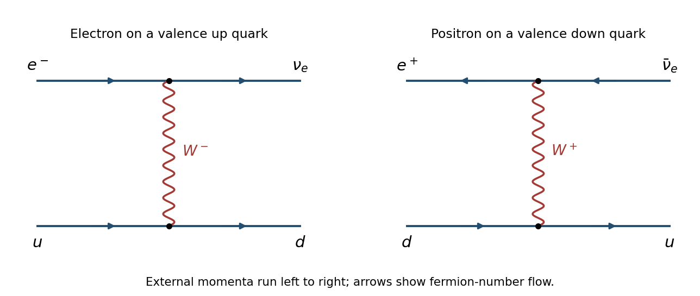

<h1 id="1/2/solution">Solution</h1>

↑ **Parent:** [2](../2.md)

At the [parton](../../../../parton.md) level, the dominant valence reactions are $e^-u\to\nu_e d$ through [W boson](../../../../w-boson.md) exchange and $e^+d\to\bar\nu_e u$ through [W boson](../../../../w-boson.md) exchange. The first also acts on $c$, while the second acts on $s$ with the appropriate [Cabibbo-Kobayashi-Maskawa matrix](../../../../cabibbo-kobayashi-maskawa-matrix.md) factors; crossing supplies the [antiquark](../../../../antiquark.md) reactions. The lines in the figure show [fermion number](../../../../fermion-number.md) flow; the [Positron](../../../../positron.md) and [antineutrino](../../../../antineutrino.md) arrows point opposite to their [momenta](../../../../momentum-split.md).

**[Figure 1](#1/2/image-leading-charged-current-electron-quark-and-positron-quark-diagrams). Leading charged-current electron-quark and positron-quark diagrams**.

For unpolarized beams, the leading [charged current](../../../../charged-current.md) [cross sections](../../../../cross-section-physics.md), suppressing [Cabibbo-Kobayashi-Maskawa matrix](../../../../cabibbo-kobayashi-maskawa-matrix.md) factors, have the form

$$
\begin{aligned}
\frac{d^2\sigma(e^-p)}{dx\,dQ^2}&=\frac{G_F^2}{2\pi}\left(\frac{M_W^2}{M_W^2+Q^2}\right)^2\left[u+c+(1-y)^2(\bar d+\bar s)\right],\\
\frac{d^2\sigma(e^+p)}{dx\,dQ^2}&=\frac{G_F^2}{2\pi}\left(\frac{M_W^2}{M_W^2+Q^2}\right)^2\left[\bar u+\bar c+(1-y)^2(d+s)\right].
\end{aligned}
$$

Here each [parton distribution function](../../../../parton-distribution-function.md) is evaluated at $(x,Q^2)$. The [proton](../../../../proton.md) has two valence [up quarks](../../../../up-quark.md) and one valence [down quark](../../../../down-quark.md); moreover, its valence contribution in the [Positron](../../../../positron.md) reaction carries the chiral angular factor $(1-y)^2$. Both effects favour $e^-p$. Increasing $Q^2$ at fixed collider [energy](../../../../energy-split.md) enforces $x\ge Q^2/s$, progressively suppressing the sea relative to the valence [quarks](../../../../quark.md); large $y$ further suppresses the [Positron](../../../../positron.md) valence term. There is no universal factor of two valid at every $(x,y)$.

The escaping [neutrino](../../../../neutrino.md) prevents direct reconstruction from a scattered charged [lepton](../../../../lepton.md). Instead use the [Jacquet-Blondel reconstruction](../../../../jacquet-blondel-reconstruction.md). With the $+z$ axis along the [proton](../../../../proton.md) beam, measure the complete hadronic final state and form

$$
\delta_h=\sum_h(E_h-p_{zh}),\quad y_h=\frac{\delta_h}{2E_e},\quad Q_h^2=\frac{|\sum_h\mathbf p_{Th}|^2}{1-y_h},\quad \boxed{x_h=\frac{Q_h^2}{sy_h}}.
$$

These relations follow from [four-momentum conservation](../../../../four-momentum-conservation.md), with the unobserved [neutrino](../../../../neutrino.md) transverse [momentum](../../../../momentum-split.md) opposite to the measured hadronic sum. A nearly hermetic [hadronic calorimeter](../../../../hadronic-calorimeter.md), supplemented by [tracking detectors](../../../../tracking-detector.md), must measure [jets](../../../../jet-particle-physics.md), their [energies](../../../../energy-split.md) and their directions. Forward losses, initial-state [radiation](../../../../radiation.md) and small $y_h$ cause significant reconstruction uncertainties.

## ↑ Ancestors (12)

1. [2](../2.md)
2. [1](../../1.md)
3. [2016](../../../2016-split.md)
4. [Past exam of the particle physics course of the University of Oxford](../../../split.md)
5. [Particle physics course of the University of Oxford](../../../../particle-physics-course-of-the-university-of-oxford.md)
6. [Year 4 of the physics course of the University of Oxford](../../../../year-4-of-the-physics-course-of-the-university-of-oxford.md)
7. [Physics course of the University of Oxford](../../../../physics-course-of-the-university-of-oxford.md)
8. [Undergraduate course of the University of Oxford](../../../../undergraduate-course-of-the-university-of-oxford.md)
9. [Course of the University of Oxford](../../../../course-of-the-university-of-oxford.md)
10. [University of Oxford](../../../../university-of-oxford-split.md)
11. [List of universities](../../../../list-of-universities.md)
12. [Codex Wiki](../../../../split.md)
