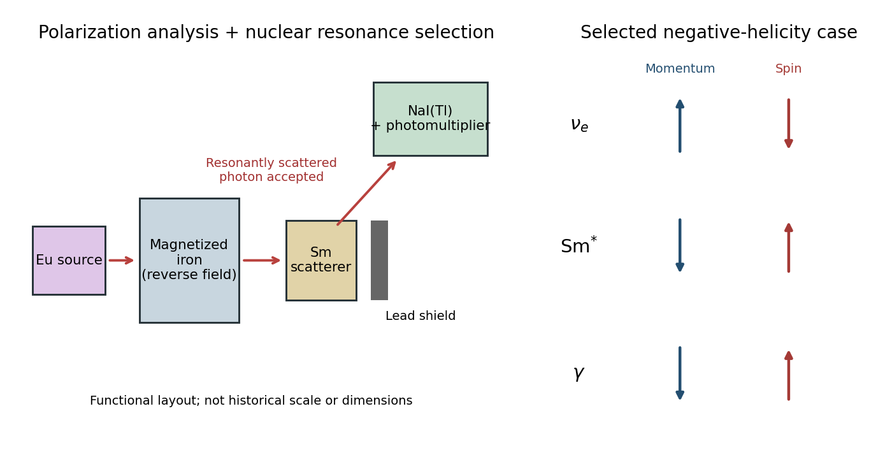

<h1 id="2/4/solution">Solution</h1>

↑ **Parent:** [4](../4.md)

The functional arrangement below separates the polarization analysis from the resonance selection. The shield prevents the direct source beam from overwhelming the detector; the off-axis detector accepts [gamma rays](../../../../gamma-ray.md) re-emitted by the [samarium](../../../../samarium.md) scatterer.

**[Figure 2](#2/4/image-functional-goldhaber-helicity-measurement-and-the-selected-spin-geometry). Functional Goldhaber helicity measurement and the selected spin geometry**.

The [europium](../../../../europium.md) source emits into magnetized iron, whose magnetization is alternated. A [samarium](../../../../samarium.md) scatterer selects nuclear [nuclear resonance fluorescence](../../../../nuclear-resonance-fluorescence.md), favouring [photons](../../../../photon.md) emitted along the daughter recoil. A shielded NaI(Tl) [scintillation counter](../../../../scintillation-counter.md) records the scattered nuclear line. Compare the background-subtracted line rates for the two iron magnetizations, and use the calibrated sign of the analysing power to identify the [photon helicity](../../../../photon-helicity.md).

The measured circular polarization was negative, compatible after angular acceptance corrections with negative [neutrino helicity](../../../../neutrino-helicity.md). By the [angular momentum conservation](../../../../conservation-of-angular-momentum.md) argument, the selected [photon helicity](../../../../photon-helicity.md) and [neutrino helicity](../../../../neutrino-helicity.md) have the same sign. Thus the experiment concludes

$$
\boxed{\mathbf S_\nu\cdot\widehat{\mathbf p}_\nu=-\frac12}
$$

for the emitted relativistic [electron neutrino](../../../../electron-neutrino.md). Finite acceptance dilutes the measured polarization; it does not justify equating the raw count asymmetry to $-1$.[Pages 1016–1017, apparatus, reversal calibration and negative circular polarization](../../../../helicity-of-neutrinos-by-maurice-goldhaber-and-others.md)

## ↑ Ancestors (12)

1. [4](../4.md)
2. [2](../../2.md)
3. [2016](../../../2016-split.md)
4. [Past exam of the particle physics course of the University of Oxford](../../../split.md)
5. [Particle physics course of the University of Oxford](../../../../particle-physics-course-of-the-university-of-oxford.md)
6. [Year 4 of the physics course of the University of Oxford](../../../../year-4-of-the-physics-course-of-the-university-of-oxford.md)
7. [Physics course of the University of Oxford](../../../../physics-course-of-the-university-of-oxford.md)
8. [Undergraduate course of the University of Oxford](../../../../undergraduate-course-of-the-university-of-oxford.md)
9. [Course of the University of Oxford](../../../../course-of-the-university-of-oxford.md)
10. [University of Oxford](../../../../university-of-oxford-split.md)
11. [List of universities](../../../../list-of-universities.md)
12. [Codex Wiki](../../../../split.md)
