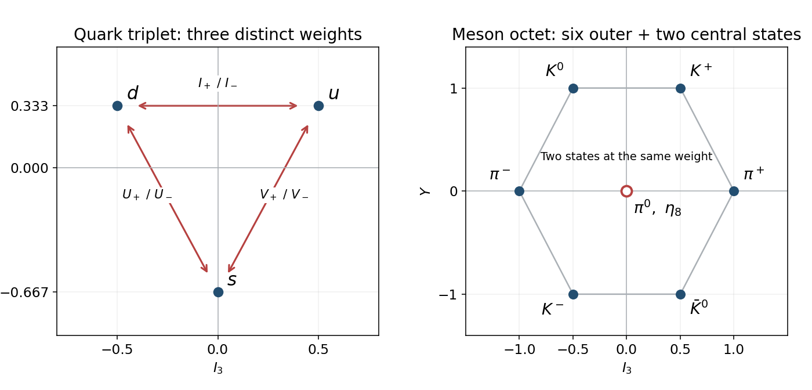

<h1 id="3/3/solution">Solution</h1>

↑ **Parent:** [3](../3.md)

Writing $E_{ij}=|i\rangle\langle j|$, the [ladder operators](../../../../ladder-operator.md) are

$$
I_\pm=\frac{\lambda_1\pm i\lambda_2}{2}=E_{ud},E_{du},\quad V_\pm=\frac{\lambda_4\pm i\lambda_5}{2}=E_{us},E_{su},\quad U_\pm=\frac{\lambda_6\pm i\lambda_7}{2}=E_{ds},E_{sd}.
$$

The ordered pair on each right-hand side gives the plus and minus operators respectively. Thus $I_+d=u$, $V_+s=u$ and $U_+s=d$, with reverse actions for the minus operators; their other actions on the fundamental triplet vanish.

The remaining [Flavor SU(3) Cartan generators](../../../../flavor-su-3-cartan-generators.md) can be chosen as $I_3=\lambda_3/2$ and $Y=\lambda_8/\sqrt3$. Their eigenvalues label [isospin](../../../../isospin.md) and [flavor hypercharge](../../../../flavor-hypercharge.md):

$$
\begin{array}{c|ccc}
&u&d&s\\\hline I_3&1/2&-1/2&0\\Y&1/3&1/3&-2/3
\end{array}
$$

These diagonal operators multiply a [flavor eigenstate](../../../../flavor-eigenstate.md) by an eigenvalue; exponentiating them changes relative phases rather than converting one [quark flavour](../../../../quark-flavor.md) into another. The [weight diagram](../../../../weight-diagram.md) makes the distinction visible: the [ladder operators](../../../../ladder-operator.md) connect different points, while the diagonal eigenvalues supply the axes.

**[Figure 3](#3/3/image-fundamental-flavour-weights-and-the-meson-octet-in-the-isospin-hypercharge-plane). Fundamental flavour weights and the meson octet in the isospin-hypercharge plane**.

## ↑ Ancestors (12)

1. [3](../3.md)
2. [3](../../3.md)
3. [2016](../../../2016-split.md)
4. [Past exam of the particle physics course of the University of Oxford](../../../split.md)
5. [Particle physics course of the University of Oxford](../../../../particle-physics-course-of-the-university-of-oxford.md)
6. [Year 4 of the physics course of the University of Oxford](../../../../year-4-of-the-physics-course-of-the-university-of-oxford.md)
7. [Physics course of the University of Oxford](../../../../physics-course-of-the-university-of-oxford.md)
8. [Undergraduate course of the University of Oxford](../../../../undergraduate-course-of-the-university-of-oxford.md)
9. [Course of the University of Oxford](../../../../course-of-the-university-of-oxford.md)
10. [University of Oxford](../../../../university-of-oxford-split.md)
11. [List of universities](../../../../list-of-universities.md)
12. [Codex Wiki](../../../../split.md)
