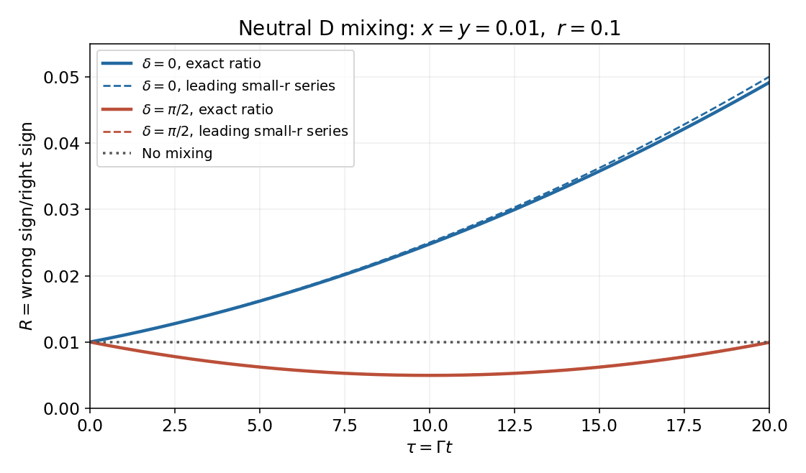

<h1 id="4/3/solution">Solution</h1>

↑ **Parent:** [3](../3.md)

The right-sign denominator has its own small mixing contribution. In the same [CP symmetry](../../../../cp-symmetry.md) convention its [decay amplitude](../../../../decay-amplitude.md) is $\mathcal A_{\mathrm{RS}}=g_++r e^{-i\delta}g_-$. After cancelling $e^{-\tau}$, the exact numerator and denominator are

$$
\begin{aligned}
N&=\tfrac12r^2(\cosh y\tau+\cos x\tau)+r(\cos\delta\sinh y\tau-\sin\delta\sin x\tau)+\tfrac12(\cosh y\tau-\cos x\tau),\\
D&=\tfrac12(\cosh y\tau+\cos x\tau)+r(\cos\delta\sinh y\tau+\sin\delta\sin x\tau)+\tfrac12r^2(\cosh y\tau-\cos x\tau),\qquad R=N/D.
\end{aligned}
$$

Define $u=y\cos\delta$ and $v=x\sin\delta$. Their [Taylor expansions](../../../../taylor-expansion.md) are $N=r^2+r(u-v)\tau+\{x^2+y^2+r^2(y^2-x^2)\}\tau^2/4+O(\tau^3)$ and $D=1+r(u+v)\tau+\{y^2-x^2+r^2(x^2+y^2)\}\tau^2/4+O(\tau^3)$. Dividing the series gives the strict second-order answer

$$
\boxed{\begin{aligned}
R&=r^2+C_1\tau+C_2\tau^2+O(\tau^3),\\
C_1&=r[(1-r^2)u-(1+r^2)v],\\
C_2&=\frac{(1-r^4)(x^2+y^2)}4-r^2(u^2-v^2)+r^4(u+v)^2.
\end{aligned}}
$$

The usually quoted approximation additionally drops terms suppressed by powers of $r$ in the right-sign denominator:

$$
R\simeq r^2+r(y\cos\delta-x\sin\delta)\tau+\frac{x^2+y^2}{4}\tau^2.
$$

For $r=0.1$ and $x=y=0.01$, this is $0.01+0.001\tau+0.00005\tau^2$ for $\delta=0$, and $0.01-0.001\tau+0.00005\tau^2$ for $\delta=\pi/2$. The first increases; the second initially decreases, reaches approximately $0.005$ at $\tau=10$, then rises. The strict series instead has $(C_1,C_2)=(0.00099,0.000049005)$ and $(-0.00101,0.000051005)$. At $\tau=20$ the exact ratios are approximately $0.04913$ and $0.009934$; the leading approximations give $0.05$ and $0.01$.

**[Figure 4](#4/3/image-wrong-sign-to-right-sign-d-decay-ratio-with-two-strong-phases). Wrong-sign to right-sign D decay ratio with two strong phases**.

With no [neutral meson mixing](../../../../neutral-meson-mixing.md), $x=y=0$ and $g_-=0$, so $\boxed{R=r^2=0.01}$ at all decay times. The wrong-sign signal then remains through direct doubly [Cabibbo suppressed](../../../../cabibbo-suppression.md) decay.

## ↑ Ancestors (12)

1. [3](../3.md)
2. [4](../../4.md)
3. [2016](../../../2016-split.md)
4. [Past exam of the particle physics course of the University of Oxford](../../../split.md)
5. [Particle physics course of the University of Oxford](../../../../particle-physics-course-of-the-university-of-oxford.md)
6. [Year 4 of the physics course of the University of Oxford](../../../../year-4-of-the-physics-course-of-the-university-of-oxford.md)
7. [Physics course of the University of Oxford](../../../../physics-course-of-the-university-of-oxford.md)
8. [Undergraduate course of the University of Oxford](../../../../undergraduate-course-of-the-university-of-oxford.md)
9. [Course of the University of Oxford](../../../../course-of-the-university-of-oxford.md)
10. [University of Oxford](../../../../university-of-oxford-split.md)
11. [List of universities](../../../../list-of-universities.md)
12. [Codex Wiki](../../../../split.md)
