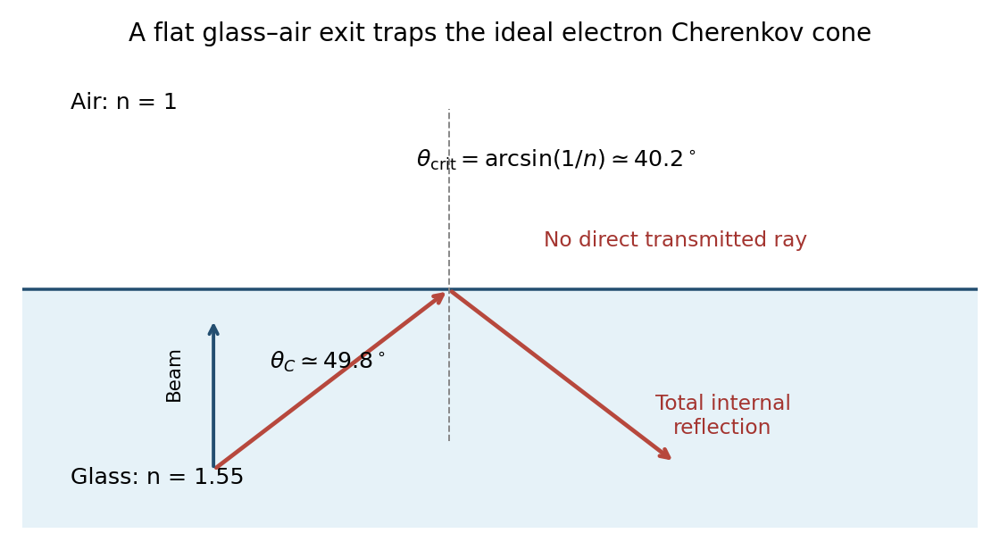

<h1 id="7/2/solution">Solution</h1>

↑ **Parent:** [2](../2.md)

At $p=600\ \mathrm{MeV}/c$, the [velocities](../../../../velocity.md) are $\beta=p/\sqrt{p^2+m^2c^2}$, giving approximately $1.0000$, $0.98485$ and $0.53874$ for [electrons](../../../../electron.md), [muons](../../../../muon.md) and [protons](../../../../proton.md). The glass threshold is $\beta>1/1.55=0.64516$. Thus the first two produce [Cherenkov radiation](../../../../cherenkov-radiation.md), with internal angles

$$
\theta_e\simeq49.82^\circ,\qquad\theta_\mu\simeq49.07^\circ,
$$

whereas a primary [proton](../../../../proton.md) at this [momentum](../../../../momentum-split.md) is below threshold.

If an optical arrangement transports those cone angles without changing them, a plane $L=2\ \mathrm m$ downstream would intersect rings of radius

$$
R=L\tan\theta_C=L\sqrt{n^2\beta^2-1},\qquad\boxed{R_e\simeq2.369\ \mathrm m,\quad R_\mu\simeq2.307\ \mathrm m}.
$$

These are **conditional geometric estimates**, not the ray trace for a flat slab in air. The $0.1\ \mathrm m$ emission depth alone spreads the radius by order $0.12\ \mathrm m$, already larger than the approximately $0.062\ \mathrm m$ separation. The slab is one [radiation length](../../../../radiation-length.md): [electrons](../../../../electron.md) lose appreciable [energy](../../../../energy-split.md) by [bremsstrahlung](../../../../bremsstrahlung.md) and begin an [electromagnetic shower](../../../../electromagnetic-shower.md), producing a broader and less clean pattern. [Muons](../../../../muon.md) mainly ionize and retain a comparatively clean cone, with some [Multiple Coulomb scattering](../../../../multiple-coulomb-scattering.md). A below-threshold primary [proton](../../../../proton.md) gives no direct cone, although energetic [delta electrons](../../../../delta-electron.md) and other secondary interactions can produce light.

There is an essential optical qualification. For a normal beam through a parallel-faced glass slab followed by air, the internal critical angle is $\theta_{\rm crit}=\arcsin(1/1.55)\simeq40.18^\circ$. Both emission angles exceed it. [Snell's law](../../../../snell-s-law.md) would require $\sin\theta_{\rm air}=1.55\sin\theta_C>1$, so the ideal photons undergo [total internal reflection](../../../../total-internal-reflection.md) at the downstream face and do not form those direct downstream rings. Optical coupling, a prism or different surface geometry must be specified to extract them. The stated material parameters alone do not define a unique detected pattern; this flat-slab geometry is a concrete counterexample to silently assuming straight transmitted rays.

**[Figure 5](#7/2/image-total-internal-reflection-prevents-direct-downstream-rings-from-a-flat-glass-air-slab). Total internal reflection prevents direct downstream rings from a flat glass-air slab**.

## ↑ Ancestors (12)

1. [2](../2.md)
2. [7](../../7.md)
3. [2016](../../../2016-split.md)
4. [Past exam of the particle physics course of the University of Oxford](../../../split.md)
5. [Particle physics course of the University of Oxford](../../../../particle-physics-course-of-the-university-of-oxford.md)
6. [Year 4 of the physics course of the University of Oxford](../../../../year-4-of-the-physics-course-of-the-university-of-oxford.md)
7. [Physics course of the University of Oxford](../../../../physics-course-of-the-university-of-oxford.md)
8. [Undergraduate course of the University of Oxford](../../../../undergraduate-course-of-the-university-of-oxford.md)
9. [Course of the University of Oxford](../../../../course-of-the-university-of-oxford.md)
10. [University of Oxford](../../../../university-of-oxford-split.md)
11. [List of universities](../../../../list-of-universities.md)
12. [Codex Wiki](../../../../split.md)
