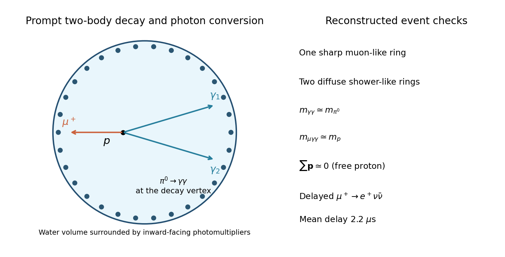

<h1 id="7/4/solution">Solution</h1>

↑ **Parent:** [4](../4.md)

A large, optically clean water [Cherenkov detector](../../../../cherenkov-detector.md) provides many [protons](../../../../proton.md), a transparent radiator and a relatively inexpensive homogeneous target. A surrounding array of inward-facing [photomultipliers](../../../../photomultiplier.md) records hit times and charge. Reconstructing the vertex and cone intersections identifies track directions and visible [energies](../../../../energy-split.md); an outer active veto rejects entering particles. Water has refractive index near $1.33$, and the charged decay products are above its relevant thresholds.

For a free stationary [proton](../../../../proton.md), [relativistic two-body decay](../../../../relativistic-two-body-decay.md) gives

$$
p^*=\frac{\sqrt{[m_p^2-(m_\mu+m_{\pi^0})^2][m_p^2-(m_\mu-m_{\pi^0})^2]}}{2m_p}\simeq453\ \mathrm{MeV}/c.
$$

The [muon](../../../../muon.md) and neutral [pion](../../../../pion.md) are back-to-back. The [pion](../../../../pion.md) decays essentially at the vertex into two [gamma rays](../../../../gamma-ray.md): $c\tau_{\pi^0}\simeq2.4\times10^{-8}\ \mathrm m$ before its modest Lorentz factor is included. Each [gamma ray](../../../../gamma-ray.md) converts and initiates an [electromagnetic shower](../../../../electromagnetic-shower.md), producing a diffuse ring. The [muon](../../../../muon.md) gives a relatively sharp ring and, if it stops, a delayed Michel [Positron](../../../../positron.md) on the $2.2\ \mathrm{microsecond}$ scale. The ideal topology therefore has one muon-like and two electron-like rings, although overlaps or a weak photon may merge or hide a ring.

**[Figure 6](#7/4/image-water-cherenkov-proton-decay-topology-with-prompt-rings-and-a-delayed-muon-decay-tag). Water Cherenkov proton-decay topology with prompt rings and a delayed muon-decay tag**.

Require the two-[photon](../../../../photon.md) invariant [mass](../../../../mass.md) to match $m_{\pi^0}$, the total reconstructed [mass](../../../../mass.md) to match $m_p$, and small total [momentum](../../../../momentum-split.md). Bound [oxygen](../../../../oxygen.md) [protons](../../../../proton.md) have Fermi motion and their hadronic products can rescatter, so those cuts need realistic nuclear corrections; the water target also contains free [hydrogen](../../../../hydrogen.md) [protons](../../../../proton.md). Install the detector deep underground to suppress cosmic-ray [muons](../../../../muon.md), with shielding and an active veto. Important irreducible backgrounds are atmospheric-[neutrino](../../../../neutrino.md) interactions producing a [muon](../../../../muon.md) and neutral [pion](../../../../pion.md), potentially with an undetected recoil nucleon.

## ↑ Ancestors (12)

1. [4](../4.md)
2. [7](../../7.md)
3. [2016](../../../2016-split.md)
4. [Past exam of the particle physics course of the University of Oxford](../../../split.md)
5. [Particle physics course of the University of Oxford](../../../../particle-physics-course-of-the-university-of-oxford.md)
6. [Year 4 of the physics course of the University of Oxford](../../../../year-4-of-the-physics-course-of-the-university-of-oxford.md)
7. [Physics course of the University of Oxford](../../../../physics-course-of-the-university-of-oxford.md)
8. [Undergraduate course of the University of Oxford](../../../../undergraduate-course-of-the-university-of-oxford.md)
9. [Course of the University of Oxford](../../../../course-of-the-university-of-oxford.md)
10. [University of Oxford](../../../../university-of-oxford-split.md)
11. [List of universities](../../../../list-of-universities.md)
12. [Codex Wiki](../../../../split.md)
