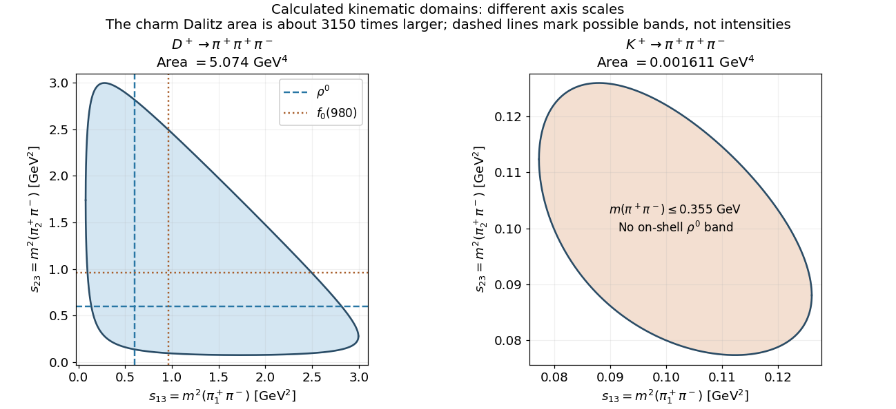
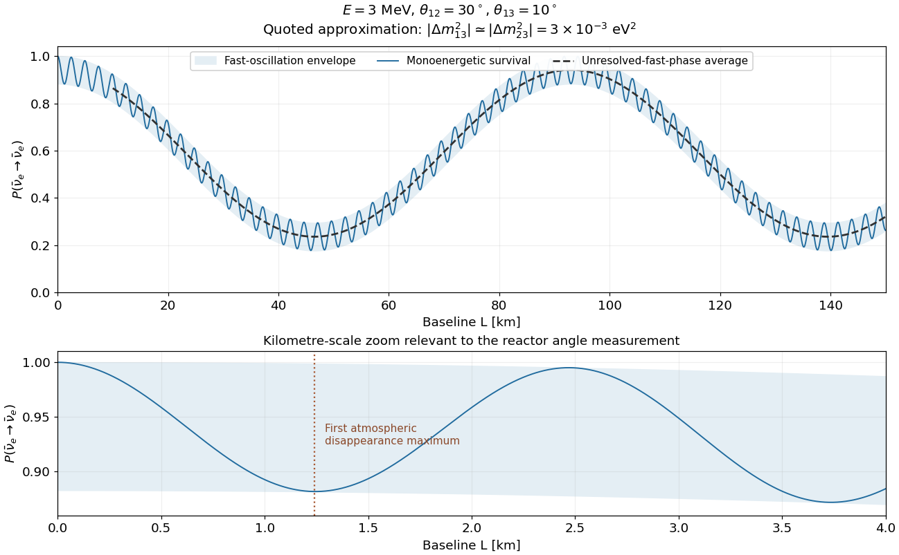
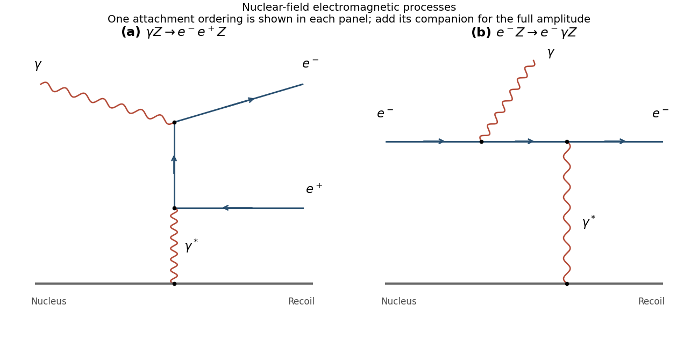
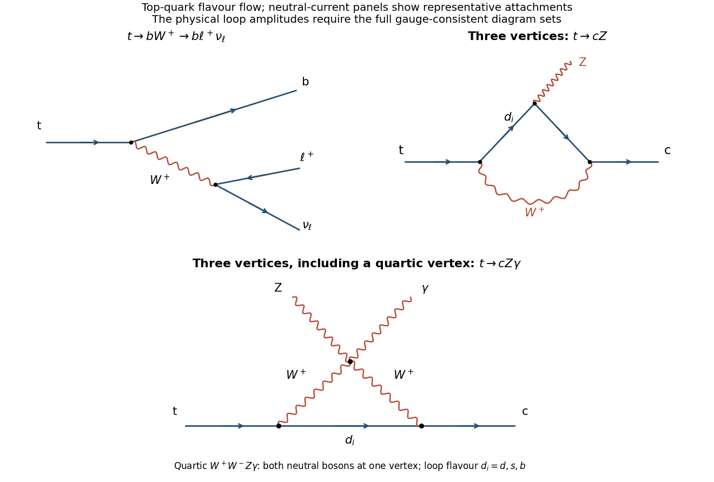

# 2017

↑ **Parent:** [Past exam of the particle physics course of the University of Oxford](../past-exam-of-the-particle-physics-course-of-the-university-of-oxford.md)

Source paper: [https://www.whatdotheyknow.com/request/oxford_physics_past_papers_2/response/2340696/attach/5/Physics%20Papers%202016.pdf?cookie_passthrough=1.](https://www.whatdotheyknow.com/request/oxford_physics_past_papers_2/response/2340696/attach/5/Physics%20Papers%202016.pdf?cookie_passthrough=1.) The held cover dates this paper to 15 June 2017; the annual bundle's filename does not determine the year. We use $\hbar=c=1$ unless displaying unit conversions. Unlettered requests are indexed consecutively; the two separately marked requests within 5a have subscopes 1 and 2. All six questions are covered.

**Table of contents**

- [1](#1)
  - [a](#1/a)
    - [Solution](#1/a/solution)
  - [b](#1/b)
    - [Solution](#1/b/solution)
  - [c](#1/c)
    - [Solution](#1/c/solution)
  - [d](#1/d)
    - [Solution](#1/d/solution)
  - [e](#1/e)
    - [Solution](#1/e/solution)
- [2](#2)
  - [a](#2/a)
    - [Solution](#2/a/solution)
  - [b](#2/b)
    - [Solution](#2/b/solution)
  - [c](#2/c)
    - [Solution](#2/c/solution)
  - [d](#2/d)
    - [Solution](#2/d/solution)
  - [e](#2/e)
    - [Solution](#2/e/solution)
- [3](#3)
  - [a](#3/a)
    - [Solution](#3/a/solution)
  - [b](#3/b)
    - [Solution](#3/b/solution)
  - [c](#3/c)
    - [Solution](#3/c/solution)
  - [d](#3/d)
    - [Solution](#3/d/solution)
  - [e](#3/e)
    - [Solution](#3/e/solution)
- [4](#4)
  - [a](#4/a)
    - [Solution](#4/a/solution)
  - [b](#4/b)
    - [Solution](#4/b/solution)
  - [c](#4/c)
    - [Solution](#4/c/solution)
  - [d](#4/d)
    - [Solution](#4/d/solution)
  - [e](#4/e)
    - [Solution](#4/e/solution)
  - [f](#4/f)
    - [Solution](#4/f/solution)
- [5](#5)
  - [a](#5/a)
    - [1](#5/a/1)
      - [Solution](#5/a/1/solution)
    - [2](#5/a/2)
      - [Solution](#5/a/2/solution)
  - [b](#5/b)
    - [Solution](#5/b/solution)
  - [c](#5/c)
    - [Solution](#5/c/solution)
- [6](#6)
  - [a](#6/a)
    - [Solution](#6/a/solution)
  - [b](#6/b)
    - [Solution](#6/b/solution)
  - [c](#6/c)
    - [Solution](#6/c/solution)
  - [d](#6/d)
    - [Solution](#6/d/solution)
  - [e](#6/e)
    - [Solution](#6/e/solution)

## 1

↑ **Parent:** [2017](2017.md)

<h3 id="1/a">a</h3>

↑ **Parent:** [1](#1)

<h4 id="1/a/solution">Solution</h4>

↑ **Parent:** [A](#1/a)

For nonzero [momentum](../momentum.md), physical [helicity](../special-relativity.md#helicity) is the [spin projection](../angular-momentum-operator.md#spin) along the direction of motion,

$$
\boxed{\hat h=\frac{\mathbf S\cdot\mathbf p}{|\mathbf p|}=\frac12\begin{pmatrix}\boldsymbol\sigma\cdot\hat{\mathbf p}&0\\0&\boldsymbol\sigma\cdot\hat{\mathbf p}\end{pmatrix},\qquad h=\pm\frac12.}
$$

The convention without $1/2$ labels the same two [eigenspaces](../linear-operator-theory.md#eigenspace) by $\pm1$. Write $\hat{\mathbf p}=(\sin\theta\cos\varphi,\sin\theta\sin\varphi,\cos\theta)$. [Normalized](../mathematics.md#normalization) [two-component eigenvectors](../algebra-over-a-field.md#spinor) are

$$
\chi_+=\begin{pmatrix}\cos(\theta/2)\\e^{i\varphi}\sin(\theta/2)\end{pmatrix},\qquad
\chi_-=\begin{pmatrix}-e^{-i\varphi}\sin(\theta/2)\\\cos(\theta/2)\end{pmatrix},\qquad
(\boldsymbol\sigma\cdot\hat{\mathbf p})\chi_\pm=\pm\chi_\pm.
$$

Each can carry an arbitrary [phase](../wave.md#phase-waves). Before imposing an [energy](../energy.md) equation, the general [four-component](../relativistic-quantum-field.md#dirac-spinor) [helicity](../special-relativity.md#helicity) [eigenvector](../linear-operator-theory.md#eigenvector) is $(a\chi_\pm,b\chi_\pm)^{\mathsf T}$, with arbitrary complex $a,b$; unit [Norm](../normed-vector-space.md#norm) imposes $|a|^2+|b|^2=1$. For a [positive-energy](../energy-eigenvalue.md) free [electron](../physics.md#electron), the [Dirac equation](../relativistic-quantum-field.md#dirac-equation) fixes their ratio and gives

$$
\boxed{u_\pm(\mathbf p)=\sqrt{\frac{E+m}{2E}}\begin{pmatrix}\chi_\pm\\\displaystyle\pm\frac{|\mathbf p|}{E+m}\chi_\pm\end{pmatrix},\qquad u_\pm^\dagger u_\pm=1.}
$$

Multiplying by an arbitrary overall [amplitude](../wave-function.md#probability-amplitude) and the common [plane wave](../wave-function.md#plane-wave) supplies the corresponding free [helicity](../special-relativity.md#helicity) eigenstate. [Helicity](../special-relativity.md#helicity) has no preferred direction at $\mathbf p=0$. For a massive particle a [boost](../special-relativity.md#lorentz-boost) can overtake its [momentum](../momentum.md) and change its [helicity](../special-relativity.md#helicity); it should not be identified with [Lorentz-invariant](../special-relativity.md#lorentz-invariance) [chirality](../relativistic-quantum-field.md#chirality-physics).

<h3 id="1/b">b</h3>

↑ **Parent:** [1](#1)

<h4 id="1/b/solution">Solution</h4>

↑ **Parent:** [B](#1/b)

Let $\chi=(\sqrt5/3,2/3)^{\mathsf T}$, so $\chi^\dagger\chi=1$. The [Pauli identity](../algebra.md#pauli-matrices) $(\boldsymbol\sigma\cdot\mathbf p)^2=|\mathbf p|^2I$ gives

$$
\psi^\dagger\psi=|N|^2\left(1+\frac{|\mathbf p|^2}{(E+m)^2}\right)=|N|^2\frac{2E}{E+m},
$$

using $E^2=|\mathbf p|^2+m^2$. Thus unit [spinor](../algebra-over-a-field.md#spinor) [probability density](../wave-function.md#probability-density) is obtained with

$$
\boxed{N=\sqrt{\frac{E+m}{2E}}.}
$$

An arbitrary constant [phase](../wave.md#phase-waves) is immaterial. For the alternative [Lorentz normalization](../quantum-field-theory.md#relativistic-normalization-of-a-one-particle-state) $u^\dagger u=2E$, choose $N=\sqrt{E+m}$. Neither convention makes an infinite [plane wave](../wave-function.md#plane-wave) [square-integrable](../measure-theory.md#square-integrable-function); a box-normalized state includes an additional $V^{-1/2}$, or one forms a normalizable [wave packet](../dispersion-relation.md#wave-packet).

<h3 id="1/c">c</h3>

↑ **Parent:** [1](#1)

<h4 id="1/c/solution">Solution</h4>

↑ **Parent:** [C](#1/c)

In the supplied [Dirac representation](../algebra-over-a-field.md#dirac-representation-of-the-gamma-matrices), $\gamma^5$ exchanges the upper and lower blocks. Therefore

$$
P_L=\frac{1-\gamma^5}{2}=\frac12\begin{pmatrix}I&-I\\-I&I\end{pmatrix}.
$$

Define $\eta=[I-\boldsymbol\sigma\cdot\mathbf p/(E+m)]\chi$. Acting with this [projector](../vector-space.md#projection-linear-algebra) gives

$$
\boxed{\psi_L=P_L\psi=\frac N2\begin{pmatrix}\eta\\-\eta\end{pmatrix}e^{i(\mathbf p\cdot\mathbf r-Et)}.}
$$

For completeness, its two independent components are

$$
\eta_1=\frac{\sqrt5}{3}\left(1-\frac{p_z}{E+m}\right)-\frac{2(p_x-ip_y)}{3(E+m)},\qquad
\eta_2=-\frac{\sqrt5(p_x+ip_y)}{3(E+m)}+\frac23\left(1+\frac{p_z}{E+m}\right).
$$

The equal-and-opposite block structure verifies $\gamma^5\psi_L=-\psi_L$. Projection isolates a [chiral component](../relativistic-quantum-field.md#chirality-physics) of the massive [Dirac](../relativistic-quantum-field.md#dirac-field) solution; that component alone generally does not satisfy an independent massive [Dirac equation](../relativistic-quantum-field.md#dirac-equation), since the [mass](../classical-mechanics.md#mass) couples both [chiralities](../relativistic-quantum-field.md#chirality-physics).

<h3 id="1/d">d</h3>

↑ **Parent:** [1](#1)

<h4 id="1/d/solution">Solution</h4>

↑ **Parent:** [D](#1/d)

Expand the original [two-spinor](../algebra-over-a-field.md#spinor) as $\chi=c_+\chi_++c_-\chi_-$. [Orthogonality](../inner-product.md#orthogonal-vectors) gives

$$
c_+=\frac{\sqrt5}{3}\cos\frac\theta2+\frac23e^{-i\varphi}\sin\frac\theta2,\qquad
c_-=-\frac{\sqrt5}{3}e^{i\varphi}\sin\frac\theta2+\frac23\cos\frac\theta2.
$$

Let $r=|\mathbf p|/(E+m)$ and $w_\pm=(\chi_\pm,-\chi_\pm)^{\mathsf T}/\sqrt2$. These $w_\pm$ are [normalized](../mathematics.md#normalization), [left-chiral](../relativistic-quantum-field.md#chirality-physics) [helicity](../special-relativity.md#helicity) [eigenvectors](../linear-operator-theory.md#eigenvector). Then

$$
\boxed{\psi_L=\sum_{\zeta=\pm1}\frac N{\sqrt2}c_\zeta(1-\zeta r)w_\zeta\,e^{i(\mathbf p\cdot\mathbf r-Et)}.}
$$

The two contributions have squared norms

$$
\boxed{\|\psi_{L,+}\|^2=|c_+|^2\frac{1-\beta}{2},\qquad
\|\psi_{L,-}\|^2=|c_-|^2\frac{1+\beta}{2},\qquad \beta=|\mathbf p|/E.}
$$

These are weights relative to the original [normalized](../mathematics.md#normalization) state; divide by their sum if conditioning on a [normalized](../mathematics.md#normalization) [left-chiral](../relativistic-quantum-field.md#chirality-physics) projection. In the ultrarelativistic limit $N\to1/\sqrt2$, $r\to1$, the [positive-helicity](../special-relativity.md#helicity) [amplitude](../wave-function.md#probability-amplitude) is suppressed as $m/(2E)$, while the [negative-helicity](../special-relativity.md#helicity) [amplitude](../wave-function.md#probability-amplitude) tends to $c_-$. Hence

$$
\boxed{\psi_L\longrightarrow c_-w_-e^{i(\mathbf p\cdot\mathbf r-Et)}.}
$$

For [momentum](../momentum.md) specifically along $+z$, $c_+=\sqrt5/3$ and $c_-=2/3$: the original [helicity](../special-relativity.md#helicity) [probabilities](../probability-theory.md#probability) are $5/9,4/9$, the [left-chiral](../relativistic-quantum-field.md#chirality-physics) [Norm](../normed-vector-space.md#norm) is $1/2-\beta/18$, and its limiting weight is $4/9$. The source does not specify that [momentum](../momentum.md) direction, so these numerical [probabilities](../probability-theory.md#probability) are a specialization, not the general answer.

<h3 id="1/e">e</h3>

↑ **Parent:** [1](#1)

<h4 id="1/e/solution">Solution</h4>

↑ **Parent:** [E](#1/e)

The [charged weak current](../standard-model.md#charged-current) contains $\bar\psi\gamma^\mu P_L\psi$. For an ultrarelativistic external [fermion](../tensor-product-of-quantum-systems.md#fermion), it selects [negative helicity](../special-relativity.md#helicity); its [antifermion](../relativistic-quantum-field.md#antifermion) partner has [positive helicity](../special-relativity.md#helicity). Wrong-helicity [charged-current](../standard-model.md#charged-current) [amplitudes](../wave-function.md#probability-amplitude) vanish in the massless limit and are suppressed by powers of $m/E$ at finite [mass](../classical-mechanics.md#mass). The active [neutrino](../standard-model.md#neutrino) is consequently [left-helicity](../special-relativity.md#helicity) and its [antineutrino](../standard-model.md#antineutrino) [right-helicity](../special-relativity.md#helicity) in this limit.

This is a [charged-current](../standard-model.md#charged-current) statement, not a prohibition on every [right-helicity](../special-relativity.md#helicity) Standard Model [fermion](../tensor-product-of-quantum-systems.md#fermion). Electromagnetic and strong vector interactions act on both [chiralities](../relativistic-quantum-field.md#chirality-physics) and conserve [helicity](../special-relativity.md#helicity) along a massless [fermion](../tensor-product-of-quantum-systems.md#fermion) line. A [neutral-current](../standard-model.md#neutral-current) $Z$ vertex also couples to both charged-fermion [chiralities](../relativistic-quantum-field.md#chirality-physics) with unequal strengths. For example, a [right-helicity](../special-relativity.md#helicity) [electron](../physics.md#electron) can scatter electromagnetically: it is not excluded from the Standard Model. In [vector-current](../relativistic-quantum-field.md#vector-current) pair [annihilation](../relativistic-quantum-field.md#annihilation) the massless [fermion](../tensor-product-of-quantum-systems.md#fermion) and [antifermion](../relativistic-quantum-field.md#antifermion) have opposite [helicities](../special-relativity.md#helicity); a purely [charged-current](../standard-model.md#charged-current) vertex keeps only the left-fermion/right-antifermion choice. [Yukawa interactions](../standard-model.md#yukawa-interaction) connect left and right fields and must be distinguished from these [vector-current](../relativistic-quantum-field.md#vector-current) selection rules.

## 2

↑ **Parent:** [2017](2017.md)

<h3 id="2/a">a</h3>

↑ **Parent:** [2](#2)

<h4 id="2/a/solution">Solution</h4>

↑ **Parent:** [A](#2/a)

The squared invariant [amplitude](../wave-function.md#probability-amplitude) weights each accessible final configuration. The final [on-shell](../classical-field-theory.md#on-shell) [momentum](../momentum.md) measure counts the available states, and the four-dimensional [delta function](../distribution-theory.md#dirac-delta-function) imposes [energy](../energy.md) and [momentum conservation](../momentum.md#momentum-conservation):

$$
d\Phi_n=(2\pi)^4\delta^{(4)}\left(P-\sum_jp_j\right)\prod_j\frac{d^3p_j}{(2\pi)^3\,2E_j}.
$$

To prove its [Lorentz invariance](../special-relativity.md#lorentz-invariance) for proper orthochronous transformations, write

$$
\boxed{\frac{d^3p}{2E_{\mathbf p}}=d^4p\,\delta(p^2-m^2)\Theta(p^0).}
$$

The four-volume measure has unit [Lorentz Jacobian](../special-relativity.md#lorentz-transformation), $p^2$ is invariant, and the future [mass shell](../special-relativity.md#mass-shell) is preserved. Likewise $\delta^{(4)}(\Lambda Q)=\delta^{(4)}(Q)$ because $|\det\Lambda|=1$. The product therefore proves that $d\Phi_n$ is invariant. [Spin](../angular-momentum-operator.md#spin) averages and sums belong in the [amplitude](../wave-function.md#probability-amplitude) as appropriate; identical final particles require a [symmetry](../physics.md#symmetry-physics) divisor if the integration covers a fully labelled [phase space](../relativistic-quantum-field.md#lorentz-invariant-phase-space).

The initial $1/(2E_i)$ factors come from relativistic [normalization](../mathematics.md#normalization) of the incoming states. They are not individually invariant, so the displayed coordinate-time [transition rate](../survival-analysis.md#transition-intensity) must not be called a [Lorentz scalar](../special-relativity.md#lorentz-scalar) merely because its final [phase space](../relativistic-quantum-field.md#lorentz-invariant-phase-space) is invariant. A one-particle decay has proper width $\Gamma_0=(2M_0)^{-1}\int|\mathcal M|^2d\Phi_n$ in its rest frame, while its laboratory rate is $\Gamma_{\mathrm{lab}}=(M_0/E_0)\Gamma_0$. A scattering [cross section](../physics.md#cross-section-physics) instead uses the invariant incident flux $4\sqrt{(p_1\cdot p_2)^2-m_1^2m_2^2}$. This distinguishes invariance of [phase space](../relativistic-quantum-field.md#lorentz-invariant-phase-space) from transformation of a measured rate.

<h3 id="2/b">b</h3>

↑ **Parent:** [2](#2)

<h4 id="2/b/solution">Solution</h4>

↑ **Parent:** [B](#2/b)

Write $s_{ij}=M_{ij}^2$ and factor the three-body [phase space](../relativistic-quantum-field.md#lorentz-invariant-phase-space) through the pair $q=p_1+p_3$, with $s=q^2$:

$$
d\Phi_3=\frac{ds}{2\pi}\,d\Phi_2(P;q,p_2)\,d\Phi_2(q;p_1,p_3).
$$

A [scalar parent](../physics.md#scalar-particle) permits integration over the [overall orientation](../riemannian-geometry.md#rotation-mathematics). In its rest frame let the pair have [momentum](../momentum.md) magnitude $p$, and in the pair rest frame let particle 3 have magnitude $p^*$. After integrating the azimuth of its direction, the two-body factors give

$$
d\Phi_3=\frac{p\,p^*}{64\pi^3M_0\sqrt{s}}\,ds\,d\cos\theta^*.
$$

In that pair rest frame, particle 2 has [momentum](../momentum.md) magnitude $M_0p/\sqrt{s}$, so $|ds_{23}/d\cos\theta^*|=2M_0pp^*/\sqrt{s}$. The [Jacobian](../multivariable-calculus.md#jacobian-determinant) cancels both [momentum](../momentum.md) factors, leaving

$$
\boxed{d\Phi_3=\frac{ds_{13}\,ds_{23}}{128\pi^3M_0^2},\qquad
\frac{d^2\Gamma}{ds_{13}ds_{23}}=\frac{|\mathcal M(s_{13},s_{23})|^2}{256\pi^3M_0^3}.}
$$

The physical domain is bounded by the requirement that the relative cosine lie between $-1$ and $1$. **The [phase-space](../relativistic-quantum-field.md#lorentz-invariant-phase-space) density is uniform within that domain; the event density is uniform only for a constant [squared amplitude](../wave-function.md#probability-amplitude).** [Scalar parent](../physics.md#scalar-particle) [spin](../angular-momentum-operator.md#spin) alone does not forbid resonance-dependent [amplitudes](../wave-function.md#probability-amplitude). A factor $1/(s_{13}-m_R^2+im_R\Gamma_R)$ is a concrete nonuniform example. For two identical [pions](../standard-model.md#pion), a conventional overall $1/2!$ compensates integration over both labelings without changing the local flatness of [phase space](../relativistic-quantum-field.md#lorentz-invariant-phase-space).[Kinematics, equations (49.22)–(49.23): three-body Dalitz density and its bounds](../physics-bibliography.md#review-of-particle-physics-by-particle-data-group-2022)

<h3 id="2/c">c</h3>

↑ **Parent:** [2](#2)

<h4 id="2/c/solution">Solution</h4>

↑ **Parent:** [C](#2/c)

The three [on-shell](../classical-field-theory.md#on-shell) spatial [momenta](../momentum.md) have nine components. Four [conservation](../mathematical-physics.md#conservation-law) constraints leave five, and an unobserved overall [spatial rotation](../riemannian-geometry.md#rotation-mathematics) removes three for the [scalar](../classical-field-theory.md#scalar-field) decay, leaving two internal kinematic variables. The pair invariants obey

$$
\boxed{s_{12}+s_{13}+s_{23}=M_0^2+m_1^2+m_2^2+m_3^2.}
$$

Thus two determine the third. They also determine each rest-frame daughter [energy](../energy.md),

$$
E_i=\frac{M_0^2+m_i^2-s_{jk}}{2M_0},
$$

and hence all [momentum](../momentum.md) magnitudes and pairwise angles. The [momentum](../momentum.md) triangle is fixed up to [overall orientation](../riemannian-geometry.md#rotation-mathematics). The [Dalitz plot](../relativistic-quantum-field.md#dalitz-plot) describes this internal [kinematics](../classical-mechanics.md#kinematics), rather than claiming to record three independently oriented [Four-vectors](../special-relativity.md#four-vector). Polarized parents or additional measured [spin](../angular-momentum-operator.md#spin) information can require orientation variables beyond the two invariant axes.

<h3 id="2/d">d</h3>

↑ **Parent:** [2](#2)

<h4 id="2/d/solution">Solution</h4>

↑ **Parent:** [D](#2/d)

Use the explicit charged channels $D^+\to\pi^+\pi^+\pi^-$ and $K^+\to\pi^+\pi^+\pi^-$, labeling the two positive [pions](../standard-model.md#pion) as 1,2 and the negative one as 3. With $m_\pi=0.139\,\mathrm{GeV}$, the opposite-charge pair [mass](../classical-mechanics.md#mass) squares have the ranges

$$
\boxed{4m_\pi^2\le s_{13},s_{23}\le(M_0-m_\pi)^2.}
$$

Their exact correlated boundaries follow by taking the pair rest-frame angle to its endpoints. For general daughter [masses](../classical-mechanics.md#mass), define $\Lambda(a,b,c)=a^2+b^2+c^2-2ab-2ac-2bc$. At fixed $s=s_{13}$,

$$
\boxed{s_{23}^{\pm}=m_2^2+m_3^2+
\frac{(M_0^2-m_2^2-s)(s+m_3^2-m_1^2)\pm\sqrt{\Lambda(M_0^2,s,m_2^2)\Lambda(s,m_1^2,m_3^2)}}{2s}.}
$$

The charged-pion thresholds give the following numerical comparison:

| Parent | $Q=M_0-3m_\pi$ | Allowed single-axis interval, $\mathrm{GeV}^2$ | Dalitz area, $\mathrm{GeV}^4$ \\ | $D^+$ | $1.453\,\mathrm{GeV}$ | $0.07728$ to $2.99636$ | approximately $5.074$ \\ | $K^+$ | $0.077\,\mathrm{GeV}$ | $0.07728$ to $0.12603$ | approximately $0.001611$ |
| --- | --- | --- |

The area is about $3150$ times smaller for the [kaon](../physics.md#kaon). Including the $M_0^{-2}$ [phase-space](../relativistic-quantum-field.md#lorentz-invariant-phase-space) prefactor, its integrated labelled three-body [phase space](../relativistic-quantum-field.md#lorentz-invariant-phase-space) is about $220$ times smaller; neither comparison predicts a ratio of [weak decay](../standard-model.md#weak-interaction) widths without the [matrix elements](../vector-space.md#matrix-element).

A $\rho^0\to\pi^+\pi^-$ intermediate state produces horizontal or vertical bands near $s_{13}$ or $s_{23}=m_\rho^2\simeq(0.775\,\mathrm{GeV})^2$ in the [charm](../standard-model.md#charm-quark) decay. [Scalar pion-pair amplitudes](../quantum-scattering.md#partial-wave), including broad low-mass $S$-wave contributions and accessible $f_0(980)$, can also populate the plot. The [kaon](../physics.md#kaon) pair [mass](../classical-mechanics.md#mass) cannot exceed $0.355\,\mathrm{GeV}$, so it cannot contain an [on-shell](../classical-field-theory.md#on-shell) $\rho^0$ or $f_0(980)$ band; smooth nonresonant and rescattering effects remain possible. Channels containing neutral [pions](../standard-model.md#pion) use their supplied $0.135\,\mathrm{GeV}$ [mass](../classical-mechanics.md#mass) and shift these boundaries slightly without changing the conclusion. The figure shows kinematic domains and representative accessible bands, not an assumed measured intensity.

**[Figure 1](#2/d/image-calculated-charged-three-pion-dalitz-domains-and-accessible-resonance-bands). Calculated charged-three-pion Dalitz domains and accessible resonance bands**.

<h3 id="2/e">e</h3>

↑ **Parent:** [2](#2)

<h4 id="2/e/solution">Solution</h4>

↑ **Parent:** [E](#2/e)

The charged two-pion and three-pion channels can be assigned to the same spin-zero [kaon](../physics.md#kaon) by their parent [mass](../classical-mechanics.md#mass) and lifetime. For two spinless [pions](../standard-model.md#pion), total [angular momentum](../momentum.md#angular-momentum) zero forces their relative [orbital angular momentum](../quantum-mechanics.md#orbital-angular-momentum) to zero, so the product of their [intrinsic parities](../quantum-field-theory.md#intrinsic-parity) gives

$$
\boxed{P_{2\pi}=(-1)^2(-1)^0=+1.}
$$

For three spinless [pions](../standard-model.md#pion), use Jacobi orbital angular [momenta](../momentum.md) $l,L$. Coupling them to total zero requires $l=L$, and hence

$$
\boxed{P_{3\pi}=(-1)^3(-1)^{l+L}=-1.}
$$

Thus both channels cannot conserve [parity](../quantum-mechanics.md#parity) in decays of one parent with a definite [parity](../quantum-mechanics.md#parity). The [weak decay](../standard-model.md#weak-interaction) interaction permits the observed coexistence.

[Dalitz plots](../relativistic-quantum-field.md#dalitz-plot) identify the three-body events, determine their internal [kinematics](../classical-mechanics.md#kinematics), and allow [amplitude](../wave-function.md#probability-amplitude) and [angular-momentum analyses](../momentum.md#angular-momentum) through their populations and [resonance](../dynamical-systems.md#resonance) structures. Together with the [spin](../angular-momentum-operator.md#spin) and parent-identity evidence, they support the [parity](../quantum-mechanics.md#parity) assignment. They are not a standalone parity-odd observable: reversing all three [momenta](../momentum.md) leaves every $s_{ij}$, and therefore every point on the plot, unchanged. A flat distribution by itself cannot establish [parity violation](../standard-model.md#parity-violation) without the channel and [spin](../angular-momentum-operator.md#spin) information.

## 3

↑ **Parent:** [2017](2017.md)

<h3 id="3/a">a</h3>

↑ **Parent:** [3](#3)

<h4 id="3/a/solution">Solution</h4>

↑ **Parent:** [A](#3/a)

The [lepton mixing matrix](../standard-model.md#lepton-mixing-matrix) relates [charged-current](../standard-model.md#charged-current) [neutrino](../standard-model.md#neutrino) [flavour fields](../quantum-system.md#flavor-eigenstate) to [mass eigenfields](../finite-element-method.md#mass-eigenstate): $\nu_{\alpha L}=\sum_iU_{\alpha i}\nu_{iL}$. Nondegenerate [masses](../classical-mechanics.md#mass) then give relative propagation [phases](../wave.md#phase-waves) and [flavour](../quantum-system.md#flavor-eigenstate) [oscillations](../standard-model.md#neutrino-oscillation). This is the three-massive-neutrino extension of the minimal massless-neutrino Standard Model.

A [unitary](../linear-operator-theory.md#unitary-matrix) three-by-three [matrix](../vector-space.md#matrix) has nine real parameters: three [rotation](../riemannian-geometry.md#rotation-mathematics) angles and six [phases](../wave.md#phase-waves). For [Dirac](../relativistic-quantum-field.md#dirac-field) leptons, the independent field rephasings remove five [phases](../wave.md#phase-waves), because one common [phase](../wave.md#phase-waves) acts trivially. Three angles and one physical [Dirac phase](../quantum-field-theory.md#cp-violation) remain. For [Majorana](../standard-model.md#majorana-neutrino) [neutrinos](../standard-model.md#neutrino) two additional [phases](../wave.md#phase-waves) cannot be removed, but they cancel from ordinary [oscillation](../standard-model.md#neutrino-oscillation) [probabilities](../probability-theory.md#probability).

**The [phases](../wave.md#phase-waves) printed in the lower two rows do not give a [unitary matrix](../linear-operator-theory.md#unitary-matrix) for general $\delta$.** A consistent convention is $U=R_{23}U_{13}(\delta)R_{12}$, where the real [rotations](../riemannian-geometry.md#rotation-mathematics) use the indicated [mixing angles](../standard-model.md#mixing-angle) and

$$
\boxed{U_{13}(\delta)=\begin{pmatrix}c_{13}&0&s_{13}e^{-i\delta}\\0&1&0\\-s_{13}e^{i\delta}&0&c_{13}\end{pmatrix}.}
$$

The lower-row [phase](../wave.md#phase-waves) factors in the resulting full [matrix](../vector-space.md#matrix) are $e^{+i\delta}$, opposite to the $e^{-i\delta}$ in $U_{e3}$. For the source's all-minus assignment, the [scalar](../classical-field-theory.md#scalar-field) product of the [electron](../physics.md#electron) row with the conjugated [muon](../standard-model.md#muon) row is $-2i\,s_{23}s_{13}c_{13}\sin\delta$, which is nonzero at $\delta=\pi/2$ and nonzero [mixing](../standard-model.md#flavour-mixing). This supplies an explicit counterexample. The electron-row moduli used below are unaffected by this correction.[Neutrino Masses, Mixing, and Oscillations, §14.3 and equation (14.34): opposite signs of the physical phase in the standard matrix](../physics-bibliography.md#review-of-particle-physics-by-particle-data-group-2022)

<h3 id="3/b">b</h3>

↑ **Parent:** [3](#3)

<h4 id="3/b/solution">Solution</h4>

↑ **Parent:** [B](#3/b)

Use $\operatorname{Re}(e^{ia}-1)=\cos a-1=-2\sin^2(a/2)$. With $k=1/4$, the source's $\Delta_{ij}=2k(\phi_i-\phi_j)$ is precisely $(\phi_i-\phi_j)/2=(m_i^2-m_j^2)L/(4E)$. The electron-row [probabilities](../probability-theory.md#probability) are $c_{12}^2c_{13}^2$, $s_{12}^2c_{13}^2$, and $s_{13}^2$. Therefore

$$
\boxed{P_{ee}=1-c_{13}^4\sin^2(2\theta_{12})\sin^2\Delta_{12}
-\sin^2(2\theta_{13})\left[c_{12}^2\sin^2\Delta_{13}+s_{12}^2\sin^2\Delta_{23}\right].}
$$

Neither $\theta_{23}$ nor the [Dirac phase](../quantum-field-theory.md#cp-violation) appears in vacuum [electron-flavour survival](../standard-model.md#neutrino-oscillation). The same vacuum [survival expression](../standard-model.md#neutrino-oscillation) applies to [reactor](../physics.md#nuclear-reactor) [electron](../physics.md#electron) [antineutrinos](../standard-model.md#antineutrino). A sufficiently large [matter effect](../standard-model.md#neutrino-matter-potential) would require a different propagation calculation, but is negligible at the short [reactor](../physics.md#nuclear-reactor) baselines used for measuring $\theta_{13}$.

<h3 id="3/c">c</h3>

↑ **Parent:** [3](#3)

<h4 id="3/c/solution">Solution</h4>

↑ **Parent:** [C](#3/c)

Restore the unit conversion in the [phase](../wave.md#phase-waves),

$$
\Delta_{ij}=\frac{\Delta m_{ij}^2c^3L}{4\hbar E}.
$$

Equivalently use [mass](../classical-mechanics.md#mass) units $\mathrm{eV}/c^2$ and [energies](../energy.md) in $\mathrm{eV}$, with $\hbar c=1.97327\times10^{-7}\,\mathrm{eV\,m}$. The numerical conversion factor is

$$
\boxed{k_{\mathrm{km,MeV,eV}}=\frac{10^3}{4(10^6)(1.97327\times10^{-7})}=1.26693\times10^3.}
$$

Thus

$$
\boxed{\Delta_{ij}=1266.93\,\frac{\Delta m_{ij}^2[\mathrm{eV}^2]L[\mathrm{km}]}{E[\mathrm{MeV}]}.}
$$

The familiar coefficient $1.267$ uses $L$ in metres and $E$ in MeV, or kilometres and GeV; it would be a factor of one thousand too small with the units requested here.[Neutrino Masses, Mixing, and Oscillations, equation (14.40): the coefficient 1.267 uses metres per MeV](../physics-bibliography.md#review-of-particle-physics-by-particle-data-group-2022) The quoted differences with units $\mathrm{eV}^2$ are interpreted as squared-mass differences, despite the source's abbreviated $\Delta m_{ij}$ notation.

<h3 id="3/d">d</h3>

↑ **Parent:** [3](#3)

<h4 id="3/d/solution">Solution</h4>

↑ **Parent:** [D](#3/d)

With the supplied angles, $c_{13}^4\sin^22\theta_{12}=0.70545$ and $\sin^22\theta_{13}=0.11698$. At $E=3\,\mathrm{MeV}$ and with the two atmospheric-scale splittings approximated by a common $3\times10^{-3}\,\mathrm{eV}^2$, the requested sketch is represented by

$$
\boxed{P_{ee}(L)\simeq1-0.70545\sin^2(0.0337849L)-0.11698\sin^2(1.26693L),\qquad L\text{ in km}.}
$$

The fast period is $2.480\,\mathrm{km}$ and its first [disappearance](../standard-model.md#neutrino-oscillation) maximum is at $1.240\,\mathrm{km}$. The slow period is $92.99\,\mathrm{km}$, giving slow minima near $46.49$ and $139.48\,\mathrm{km}$. At each baseline the fast [oscillations](../standard-model.md#neutrino-oscillation) lie between $1-0.70545\sin^2(0.0337849L)$ and that value minus $0.11698$. Averaging over unresolved fast [oscillations](../standard-model.md#neutrino-oscillation) subtracts half that [amplitude](../wave-function.md#probability-amplitude), rather than erasing the slow [oscillation](../standard-model.md#neutrino-oscillation).

The equal atmospheric splittings are an approximation: exact squared [masses](../classical-mechanics.md#mass) require $\Delta m_{13}^2=\Delta m_{12}^2+\Delta m_{23}^2$. For example, choosing magnitudes $\Delta m_{31}^2=3.00\times10^{-3}$ and $\Delta m_{21}^2=0.08\times10^{-3}\,\mathrm{eV}^2$ gives $\Delta m_{32}^2=2.92\times10^{-3}\,\mathrm{eV}^2$. This changes the fine fast pattern while retaining the two physical scales. The figure deliberately displays the source's common-frequency approximation and labels the fast-averaged curve separately from the monoenergetic result.

**[Figure 2](#3/d/image-vacuum-electron-antineutrino-survival-at-the-supplied-reactor-energy-and-mixing-parameters). Vacuum electron-antineutrino survival at the supplied reactor energy and mixing parameters**.

<h3 id="3/e">e</h3>

↑ **Parent:** [3](#3)

<h4 id="3/e/solution">Solution</h4>

↑ **Parent:** [E](#3/e)

Place a far detector near the first atmospheric [disappearance](../standard-model.md#neutrino-oscillation) maximum, approximately $1.2\,\mathrm{km}$ for the source's monochromatic [energy](../energy.md) and splitting, and a nearly identical near detector a few hundred metres from the [reactor](../physics.md#nuclear-reactor) complex. Their flux-corrected comparison largely cancels [reactor](../physics.md#nuclear-reactor) power, emitted-spectrum and absolute-efficiency uncertainties. For a broad [reactor](../physics.md#nuclear-reactor) spectrum one fits energy-dependent [disappearance](../standard-model.md#neutrino-oscillation) instead of treating that single baseline as a universal exact optimum.

Detect $\bar\nu_ep\to e^+n$ in a [hydrogen-rich target](../physics.md#inverse-beta-decay), for example [liquid scintillator](../physics.md#liquid-scintillator) with neutron-capture enhancement. The prompt [Positron](../physics.md#positron) signal estimates [neutrino](../standard-model.md#neutrino) [energy](../energy.md); the delayed neutron-capture signal supplies a time-and-position coincidence that strongly reduces random backgrounds. Use sufficient target [mass](../classical-mechanics.md#mass) and exposure, low radioactivity, overburden and a [muon veto](../particle-detection.md#active-detector-veto) to reduce cosmogenic backgrounds, [calibrated](../calorimetry.md#calorimeter-calibration) relative [energy](../energy.md) response and efficiency, and monitored [reactor](../physics.md#nuclear-reactor) powers and baselines. Account for multiple [reactor](../physics.md#nuclear-reactor) cores, spent-fuel backgrounds and accidental coincidences. At kilometre baselines the slow solar [phase](../wave.md#phase-waves) is small, so the [disappearance](../standard-model.md#neutrino-oscillation) depth directly probes $\sin^2(2\theta_{13})$ with little sensitivity to the [CP phase](../quantum-field-theory.md#cp-violation) or [mass ordering](../standard-model.md#neutrino-mass-ordering).

## 4

↑ **Parent:** [2017](2017.md)

<h3 id="4/a">a</h3>

↑ **Parent:** [4](#4)

<h4 id="4/a/solution">Solution</h4>

↑ **Parent:** [A](#4/a)

Nuclear-field [pair creation](../perturbative-quantum-field-theory.md#pair-production) is $\gamma Z\to e^-e^+Z$. A [virtual photon](../quantum-field-theory.md#virtual-photon) exchanged with the [nucleus](../atomic-nucleus.md) supplies recoil [momentum](../momentum.md), while the real [photon](../quantum-mechanics.md#photon) and [virtual photon](../quantum-field-theory.md#virtual-photon) attach to the [electron](../physics.md#electron) line joining the outgoing pair. The figure shows a representative graph. The second attachment ordering must be included in the full [amplitude](../wave-function.md#probability-amplitude). A real [photon](../quantum-mechanics.md#photon) cannot create a free massive pair in vacuum: its [invariant mass](../special-relativity.md#invariant-mass) is zero, whereas $(p_{e^-}+p_{e^+})^2\ge4m_e^2$. [Nuclear recoil](../momentum.md#recoil) resolves that kinematic obstruction and permits [energy-momentum conservation](../special-relativity.md#four-momentum-conservation).

**[Figure 3](#4/a/image-representative-nuclear-field-pair-production-and-bremsstrahlung-diagrams). Representative nuclear-field pair-production and bremsstrahlung diagrams**.

<h3 id="4/b">b</h3>

↑ **Parent:** [4](#4)

<h4 id="4/b/solution">Solution</h4>

↑ **Parent:** [B](#4/b)

For [bremsstrahlung](../electromagnetic-radiation.md#bremsstrahlung), the [electron](../physics.md#electron) scatters from the [nucleus](../atomic-nucleus.md) by virtual-photon exchange and emits a real [photon](../quantum-mechanics.md#photon): $e^-Z\to e^-\gamma Z$. The two lowest-order graphs have emission before or after the Coulomb scattering. One is drawn in the figure; interchanging the emission and exchange vertices gives the other. Their sum is needed for the full gauge-consistent [amplitude](../wave-function.md#probability-amplitude). Reversing the charged-lepton arrows gives [Positron](../physics.md#positron) [bremsstrahlung](../electromagnetic-radiation.md#bremsstrahlung), with the same underlying electromagnetic mechanism.

<h3 id="4/c">c</h3>

↑ **Parent:** [4](#4)

<h4 id="4/c/solution">Solution</h4>

↑ **Parent:** [C](#4/c)

At low charged-lepton [energy](../energy.md), collisional [ionization](../atomic-physics.md#ionization) and [excitation](../physics.md#elementary-excitation) dominate over radiation. A slowing [Positron](../physics.md#positron) also eventually annihilates, usually yielding [photons](../quantum-mechanics.md#photon). Low-energy [photons](../quantum-mechanics.md#photon) lose [energy](../energy.md) through [Compton scattering](../mathematical-physics.md#compton-scattering) and, at sufficiently low [energy](../energy.md), [photoelectric absorption](../quantum-mechanics.md#photoelectric-effect); [pair production](../perturbative-quantum-field-theory.md#pair-production) is kinematically unavailable below its threshold.

The [electron](../physics.md#electron) [critical energy](../particle-detection.md#critical-energy-of-an-electromagnetic-shower) $E_c$ is the [energy](../energy.md) where mean [bremsstrahlung](../electromagnetic-radiation.md#bremsstrahlung) and collisional losses are equal. With $-(dE/dx)_{\mathrm{rad}}\simeq E/X_0$ and a slowly varying collisional loss,

$$
\boxed{\left|\frac{dE}{dx}\right|_{\mathrm{rad},E_c}=\left|\frac{dE}{dx}\right|_{\mathrm{coll},E_c}.}
$$

Above this [energy](../energy.md), radiation and [pair creation](../perturbative-quantum-field-theory.md#pair-production) multiply [shower](../particle-detection.md#electromagnetic-shower) particles efficiently. Below it, charged particles mainly deposit their [energy](../energy.md) by collisions and the [shower](../particle-detection.md#electromagnetic-shower) dies out. [Critical energy](../particle-detection.md#critical-energy-of-an-electromagnetic-shower) is material dependent; it is not a new photon-production threshold.

<h3 id="4/d">d</h3>

↑ **Parent:** [4](#4)

<h4 id="4/d/solution">Solution</h4>

↑ **Parent:** [D](#4/d)

In the [binary branching model of an electromagnetic shower](../particle-detection.md#binary-branching-model-of-an-electromagnetic-shower), after $n$ ideal equal-sharing generations, the model has $N_n=2^n$ particles of [energy](../energy.md) $E_n=E_0/2^n$, at depth $nX_0$. Stop the branching when $E_n\le E_c$. Thus

$$
\boxed{n_{\mathrm{stop}}=\left\lceil\log_2\frac{E_0}{E_c}\right\rceil
=\lceil\log_2(10^4)\rceil=14.}
$$

The continuous estimate is $13.29X_0$. At 13 generations the particles still have approximately $12.2\,\mathrm{MeV}$, whereas at 14 they have approximately $6.10\,\mathrm{MeV}$. The ideal branching model therefore suggests roughly $13$–$14X_0$ before multiplication stops.

This is not an accurate containment criterion. Real conversion and radiation distances fluctuate, [bremsstrahlung](../electromagnetic-radiation.md#bremsstrahlung) [energy](../energy.md) sharing is broad rather than always one half, some energetic branches penetrate beyond the average, and particles below [critical energy](../particle-detection.md#critical-energy-of-an-electromagnetic-shower) still have stopping and absorption ranges. The simplified stopping depth is closer to its own model's shower-maximum scale than a depth containing all deposited [energy](../energy.md). A [calorimeter](../particle-detection.md#calorimeter-particle-physics) needs additional longitudinal depth to control leakage and event-to-event tails. These effects explain why approximately $25X_0$ can be required even though the equal-sharing estimate is smaller. The toy model does not predict the realistic [shower](../particle-detection.md#electromagnetic-shower) maximum or leakage fraction quantitatively.

<h3 id="4/e">e</h3>

↑ **Parent:** [4](#4)

<h4 id="4/e/solution">Solution</h4>

↑ **Parent:** [E](#4/e)

The principal passive-material requirement is a short [radiation length](../particle-detection.md#radiation-length) in centimetres, normally obtained using a dense, high-atomic-number [absorber](../particle-detection.md#sampling-calorimeter) such as lead or tungsten. It produces and contains an [electromagnetic shower](../particle-detection.md#electromagnetic-shower) in a compact detector. Mechanical construction, transverse spread, cost, [radiation tolerance](../biophysical-measurement.md#radiation-damage) and inactive gaps also affect the choice, but the [absorber](../particle-detection.md#sampling-calorimeter) is selected for [shower](../particle-detection.md#electromagnetic-shower) formation rather than signal production.

[Liquid-argon](../chemical-substance.md#argon) gaps are a suitable active sampling medium. [Ionization](../atomic-physics.md#ionization) [electrons](../physics.md#electron) drift in an [electric field](../electric-field.md) and induce a measurable charge signal. Advantages include [radiation tolerance](../biophysical-measurement.md#radiation-damage), stable response and useful spatial segmentation. Disadvantages include cryogenic infrastructure, high-voltage and purity requirements, signal collection times and electronic-noise control. Only the active fraction is measured directly, so fluctuations of [energy](../energy.md) shared between [absorber](../particle-detection.md#sampling-calorimeter) and active gaps introduce a sampling contribution to the resolution. A high active fraction and fine sampling help, at the price of construction complexity and additional channels.

<h3 id="4/f">f</h3>

↑ **Parent:** [4](#4)

<h4 id="4/f/solution">Solution</h4>

↑ **Parent:** [F](#4/f)

For independent contributions the parametrization means

$$
\boxed{\sigma^2(E)=A^2E+B^2+C^2E^2.}
$$

The [stochastic](../probability-theory.md#statistical-fluctuation) coefficient $A$ includes fluctuations in the sampled [shower](../particle-detection.md#electromagnetic-shower) fraction, the finite number of signal quanta, and intrinsic [shower](../particle-detection.md#electromagnetic-shower) fluctuations. A number of detected quanta proportional to $E$ has fluctuations proportional to $\sqrt E$, giving relative resolution proportional to $E^{-1/2}$. The [noise](../electrical-engineering.md#noise-signal-processing) coefficient $B$ describes an approximately fixed energy-equivalent readout uncertainty, including [electronic noise](../electrical-engineering.md#electronic-noise) and, for specified running conditions, [Pile-up](../particle-detection.md#collision-pileup) contributions. The constant term $C$ represents residual fractional nonuniformity, [calibration](../calorimetry.md#calorimeter-calibration) and response variations, imperfect correction for inactive material, and leakage effects over the fitted range. The simple three-term model is an approximation; leakage and [Pile-up](../particle-detection.md#collision-pileup) need not follow these powers exactly.

A [homogeneous calorimeter](../particle-detection.md#homogeneous-calorimeter) uses the showering material itself as the active medium, for example a [scintillating crystal](../physics.md#scintillator). It removes the absorber-versus-active sampling fluctuation and can have a much smaller [stochastic](../probability-theory.md#statistical-fluctuation) term, but it does not eliminate [signal statistics](../discrete-probability-distribution.md#poisson-distribution) or intrinsic [shower](../particle-detection.md#electromagnetic-shower) fluctuations. Its [noise](../electrical-engineering.md#noise-signal-processing) and constant terms are not automatically smaller: they depend on light collection, [calibration](../calorimetry.md#calorimeter-calibration), temperature, radiation damage, electronics and geometry. [Homogeneous detectors](../particle-detection.md#homogeneous-calorimeter) can offer excellent [energy](../energy.md) resolution and compact construction, but large crystal volumes can be costly and fine longitudinal segmentation difficult. [Sampling detectors](../particle-detection.md#sampling-calorimeter) often provide economical large coverage and flexible segmentation with robust [absorbers](../particle-detection.md#sampling-calorimeter), at the cost of sampling fluctuations and inactive material. If [energy](../energy.md) is expressed in GeV, $A$ has units $\mathrm{GeV}^{1/2}$, $B$ has units GeV and $C$ is dimensionless.

## 5

↑ **Parent:** [2017](2017.md)

<h3 id="5/a">a</h3>

↑ **Parent:** [5](#5)

<h4 id="5/a/1">1</h4>

↑ **Parent:** [A](#5/a)

<h5 id="5/a/1/solution">Solution</h5>

↑ **Parent:** [1](#5/a/1)

Assume first an ultrarelativistic [charged-current](../standard-model.md#charged-current) interaction with negligible [electron](../physics.md#electron) [mass](../classical-mechanics.md#mass) in the centre-of-mass [spin](../angular-momentum-operator.md#spin) analysis. Choose the incident [antineutrino](../standard-model.md#antineutrino) along $+z$. Its right [helicity](../special-relativity.md#helicity) gives [spin](../angular-momentum-operator.md#spin) $+z$; the interacting [left-helicity](../special-relativity.md#helicity) [electron](../physics.md#electron) moves along $-z$ and also has [spin](../angular-momentum-operator.md#spin) $+z$. The total initial projection is $+1$. The final [antineutrino](../standard-model.md#antineutrino) and selected [electron](../physics.md#electron) likewise have total [spin](../angular-momentum-operator.md#spin) $+1$ along the outgoing [antineutrino](../standard-model.md#antineutrino) direction. The spin-one [rotation](../riemannian-geometry.md#rotation-mathematics) therefore gives

$$
\mathcal M\propto d^1_{11}(\theta^\star)=\frac{1+\cos\theta^\star}{2},\qquad
\boxed{\frac{d\sigma_{\mathrm{CC}}}{d\cos\theta^\star}\propto(1+\cos\theta^\star)^2.}
$$

An unpolarized [electron](../physics.md#electron) target changes the [normalization](../mathematics.md#normalization) through the [spin](../angular-momentum-operator.md#spin) average, not this selected-current shape. For [electron](../physics.md#electron) [antineutrinos](../standard-model.md#antineutrino) the [charged-current](../standard-model.md#charged-current) diagram is the $s$-channel $W^-$ graph. A [contact approximation](../quantum-field-theory.md#fermi-interaction) further requires $m_e^2\ll s\ll m_W^2,m_Z^2$.

**The full Standard Model also has [neutral-current](../standard-model.md#neutral-current) $Z$ exchange.** In the contact limit it supplies a right-electron contribution as well as interference in the left-electron channel. With $g_L=1/2+\sin^2\theta_W$, $g_R=\sin^2\theta_W$, the full high-energy shape is proportional to $g_L^2(1+\cos\theta^\star)^2/4+g_R^2$. Thus the pure squared angular form is an explicitly stated [charged-current](../standard-model.md#charged-current) approximation, not an exact prediction for all Standard Model contributions. At [momentum](../momentum.md) transfers comparable to the [weak-boson](../standard-model.md#electroweak-gauge-boson) [masses](../classical-mechanics.md#mass), propagators must also be retained.[§10.3.1, equation (10.30) and following electron-neutrino charged-current shift: both left- and right-electron weights](../physics-bibliography.md#electroweak-model-and-constraints-on-new-physics-by-j-erler-and-a-freitas-2024)

<h4 id="5/a/2">2</h4>

↑ **Parent:** [A](#5/a)

<h5 id="5/a/2/solution">Solution</h5>

↑ **Parent:** [2](#5/a/2)

Neglecting the [electron](../physics.md#electron) [mass](../classical-mechanics.md#mass) in the centre-of-mass [kinematics](../classical-mechanics.md#kinematics), take $k=(E^*,0,0,E^*)$, $p=(E^*,0,0,-E^*)$, and $k'=(E^*,E^*\sin\theta^\star,0,E^*\cos\theta^\star)$. Then $p\cdot k=2E^{*2}$ and $p\cdot k'=E^{*2}(1+\cos\theta^\star)$. Hence

$$
\boxed{y=1-\frac{p\cdot k'}{p\cdot k}=\frac{1-\cos\theta^\star}{2},\qquad 0\le y\le1.}
$$

The constant [Jacobian](../multivariable-calculus.md#jacobian-determinant) $|d\cos\theta^\star/dy|=2$ gives

$$
\boxed{\frac{d\sigma_{\mathrm{CC}}}{dy}\propto(1-y)^2,\qquad
\frac1{\sigma_{\mathrm{CC}}}\frac{d\sigma_{\mathrm{CC}}}{dy}=3(1-y)^2.}
$$

Including both Standard Model chiral channels in the [contact approximation](../quantum-field-theory.md#fermi-interaction) instead gives $d\sigma/dy\propto g_L^2(1-y)^2+g_R^2$. The right-electron term is flat in $y$.

In the electron-rest laboratory frame $p=(m_e,\mathbf0)$, the invariant definition immediately gives

$$
\boxed{y=\frac{m_e(E_\nu-E'_\nu)}{m_eE_\nu}=\frac{E_\nu-E'_\nu}{E_\nu}.}
$$

This last equality is exact. With [electron](../physics.md#electron) [mass](../classical-mechanics.md#mass) retained in the centre-of-mass relation, the angular formula becomes $y=(s-m_e^2)(1-\cos\theta^\star)/(2s)$, approaching the boxed massless relation at high [energy](../energy.md).

<h3 id="5/b">b</h3>

↑ **Parent:** [5](#5)

<h4 id="5/b/solution">Solution</h4>

↑ **Parent:** [B](#5/b)

Treat a [nucleon](../physics.md#nucleon) as incoherent collinear spin-half [quarks](../standard-model.md#quark) and [antiquarks](../standard-model.md#antiquark) carrying fractions $x$ of its [momentum](../momentum.md). Neglect their [masses](../classical-mechanics.md#mass) and transverse motion, use a [charged-current](../standard-model.md#charged-current) four-fermion interaction, and take $Q^2\ll m_W^2$. The subprocess [energy](../energy.md) is $\hat s\simeq xs$. [Antineutrino](../standard-model.md#antineutrino) scattering on a [quark](../standard-model.md#quark) has the same selected-current [helicity](../special-relativity.md#helicity) factor $(1-y)^2$ as in part a; crossing to an [antiquark](../standard-model.md#antiquark) changes the allowed [spin](../angular-momentum-operator.md#spin) pairing and gives a flat distribution. Multiplying the elementary strength by the respective [parton densities](../standard-model.md#parton-distribution-function) gives

$$
\boxed{\frac{d^2\sigma(\bar\nu N)}{dx\,dy}=\frac{G_F^2sx}{\pi}\left[(1-y)^2q(x)+\bar q(x)\right].}
$$

Here $q,\bar q$ are the effective [weak flavour combinations](../standard-model.md#parton-distribution-function) with the [isoscalar](../standard-model.md#isoscalar-target) proton-neutron average and [CKM weights](../standard-model.md#cabibbo-kobayashi-maskawa-matrix) absorbed into their definitions. With only light [flavours](../quantum-system.md#flavor-eigenstate) and [charge symmetry](../standard-model.md#charge-symmetry-of-nucleon-parton-distributions), the relevant up and down combinations coincide on an [isoscalar target](../standard-model.md#isoscalar-target). Rescaling those density definitions requires rescaling the prefactor consistently.

The equation is a leading-order scaling result: it neglects logarithmic [QCD](../standard-model.md#quantum-chromodynamics) evolution, heavy-quark thresholds, [higher-twist](../standard-model.md#higher-twist) and [target-mass](../standard-model.md#deep-inelastic-scattering) corrections, [nuclear modifications](../standard-model.md#nuclear-parton-distribution-function), and [weak-propagator](../standard-model.md#w-boson-propagator) suppression. The current produces $\mu^+$ for an incident [muon](../standard-model.md#muon) [antineutrino](../standard-model.md#antineutrino). At higher [momentum](../momentum.md) transfer the weak propagator supplies a factor approximately $[m_W^2/(m_W^2+Q^2)]^2$, and at low [energy](../energy.md) [resonance](../dynamical-systems.md#resonance) and quasielastic scattering invalidate a pure [DIS](../standard-model.md#deep-inelastic-scattering) description.

<h3 id="5/c">c</h3>

↑ **Parent:** [5](#5)

<h4 id="5/c/solution">Solution</h4>

↑ **Parent:** [C](#5/c)

For a [nucleon](../physics.md#nucleon) at rest and beam [energy](../energy.md) well above its [mass](../classical-mechanics.md#mass) scales, $s\simeq2m_NE$. If the leading [parton distributions](../standard-model.md#parton-distribution-function) are approximately independent of beam [energy](../energy.md), integration over $x,y$ therefore makes both total [cross sections](../physics.md#cross-section-physics) approximately proportional to $E$. The plotted plateaus are evidence for scattering on approximately pointlike constituents in this range, with the departures expected from [QCD](../standard-model.md#quantum-chromodynamics) evolution and threshold effects.

Define the momentum-weighted contents $Q=\int_0^1xq(x)dx$ and $\bar Q=\int_0^1x\bar q(x)dx$. Since $\int_0^1(1-y)^2dy=1/3$, the two [cross sections](../physics.md#cross-section-physics) obey

$$
\frac{\sigma_\nu}{E}\propto Q+\frac{\bar Q}{3},\qquad
\frac{\sigma_{\bar\nu}}{E}\propto\frac Q3+\bar Q.
$$

Read the original high-energy plateaus as approximately $0.67$ and $0.33$ in the plotted $10^{-38}\,\mathrm{cm^2/GeV}$ units. With $R=\sigma_{\bar\nu}/\sigma_\nu\simeq1/2$ and $r=\bar Q/Q$,

$$
R=\frac{1/3+r}{1+r/3},\qquad
\boxed{r=\frac{3R-1}{3-R}\simeq0.20.}
$$

Using the literal readings $0.33/0.67$ gives $r=0.1905$, so twenty percent is an appropriate graphical estimate, not a precision fit. A purely valence target would have $R=1/3$, while a fully symmetric sea would give $R=1$.

The [neutrino-antineutrino DIS sea momentum ratio](../standard-model.md#neutrino-antineutrino-dis-sea-momentum-ratio) is a ratio of [momentum](../momentum.md) fractions in the effective [flavour](../quantum-system.md#flavor-eigenstate) combinations, not an unweighted count of [antiquarks](../standard-model.md#antiquark). The cross-section integral contains $xq(x)$: it cannot determine $\int\bar q/\int q$ without additional assumptions about their shapes. A distribution growing at small $x$ can have a large number integral while its [momentum](../momentum.md) integral remains finite.

## 6

↑ **Parent:** [2017](2017.md)

<h3 id="6/a">a</h3>

↑ **Parent:** [6](#6)

<h4 id="6/a/solution">Solution</h4>

↑ **Parent:** [A](#6/a)

The dominant [semileptonic decay](../physics.md#semileptonic-decay) is $t\to bW^+\to b\ell^+\nu_\ell$. Replacing $b$ by $s$ or $d$ weights the [amplitude](../wave-function.md#probability-amplitude) by $V_{ts}$ or $V_{td}$ rather than $V_{tb}$. Neglecting the down-type [masses](../classical-mechanics.md#mass),

$$
\boxed{B(t\to bW^+)\simeq\frac{|V_{tb}|^2}{|V_{td}|^2+|V_{ts}|^2+|V_{tb}|^2}=0.9983}
$$

with the source's rounded [matrix](../vector-space.md#matrix) entries. For the $W$, three leptonic widths and two open [up-type quark](../standard-model.md#up-quark) rows with three colours give nine common width units. Thus, ignoring [QCD](../standard-model.md#quantum-chromodynamics) and final-mass corrections,

$$
\boxed{B(t\to b\ell^+\nu_\ell)\simeq\frac{0.9983}{9}\simeq11.1\%\quad\text{per lepton flavour}.}
$$

Summing all three [flavours](../quantum-system.md#flavor-eigenstate) gives approximately one third; summing only [electron](../physics.md#electron) and [muon](../standard-model.md#muon) modes gives approximately $22.2\%$. These are per-top [branching ratios](../relativistic-quantum-field.md#branching-fraction), not the separate [branching ratio](../relativistic-quantum-field.md#branching-fraction) of a specified two-top event topology.

An [isolated](../particle-detection.md#lepton-isolation) high-transverse-momentum charged lepton, [missing transverse momentum](../particle-detection.md#missing-transverse-momentum) from the [neutrino](../standard-model.md#neutrino), and a tagged [bottom jet](../particle-detection.md#bottom-quark-jet-tagging) form a much cleaner signature than an entirely hadronic final state amid [QCD](../standard-model.md#quantum-chromodynamics) [jets](../standard-model.md#jet-particle-physics). [Electrons](../physics.md#electron) and [muons](../standard-model.md#muon) are the easiest charged-lepton [flavours](../quantum-system.md#flavor-eigenstate) to identify cleanly. [Tau](../standard-model.md#tau-particle) decays add [neutrinos](../standard-model.md#neutrino) and often hadrons, making identification and reconstruction more difficult. The figure contains the [quark](../standard-model.md#quark)/lepton-level [charged-current](../standard-model.md#charged-current) diagram as well as the rare-loop examples used below.

**[Figure 4](#6/a/image-dominant-semileptonic-top-decay-and-representative-flavour-changing-neutral-current-loop-diagrams). Dominant semileptonic top decay and representative flavour-changing neutral-current loop diagrams**.

<h3 id="6/b">b</h3>

↑ **Parent:** [6](#6)

<h4 id="6/b/solution">Solution</h4>

↑ **Parent:** [B](#6/b)

Top decay occurs before a [colour-bound](../standard-model.md#hadronization) hadron can form. Using representative scales $\Gamma_t\sim1$–$1.5\,\mathrm{GeV}$ and $\Lambda_{\mathrm{QCD}}\sim0.2\,\mathrm{GeV}$,

$$
\boxed{\tau_t\sim\frac\hbar{\Gamma_t}\sim5\times10^{-25}\,\mathrm s
<\tau_{\mathrm{had}}\sim\frac\hbar{\Lambda_{\mathrm{QCD}}}\sim3\times10^{-24}\,\mathrm s.}
$$

Thus [top quarks](../standard-model.md#top-quark) do not live long enough to form ordinary top-containing mesons. The decay products still participate in [QCD](../standard-model.md#quantum-chromodynamics) radiation and [hadronization](../standard-model.md#hadronization), so “free decay” here means decay before binding, not a stable observable free [coloured](../standard-model.md#color-charge) asymptotic particle.

<h3 id="6/c">c</h3>

↑ **Parent:** [6](#6)

<h4 id="6/c/solution">Solution</h4>

↑ **Parent:** [C](#6/c)

The weak [charged current](../standard-model.md#charged-current) couples an [up-type quark](../standard-model.md#up-quark) to the rotated down field $d'_{iL}=\sum_jV_{ij}d_{jL}$. A [neutral current](../standard-model.md#neutral-current) is [flavour](../quantum-system.md#flavor-eigenstate) universal within equal-charge [quarks](../standard-model.md#quark). Rotating it into the [mass](../classical-mechanics.md#mass) basis therefore gives

$$
\sum_i\bar d'_{iL}\gamma^\mu d'_{iL}
=\sum_{j,k}\bar d_{jL}\gamma^\mu(V^\dagger V)_{jk}d_{kL}
=\sum_j\bar d_{jL}\gamma^\mu d_{jL}.
$$

The off-diagonal terms vanish by [CKM unitarity](../standard-model.md#cabibbo-kobayashi-maskawa-matrix), so no tree-level [flavour-changing neutral current](../standard-model.md#flavor-changing-neutral-current) is generated. In the two-generation description, the orthogonal strange-charm partner completes the [rotation](../riemannian-geometry.md#rotation-mathematics) whose single down-strange combination alone would have produced an off-diagonal neutral coupling. The complete multiplet supplies the cancellation.

At [loop](../perturbative-quantum-field-theory.md#loop-feynman-diagram) level, a flavour-changing [amplitude](../wave-function.md#probability-amplitude) has the structure

$$
\mathcal A_{a\to b}\propto\sum_iV_{ai}V_{bi}^*F(m_i^2/m_W^2),\qquad a\ne b.
$$

If all internal [masses](../classical-mechanics.md#mass) were equal, $F$ would be common and $\sum_iV_{ai}V_{bi}^*=0$. Subtracting an arbitrary common value makes the suppression explicit:

$$
\boxed{\mathcal A_{a\to b}\propto\sum_iV_{ai}V_{bi}^*\left[F(m_i^2/m_W^2)-F(m_{\mathrm{ref}}^2/m_W^2)\right].}
$$

This is the [Glashow-Iliopoulos-Maiani mechanism](../standard-model.md#glashow-iliopoulos-maiani-mechanism). Unequal [masses](../classical-mechanics.md#mass) leave small loop-level [flavour-changing neutral currents](../standard-model.md#flavor-changing-neutral-current), so the statement that they are never observed would be too strong: the mechanism suppresses them and forbids them at tree level. The cancellation requires complex [CKM](../standard-model.md#cabibbo-kobayashi-maskawa-matrix) products; the rounded table of absolute values alone must not be summed as if every [phase](../wave.md#phase-waves) were positive.

<h3 id="6/d">d</h3>

↑ **Parent:** [6](#6)

<h4 id="6/d/solution">Solution</h4>

↑ **Parent:** [D](#6/d)

The literal $t\to qZ\gamma$ final state has a three-vertex [loop](../perturbative-quantum-field-theory.md#loop-feynman-diagram) using the [Standard Model quartic vertex](../relativistic-quantum-field.md#quartic-w-photon-z-gauge-coupling) $W^+W^-Z\gamma$. The two other vertices are $t\to d_iW^+$ and $d_iW^+\to q$, with $q=u,c$. The internal [down-type quark](../standard-model.md#down-quark) joins those two vertices, while two charged-vector propagators join them through the quartic vertex emitting both neutral bosons. The bottom panel of the figure shows this topology, satisfying the three-vertex hint without dropping the [photon](../quantum-mechanics.md#photon). Its additional electromagnetic coupling is contained in the four-leg vertex; counting vertices alone does not determine coupling order.

The companion single-$Z$ [penguin](../standard-model.md#penguin-diagram) diagram illustrates $t\to qZ$: it instead attaches the neutral boson to the internal [quark](../standard-model.md#quark) line and has three cubic vertices. These are different final states. A complete [gauge-invariant](../relativistic-quantum-field.md#gauge-invariance) [amplitude](../wave-function.md#probability-amplitude) requires all companion attachments; for $qZ\gamma$ these include [photon](../quantum-mechanics.md#photon) radiation from charged lines as well as the quartic graph.

Both [flavour](../quantum-system.md#flavor-eigenstate) sums have the form

$$
\mathcal A(t\to qZ[\gamma])\propto\sum_{i=d,s,b}V_{ti}V_{qi}^*F_i,
$$

where the [loop](../perturbative-quantum-field-theory.md#loop-feynman-diagram) function also depends on the final-state [kinematics](../classical-mechanics.md#kinematics). After cancellation of a mass-independent part by [GIM mechanism](../standard-model.md#gim-mechanism), the [bottom-quark](../standard-model.md#bottom-quark) [mass](../classical-mechanics.md#mass) gives the largest surviving contribution: $m_b^2\gg m_s^2,m_d^2$, while $|V_{tb}V_{cb}|\simeq0.042$ is not unusually small compared with the strange combination. The larger $|V_{cb}|$ than $|V_{ub}|$ then favours final [charm](../standard-model.md#charm-quark). Schematically,

$$
\boxed{t\to cZ\gamma\text{ with virtual }b\text{ is the favoured flavour combination},\qquad
\frac{|\mathcal A_c|^2}{|\mathcal A_u|^2}\sim\frac{|V_{cb}|^2}{|V_{ub}|^2}\simeq110.}
$$

The same [flavour](../quantum-system.md#flavor-eigenstate) preference applies to the separate two-body modes $t\to cZ$ and $t\to c\gamma$. This estimates a relative [flavour](../quantum-system.md#flavor-eigenstate) preference, not an absolute [branching ratio](../relativistic-quantum-field.md#branching-fraction). [Loop](../perturbative-quantum-field-theory.md#loop-feynman-diagram) factors and mass-difference suppression remain, so these channels are fully compatible with [GIM](../standard-model.md#gim-mechanism). A resolved extra [photon](../quantum-mechanics.md#photon) also introduces another electromagnetic coupling and three-body [phase space](../relativistic-quantum-field.md#lorentz-invariant-phase-space); an experimental $Z\gamma$ definition needs photon-energy and [isolation](../particle-detection.md#particle-isolation) cuts to distinguish hard radiation from the soft limit.

<h3 id="6/e">e</h3>

↑ **Parent:** [6](#6)

<h4 id="6/e/solution">Solution</h4>

↑ **Parent:** [E](#6/e)

For a $t\to cZ$ search, the cleanest neutral-boson reconstruction is $Z\to e^+e^-$ or $\mu^+\mu^-$: require an [isolated](../particle-detection.md#lepton-isolation) opposite-sign same-flavour pair near the $Z$ [mass](../classical-mechanics.md#mass) and a [jet](../standard-model.md#jet-particle-physics) forming the top [mass](../classical-mechanics.md#mass) with that pair. In top-pair events, tagging the other top through its ordinary $bW$ decay provides a [bottom jet](../particle-detection.md#bottom-quark-jet-tagging) and, if its $W$ is leptonic, another [isolated](../particle-detection.md#lepton-isolation) lepton and [missing transverse momentum](../particle-detection.md#missing-transverse-momentum). Kinematic reconstruction and heavy-flavour information help reject vector-boson-plus-jets and other backgrounds. Hadronic or invisible $Z$ decays have higher rate but less distinctive backgrounds or incomplete [mass](../classical-mechanics.md#mass) reconstruction.

For the literal $t\to cZ\gamma$ channel, additionally require a prompt [isolated](../particle-detection.md#particle-isolation) [photon](../quantum-mechanics.md#photon) and reconstruct the top with $Z+\gamma+$[jet](../standard-model.md#jet-particle-physics). For the alternative $t\to c\gamma$, use an [isolated](../particle-detection.md#particle-isolation) energetic [photon](../quantum-mechanics.md#photon) and [jet](../standard-model.md#jet-particle-physics) near the top [mass](../classical-mechanics.md#mass), again exploiting the other top as a tag. These are search signatures; no present-day observation claim is needed to interpret the historical question.

## ↑ Ancestors (9)

1. [Past exam of the particle physics course of the University of Oxford](../past-exam-of-the-particle-physics-course-of-the-university-of-oxford.md)
2. [Particle physics course of the University of Oxford](../university-of-oxford.md#particle-physics-course-of-the-university-of-oxford)
3. [Year 4 of the physics course of the University of Oxford](../university-of-oxford.md#year-4-of-the-physics-course-of-the-university-of-oxford)
4. [Physics course of the University of Oxford](../university-of-oxford.md#physics-course-of-the-university-of-oxford)
5. [Undergraduate course of the University of Oxford](../university-of-oxford.md#undergraduate-course-of-the-university-of-oxford)
6. [Course of the University of Oxford](../university-of-oxford.md#course-of-the-university-of-oxford)
7. [University of Oxford](../university-of-oxford.md)
8. [List of universities](../README.md#list-of-universities)
9. [Codex Wiki](../README.md)
