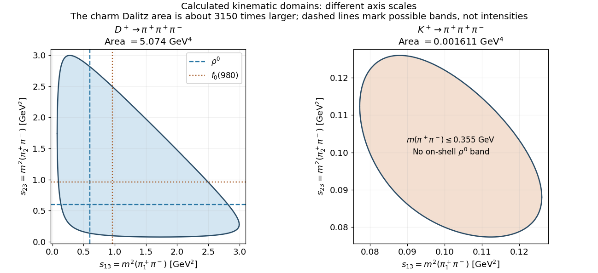

<h1 id="2/d/solution">Solution</h1>

↑ **Parent:** [D](../d.md)

Use the explicit charged channels $D^+\to\pi^+\pi^+\pi^-$ and $K^+\to\pi^+\pi^+\pi^-$, labeling the two positive [pions](../../../../pion.md) as 1,2 and the negative one as 3. With $m_\pi=0.139\,\mathrm{GeV}$, the opposite-charge pair [mass](../../../../mass.md) squares have the ranges

$$
\boxed{4m_\pi^2\le s_{13},s_{23}\le(M_0-m_\pi)^2.}
$$

Their exact correlated boundaries follow by taking the pair rest-frame angle to its endpoints. For general daughter [masses](../../../../mass.md), define $\Lambda(a,b,c)=a^2+b^2+c^2-2ab-2ac-2bc$. At fixed $s=s_{13}$,

$$
\boxed{s_{23}^{\pm}=m_2^2+m_3^2+
\frac{(M_0^2-m_2^2-s)(s+m_3^2-m_1^2)\pm\sqrt{\Lambda(M_0^2,s,m_2^2)\Lambda(s,m_1^2,m_3^2)}}{2s}.}
$$

The charged-pion thresholds give the following numerical comparison:

| Parent | $Q=M_0-3m_\pi$ | Allowed single-axis interval, $\mathrm{GeV}^2$ | Dalitz area, $\mathrm{GeV}^4$ \\ | $D^+$ | $1.453\,\mathrm{GeV}$ | $0.07728$ to $2.99636$ | approximately $5.074$ \\ | $K^+$ | $0.077\,\mathrm{GeV}$ | $0.07728$ to $0.12603$ | approximately $0.001611$ |
| --- | --- | --- |

The area is about $3150$ times smaller for the [kaon](../../../../kaon.md). Including the $M_0^{-2}$ [phase-space](../../../../lorentz-invariant-phase-space.md) prefactor, its integrated labelled three-body [phase space](../../../../lorentz-invariant-phase-space.md) is about $220$ times smaller; neither comparison predicts a ratio of [weak decay](../../../../weak-interaction.md) widths without the [matrix elements](../../../../matrix-element.md).

A $\rho^0\to\pi^+\pi^-$ intermediate state produces horizontal or vertical bands near $s_{13}$ or $s_{23}=m_\rho^2\simeq(0.775\,\mathrm{GeV})^2$ in the [charm](../../../../charm-quark.md) decay. [Scalar pion-pair amplitudes](../../../../partial-wave.md), including broad low-mass $S$-wave contributions and accessible $f_0(980)$, can also populate the plot. The [kaon](../../../../kaon.md) pair [mass](../../../../mass.md) cannot exceed $0.355\,\mathrm{GeV}$, so it cannot contain an [on-shell](../../../../on-shell.md) $\rho^0$ or $f_0(980)$ band; smooth nonresonant and rescattering effects remain possible. Channels containing neutral [pions](../../../../pion.md) use their supplied $0.135\,\mathrm{GeV}$ [mass](../../../../mass.md) and shift these boundaries slightly without changing the conclusion. The figure shows kinematic domains and representative accessible bands, not an assumed measured intensity.

**[Figure 1](#2/d/image-calculated-charged-three-pion-dalitz-domains-and-accessible-resonance-bands). Calculated charged-three-pion Dalitz domains and accessible resonance bands**.

## ↑ Ancestors (12)

1. [D](../d.md)
2. [2](../../2.md)
3. [2017](../../../2017-split.md)
4. [Past exam of the particle physics course of the University of Oxford](../../../split.md)
5. [Particle physics course of the University of Oxford](../../../../particle-physics-course-of-the-university-of-oxford.md)
6. [Year 4 of the physics course of the University of Oxford](../../../../year-4-of-the-physics-course-of-the-university-of-oxford.md)
7. [Physics course of the University of Oxford](../../../../physics-course-of-the-university-of-oxford.md)
8. [Undergraduate course of the University of Oxford](../../../../undergraduate-course-of-the-university-of-oxford.md)
9. [Course of the University of Oxford](../../../../course-of-the-university-of-oxford.md)
10. [University of Oxford](../../../../university-of-oxford-split.md)
11. [List of universities](../../../../list-of-universities.md)
12. [Codex Wiki](../../../../split.md)
