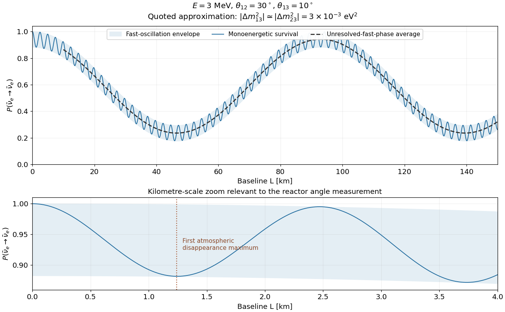

<h1 id="3/d/solution">Solution</h1>

↑ **Parent:** [D](../d.md)

With the supplied angles, $c_{13}^4\sin^22\theta_{12}=0.70545$ and $\sin^22\theta_{13}=0.11698$. At $E=3\,\mathrm{MeV}$ and with the two atmospheric-scale splittings approximated by a common $3\times10^{-3}\,\mathrm{eV}^2$, the requested sketch is represented by

$$
\boxed{P_{ee}(L)\simeq1-0.70545\sin^2(0.0337849L)-0.11698\sin^2(1.26693L),\qquad L\text{ in km}.}
$$

The fast period is $2.480\,\mathrm{km}$ and its first [disappearance](../../../../neutrino-oscillation.md) maximum is at $1.240\,\mathrm{km}$. The slow period is $92.99\,\mathrm{km}$, giving slow minima near $46.49$ and $139.48\,\mathrm{km}$. At each baseline the fast [oscillations](../../../../neutrino-oscillation.md) lie between $1-0.70545\sin^2(0.0337849L)$ and that value minus $0.11698$. Averaging over unresolved fast [oscillations](../../../../neutrino-oscillation.md) subtracts half that [amplitude](../../../../probability-amplitude.md), rather than erasing the slow [oscillation](../../../../neutrino-oscillation.md).

The equal atmospheric splittings are an approximation: exact squared [masses](../../../../mass.md) require $\Delta m_{13}^2=\Delta m_{12}^2+\Delta m_{23}^2$. For example, choosing magnitudes $\Delta m_{31}^2=3.00\times10^{-3}$ and $\Delta m_{21}^2=0.08\times10^{-3}\,\mathrm{eV}^2$ gives $\Delta m_{32}^2=2.92\times10^{-3}\,\mathrm{eV}^2$. This changes the fine fast pattern while retaining the two physical scales. The figure deliberately displays the source's common-frequency approximation and labels the fast-averaged curve separately from the monoenergetic result.

**[Figure 2](#3/d/image-vacuum-electron-antineutrino-survival-at-the-supplied-reactor-energy-and-mixing-parameters). Vacuum electron-antineutrino survival at the supplied reactor energy and mixing parameters**.

## ↑ Ancestors (12)

1. [D](../d.md)
2. [3](../../3.md)
3. [2017](../../../2017-split.md)
4. [Past exam of the particle physics course of the University of Oxford](../../../split.md)
5. [Particle physics course of the University of Oxford](../../../../particle-physics-course-of-the-university-of-oxford.md)
6. [Year 4 of the physics course of the University of Oxford](../../../../year-4-of-the-physics-course-of-the-university-of-oxford.md)
7. [Physics course of the University of Oxford](../../../../physics-course-of-the-university-of-oxford.md)
8. [Undergraduate course of the University of Oxford](../../../../undergraduate-course-of-the-university-of-oxford.md)
9. [Course of the University of Oxford](../../../../course-of-the-university-of-oxford.md)
10. [University of Oxford](../../../../university-of-oxford-split.md)
11. [List of universities](../../../../list-of-universities.md)
12. [Codex Wiki](../../../../split.md)
