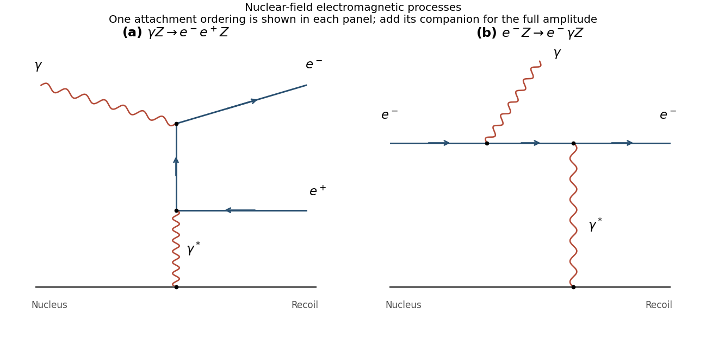

<h1 id="4/a/solution">Solution</h1>

↑ **Parent:** [A](../a.md)

Nuclear-field [pair creation](../../../../pair-production.md) is $\gamma Z\to e^-e^+Z$. A [virtual photon](../../../../virtual-photon.md) exchanged with the [nucleus](../../../../atomic-nucleus-split.md) supplies recoil [momentum](../../../../momentum-split.md), while the real [photon](../../../../photon.md) and [virtual photon](../../../../virtual-photon.md) attach to the [electron](../../../../electron.md) line joining the outgoing pair. The figure shows a representative graph. The second attachment ordering must be included in the full [amplitude](../../../../probability-amplitude.md). A real [photon](../../../../photon.md) cannot create a free massive pair in vacuum: its [invariant mass](../../../../invariant-mass.md) is zero, whereas $(p_{e^-}+p_{e^+})^2\ge4m_e^2$. [Nuclear recoil](../../../../recoil.md) resolves that kinematic obstruction and permits [energy-momentum conservation](../../../../four-momentum-conservation.md).

**[Figure 3](#4/a/image-representative-nuclear-field-pair-production-and-bremsstrahlung-diagrams). Representative nuclear-field pair-production and bremsstrahlung diagrams**.

## ↑ Ancestors (12)

1. [A](../a.md)
2. [4](../../4.md)
3. [2017](../../../2017-split.md)
4. [Past exam of the particle physics course of the University of Oxford](../../../split.md)
5. [Particle physics course of the University of Oxford](../../../../particle-physics-course-of-the-university-of-oxford.md)
6. [Year 4 of the physics course of the University of Oxford](../../../../year-4-of-the-physics-course-of-the-university-of-oxford.md)
7. [Physics course of the University of Oxford](../../../../physics-course-of-the-university-of-oxford.md)
8. [Undergraduate course of the University of Oxford](../../../../undergraduate-course-of-the-university-of-oxford.md)
9. [Course of the University of Oxford](../../../../course-of-the-university-of-oxford.md)
10. [University of Oxford](../../../../university-of-oxford-split.md)
11. [List of universities](../../../../list-of-universities.md)
12. [Codex Wiki](../../../../split.md)
