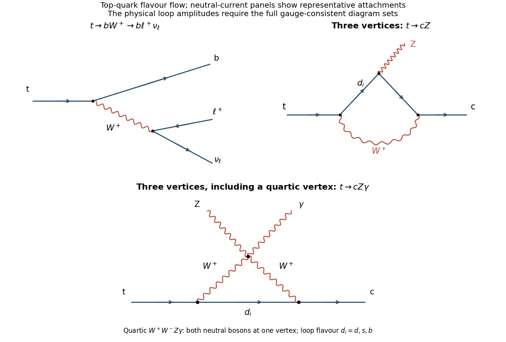

<h1 id="6/a/solution">Solution</h1>

↑ **Parent:** [A](../a.md)

The dominant [semileptonic decay](../../../../semileptonic-decay.md) is $t\to bW^+\to b\ell^+\nu_\ell$. Replacing $b$ by $s$ or $d$ weights the [amplitude](../../../../probability-amplitude.md) by $V_{ts}$ or $V_{td}$ rather than $V_{tb}$. Neglecting the down-type [masses](../../../../mass.md),

$$
\boxed{B(t\to bW^+)\simeq\frac{|V_{tb}|^2}{|V_{td}|^2+|V_{ts}|^2+|V_{tb}|^2}=0.9983}
$$

with the source's rounded [matrix](../../../../matrix.md) entries. For the $W$, three leptonic widths and two open [up-type quark](../../../../up-quark.md) rows with three colours give nine common width units. Thus, ignoring [QCD](../../../../quantum-chromodynamics.md) and final-mass corrections,

$$
\boxed{B(t\to b\ell^+\nu_\ell)\simeq\frac{0.9983}{9}\simeq11.1\%\quad\text{per lepton flavour}.}
$$

Summing all three [flavours](../../../../flavor-eigenstate.md) gives approximately one third; summing only [electron](../../../../electron.md) and [muon](../../../../muon.md) modes gives approximately $22.2\%$. These are per-top [branching ratios](../../../../branching-fraction.md), not the separate [branching ratio](../../../../branching-fraction.md) of a specified two-top event topology.

An [isolated](../../../../lepton-isolation.md) high-transverse-momentum charged lepton, [missing transverse momentum](../../../../missing-transverse-momentum.md) from the [neutrino](../../../../neutrino.md), and a tagged [bottom jet](../../../../bottom-quark-jet-tagging.md) form a much cleaner signature than an entirely hadronic final state amid [QCD](../../../../quantum-chromodynamics.md) [jets](../../../../jet-particle-physics.md). [Electrons](../../../../electron.md) and [muons](../../../../muon.md) are the easiest charged-lepton [flavours](../../../../flavor-eigenstate.md) to identify cleanly. [Tau](../../../../tau-particle.md) decays add [neutrinos](../../../../neutrino.md) and often hadrons, making identification and reconstruction more difficult. The figure contains the [quark](../../../../quark.md)/lepton-level [charged-current](../../../../charged-current.md) diagram as well as the rare-loop examples used below.

**[Figure 4](#6/a/image-dominant-semileptonic-top-decay-and-representative-flavour-changing-neutral-current-loop-diagrams). Dominant semileptonic top decay and representative flavour-changing neutral-current loop diagrams**.

## ↑ Ancestors (12)

1. [A](../a.md)
2. [6](../../6.md)
3. [2017](../../../2017-split.md)
4. [Past exam of the particle physics course of the University of Oxford](../../../split.md)
5. [Particle physics course of the University of Oxford](../../../../particle-physics-course-of-the-university-of-oxford.md)
6. [Year 4 of the physics course of the University of Oxford](../../../../year-4-of-the-physics-course-of-the-university-of-oxford.md)
7. [Physics course of the University of Oxford](../../../../physics-course-of-the-university-of-oxford.md)
8. [Undergraduate course of the University of Oxford](../../../../undergraduate-course-of-the-university-of-oxford.md)
9. [Course of the University of Oxford](../../../../course-of-the-university-of-oxford.md)
10. [University of Oxford](../../../../university-of-oxford-split.md)
11. [List of universities](../../../../list-of-universities.md)
12. [Codex Wiki](../../../../split.md)
