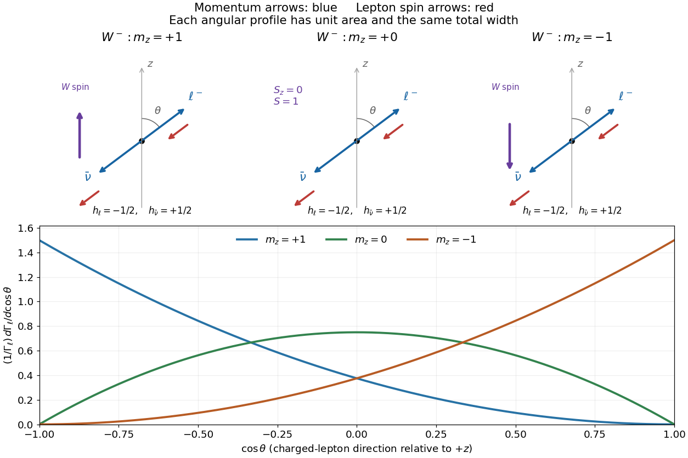
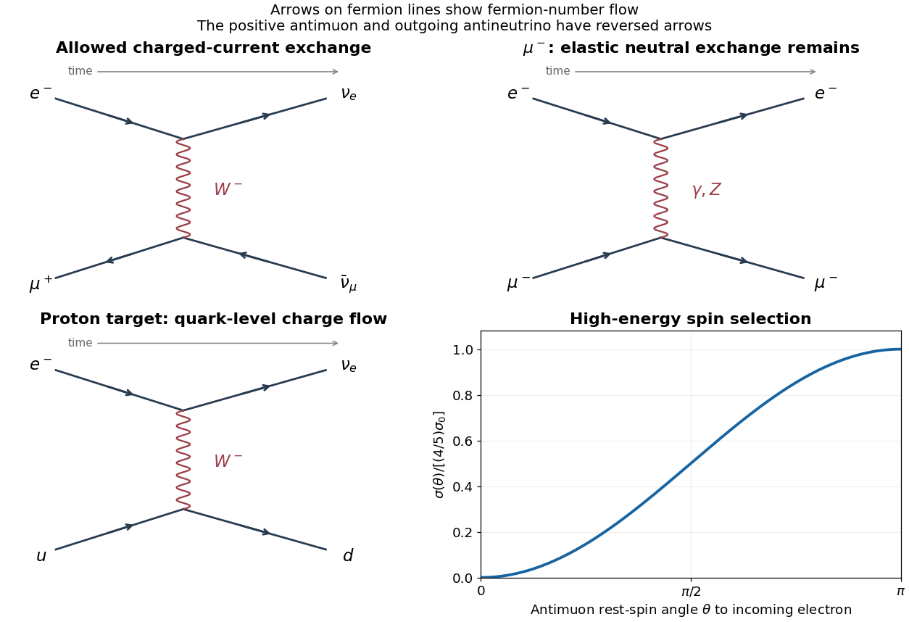
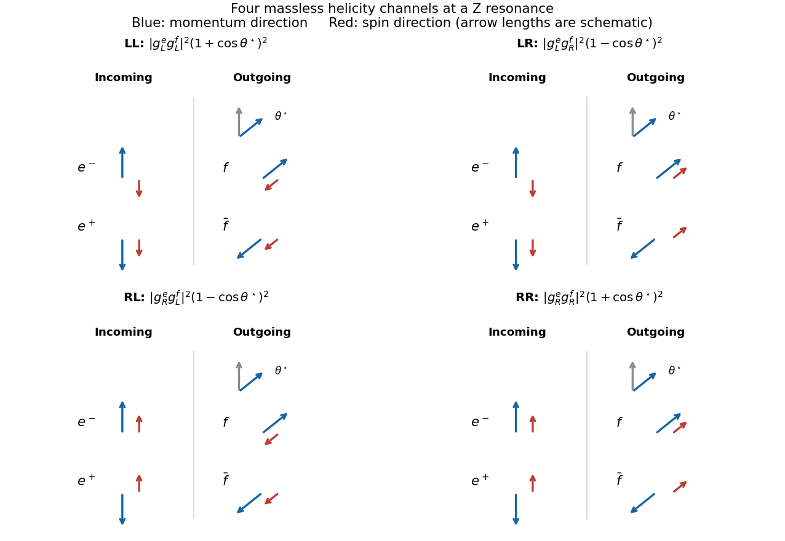

# 2018

↑ **Parent:** [Past exam of the particle physics course of the University of Oxford](../past-exam-of-the-particle-physics-course-of-the-university-of-oxford.md)

Source paper: [https://www.whatdotheyknow.com/request/oxford_physics_past_papers_2/response/2340696/attach/6/Physics%20Papers%202017.pdf?cookie_passthrough=1.](https://www.whatdotheyknow.com/request/oxford_physics_past_papers_2/response/2340696/attach/6/Physics%20Papers%202017.pdf?cookie_passthrough=1.) The held cover identifies C4 on 14 June 2018; the annual bundle's filename does not determine the year. [Natural units](../mathematical-physics.md#natural-units) $\hbar=c=1$ are used except in the silicon-detector calculations, where [SI units](../physics.md#international-system-of-units) and the [momentum](../momentum.md) conversion are stated explicitly. All six questions are solved.

**Table of contents**

- [1](#1)
  - [a](#1/a)
    - [Solution](#1/a/solution)
  - [b](#1/b)
    - [Solution](#1/b/solution)
  - [c](#1/c)
    - [Solution](#1/c/solution)
  - [d](#1/d)
    - [Solution](#1/d/solution)
  - [e](#1/e)
    - [Solution](#1/e/solution)
- [2](#2)
  - [a](#2/a)
    - [Solution](#2/a/solution)
  - [b](#2/b)
    - [Solution](#2/b/solution)
  - [c](#2/c)
    - [Solution](#2/c/solution)
  - [d](#2/d)
    - [Solution](#2/d/solution)
  - [e](#2/e)
    - [Solution](#2/e/solution)
- [3](#3)
  - [a](#3/a)
    - [Solution](#3/a/solution)
  - [b](#3/b)
    - [Solution](#3/b/solution)
  - [c](#3/c)
    - [Solution](#3/c/solution)
    - [i](#3/c/i)
      - [Solution](#3/c/i/solution)
    - [ii](#3/c/ii)
      - [Solution](#3/c/ii/solution)
    - [iii](#3/c/iii)
      - [Solution](#3/c/iii/solution)
  - [d](#3/d)
    - [Solution](#3/d/solution)
  - [e](#3/e)
    - [Solution](#3/e/solution)
- [4](#4)
  - [a](#4/a)
    - [Solution](#4/a/solution)
  - [b](#4/b)
    - [Solution](#4/b/solution)
  - [c](#4/c)
    - [Solution](#4/c/solution)
  - [d](#4/d)
    - [Solution](#4/d/solution)
  - [e](#4/e)
    - [i](#4/e/i)
      - [Solution](#4/e/i/solution)
    - [ii](#4/e/ii)
      - [Solution](#4/e/ii/solution)
- [5](#5)
  - [a](#5/a)
    - [Solution](#5/a/solution)
  - [b](#5/b)
    - [Solution](#5/b/solution)
  - [c](#5/c)
    - [Solution](#5/c/solution)
  - [d](#5/d)
    - [Solution](#5/d/solution)
- [6](#6)
  - [a](#6/a)
    - [Solution](#6/a/solution)
  - [b](#6/b)
    - [Solution](#6/b/solution)
  - [c](#6/c)
    - [Solution](#6/c/solution)

## 1

↑ **Parent:** [2018](2018.md)

<h3 id="1/a">a</h3>

↑ **Parent:** [1](#1)

<h4 id="1/a/solution">Solution</h4>

↑ **Parent:** [A](#1/a)

Work in the [W boson](../standard-model.md#w-boson) [rest frame](../mathematical-physics.md#rest-frame), taking the spin-quantization axis along its laboratory motion. Neglect charged-lepton and [neutrino](../standard-model.md#neutrino) [masses](../classical-mechanics.md#mass). The [weak charged current](../standard-model.md#charged-current) produces a [negative-helicity](../special-relativity.md#helicity) $\ell^-$ and a [positive-helicity](../special-relativity.md#helicity) [antineutrino](../standard-model.md#antineutrino). Their [momenta](../momentum.md) are opposite, so both [spin](../angular-momentum-operator.md#spin) [Vectors](../vector-space.md#vector) point opposite to the [charged lepton](../standard-model.md#charged-lepton)'s direction $\hat{\mathbf n}$; the final total [spin projection](../angular-momentum-operator.md#spin) along $\hat{\mathbf n}$ is $-1$.

Let $\lambda_W=+1,0,-1$ denote the parent [spin projection](../angular-momentum-operator.md#spin) along $z$. In the given [probability amplitude](../wave-function.md#probability-amplitude), use $j=1$ and the [rotation](../riemannian-geometry.md#rotation-mathematics) element $d^1_{-1,\lambda_W}(\theta)$. The supplied spin-one [rotation](../riemannian-geometry.md#rotation-mathematics) elements give

$$
\boxed{|\mathcal M_{+1}|^2=m_W^2g^2\frac{(1-\cos\theta)^2}{4},\qquad
|\mathcal M_0|^2=m_W^2g^2\frac{\sin^2\theta}{2},\qquad
|\mathcal M_{-1}|^2=m_W^2g^2\frac{(1+\cos\theta)^2}{4}.}
$$

The transverse states have [spin projections](../angular-momentum-operator.md#spin) $\pm1$; the longitudinal state has projection zero, not total [spin](../angular-momentum-operator.md#spin) zero. The original diagram below distinguishes [momenta](../momentum.md) from [spins](../angular-momentum-operator.md#spin) and shows the corresponding normalized angular profiles.

**[Figure 1](#1/a/image-w-boson-spin-projections-lepton-helicities-and-decay-angular-distributions). W boson spin projections, lepton helicities and decay angular distributions**.

<h3 id="1/b">b</h3>

↑ **Parent:** [1](#1)

<h4 id="1/b/solution">Solution</h4>

↑ **Parent:** [B](#1/b)

With relativistically normalized one-particle states, [Fermi's golden rule](../quantum-mechanics.md#fermi-s-golden-rule) becomes

$$
\Gamma=\frac1{2M}\int |\mathcal M|^2(2\pi)^4\delta^{(4)}(P-p_1-p_2)
\frac{d^3p_1}{(2\pi)^3 2E_1}\frac{d^3p_2}{(2\pi)^3 2E_2}.
$$

In the parent [rest frame](../mathematical-physics.md#rest-frame), the three-momentum [delta function](../distribution-theory.md#dirac-delta-function) fixes $\mathbf p_2=-\mathbf p_1$. The [energy](../energy.md) [delta function](../distribution-theory.md#dirac-delta-function) fixes the common magnitude $p^*$; its radial [Jacobian](../multivariable-calculus.md#jacobian-determinant) converts the remaining [phase-space](../relativistic-quantum-field.md#lorentz-invariant-phase-space) factor into

$$
\boxed{\Gamma=\frac{p^*}{32\pi^2M^2}\int|\mathcal M|^2\,d\Omega.}
$$

Only one [momentum](../momentum.md) magnitude remains because the two final [momenta](../momentum.md) are constrained, not independent. Explicitly,

$$
p^*=\frac{\sqrt{[M^2-(m_1+m_2)^2][M^2-(m_1-m_2)^2]}}{2M}.
$$

For leptonic [W boson](../standard-model.md#w-boson) decay both final [masses](../classical-mechanics.md#mass) are small compared with $m_W$, including the [tau](../standard-model.md#tau-particle) [mass](../classical-mechanics.md#mass) at the precision requested, so $p^*\simeq m_W/2$.

<h3 id="1/c">c</h3>

↑ **Parent:** [1](#1)

<h4 id="1/c/solution">Solution</h4>

↑ **Parent:** [C](#1/c)

For the longitudinal state,

$$
\int |\mathcal M_0|^2d\Omega=m_W^2g^2\,2\pi\int_{-1}^{1}\frac{1-z^2}{2}\,dz=\frac{4\pi}{3}m_W^2g^2.
$$

Insert this and $p^*=m_W/2$ into the [phase-space](../relativistic-quantum-field.md#lorentz-invariant-phase-space) formula:

$$
\boxed{\Gamma_\ell=\frac{g^2m_W}{48\pi}.}
$$

Rotational invariance makes the integrated [decay probability](../relativistic-quantum-field.md#decay-width) independent of the orientation of the initial [spin](../angular-momentum-operator.md#spin). Both transverse [polarizations](../special-relativity.md#particle-polarization) therefore have the same rate. An unpolarized sample averages these three equal rates; it does not add three copies. Hence its [width](../relativistic-quantum-field.md#decay-width) into one specified charged-lepton [flavour](../quantum-system.md#flavor-eigenstate) is also $g^2m_W/(48\pi)$.

<h3 id="1/d">d</h3>

↑ **Parent:** [1](#1)

<h4 id="1/d/solution">Solution</h4>

↑ **Parent:** [D](#1/d)

At a hadron collider, select $W\to\ell\nu$ events and reconstruct the [transverse mass](../particle-detection.md#transverse-mass)

$$
m_T=\sqrt{2p_T^\ell p_T^\nu(1-\cos\Delta\phi)},
$$

using [missing transverse momentum](../particle-detection.md#missing-transverse-momentum) for the [neutrino](../standard-model.md#neutrino). Fit the shape, especially the region above the nominal [Jacobian](../multivariable-calculus.md#jacobian-determinant) edge, with finite-width resonance templates convolved with detector resolution, recoil modelling and backgrounds. The [Breit-Wigner](../quantum-scattering.md#breit-wigner-resonance-cross-section) [width](../relativistic-quantum-field.md#decay-width) controls this off-shell tail. Calibrated [momentum](../momentum.md) and missing-momentum resolutions must be separated from the physical [width](../relativistic-quantum-field.md#decay-width). This is a lineshape measurement; the [lifetime](../relativistic-quantum-field.md#mean-lifetime-physics) is far too short for a direct flight-distance measurement.

<h3 id="1/e">e</h3>

↑ **Parent:** [1](#1)

<h4 id="1/e/solution">Solution</h4>

↑ **Parent:** [E](#1/e)

Assume only [Standard Model](../standard-model.md) decay channels, negligible final-state [masses](../classical-mechanics.md#mass), three [lepton](../standard-model.md#lepton) families, three [quark](../standard-model.md#quark) [colours](../standard-model.md#color-charge) and a [unitary](../vector-space.md#unitary-operator) [CKM matrix](../standard-model.md#cabibbo-kobayashi-maskawa-matrix). The [top-quark](../standard-model.md#top-quark) channels are kinematically closed. Summing the allowed [quark](../standard-model.md#quark) channels gives $3\sum_{i=u,c}\sum_{j=d,s,b}|V_{ij}|^2\simeq6$ times one leptonic [width](../relativistic-quantum-field.md#decay-width), while the [leptons](../standard-model.md#lepton) contribute three. Neglecting [QCD](../standard-model.md#quantum-chromodynamics) and [electroweak](../standard-model.md#electroweak-interaction) [radiative corrections](../perturbative-quantum-field-theory.md#radiative-correction),

$$
\Gamma_W\simeq9\Gamma_\ell=\frac{9g^2m_W}{48\pi}.
$$

The source's rounded CKM entries give almost the same factor; their tiny nonunitarity is not physically significant. Consequently

$$
\boxed{g^2=\frac{48\pi\Gamma_W}{9m_W}=0.4356\pm0.0083,\qquad g=0.6600\pm0.0063.}
$$

The propagated [uncertainty](../physics.md#measurement-uncertainty) uses $\delta g/g=\tfrac12\delta\Gamma_W/\Gamma_W$, taking $m_W$ as fixed. It is the measurement [uncertainty](../physics.md#measurement-uncertainty) within the stated tree-level approximation; omitted [radiative corrections](../perturbative-quantum-field-theory.md#radiative-correction) are an additional modelling limitation. In particular [QCD](../standard-model.md#quantum-chromodynamics) increases the hadronic [width](../relativistic-quantum-field.md#decay-width) and lowers the inferred [coupling](../relativistic-quantum-field.md#gauge-coupling) when included.

The printed electromagnetic comparison $4\pi/137$ is $e^2$, not the [probability amplitude](../wave-function.md#probability-amplitude) [coupling](../relativistic-quantum-field.md#gauge-coupling) $e$. Compare like quantities:

$$
\boxed{\frac{g^2}{e^2}\simeq4.75,\qquad e=\sqrt{4\pi/137}\simeq0.303,\qquad g/e\simeq2.18.}
$$

Equivalently $\alpha_W=g^2/(4\pi)\simeq0.0347$ exceeds $\alpha_{\mathrm{EM}}\simeq1/137$. The [weak interaction](../standard-model.md#weak-interaction) is weak at low [energy](../energy.md) primarily because of the massive [propagator](../quantum-field-theory.md#propagator), rather than an exceptionally small fundamental [coupling](../relativistic-quantum-field.md#gauge-coupling).

## 2

↑ **Parent:** [2018](2018.md)

<h3 id="2/a">a</h3>

↑ **Parent:** [2](#2)

<h4 id="2/a/solution">Solution</h4>

↑ **Parent:** [A](#2/a)

The [valence quark](../standard-model.md#valence-quark) distributions describe net [quark](../standard-model.md#quark) content: $\int u_v(x)dx=2$ and $\int d_v(x)dx=1$ for a [proton](../physics.md#proton). Their [momentum](../momentum.md) densities $xu_v,xd_v$ are small at very small $x$, peak at moderate [momentum fractions](../standard-model.md#parton-momentum-fraction), and vanish toward $x=1$, where one [parton](../standard-model.md#parton) carrying almost all [proton](../physics.md#proton) [momentum](../momentum.md) is unlikely. The larger $u$ distribution reflects two valence [up quarks](../standard-model.md#up-quark) and its comparatively harder shape; its pointwise value need not be exactly twice the down distribution.

The [sea quark](../standard-model.md#sea-quark) distribution is generated largely by [gluon](../standard-model.md#gluon) radiation and $g\to q\bar q$ splitting. It grows strongly toward small $x$ and falls at large $x$. The plotted sea curve is scaled by $0.05$, so it must be multiplied by twenty before numerical use. The total up-quark [PDF](../standard-model.md#parton-distribution-function) is

$$
\boxed{u(x)=u_v(x)+\bar u(x),}
$$

using the valence-up distribution and the up-sea distribution. The summed sea curve alone does not fix $\bar u$ without a [flavour](../quantum-system.md#flavor-eigenstate) assumption. Under the later stated four-flavour symmetry, $\bar u=\Sigma/8$.

<h3 id="2/b">b</h3>

↑ **Parent:** [2](#2)

<h4 id="2/b/solution">Solution</h4>

↑ **Parent:** [B](#2/b)

At leading order, neglect the [transverse momentum](../particle-detection.md#transverse-momentum) of the incoming [partons](../standard-model.md#parton) and of the produced [on-shell](../classical-field-theory.md#on-shell) boson. In the hadron [centre-of-mass frame](../special-relativity.md#center-of-momentum-frame),

$$
p_+=\frac{\sqrt s}{2}(x_+,0,0,x_+),\qquad
p_-=\frac{\sqrt s}{2}(x_-,0,0,-x_-).
$$

Then $m_W^2=(p_++p_-)^2=x_+x_-s$, and

$$
y=\frac12\ln\frac{x_+}{x_-}.
$$

Solving these product and ratio equations gives

$$
\boxed{x_+=\sqrt\tau e^y,\qquad x_-=\sqrt\tau e^{-y},\qquad \sqrt\tau=\frac{80.4}{2000}=0.0402.}
$$

Over $-2<y<2$, each [momentum fraction](../standard-model.md#parton-momentum-fraction) ranges between

$$
\boxed{0.00544<x_\pm<0.2970.}
$$

They are anticorrelated: increasing $y$ increases $x_+$ while decreasing $x_-$. Higher-order recoil changes the simple two-to-one [kinematics](../classical-mechanics.md#kinematics).

<h3 id="2/c">c</h3>

↑ **Parent:** [2](#2)

<h4 id="2/c/solution">Solution</h4>

↑ **Parent:** [C](#2/c)

The leading subprocess is $u\bar d\to W^+$. There are two beam assignments, and [charge conjugation](../quantum-field-theory.md#charge-conjugation) relates [antiproton](../relativistic-quantum-field.md#antiproton) [PDFs](../standard-model.md#parton-distribution-function) to [proton](../physics.md#proton) [PDFs](../standard-model.md#parton-distribution-function). Therefore

$$
\frac{d\sigma}{dy}\propto u_p(x_+)\bar d_{\bar p}(x_-)+\bar d_p(x_+)u_{\bar p}(x_-)
=u(x_+)d(x_-)+\bar d(x_+)\bar u(x_-).
$$

In a narrow-width leading-order [normalization](../mathematics.md#normalization) the prefactor is $\pi g^2/(12s)$ when $|V_{ud}|=1$; only the [PDF](../standard-model.md#parton-distribution-function) dependence is needed for the fractions below.

Write the common sea [PDF](../standard-model.md#parton-distribution-function) as $S=\bar u=\bar d=\bar s=\bar c=\Sigma/8$. The [Valence and sea decomposition of proton-antiproton W production](../standard-model.md#valence-and-sea-decomposition-of-proton-antiproton-w-production) gives the three [parton](../standard-model.md#parton) luminosities

$$
\boxed{\mathcal L_{VV}=u_v(x_+)d_v(x_-),\quad
\mathcal L_{VS}=u_v(x_+)S(x_-)+S(x_+)d_v(x_-),\quad
\mathcal L_{SS}=2S(x_+)S(x_-).}
$$

The factor two in the sea-sea term includes both beam assignments. The [antiproton](../relativistic-quantum-field.md#antiproton)'s [valence antiquarks](../standard-model.md#valence-quark) make valence-valence [Annihilation](../relativistic-quantum-field.md#annihilation) possible.

<h3 id="2/d">d</h3>

↑ **Parent:** [2](#2)

<h4 id="2/d/solution">Solution</h4>

↑ **Parent:** [D](#2/d)

At $y=0$, both fractions equal $x=0.0402$. Reading the original plot near this value gives representative [momentum](../momentum.md) densities

$$
U=xu_v\simeq0.42,\qquad D=xd_v\simeq0.24,\qquad 0.05x\Sigma\simeq0.08.
$$

These are approximate graphical readings, not a precision [PDF](../standard-model.md#parton-distribution-function) fit. Undo the sea-curve scale and divide by eight [flavours](../quantum-system.md#flavor-eigenstate)/antiflavours:

$$
S_x=xS=\frac{x\Sigma}{8}\simeq\frac{0.08}{0.05\times8}=0.20.
$$

All products have the same $1/x^2$ factor, which cancels in the fractions. The three relative weights are

$$
w_{VV}=UD=0.1008,\qquad w_{VS}=S_x(U+D)=0.1320,\qquad w_{SS}=2S_x^2=0.0800.
$$

Their sum is $0.3128$, giving

$$
\boxed{f_{VV}\simeq32\%,\qquad f_{VS}\simeq42\%,\qquad f_{SS}\simeq26\%.}
$$

Reading the central curves more finely changes these percentages by about a percentage point, well within what the plot supports. Omitting its factor $0.05$ would substantially underestimate the sea contribution.

<h3 id="2/e">e</h3>

↑ **Parent:** [2](#2)

<h4 id="2/e/solution">Solution</h4>

↑ **Parent:** [E](#2/e)

Use leptonic decays: an isolated high [transverse momentum](../particle-detection.md#transverse-momentum) positive [electron](../physics.md#electron) or [muon](../standard-model.md#muon), together with substantial [missing transverse momentum](../particle-detection.md#missing-transverse-momentum) from the [neutrino](../standard-model.md#neutrino), provides a clean $W^+$ signature. The [lepton](../standard-model.md#lepton) [transverse momentum](../particle-detection.md#transverse-momentum) has a [Jacobian](../standard-model.md#w-decay-jacobian-peak) scale near $m_W/2$, and the [lepton](../standard-model.md#lepton)–missing-momentum [transverse mass](../particle-detection.md#transverse-mass) has an edge near $m_W$, broadened by [width](../relativistic-quantum-field.md#decay-width), recoil and resolution. [Lepton](../standard-model.md#lepton) identification, isolation and a prompt primary-vertex origin suppress [Jets](../standard-model.md#jet-particle-physics) faking [leptons](../standard-model.md#lepton) and heavy-flavour decays. Missing-momentum quality requirements suppress mismeasured multijet events; a veto on a second oppositely [charged lepton](../standard-model.md#charged-lepton) suppresses $Z\to\ell^+\ell^-$ when both are reconstructed. Hadronic $W$ decays have a much larger ordinary-QCD background.

## 3

↑ **Parent:** [2018](2018.md)

<h3 id="3/a">a</h3>

↑ **Parent:** [3](#3)

<h4 id="3/a/solution">Solution</h4>

↑ **Parent:** [A](#3/a)

The [flavour states](../quantum-system.md#flavor-eigenstate) $K^0=d\bar s$ and $\bar K^0=s\bar d$ have definite [Strangeness](../standard-model.md#strangeness) and are distinguished by flavour-sensitive production or decay. The [propagation states](../finite-element-method.md#mass-eigenstate) diagonalize the [effective Hamiltonian](../physics.md#effective-hamiltonian-for-neutral-meson-mixing) $H_{\mathrm{eff}}=M-i\Gamma/2$; their complex [eigenvalues](../linear-operator-theory.md#eigenvalue) give a pole [mass](../classical-mechanics.md#mass) and a [decay width](../relativistic-quantum-field.md#decay-width). The common [flavour](../quantum-system.md#flavor-eigenstate) combinations specified in the source assume the usual [CPT-symmetric](../quantum-field-theory.md#cpt-symmetry) two-state description and are normalized with $|p|^2+|q|^2=1$.

Choose the [phase](../wave.md#phase-waves) convention $CP|K^0\rangle=|\bar K^0\rangle$. If mixing conserves [CP](../quantum-field-theory.md#cp-symmetry), $p=q$ can be chosen, and the symmetric and antisymmetric combinations are [CP](../quantum-field-theory.md#cp-symmetry) even and odd. More generally the equality must be understood with the corresponding flavour-state [phase](../wave.md#phase-waves) convention; $|p|=|q|$ alone is not a statement fixing an arbitrary written [phase](../wave.md#phase-waves).

The almost [CP-even](../quantum-field-theory.md#cp-eigenstate) state decays rapidly to [two pions](../standard-model.md#pion), whereas the almost [CP-odd](../quantum-field-theory.md#cp-eigenstate) state is largely restricted to slower channels such as [three pions](../standard-model.md#pion). Their very different [lifetimes](../relativistic-quantum-field.md#mean-lifetime-physics) are easier to distinguish than their tiny [mass](../classical-mechanics.md#mass) splitting, motivating the names $K_S^0$ and $K_L^0$. In the source's first notation the subscript $L$ means _light_, not _long-lived_: the light state is identified with the short-lived [kaon](../physics.md#kaon), and the heavy state with the long-lived [kaon](../physics.md#kaon). Below, $\ell,h$ label light/heavy to avoid that collision.

<h3 id="3/b">b</h3>

↑ **Parent:** [3](#3)

<h4 id="3/b/solution">Solution</h4>

↑ **Parent:** [B](#3/b)

The two indistinguishable paths to the same final state must be added as [probability amplitudes](../wave-function.md#probability-amplitude):

$$
\mathcal A_f(t)=A_f g_+(t)+\frac qp\bar A_f g_-(t)=A_f[g_+(t)+\lambda g_-(t)].
$$

Taking the [squared modulus](../complex-analysis.md#complex-modulus) gives the time-dependent [decay rate](../relativistic-quantum-field.md#decay-width), with the common final-state [phase-space](../relativistic-quantum-field.md#lorentz-invariant-phase-space) [normalization](../mathematics.md#normalization) absorbed into the [probability amplitudes](../wave-function.md#probability-amplitude):

$$
\boxed{\Gamma(K(t)\to f)=|A_f|^2\left[|g_+|^2+|\lambda|^2|g_-|^2+2\operatorname{Re}(\lambda g_-g_+^*)\right].}
$$

The cross term is the [interference](../physical-optics.md#interference-wave-propagation) between direct decay and decay after [flavour](../quantum-system.md#flavor-eigenstate) conversion. For reference, diagonal propagation gives $g_\pm=(e_\ell\pm e_h)/2$, where $e_j=e^{-im_jt-\Gamma_jt/2}$ and $t$ is [proper time](../special-relativity.md#proper-time). The unfactored expression remains usable if $A_f=0$, when the ratio $\lambda$ itself is undefined.

<h3 id="3/c">c</h3>

↑ **Parent:** [3](#3)

<h4 id="3/c/solution">Solution</h4>

↑ **Parent:** [C](#3/c)

Starting with an [antikaon](../physics.md#neutral-antikaon) instead gives

$$
\bar{\mathcal A}_f(t)=\bar A_f g_++\frac pq A_f g_-=\bar A_f[g_++\lambda^{-1}g_-].
$$

Thus

$$
\boxed{\Gamma(\bar K(t)\to f)=|\bar A_f|^2\left[|g_+|^2+|\lambda^{-1}|^2|g_-|^2+2\operatorname{Re}(\lambda^{-1}g_-g_+^*)\right].}
$$

This factored form assumes $A_f,\bar A_f\ne0$; otherwise use the preceding [probability amplitude](../wave-function.md#probability-amplitude). The three mechanisms are separated below. Comparisons for distinct final states must pair $f$ with its [CP](../quantum-field-theory.md#cp-symmetry) conjugate $\bar f$.

<h4 id="3/c/i">i</h4>

↑ **Parent:** [C](#3/c)

<h5 id="3/c/i/solution">Solution</h5>

↑ **Parent:** [I](#3/c/i)

Direct [CP violation](../quantum-field-theory.md#cp-violation) means unequal magnitudes of CP-conjugate decay [probability amplitudes](../wave-function.md#probability-amplitude):

$$
\boxed{|A_f|\ne|\bar A_{\bar f}|.}
$$

It changes [decay probabilities](../relativistic-quantum-field.md#decay-width) even at $t=0$, before any mixing. For a common [CP eigenstate](../quantum-field-theory.md#cp-eigenstate) final state, this reduces to $|A_f|\ne|\bar A_f|$. Usually it requires interfering decay contributions with different [weak phases](../quantum-field-theory.md#weak-phase-cp-violation) and different [strong phases](../relativistic-quantum-field.md#absorptive-phase-of-a-decay-amplitude); it is not equivalent to a nonzero weak [phase](../wave.md#phase-waves) in one isolated [probability amplitude](../wave-function.md#probability-amplitude).

<h4 id="3/c/ii">ii</h4>

↑ **Parent:** [C](#3/c)

<h5 id="3/c/ii/solution">Solution</h5>

↑ **Parent:** [Ii](#3/c/ii)

[CP violation in mixing](../physics.md#cp-violation-in-neutral-meson-mixing) occurs when

$$
\boxed{|q/p|\ne1.}
$$

The flavour-transition [probabilities](../probability-theory.md#probability) are proportional to $|q/p|^2|g_-|^2$ for $K^0\to\bar K^0$, and $|p/q|^2|g_-|^2$ for the reverse. Their inequality remains when decay [probability amplitudes](../wave-function.md#probability-amplitude) themselves conserve [CP](../quantum-field-theory.md#cp-symmetry). The coefficients multiplying the mixed-decay terms in the rate equations encode this asymmetry.

<h4 id="3/c/iii">iii</h4>

↑ **Parent:** [C](#3/c)

<h5 id="3/c/iii/solution">Solution</h5>

↑ **Parent:** [Iii](#3/c/iii)

[Interference](../physical-optics.md#interference-wave-propagation) [CP violation](../quantum-field-theory.md#cp-violation) concerns the relative [phase](../wave.md#phase-waves) between direct decay and decay after mixing. For a common [CP eigenstate](../quantum-field-theory.md#cp-eigenstate) final state, it can occur with both $|q/p|=1$ and $|\bar A_f/A_f|=1$, so neither of the first two mechanisms is needed. In that limit $|\lambda|=1$, but

$$
\boxed{\operatorname{Im}\lambda\ne0}
$$

produces different [interference](../physical-optics.md#interference-wave-propagation) terms for $\lambda$ and $\lambda^{-1}=\lambda^*$. With $\Delta m=m_h-m_\ell$,

$$
g_-g_+^*=\frac14\left[e^{-\Gamma_\ell t}-e^{-\Gamma_h t}+2i e^{-(\Gamma_\ell+\Gamma_h)t/2}\sin(\Delta m t)\right].
$$

The term proportional to $\operatorname{Im}\lambda\sin(\Delta m t)$ consequently reverses sign. In the CP-conserving limit, $\lambda$ is the real [CP](../quantum-field-theory.md#cp-symmetry) [parity](../quantum-mechanics.md#parity) of the final state in a consistent [phase](../wave.md#phase-waves) convention. For non-CP-eigenstate final states, compare the full coefficients in CP-conjugate rates rather than imposing this simplified criterion.

<h3 id="3/d">d</h3>

↑ **Parent:** [3](#3)

<h4 id="3/d/solution">Solution</h4>

↑ **Parent:** [D](#3/d)

Introduce all four physical [probability amplitudes](../wave-function.md#probability-amplitude): $A_f,\bar A_f,A_{\bar f},\bar A_{\bar f}$. Under exchange of the [flavour](../quantum-system.md#flavor-eigenstate) and final-state labels, define

$$
\boxed{\bar\lambda=\frac pq\frac{A_{\bar f}}{\bar A_{\bar f}}.}
$$

This [CP-conjugate decay-amplitude ratio](../physics.md#cp-conjugate-decay-amplitude-ratio) gives the conjugate-channel rates

$$
\boxed{\begin{aligned}
\Gamma(\bar K(t)\to\bar f)&=|\bar A_{\bar f}|^2\left[|g_+|^2+|\bar\lambda|^2|g_-|^2+2\operatorname{Re}(\bar\lambda g_-g_+^*)\right],\\
\Gamma(K(t)\to\bar f)&=|A_{\bar f}|^2\left[|g_+|^2+|\bar\lambda^{-1}|^2|g_-|^2+2\operatorname{Re}(\bar\lambda^{-1}g_-g_+^*)\right].
\end{aligned}}
$$

[CP](../quantum-field-theory.md#cp-symmetry) is a [unitary](../vector-space.md#unitary-operator) discrete transformation, so exchanging state labels does not mean complex-conjugating every strong [phase](../wave.md#phase-waves) by fiat. Nor should one assume that CP-conjugate [probability amplitudes](../wave-function.md#probability-amplitude) are equal while studying [CP violation](../quantum-field-theory.md#cp-violation).

The equality $\bar\lambda=\lambda^{-1}$ holds when

$$
\boxed{\frac{A_{\bar f}}{\bar A_{\bar f}}=\frac{A_f}{\bar A_f},}
$$

in particular when $\bar f$ and $f$ are the same [CP eigenstate](../quantum-field-theory.md#cp-eigenstate) ray, with a consistent state [phase](../wave.md#phase-waves). It is not automatic for two distinct CP-conjugate final states. For example, $p=q$, $A_f=\bar A_{\bar f}=2$ and $\bar A_f=A_{\bar f}=1$ conserve the paired decay [probability amplitudes](../wave-function.md#probability-amplitude) but give $\lambda=\bar\lambda=1/2$, not inverse values.

<h3 id="3/e">e</h3>

↑ **Parent:** [3](#3)

<h4 id="3/e/solution">Solution</h4>

↑ **Parent:** [E](#3/e)

Assume the usual [semileptonic](../physics.md#semileptonic-decay) [flavour](../quantum-system.md#flavor-eigenstate) selection rule $\Delta S=\Delta Q$, negligible wrong-sign decay [probability amplitudes](../wave-function.md#probability-amplitude), and equal magnitudes for CP-conjugate allowed [probability amplitudes](../wave-function.md#probability-amplitude). Then $f_+=\pi^-\ell^+\nu$ is reached directly only from $K^0$, and $f_-=\pi^+\ell^-\bar\nu$ only from $\bar K^0$. Put $|A_{f_+}|=|\bar A_{f_-}|=|A|$. The four rates are

$$
\boxed{\begin{aligned}
\Gamma(K(t)\to f_+)&=|A|^2|g_+|^2,&\Gamma(\bar K(t)\to f_-)&=|A|^2|g_+|^2,\\
\Gamma(K(t)\to f_-)&=|A|^2|q/p|^2|g_-|^2,&\Gamma(\bar K(t)\to f_+)&=|A|^2|p/q|^2|g_-|^2.
\end{aligned}}
$$

There is only one path to each tagged [semileptonic](../physics.md#semileptonic-decay) channel, so no direct/mixed decay [interference](../physical-optics.md#interference-wave-propagation) survives. The [semileptonic wrong-sign mixing asymmetry](../physics.md#semileptonic-wrong-sign-mixing-asymmetry) is

$$
\boxed{a_{\mathrm{SL}}=\frac{\Gamma(\bar K(t)\to f_+)-\Gamma(K(t)\to f_-)}{\Gamma(\bar K(t)\to f_+)+\Gamma(K(t)\to f_-)}
=\frac{1-|q/p|^4}{1+|q/p|^4}.}
$$

It isolates [CP violation in mixing](../physics.md#cp-violation-in-neutral-meson-mixing) under the stated assumptions. Allowing direct [semileptonic](../physics.md#semileptonic-decay) [CP violation](../quantum-field-theory.md#cp-violation) or wrong-sign [probability amplitudes](../wave-function.md#probability-amplitude) would spoil that isolation.[[CP violation](../quantum-field-theory.md#cp-violation) in the [Quark](../standard-model.md#quark) Sector, §13.1.3, equations (13.22)–(13.24): mixing and [semileptonic](../physics.md#semileptonic-decay) wrong-sign asymmetry](../physics-bibliography.md#review-of-particle-physics-by-particle-data-group-2022)

## 4

↑ **Parent:** [2018](2018.md)

<h3 id="4/a">a</h3>

↑ **Parent:** [4](#4)

<h4 id="4/a/solution">Solution</h4>

↑ **Parent:** [A](#4/a)

Use dimensionless physical [helicity](../special-relativity.md#helicity) $h=\mathbf S\cdot\hat{\mathbf p}$, with [spin](../angular-momentum-operator.md#spin) [eigenvalues](../linear-operator-theory.md#eigenvalue) $\pm1/2$ in [natural units](../mathematical-physics.md#natural-units). In the [Dirac representation](../algebra-over-a-field.md#dirac-representation-of-the-gamma-matrices),

$$
\boxed{h_D=\frac12\begin{pmatrix}\boldsymbol\sigma\cdot\hat{\mathbf p}&0\\0&\boldsymbol\sigma\cdot\hat{\mathbf p}\end{pmatrix}.}
$$

The entries $1$ in the supplied transformation denote two-by-two [identities](../vector-space.md#identity-matrix). Since its [matrix](../vector-space.md#matrix) acts only on the upper/lower [spinor](../algebra-over-a-field.md#spinor) blocks, it [commutes](../vector-space.md#commuting-operators) with the repeated [Pauli block](../algebra.md#pauli-matrices). Therefore $u^{-1}=u$ and

$$
\boxed{h_W=u h_Du^{-1}=h_D.}
$$

The [eigenvalues](../linear-operator-theory.md#eigenvalue) remain the physical [spin projection](../angular-momentum-operator.md#spin) along the direction of motion, $+1/2$ or $-1/2$. A convention omitting the factor one half instead labels them $\pm1$; this changes no measurement [probabilities](../probability-theory.md#probability). A change of [gamma-matrix representation](../algebra-over-a-field.md#gamma-matrices) cannot change the [spin](../angular-momentum-operator.md#spin) observable.

<h3 id="4/b">b</h3>

↑ **Parent:** [4](#4)

<h4 id="4/b/solution">Solution</h4>

↑ **Parent:** [B](#4/b)

The two [Weyl spinors](../relativistic-quantum-field.md#weyl-spinor) transform in the inequivalent left- and [right-chiral](../relativistic-quantum-field.md#chirality-physics) representations of the proper [Lorentz group](../special-relativity.md#lorentz-group). They are selected by $P_{L,R}=(1\mp\gamma^5)/2$ and have different [boost](../special-relativity.md#lorentz-boost) transformation laws; [parity](../quantum-mechanics.md#parity) exchanges the two. A massive [Dirac equation](../relativistic-quantum-field.md#dirac-equation) couples them, whereas in the massless limit they can propagate independently.

For the particular $u$ printed in this paper, transforming its supplied Dirac $\gamma^5$ gives

$$
\boxed{\gamma_W^5=u\begin{pmatrix}0&I\\I&0\end{pmatrix}u^{-1}=\begin{pmatrix}I&0\\0&-I\end{pmatrix}.}
$$

Thus the upper block is [right chiral](../relativistic-quantum-field.md#chirality-physics) and the lower block [left chiral](../relativistic-quantum-field.md#chirality-physics) in this convention. Many references use the opposite block order; neither convention changes physics, but they must not be mixed. [Chirality](../relativistic-quantum-field.md#chirality-physics) is not generally the same as [helicity](../special-relativity.md#helicity) for a massive [electron](../physics.md#electron). The weak [charged current](../standard-model.md#charged-current) selects the [left-chiral](../relativistic-quantum-field.md#chirality-physics) [electron](../physics.md#electron) component, reducing to negative [helicity](../special-relativity.md#helicity) at high [energy](../energy.md).

<h3 id="4/c">c</h3>

↑ **Parent:** [4](#4)

<h4 id="4/c/solution">Solution</h4>

↑ **Parent:** [C](#4/c)

Put $r=p/(E+m)$ and assume $p>0$. The common [plane wave](../wave-function.md#plane-wave) has unit [modulus](../complex-analysis.md#complex-modulus). The component [norm](../normed-vector-space.md#norm) is

$$
\psi^\dagger\psi=|N|^2[(1+r)^2+4(1-r)^2+(1-r)^2+4(1+r)^2]=10|N|^2(1+r^2).
$$

For unit [spinor](../algebra-over-a-field.md#spinor) [probability density](../wave-function.md#probability-density) choose

$$
\boxed{N=\frac1{\sqrt{10(1+r^2)}}=\sqrt{\frac{E+m}{20E}},}
$$

where $E^2=p^2+m^2$ was used. This is [spinor](../algebra-over-a-field.md#spinor) [normalization](../mathematics.md#normalization), not square [normalization](../mathematics.md#normalization) of a [plane wave](../wave-function.md#plane-wave) over infinite space; a box or [wavepacket](../dispersion-relation.md#wave-packet) gives the corresponding spatial [normalization](../mathematics.md#normalization). If the convention is instead $\psi^\dagger\psi=2E$, use $N=\sqrt{(E+m)/10}$.

For [momentum](../momentum.md) along $+z$, the [positive-helicity](../special-relativity.md#helicity) components are the first and third, while the second and fourth have negative [helicity](../special-relativity.md#helicity). Hence

$$
\boxed{P(h=+1/2)=2|N|^2(1+r^2)=\frac15,\qquad P(h=-1/2)=8|N|^2(1+r^2)=\frac45.}
$$

Both are independent of [speed](../classical-mechanics.md#speed). In the source's chiral block order the exact [left-chiral](../relativistic-quantum-field.md#chirality-physics) weight is $1/2+3p/(10E)$, tending to $4/5$ at high [energy](../energy.md); [helicity](../special-relativity.md#helicity) and [chirality](../relativistic-quantum-field.md#chirality-physics) [probabilities](../probability-theory.md#probability) agree only in that limit.

<h3 id="4/d">d</h3>

↑ **Parent:** [4](#4)

<h4 id="4/d/solution">Solution</h4>

↑ **Parent:** [D](#4/d)

The [charged-current](../standard-model.md#charged-current) process is

$$
\boxed{e^-+\mu^+\longrightarrow\nu_e+\bar\nu_\mu,}
$$

with a $t$-channel $W^-$ emitted at the electron-to-neutrino vertex and absorbed at the antimuon-to-antineutrino vertex. It is not an $s$-channel [Annihilation](../relativistic-quantum-field.md#annihilation) of the unlike-flavour [charged leptons](../standard-model.md#charged-lepton) into one $W$.

At high [momentum transfer](../quantum-scattering.md#momentum-transfer) the incident [electron](../physics.md#electron)'s [left-chiral](../relativistic-quantum-field.md#chirality-physics) fraction tends to $4/5$. In the collision [centre-of-mass frame](../special-relativity.md#center-of-momentum-frame), the incoming [antimuon](../standard-model.md#antimuon) moves along $-z$ and its [charged-current](../standard-model.md#charged-current) allowed right [helicity](../special-relativity.md#helicity) has [spin](../angular-momentum-operator.md#spin) along $-z$. A rest-frame [spin](../angular-momentum-operator.md#spin) at [Angle](../geometry-and-topology.md#angle) $\theta$ to $+z$ projects onto that [spin](../angular-momentum-operator.md#spin) direction with [probability](../probability-theory.md#probability) $\sin^2(\theta/2)$. Therefore, if $\sigma_0$ denotes the [cross section](../physics.md#cross-section-physics) for a pure [left-helicity](../special-relativity.md#helicity) [electron](../physics.md#electron) and fully selected [antimuon](../standard-model.md#antimuon) [spin](../angular-momentum-operator.md#spin),

$$
\boxed{\sigma(\theta)\simeq\frac45\,\sigma_0\sin^2\frac\theta2=\frac25\sigma_0(1-\cos\theta).}
$$

It vanishes at $\theta=0$ in the ultrarelativistic selection limit and is maximal at $\theta=\pi$. Finite-mass corrections can fill the suppressed orientation. The absolute [normalization](../mathematics.md#normalization) depends on beam [energy](../energy.md) and the exchanged-boson [propagator](../quantum-field-theory.md#propagator); the spin-angle dependence is what is fixed here.

**[Figure 2](#4/d/image-leptonic-and-quark-level-exchange-diagrams-and-polarized-charged-current-angular-dependence). Leptonic and quark-level exchange diagrams and polarized charged-current angular dependence**.

<h3 id="4/e">e</h3>

↑ **Parent:** [4](#4)

<h4 id="4/e/i">i</h4>

↑ **Parent:** [E](#4/e)

<h5 id="4/e/i/solution">Solution</h5>

↑ **Parent:** [I](#4/e/i)

For an incoming $\mu^-$, a putative $e^-\mu^-\to\nu_e\nu_\mu$ process would change total [electric charge](../electric-charge.md) from $-2$ to zero. It is forbidden: both negative [charged leptons](../standard-model.md#charged-lepton) would have to emit a $W^-$, and a single exchanged charged boson cannot connect those two emission vertices. Ordinary [elastic](../quantum-scattering.md#elastic-scattering) $e^-\mu^-\to e^-\mu^-$ scattering remains possible through $t$-channel [photon](../quantum-mechanics.md#photon) or $Z$ exchange, shown in the figure, but this is not the [charged-current](../standard-model.md#charged-current) reaction of part d. The [neutral-current](../standard-model.md#neutral-current) weak contribution is distinct from the electromagnetic one.

<h4 id="4/e/ii">ii</h4>

↑ **Parent:** [E](#4/e)

<h5 id="4/e/ii/solution">Solution</h5>

↑ **Parent:** [Ii](#4/e/ii)

A [proton](../physics.md#proton) contains [up quarks](../standard-model.md#up-quark) on which the [charged current](../standard-model.md#charged-current) can act:

$$
\boxed{e^-u\longrightarrow\nu_e d}
$$

through $W^-$ exchange, weighted by $V_{ud}$. Spectator [quarks](../standard-model.md#quark) complete the hadronic final state. At the exclusive nucleon level the charge assignment is $e^-p\to\nu_e n$; at the high [momentum](../momentum.md) transfers specified, the generally dominant description is inclusive $e^-p\to\nu_e X$ with [proton](../physics.md#proton) structure and hadronic breakup, not an unsuppressed pointlike proton-to-neutron transition. The [quark-level](../standard-model.md#quark) diagram in the figure displays this allowed charge flow. The [electron](../physics.md#electron)'s [left-chiral](../relativistic-quantum-field.md#chirality-physics) selection is the same as in part d.

## 5

↑ **Parent:** [2018](2018.md)

<h3 id="5/a">a</h3>

↑ **Parent:** [5](#5)

<h4 id="5/a/solution">Solution</h4>

↑ **Parent:** [A](#5/a)

A fast charged particle loses [energy](../energy.md) by [ionizing](../atomic-physics.md#ionization) and exciting [silicon](../chemical-substance.md#silicon), creating [electron–hole pairs](../quantum-mechanics.md#electron-hole-pair) along its path. In a reverse-biased [microstrip diode](../particle-detection.md#silicon-microstrip-detector), the [electric field](../electric-field.md) separates and drifts the [electrons](../physics.md#electron) and [holes](../quantum-mechanics.md#electron-hole) toward opposite [electrodes](../electrochemistry.md#electrode). Their motion induces a [current](../electric-charge.md#electric-current) on the strips, which is integrated by the readout electronics to locate the hit.

The bias depletes the bulk of mobile equilibrium carriers, reducing conduction and [capacitance](../electromagnetism.md#capacitance), and supplies rapid directed charge collection before [recombination](../cosmology.md#recombination-cosmology) or trapping. Without a collecting field, [diffusion](../thermodynamics.md#diffusion) is slow and charge spreads or recombines, degrading signal and position measurement. The signal is generated by the traversing particle's [energy](../energy.md) deposition, not by the bias creating the [ionization](../atomic-physics.md#ionization) charge.

<h3 id="5/b">b</h3>

↑ **Parent:** [5](#5)

<h4 id="5/b/solution">Solution</h4>

↑ **Parent:** [B](#5/b)

Treat the $p^+$ strips as much more strongly [doped](../semiconductor.md#semiconductor-doping) than the $n$ bulk, so the [depletion layer](../semiconductor.md#depletion-region) lies predominantly in the latter. Fully ionized [donors](../semiconductor.md#donor-impurity) leave uniform [space charge](../electric-charge.md#space-charge) $\rho=eN_D$. In one dimension,

$$
\frac{dE}{dx}=\frac{eN_D}{\epsilon_{\mathrm{Si}}},\qquad \epsilon_{\mathrm{Si}}=\epsilon_r\epsilon_0.
$$

At the depletion boundary $x=d$, the minimum-bias solution has $E(d)=0$. Thus $E(x)=eN_D(x-d)/\epsilon_{\mathrm{Si}}$, and the magnitude of the potential drop is

$$
\boxed{V_{\mathrm{dep}}=\left|\int_0^dE(x)dx\right|=\frac{eN_Dd^2}{2\epsilon_r\epsilon_0}.}
$$

For $N_D=10^{18}\,\mathrm{m^{-3}}$, $d=300\,\mu\mathrm m$, and $\epsilon_r=11.6$, this is

$$
\boxed{V_{\mathrm{dep}}\simeq70.2\,\mathrm V.}
$$

The applied [reverse bias](../electrical-circuit.md#reverse-bias) is approximately this value; more precisely the built-in [junction potential](../semiconductor.md#built-in-potential) contributes to the total [depletion voltage](../semiconductor.md#one-sided-depletion-voltage) and is subtracted from the required external bias. It is small on the scale of seventy volts and is not specified. Here the stated free-carrier density is used as the effective [donor density](../semiconductor.md#donor-impurity) of the neutral bulk before depletion.

<h3 id="5/c">c</h3>

↑ **Parent:** [5](#5)

<h4 id="5/c/solution">Solution</h4>

↑ **Parent:** [C](#5/c)

For [binary strip readout](../particle-detection.md#binary-strip-position-resolution), report the centre of the hit strip. With uniform impact position across pitch $w$, the position error is uniformly distributed on $[-w/2,w/2]$, so

$$
\sigma_x^2=\frac1w\int_{-w/2}^{w/2}x^2dx=\frac{w^2}{12},\qquad
\boxed{\sigma_x=\frac{100\,\mu\mathrm m}{\sqrt{12}}=28.87\,\mu\mathrm m.}
$$

This assumes no analogue charge sharing between strips.

The [magnetic force](../relativistic-electromagnetism.md#lorentz-force) is $d\mathbf p/dt=q\mathbf v\times\mathbf B$. Since relativistic [momentum](../momentum.md) is parallel to [velocity](../classical-mechanics.md#velocity), $d(p^2)/dt=2\mathbf p\cdot q(\mathbf v\times\mathbf B)=0$. A uniform transverse field therefore changes [momentum](../momentum.md) direction but not magnitude. If the trajectory turns at angular [speed](../classical-mechanics.md#speed) $v/R$, then $|d\mathbf p/dt|=p_Tv/R$. Equating force magnitudes yields

$$
\boxed{R=\frac{p_T}{|q|B}.}
$$

This is the positive [radius](../topology.md#radius). The sign of $q$ determines the direction of [curvature](../differential-geometry.md#curvature); the source's signed formula can describe an oriented [radius](../topology.md#radius). In practical tracking units,

$$
p_T[\mathrm{GeV}/c]=0.299792458\,|q/e|B[\mathrm T]R[\mathrm m].
$$

<h3 id="5/d">d</h3>

↑ **Parent:** [5](#5)

<h4 id="5/d/solution">Solution</h4>

↑ **Parent:** [D](#5/d)

The source labels $L$ as the full chord from $P_1$ to $P_3$, with $L/2$ on each side of its midpoint. The [Right triangle](../euclidean-geometry.md#right-triangle) between the [Circle](../topology.md#circle) centre, chord midpoint and endpoint gives

$$
(R-s)^2+(L/2)^2=R^2,\qquad
\boxed{R=\frac{L^2}{8s}+\frac s2\simeq\frac{L^2}{8s}.}
$$

For fixed geometry and field, the inverse [transverse momentum](../particle-detection.md#transverse-momentum) is

$$
\frac1{p_T}\simeq\frac{8s}{0.299792458\,|q/e|BL^2}.
$$

If the [uncertainty](../physics.md#measurement-uncertainty) is dominated by the central point, $\sigma_s\simeq\sigma_x$. Linear [propagation of uncertainty](../wave-equation.md#propagation-of-uncertainty) gives

$$
\boxed{\sigma(1/p_T)\simeq\frac{8\sigma_x}{0.299792458\,|q/e|BL^2}.}
$$

Using $|q/e|=1$, $B=2\,\mathrm T$, $L=0.6\,\mathrm m$ and $\sigma_x=28.87\,\mu\mathrm m$,

$$
\boxed{\sigma(1/p_T)=1.070\times10^{-3}\,(\mathrm{GeV}/c)^{-1}.}
$$

The inverse-momentum resolution is approximately [momentum](../momentum.md) independent in this spatial-error-only model; the relative [momentum](../momentum.md) resolution grows as $p_T\sigma(1/p_T)$. Endpoint errors and [multiple scattering](../wave.md#multiple-scattering) are excluded by the stated assumptions.

## 6

↑ **Parent:** [2018](2018.md)

<h3 id="6/a">a</h3>

↑ **Parent:** [6](#6)

<h4 id="6/a/solution">Solution</h4>

↑ **Parent:** [A](#6/a)

For negligible [fermion](../tensor-product-of-quantum-systems.md#fermion) [masses](../classical-mechanics.md#mass), the [neutral-current](../standard-model.md#neutral-current) vertex connects a [fermion](../tensor-product-of-quantum-systems.md#fermion) and [antifermion](../relativistic-quantum-field.md#antifermion) of opposite [helicity](../special-relativity.md#helicity). The two incoming choices are $e^-_Le^+_R$ and $e^-_Re^+_L$; the two outgoing choices are $f_L\bar f_R$ and $f_R\bar f_L$. Their combinations give four channels, denoted $LL,LR,RL,RR$, where each letter refers to the [fermion](../tensor-product-of-quantum-systems.md#fermion) rather than [antifermion](../relativistic-quantum-field.md#antifermion).

Take the incoming [electron](../physics.md#electron) [momentum](../momentum.md) along $+z$ and [Positron](../physics.md#positron) [momentum](../momentum.md) along $-z$. The initial $L$ pair has both [spins](../angular-momentum-operator.md#spin) along $-z$, giving total projection $-1$; the $R$ pair has both along $+z$, giving projection $+1$. If the outgoing [fermion](../tensor-product-of-quantum-systems.md#fermion) moves along $\hat{\mathbf n}$, an outgoing $L$ pair has both [spins](../angular-momentum-operator.md#spin) along $-\hat{\mathbf n}$ and an $R$ pair both along $+\hat{\mathbf n}$. The figure shows [momentum](../momentum.md) and [spin](../angular-momentum-operator.md#spin) arrows separately for all four channels.

**[Figure 3](#6/a/image-four-massless-z-boson-helicity-channels-with-momentum-and-spin-directions). Four massless Z boson helicity channels with momentum and spin directions**.

<h3 id="6/b">b</h3>

↑ **Parent:** [6](#6)

<h4 id="6/b/solution">Solution</h4>

↑ **Parent:** [B](#6/b)

Let $z=\cos\theta^\star$. Rotating the spin-one intermediate state between initial and final axes gives [probability amplitudes](../wave-function.md#probability-amplitude) proportional to $d^1_{\pm1,\pm1}$ for equal [fermion](../tensor-product-of-quantum-systems.md#fermion) [helicities](../special-relativity.md#helicity) and $d^1_{\mp1,\pm1}$ for opposite ones. Thus, apart from a common positive [normalization](../mathematics.md#normalization),

| Channel | Angular weight \\ | $LL$ | $|g_L^eg_L^f|^2(1+z)^2$ \\ | $RR$ | $|g_R^eg_R^f|^2(1+z)^2$ \\ | $LR$ | $|g_L^eg_R^f|^2(1-z)^2$ \\ | $RL$ | $|g_R^eg_L^f|^2(1-z)^2$ |
| --- | --- | --- | --- | --- |

The common factor $1/4$ from the [rotation](../riemannian-geometry.md#rotation-mathematics) elements is absorbed into the [normalization](../mathematics.md#normalization). Distinct external [helicities](../special-relativity.md#helicity) are [orthogonal](../inner-product.md#orthogonal-vectors), so an unpolarized rate adds their squared [probability amplitudes](../wave-function.md#probability-amplitude) incoherently.

**The source interchanges the conventional left and right [electron](../physics.md#electron) [coupling](../relativistic-quantum-field.md#gauge-coupling) labels.** With $g_L=T_3-Q\sin^2\theta_W$ and $g_R=-Q\sin^2\theta_W$, the physical [electron](../physics.md#electron) values are

$$
g_L=-\frac12+\sin^2\theta_W,\qquad g_R=\sin^2\theta_W.
$$

At $\sin^2\theta_W=0$, for example, the left [electron](../physics.md#electron) still carries [weak isospin](../standard-model.md#weak-isospin) $-1/2$, while the right [electron](../physics.md#electron) is a [weak singlet](../representation-theory.md#singlet-representation); the printed assignment gives the opposite result. This fixes how the helicity-channel table should be interpreted.[§10.1: [fermion](../tensor-product-of-quantum-systems.md#fermion) [neutral-current](../standard-model.md#neutral-current) interaction and weak-isospin assignments](../physics-bibliography.md#electroweak-model-and-constraints-on-new-physics-by-j-erler-and-a-freitas-2024)

For a [muon](../standard-model.md#muon) final state, [lepton universality](../standard-model.md#lepton-universality) gives the same pair of [couplings](../relativistic-quantum-field.md#gauge-coupling). Crucially, swapping both labels does not change the summed distribution. Put $L=g_L$, $R=g_R$; then

$$
\boxed{\frac{d\sigma}{dz}=\mathcal N\left[(L^4+R^4)(1+z)^2+2L^2R^2(1-z)^2\right]
=\mathcal N\left[(L^2+R^2)^2(1+z^2)+2(L^2-R^2)^2z\right].}
$$

Here $\mathcal N$ includes the resonance [propagator](../quantum-field-theory.md#propagator), initial [spin](../angular-momentum-operator.md#spin) average and common [coupling](../relativistic-quantum-field.md#gauge-coupling) [normalization](../mathematics.md#normalization). Equivalently,

$$
\boxed{\frac1\sigma\frac{d\sigma}{dz}=\frac38(1+z^2)+\frac34\mathcal A_\ell^2z,\qquad
\mathcal A_\ell=\frac{L^2-R^2}{L^2+R^2}.}
$$

The source's simultaneous label interchange reverses $\mathcal A_\ell$ but leaves its square unchanged.

<h3 id="6/c">c</h3>

↑ **Parent:** [6](#6)

<h4 id="6/c/solution">Solution</h4>

↑ **Parent:** [C](#6/c)

For the [Pole forward-backward asymmetry for charged leptons](../standard-model.md#pole-forward-backward-asymmetry-for-charged-leptons), [integrating](../integral.md) the normalized distribution over the two hemispheres cancels the even term in the numerator. Since $\int_{-1}^{1}(1+z^2)dz=8/3$ and $\int_0^1z\,dz-\int_{-1}^0z\,dz=1$,

$$
\boxed{A_{FB}=\frac34\left(\frac{L^2-R^2}{L^2+R^2}\right)^2
=\frac34\left[\frac{1-4\sin^2\theta_W}{1-4\sin^2\theta_W+8\sin^4\theta_W}\right]^2.}
$$

Within this single-$Z$, tree-level model, a nonzero asymmetry requires unequal left/right [coupling](../relativistic-quantum-field.md#gauge-coupling) magnitudes, demonstrating [parity violation](../standard-model.md#parity-violation) in the vertices. For $g_L=g_R$ the odd angular term vanishes and $A_{FB}=0$; equal magnitudes with opposite signs also give zero. This inference is process-specific: a forward-backward asymmetry is not universally a parity-odd observable, since reversing both beam and outgoing [momenta](../momentum.md) leaves their relative [Angle](../geometry-and-topology.md#angle) unchanged. Purely electromagnetic [Bhabha scattering](../perturbative-quantum-field-theory.md#bhabha-scattering) is a concrete parity-conserving process with a forward-peaked, asymmetric distribution.

For the supplied $\sin^2\theta_W=0.23153$,

$$
\boxed{A_{FB}^{\mathrm{pred}}=0.01620.}
$$

The measurement differs by $0.0188-0.01620=0.00260$, or $0.79$ times its quoted [uncertainty](../physics.md#measurement-uncertainty) of $0.0033$, so it is consistent with the prediction. Statistical fluctuations alone preclude exact equality; [photon](../quantum-mechanics.md#photon) exchange, [initial-state radiation](../particle-detection.md#initial-state-radiation) and [electroweak](../standard-model.md#electroweak-interaction) [radiative corrections](../perturbative-quantum-field-theory.md#radiative-correction) also modify the idealized pure-resonance prediction and provide physical reasons for small differences.

## ↑ Ancestors (9)

1. [Past exam of the particle physics course of the University of Oxford](../past-exam-of-the-particle-physics-course-of-the-university-of-oxford.md)
2. [Particle physics course of the University of Oxford](../university-of-oxford.md#particle-physics-course-of-the-university-of-oxford)
3. [Year 4 of the physics course of the University of Oxford](../university-of-oxford.md#year-4-of-the-physics-course-of-the-university-of-oxford)
4. [Physics course of the University of Oxford](../university-of-oxford.md#physics-course-of-the-university-of-oxford)
5. [Undergraduate course of the University of Oxford](../university-of-oxford.md#undergraduate-course-of-the-university-of-oxford)
6. [Course of the University of Oxford](../university-of-oxford.md#course-of-the-university-of-oxford)
7. [University of Oxford](../university-of-oxford.md)
8. [List of universities](../README.md#list-of-universities)
9. [Codex Wiki](../README.md)
