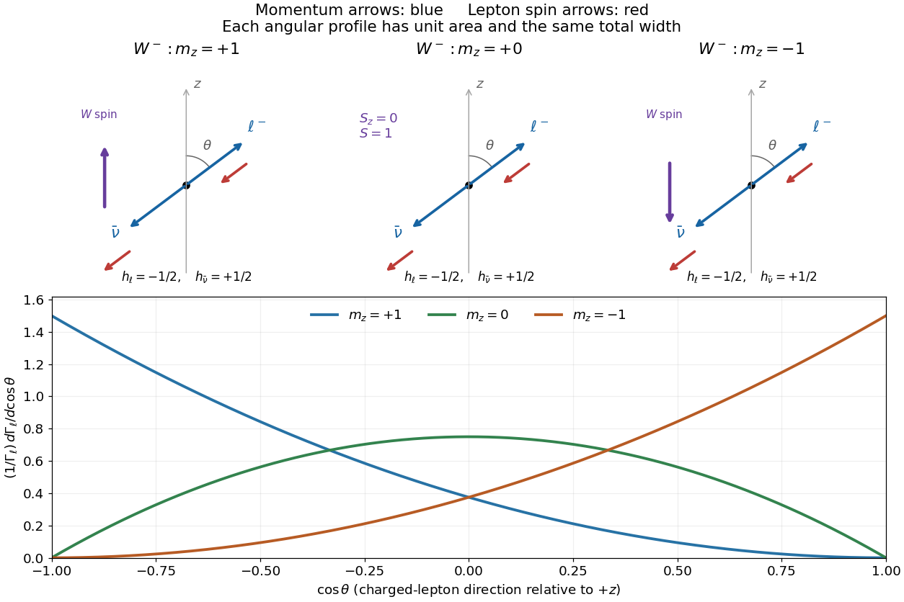

<h1 id="1/a/solution">Solution</h1>

↑ **Parent:** [A](../a.md)

Work in the [W boson](../../../../w-boson.md) [rest frame](../../../../rest-frame.md), taking the spin-quantization axis along its laboratory motion. Neglect charged-lepton and [neutrino](../../../../neutrino.md) [masses](../../../../mass.md). The [weak charged current](../../../../charged-current.md) produces a [negative-helicity](../../../../helicity.md) $\ell^-$ and a [positive-helicity](../../../../helicity.md) [antineutrino](../../../../antineutrino.md). Their [momenta](../../../../momentum-split.md) are opposite, so both [spin](../../../../spin.md) [Vectors](../../../../vector.md) point opposite to the [charged lepton](../../../../charged-lepton.md)'s direction $\hat{\mathbf n}$; the final total [spin projection](../../../../spin.md) along $\hat{\mathbf n}$ is $-1$.

Let $\lambda_W=+1,0,-1$ denote the parent [spin projection](../../../../spin.md) along $z$. In the given [probability amplitude](../../../../probability-amplitude.md), use $j=1$ and the [rotation](../../../../rotation-mathematics.md) element $d^1_{-1,\lambda_W}(\theta)$. The supplied spin-one [rotation](../../../../rotation-mathematics.md) elements give

$$
\boxed{|\mathcal M_{+1}|^2=m_W^2g^2\frac{(1-\cos\theta)^2}{4},\qquad
|\mathcal M_0|^2=m_W^2g^2\frac{\sin^2\theta}{2},\qquad
|\mathcal M_{-1}|^2=m_W^2g^2\frac{(1+\cos\theta)^2}{4}.}
$$

The transverse states have [spin projections](../../../../spin.md) $\pm1$; the longitudinal state has projection zero, not total [spin](../../../../spin.md) zero. The original diagram below distinguishes [momenta](../../../../momentum-split.md) from [spins](../../../../spin.md) and shows the corresponding normalized angular profiles.

**[Figure 1](#1/a/image-w-boson-spin-projections-lepton-helicities-and-decay-angular-distributions). W boson spin projections, lepton helicities and decay angular distributions**.

## ↑ Ancestors (12)

1. [A](../a.md)
2. [1](../../1.md)
3. [2018](../../../2018-split.md)
4. [Past exam of the particle physics course of the University of Oxford](../../../split.md)
5. [Particle physics course of the University of Oxford](../../../../particle-physics-course-of-the-university-of-oxford.md)
6. [Year 4 of the physics course of the University of Oxford](../../../../year-4-of-the-physics-course-of-the-university-of-oxford.md)
7. [Physics course of the University of Oxford](../../../../physics-course-of-the-university-of-oxford.md)
8. [Undergraduate course of the University of Oxford](../../../../undergraduate-course-of-the-university-of-oxford.md)
9. [Course of the University of Oxford](../../../../course-of-the-university-of-oxford.md)
10. [University of Oxford](../../../../university-of-oxford-split.md)
11. [List of universities](../../../../list-of-universities.md)
12. [Codex Wiki](../../../../split.md)
