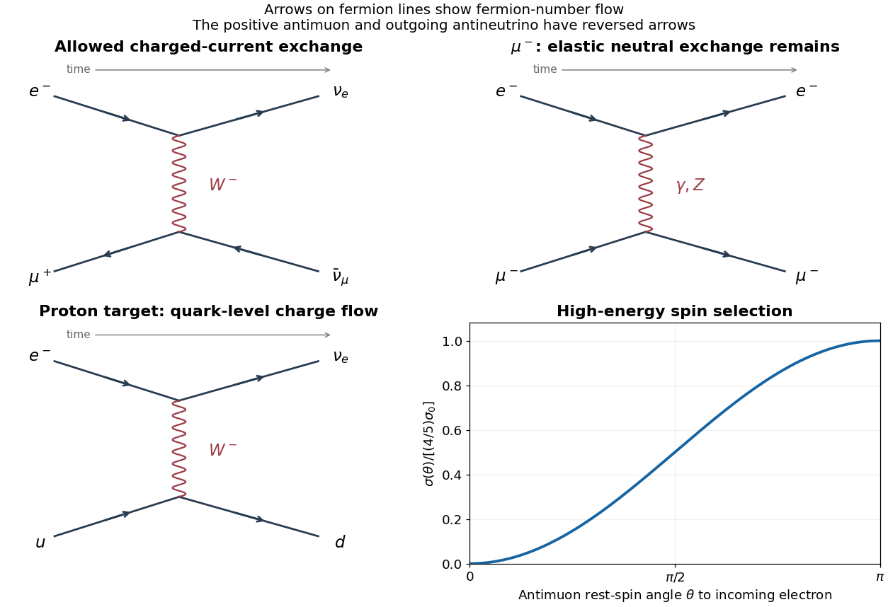

<h1 id="4/d/solution">Solution</h1>

↑ **Parent:** [D](../d.md)

The [charged-current](../../../../charged-current.md) process is

$$
\boxed{e^-+\mu^+\longrightarrow\nu_e+\bar\nu_\mu,}
$$

with a $t$-channel $W^-$ emitted at the electron-to-neutrino vertex and absorbed at the antimuon-to-antineutrino vertex. It is not an $s$-channel [Annihilation](../../../../annihilation.md) of the unlike-flavour [charged leptons](../../../../charged-lepton.md) into one $W$.

At high [momentum transfer](../../../../momentum-transfer.md) the incident [electron](../../../../electron.md)'s [left-chiral](../../../../chirality-physics.md) fraction tends to $4/5$. In the collision [centre-of-mass frame](../../../../center-of-momentum-frame.md), the incoming [antimuon](../../../../antimuon.md) moves along $-z$ and its [charged-current](../../../../charged-current.md) allowed right [helicity](../../../../helicity.md) has [spin](../../../../spin.md) along $-z$. A rest-frame [spin](../../../../spin.md) at [Angle](../../../../angle.md) $\theta$ to $+z$ projects onto that [spin](../../../../spin.md) direction with [probability](../../../../probability.md) $\sin^2(\theta/2)$. Therefore, if $\sigma_0$ denotes the [cross section](../../../../cross-section-physics.md) for a pure [left-helicity](../../../../helicity.md) [electron](../../../../electron.md) and fully selected [antimuon](../../../../antimuon.md) [spin](../../../../spin.md),

$$
\boxed{\sigma(\theta)\simeq\frac45\,\sigma_0\sin^2\frac\theta2=\frac25\sigma_0(1-\cos\theta).}
$$

It vanishes at $\theta=0$ in the ultrarelativistic selection limit and is maximal at $\theta=\pi$. Finite-mass corrections can fill the suppressed orientation. The absolute [normalization](../../../../normalization.md) depends on beam [energy](../../../../energy-split.md) and the exchanged-boson [propagator](../../../../propagator.md); the spin-angle dependence is what is fixed here.

**[Figure 2](#4/d/image-leptonic-and-quark-level-exchange-diagrams-and-polarized-charged-current-angular-dependence). Leptonic and quark-level exchange diagrams and polarized charged-current angular dependence**.

## ↑ Ancestors (12)

1. [D](../d.md)
2. [4](../../4.md)
3. [2018](../../../2018-split.md)
4. [Past exam of the particle physics course of the University of Oxford](../../../split.md)
5. [Particle physics course of the University of Oxford](../../../../particle-physics-course-of-the-university-of-oxford.md)
6. [Year 4 of the physics course of the University of Oxford](../../../../year-4-of-the-physics-course-of-the-university-of-oxford.md)
7. [Physics course of the University of Oxford](../../../../physics-course-of-the-university-of-oxford.md)
8. [Undergraduate course of the University of Oxford](../../../../undergraduate-course-of-the-university-of-oxford.md)
9. [Course of the University of Oxford](../../../../course-of-the-university-of-oxford.md)
10. [University of Oxford](../../../../university-of-oxford-split.md)
11. [List of universities](../../../../list-of-universities.md)
12. [Codex Wiki](../../../../split.md)
