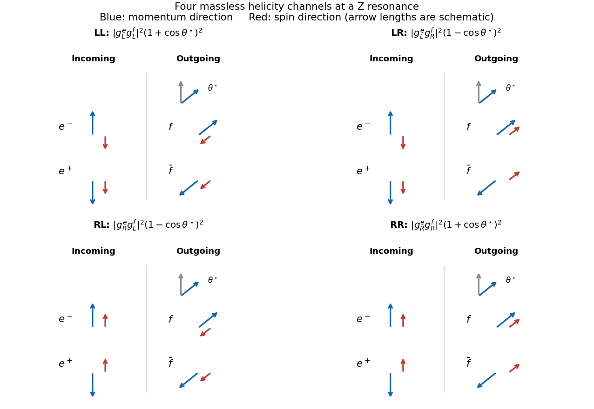

<h1 id="6/a/solution">Solution</h1>

↑ **Parent:** [A](../a.md)

For negligible [fermion](../../../../fermion.md) [masses](../../../../mass.md), the [neutral-current](../../../../neutral-current.md) vertex connects a [fermion](../../../../fermion.md) and [antifermion](../../../../antifermion.md) of opposite [helicity](../../../../helicity.md). The two incoming choices are $e^-_Le^+_R$ and $e^-_Re^+_L$; the two outgoing choices are $f_L\bar f_R$ and $f_R\bar f_L$. Their combinations give four channels, denoted $LL,LR,RL,RR$, where each letter refers to the [fermion](../../../../fermion.md) rather than [antifermion](../../../../antifermion.md).

Take the incoming [electron](../../../../electron.md) [momentum](../../../../momentum-split.md) along $+z$ and [Positron](../../../../positron.md) [momentum](../../../../momentum-split.md) along $-z$. The initial $L$ pair has both [spins](../../../../spin.md) along $-z$, giving total projection $-1$; the $R$ pair has both along $+z$, giving projection $+1$. If the outgoing [fermion](../../../../fermion.md) moves along $\hat{\mathbf n}$, an outgoing $L$ pair has both [spins](../../../../spin.md) along $-\hat{\mathbf n}$ and an $R$ pair both along $+\hat{\mathbf n}$. The figure shows [momentum](../../../../momentum-split.md) and [spin](../../../../spin.md) arrows separately for all four channels.

**[Figure 3](#6/a/image-four-massless-z-boson-helicity-channels-with-momentum-and-spin-directions). Four massless Z boson helicity channels with momentum and spin directions**.

## ↑ Ancestors (12)

1. [A](../a.md)
2. [6](../../6.md)
3. [2018](../../../2018-split.md)
4. [Past exam of the particle physics course of the University of Oxford](../../../split.md)
5. [Particle physics course of the University of Oxford](../../../../particle-physics-course-of-the-university-of-oxford.md)
6. [Year 4 of the physics course of the University of Oxford](../../../../year-4-of-the-physics-course-of-the-university-of-oxford.md)
7. [Physics course of the University of Oxford](../../../../physics-course-of-the-university-of-oxford.md)
8. [Undergraduate course of the University of Oxford](../../../../undergraduate-course-of-the-university-of-oxford.md)
9. [Course of the University of Oxford](../../../../course-of-the-university-of-oxford.md)
10. [University of Oxford](../../../../university-of-oxford-split.md)
11. [List of universities](../../../../list-of-universities.md)
12. [Codex Wiki](../../../../split.md)
