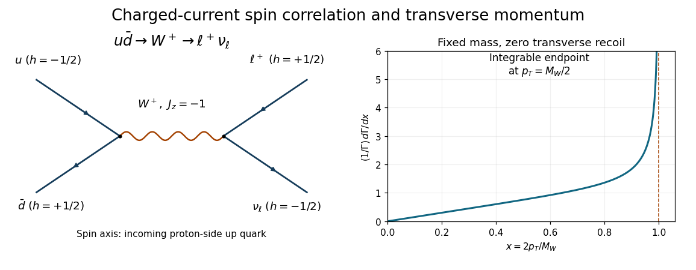
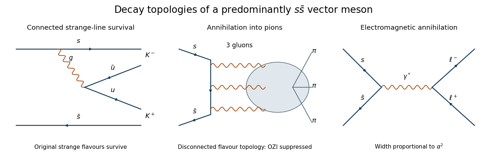
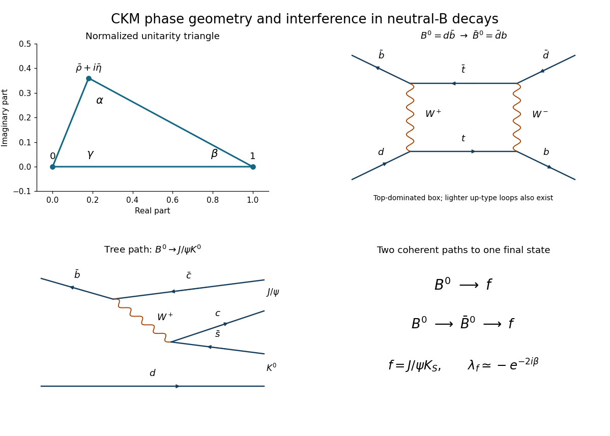

# 2019

↑ **Parent:** [Past exam of the particle physics course of the University of Oxford](../past-exam-of-the-particle-physics-course-of-the-university-of-oxford.md)

Source paper: [https://www.whatdotheyknow.com/request/oxford_physics_past_papers_2/response/2340696/attach/7/Physics%20Papers%202018.pdf?cookie_passthrough=1](https://www.whatdotheyknow.com/request/oxford_physics_past_papers_2/response/2340696/attach/7/Physics%20Papers%202018.pdf?cookie_passthrough=1)

The cover establishes Trinity Term 2019 despite the annual bundle's 2018 filename. Use $\hbar=c=1$ and the mostly-minus [Minkowski metric](../special-relativity.md#minkowski-metric). All six questions are solved, including the alternatives allowed by the paper's choice of four questions.

**Table of contents**

- [1](#1)
  - [a](#1/a)
    - [i](#1/a/i)
      - [Solution](#1/a/i/solution)
    - [ii](#1/a/ii)
      - [Solution](#1/a/ii/solution)
    - [iii](#1/a/iii)
      - [Solution](#1/a/iii/solution)
  - [b](#1/b)
    - [i](#1/b/i)
      - [Solution](#1/b/i/solution)
    - [ii](#1/b/ii)
      - [Solution](#1/b/ii/solution)
  - [c](#1/c)
    - [i](#1/c/i)
      - [Solution](#1/c/i/solution)
    - [ii](#1/c/ii)
      - [Solution](#1/c/ii/solution)
    - [iii](#1/c/iii)
      - [Solution](#1/c/iii/solution)
- [2](#2)
  - [a](#2/a)
    - [Solution](#2/a/solution)
  - [b](#2/b)
    - [Solution](#2/b/solution)
  - [c](#2/c)
    - [Solution](#2/c/solution)
  - [d](#2/d)
    - [Solution](#2/d/solution)
- [3](#3)
  - [a](#3/a)
    - [Solution](#3/a/solution)
  - [b](#3/b)
    - [Solution](#3/b/solution)
  - [c](#3/c)
    - [Solution](#3/c/solution)
  - [d](#3/d)
    - [Solution](#3/d/solution)
- [4](#4)
  - [a](#4/a)
    - [Solution](#4/a/solution)
  - [b](#4/b)
    - [Solution](#4/b/solution)
  - [c](#4/c)
    - [Solution](#4/c/solution)
  - [d](#4/d)
    - [Solution](#4/d/solution)
- [5](#5)
  - [a](#5/a)
    - [Solution](#5/a/solution)
  - [b](#5/b)
    - [Solution](#5/b/solution)
  - [c](#5/c)
    - [Solution](#5/c/solution)
  - [d](#5/d)
    - [Solution](#5/d/solution)
- [6](#6)
  - [a](#6/a)
    - [Solution](#6/a/solution)
  - [b](#6/b)
    - [Solution](#6/b/solution)
  - [c](#6/c)
    - [Solution](#6/c/solution)
- [Sources](#sources)
  - [Structure functions by Particle Data Group (2024)](#sources/structure-functions-by-particle-data-group-2024)
  - [Neutrino masses, mixing, and oscillations by Particle Data Group (2024)](#sources/neutrino-masses-mixing-and-oscillations-by-particle-data-group-2024)

## 1

↑ **Parent:** [2019](2019.md)

<h3 id="1/a">a</h3>

↑ **Parent:** [1](#1)

<h4 id="1/a/i">i</h4>

↑ **Parent:** [A](#1/a)

<h5 id="1/a/i/solution">Solution</h5>

↑ **Parent:** [I](#1/a/i)

A leading valence-level process is $u\bar d\to W^+\to e^+\nu_e$, with the [up quark](../standard-model.md#up-quark) supplied by the [proton](../physics.md#proton) and the [down antiquark](../standard-model.md#down-antiquark) by the [antiproton](../relativistic-quantum-field.md#antiproton). The same [Feynman diagram](../perturbative-quantum-field-theory.md#feynman-diagram) works with $e^+\nu_e$ replaced by $\mu^+\nu_\mu$. Both vertices are [weak charged current](../standard-model.md#charged-current) vertices; the production [scattering amplitude](../quantum-scattering.md#scattering-amplitude) contains the [CKM matrix](../standard-model.md#cabibbo-kobayashi-maskawa-matrix) element $V_{ud}$ or its conjugate according to the chosen fermion-flow convention. The intermediate [W boson](../standard-model.md#w-boson) is produced near its [mass shell](../special-relativity.md#mass-shell).

**[Figure 1](#1/a/i/image-original-charged-current-production-diagram-and-the-normalized-ideal-charged-lepton-transverse-momentum-density-the-angular-axis-is-measured-from-the-proton-side-incoming-up-quark). Original charged-current production diagram and the normalized ideal charged-lepton transverse-momentum density. The angular axis is measured from the proton-side incoming up quark.**

<h4 id="1/a/ii">ii</h4>

↑ **Parent:** [A](#1/a)

<h5 id="1/a/ii/solution">Solution</h5>

↑ **Parent:** [Ii](#1/a/ii)

Neglect the participating [quark](../standard-model.md#quark) and [lepton](../standard-model.md#lepton) [masses](../classical-mechanics.md#mass), so that the [weak charged current](../standard-model.md#charged-current) selects a left-[helicity](../special-relativity.md#helicity) $u$ and a right-[helicity](../special-relativity.md#helicity) $\bar d$. Choose $+z$ along the [proton](../physics.md#proton) beam in the [partonic](../standard-model.md#parton-model) [centre-of-momentum frame](../special-relativity.md#center-of-momentum-frame). Then the [up quark](../standard-model.md#up-quark) moves along $+z$ with [spin projection](../angular-momentum-operator.md#spin) $-1/2$, while the [down antiquark](../standard-model.md#down-antiquark) moves along $-z$ with [helicity](../special-relativity.md#helicity) $+1/2$ and also has [spin projection](../angular-momentum-operator.md#spin) $-1/2$ along $+z$. Thus

$$
\boxed{J_z(W^+)=-1.}
$$

The collinear two-body initial state has no orbital projection about its collision axis. In this approximation the produced [W boson](../standard-model.md#w-boson) therefore has the indicated transverse [polarization](../wave.md#polarization-waves); its longitudinal spin state is absent. The unpolarized [hadron](../physics.md#hadron) beams contain other constituent [spin states](../angular-momentum-operator.md#spin), but these do not participate in this [massless](../physics.md#massless-particle) [charged-current](../standard-model.md#charged-current) subprocess.

In the final state the [Positron](../physics.md#positron) has [helicity](../special-relativity.md#helicity) $+1/2$ and the [electron neutrino](../standard-model.md#electron-neutrino) has [helicity](../special-relativity.md#helicity) $-1/2$. Along the outgoing [charged-lepton](../standard-model.md#charged-lepton) direction their combined angular-momentum projection is $+1$, because the oppositely moving [neutrino](../standard-model.md#neutrino) has [spin projection](../angular-momentum-operator.md#spin) $+1/2$ on that axis. Finite [masses](../classical-mechanics.md#mass), noncollinear production and sea contributions modify the ideal configuration.

<h4 id="1/a/iii">iii</h4>

↑ **Parent:** [A](#1/a)

<h5 id="1/a/iii/solution">Solution</h5>

↑ **Parent:** [Iii](#1/a/iii)

Let $\theta^\star$ be the angle from the incoming [up quark](../standard-model.md#up-quark), along the [proton](../physics.md#proton) direction, to the outgoing charged [antilepton](../standard-model.md#antilepton) in the [W boson](../standard-model.md#w-boson) rest frame. The initial and final [spin projections](../angular-momentum-operator.md#spin) in [ii](#1/a/ii) are $-1$ and $+1$. The [Wigner small-d matrix](../angular-momentum-operator.md#wigner-small-d-matrix) therefore gives

$$
\mathcal M(\theta^\star)\propto d^1_{-1,+1}(\theta^\star)
=\frac{1-\cos\theta^\star}{2}.
$$

After squaring and normalizing over $c=\cos\theta^\star$, the [charged-lepton](../standard-model.md#charged-lepton) [angular distribution](../quantum-scattering.md#angular-distribution) is

$$
\boxed{\frac1\Gamma\frac{d\Gamma}{dc}=\frac38(1-c)^2,\qquad -1<c<1.}
$$

Its integral is one since $\int_{-1}^{1}(1-c)^2dc=8/3$. The charged [antilepton](../standard-model.md#antilepton) is preferentially emitted toward the [antiproton](../relativistic-quantum-field.md#antiproton). Measuring the angle from the incoming [down antiquark](../standard-model.md#down-antiquark) instead replaces $c$ by $-c$ and produces $(1+c)^2$; the axis convention is part of the answer. Per unit solid angle the normalized density is $3(1-\cos\theta^\star)^2/(16\pi)$.

<h3 id="1/b">b</h3>

↑ **Parent:** [1](#1)

<h4 id="1/b/i">i</h4>

↑ **Parent:** [B](#1/b)

<h5 id="1/b/i/solution">Solution</h5>

↑ **Parent:** [I](#1/b/i)

Take an on-shell [W boson](../standard-model.md#w-boson) of fixed [mass](../classical-mechanics.md#mass) $M_W$, zero transverse recoil, negligible [charged-lepton](../standard-model.md#charged-lepton) [mass](../classical-mechanics.md#mass), and unrestricted angular acceptance. In its rest frame the charged [lepton](../standard-model.md#lepton) has [momentum](../momentum.md) magnitude $p_0=M_W/2$. A longitudinal [Lorentz boost](../special-relativity.md#lorentz-boost) to the laboratory preserves [transverse momentum](../particle-detection.md#transverse-momentum), so

$$
p_T=p_0\sin\theta^\star,\qquad
c=\pm\sqrt{1-(p_T/p_0)^2}.
$$

Both angular roots contribute to the same $p_T$. Set $x=p_T/p_0$ and $a=\sqrt{1-x^2}$. The change-of-variable [Jacobian determinant](../multivariable-calculus.md#jacobian-determinant) has $|dc/dp_T|=x/(p_0a)$, and the two-root angular weight is $\tfrac38[(1-a)^2+(1+a)^2]=\tfrac34(2-x^2)$. Consequently

$$
\boxed{\frac1\Gamma\frac{d\Gamma}{dp_T}
=\frac{3}{4p_0}\frac{x(2-x^2)}{\sqrt{1-x^2}},\qquad
0<p_T<p_0,\qquad p_T^{\max}=\frac{M_W}{2}.}
$$

This is the ideal [W-decay Jacobian peak](../standard-model.md#w-decay-jacobian-peak). The divergence at the endpoint is integrable; it is a change-of-variable effect, not an infinite decay probability. Reversing the polar axis does not change this [transverse momentum](../particle-detection.md#transverse-momentum) density, because the sum of the two roots removes the term odd in $c$.

<h4 id="1/b/ii">ii</h4>

↑ **Parent:** [B](#1/b)

<h5 id="1/b/ii/solution">Solution</h5>

↑ **Parent:** [Ii](#1/b/ii)

[Initial-state radiation](../particle-detection.md#initial-state-radiation) of [gluons](../standard-model.md#gluon) gives the [W boson](../standard-model.md#w-boson) nonzero [transverse momentum](../particle-detection.md#transverse-momentum). Its transverse [Lorentz boost](../special-relativity.md#lorentz-boost) then changes the [charged-lepton](../standard-model.md#charged-lepton) $p_T$, washing out the sharp $M_W/2$ edge and permitting events above it. The recoil must be modelled with [Quantum chromodynamics](../standard-model.md#quantum-chromodynamics) and constrained by measured [hadronic](../physics.md#hadron) activity. Independently, the finite [W boson](../standard-model.md#w-boson) [decay width](../relativistic-quantum-field.md#decay-width) spreads its actual [invariant mass](../special-relativity.md#invariant-mass), also smearing the fixed-mass endpoint. Either is a theoretical broadening mechanism; neither is a [detector-resolution](../particle-detection.md#particle-detector) effect.

<h3 id="1/c">c</h3>

↑ **Parent:** [1](#1)

<h4 id="1/c/i">i</h4>

↑ **Parent:** [C](#1/c)

<h5 id="1/c/i/solution">Solution</h5>

↑ **Parent:** [I](#1/c/i)

The useful modes are $\boxed{W^+\to e^+\nu_e\ \text{and}\ W^+\to\mu^+\nu_\mu}$ and their charge conjugates. An [electron](../physics.md#electron) gives an isolated track and localized [electromagnetic shower](../particle-detection.md#electromagnetic-shower); a [muon](../standard-model.md#muon) gives an isolated penetrating track. Both allow a well-calibrated [charged-lepton](../standard-model.md#charged-lepton) [transverse momentum](../particle-detection.md#transverse-momentum) and a [missing transverse momentum](../particle-detection.md#missing-transverse-momentum) measurement for the [neutrino](../standard-model.md#neutrino).

The [tau lepton](../standard-model.md#tau-particle) decays before detection, usually adding further [neutrinos](../standard-model.md#neutrino). Its visible [momentum](../momentum.md) is only part of the original tau [momentum](../momentum.md), so the simple two-body endpoint is lost. For the direct [electron](../physics.md#electron) and [muon](../standard-model.md#muon) modes, the [transverse mass](../particle-detection.md#transverse-mass)

$$
M_T^2=2p_T^\ell p_T^\nu[1-\cos(\Delta\varphi)]
$$

also has an ideal endpoint at $M_W$ and avoids needing the unmeasured [neutrino](../standard-model.md#neutrino) longitudinal [momentum](../momentum.md). Fits to this distribution or the [charged-lepton](../standard-model.md#charged-lepton) $p_T$ spectrum determine $M_W$.

<h4 id="1/c/ii">ii</h4>

↑ **Parent:** [C](#1/c)

<h5 id="1/c/ii/solution">Solution</h5>

↑ **Parent:** [Ii](#1/c/ii)

Choose $W^+\to\mu^+\nu_\mu$. Important backgrounds include [Quantum chromodynamics](../standard-model.md#quantum-chromodynamics) production of heavy-flavour [hadrons](../physics.md#hadron) with semileptonic decays, in-flight [pion](../standard-model.md#pion) or [kaon](../physics.md#kaon) decays, and [hadrons](../physics.md#hadron) penetrating the calorimeters. These generally have accompanying jet activity; semileptonic decays can contain real [neutrinos](../standard-model.md#neutrino), while jet mismeasurement can fake [missing transverse momentum](../particle-detection.md#missing-transverse-momentum). Heavy-flavour tracks can originate at a [displaced decay vertex](../particle-detection.md#displaced-decay-vertex). Require a high-$p_T$ isolated [muon](../standard-model.md#muon), agreement between inner tracking and the external [muon](../standard-model.md#muon) system, and substantial [missing transverse momentum](../particle-detection.md#missing-transverse-momentum) inconsistent with [detector](../particle-detection.md#particle-detector) noise or a mismeasured jet.

The genuine electroweak backgrounds include $Z\to\mu^+\mu^-$ with one [muon](../standard-model.md#muon) lost and $W\to\tau\nu\to\mu\nu\nu\nu$. Veto a second reconstructed opposite-sign [muon](../standard-model.md#muon) and use the dimuon [invariant mass](../special-relativity.md#invariant-mass) when both are present to reject the [Z boson](../standard-model.md#z-boson) channel. The tau-mediated spectrum is softer and contains extra missing [particles](../physics.md#particle-physics); template fits and control samples estimate its residual contribution. [Detector acceptance](../particle-detection.md#detector-acceptance) determines how much of the lost-muon background survives.

<h4 id="1/c/iii">iii</h4>

↑ **Parent:** [C](#1/c)

<h5 id="1/c/iii/solution">Solution</h5>

↑ **Parent:** [Iii](#1/c/iii)

For the selected [muon](../standard-model.md#muon) channel, finite curvature resolution in the magnetic tracking system broadens the reconstructed [transverse momentum](../particle-detection.md#transverse-momentum) spectrum. A high-$p_T$ track has small [sagitta](../topology.md#sagitta), so spatial measurement errors, alignment errors and magnetic-field calibration errors become important; at high [momentum](../momentum.md) an approximately fixed uncertainty in $1/p_T$ gives $\delta p_T\propto p_T^2$. [Multiple Coulomb scattering](../wave.md#multiple-coulomb-scattering) contributes at lower [momenta](../momentum.md). If the [transverse mass](../particle-detection.md#transverse-mass) is fitted, finite hadronic-recoil resolution additionally smears the inferred [missing transverse momentum](../particle-detection.md#missing-transverse-momentum). These are experimental effects, distinct from the physical recoil and width in [ii](#1/b/ii).

## 2

↑ **Parent:** [2019](2019.md)

<h3 id="2/a">a</h3>

↑ **Parent:** [2](#2)

<h4 id="2/a/solution">Solution</h4>

↑ **Parent:** [A](#2/a)

[Quadrupole magnets](../particle-accelerator.md#quadrupole-magnet) provide transverse restoring forces proportional to displacement from the reference orbit. Their [magnetic field](../magnetic-field.md) increases linearly away from the axis, so an off-axis [particle](../physics.md#particle-physics) receives a kick that can bring its trajectory back toward the design orbit. A magnetic [quadrupole](../particle-accelerator.md#quadrupole-magnet) focuses in one transverse plane and defocuses in the other; a single [quadrupole](../particle-accelerator.md#quadrupole-magnet) cannot confine both planes.

An [alternating-gradient focusing](../particle-accelerator.md#strong-focusing) lattice alternates [quadrupole](../particle-accelerator.md#quadrupole-magnet) orientations with drift spaces. With suitable strengths and separations, a focusing-defocusing sequence gives stable [betatron oscillations](../particle-accelerator.md#betatron-oscillation) in both planes. The focusing acts on transverse position, while the phase advance through the lattice converts an initial angular deviation into position and then a corrective kick. The beam is thus transported within a bounded envelope rather than allowed to drift into the pipe. Dipoles provide the main bending; the [quadrupole](../particle-accelerator.md#quadrupole-magnet) lattice controls the small deviations.

<h3 id="2/b">b</h3>

↑ **Parent:** [2](#2)

<h4 id="2/b/solution">Solution</h4>

↑ **Parent:** [B](#2/b)

Write $z=\sqrt\epsilon\,\omega\cos\psi$, with $\omega=\sqrt\beta>0$ and $\psi=\phi-\phi_0$. Differentiating twice gives

$$
\frac{z''+kz}{\sqrt\epsilon}
=[\omega''-\omega(\phi')^2+k\omega]\cos\psi
-[2\omega'\phi'+\omega\phi'']\sin\psi.
$$

The coefficients must vanish for arbitrary initial phase $\phi_0$. The sine coefficient gives

$$
(\omega^2\phi')'=0,\qquad \omega^2\phi'=C.
$$

The conventional [Courant-Snyder parameters](../particle-accelerator.md#courant-snyder-parameters) normalize the phase so that $C=1$; any positive constant $C$ can be absorbed into the scale assigned to $\beta$ and $\epsilon$. Explicitly, $\widetilde\beta=\beta/C$ and $\widetilde\epsilon=C\epsilon$ preserve the orbit while making $\widetilde\beta\phi'=1$. With this convention,

$$
\boxed{\phi'=\frac1\beta,\qquad
\omega''-\frac1{\omega^3}+k(s)\omega=0.}
$$

The second expression is the [Ermakov-Pinney equation](../differential-equation.md#ermakov-pinney-equation) for the beam envelope. It follows by substituting $\phi'=1/\omega^2$ into the cosine coefficient.

**The printed equation omits the factor $\omega$ multiplying $k(s)$.** For a concrete counterexample, take the constant periodic focusing strength $k=1/16$ and the constant envelope $\omega=2$. Then $\phi'=1/4$ and $z=2\sqrt\epsilon\cos(s/4-\phi_0)$ solve $z''+z/16=0$. The correct envelope equation is $0-1/8+(1/16)2=0$, whereas the printed equation gives $-1/8+1/16=-1/16$.

The associated invariant is

$$
\epsilon=\gamma_Tz^2+2\alpha_Tzz'+\beta z'^2,
\qquad \alpha_T=-\beta'/2,\quad
\gamma_T=(1+\alpha_T^2)/\beta.
$$

Thus $\epsilon$ fixes the [phase-space](../hamiltonian-mechanics.md#phase-space) ellipse of a trajectory; a beam's rms [geometric emittance](../particle-accelerator.md#geometric-emittance) uses the corresponding second-moment convention. Factors of $\pi$ depend on whether emittance means ellipse area or area divided by $\pi$ and do not alter the envelope equation.

<h3 id="2/c">c</h3>

↑ **Parent:** [2](#2)

<h4 id="2/c/solution">Solution</h4>

↑ **Parent:** [C](#2/c)

For a beam with rms [geometric emittance](../particle-accelerator.md#geometric-emittance) $\epsilon_y$, its vertical size at the collision point is $\sigma_y^\star=\sqrt{\epsilon_y\beta_y^\star}$. Reducing $\beta_y^\star$ therefore concentrates the beam, increasing the number of [particles](../physics.md#particle-physics) encountering the opposite beam per transverse area. For identical Gaussian beams colliding head-on,

$$
\mathcal L=\frac{n_b f_{\rm rev}N_1N_2}{4\pi\sigma_x^\star\sigma_y^\star}.
$$

Keep bunch populations, horizontal size, collision frequency and emittances fixed. If both vertical beta values are decreased by a factor $f>1$, meaning $\beta_{y,\rm new}^\star=\beta_{y,\rm old}^\star/f$, both vertical beam sizes decrease by $1/\sqrt f$, and

$$
\boxed{\frac{\mathcal L_{\rm new}}{\mathcal L_{\rm old}}=\sqrt f.}
$$

The [luminosity](../standard-model.md#collider-luminosity) is inversely proportional to the common vertical size, not its square, because only one transverse dimension has changed. The same ratio follows from the unequal-beam overlap denominator $\sqrt{\sigma_{y1}^2+\sigma_{y2}^2}$.

A [final-focus quadrupole](../particle-accelerator.md#final-focus-quadrupole) system on either side of the interaction point forms a waist there. Strong [quadrupole](../particle-accelerator.md#quadrupole-magnet) doublets or triplets, with suitable matching sections, focus both planes. At a symmetric waist $\beta'=0$ and the nearby drift gives $\beta(s)=\beta^\star+s^2/\beta^\star$, so small $\beta^\star$ requires large beam envelopes and strong optical gradients in the adjacent magnets. Chromatic correction is needed for off-momentum [particles](../physics.md#particle-physics). The formula assumes negligible crossing-angle and hourglass reductions; a bunch length comparable to $\beta^\star$ changes the effective overlap.

<h3 id="2/d">d</h3>

↑ **Parent:** [2](#2)

<h4 id="2/d/solution">Solution</h4>

↑ **Parent:** [D](#2/d)

For a paraxial orbit $z'\simeq p_z/p_s$, where $p_z$ is transverse [momentum](../momentum.md) and $p_s$ longitudinal [momentum](../momentum.md). Acceleration mainly increases $p_s$, so a given transverse kick produces a smaller angular deviation. In an ideal matched accelerator without scattering or radiation, the conserved transverse canonical [phase-space](../hamiltonian-mechanics.md#phase-space) area becomes a smaller area in the coordinates $(z,z')$. This is [adiabatic damping of geometric emittance](../particle-accelerator.md#adiabatic-damping-of-geometric-emittance), not loss of canonical [phase-space](../hamiltonian-mechanics.md#phase-space) volume.

The invariant [normalized emittance](../particle-accelerator.md#normalized-emittance) is

$$
\epsilon_n=\beta_{\rm rel}\gamma_{\rm rel}\epsilon
=\frac{p_s}{m}\epsilon,
\qquad
\boxed{\epsilon\propto p_s^{-1}.}
$$

Here $\beta_{\rm rel}$ is speed in units of $c$, distinct from the lattice beta function. Neglecting dilution mechanisms, each acceleration stage thus supplies a beam with smaller angular spread and [geometric emittance](../particle-accelerator.md#geometric-emittance) for injection into the next stage.

A chain of increasingly energetic [particle accelerators](../particle-accelerator.md) lets each ring operate over a manageable range of [magnetic rigidity](../relativistic-electromagnetism.md#magnetic-rigidity) and radio-frequency settings. It also avoids injecting a large-emittance low-energy beam directly into the small-aperture high-field main ring. Higher injection [energy](../energy.md) reduces space-charge effects and improves capture and transmission. Emittance dilution, mismatching and collective instabilities can oppose the ideal damping; acceleration alone does not reduce [normalized emittance](../particle-accelerator.md#normalized-emittance).

## 3

↑ **Parent:** [2019](2019.md)

<h3 id="3/a">a</h3>

↑ **Parent:** [3](#3)

<h4 id="3/a/solution">Solution</h4>

↑ **Parent:** [A](#3/a)

Use the [orthonormal](../inner-product.md#orthonormal-set) basis $|u\bar u\rangle,|d\bar d\rangle,|s\bar s\rangle$. The normalized [flavour](../standard-model.md#quark-flavor) [singlet](../representation-theory.md#singlet-representation) is

$$
\boxed{|1\rangle=\frac{|u\bar u\rangle+|d\bar d\rangle+|s\bar s\rangle}{\sqrt3},
\qquad I=I_3=S=0.}
$$

The [SU(3)](../topological-group.md#su-3-group) invariant contraction pairs each fundamental [flavour](../standard-model.md#quark-flavor) with its conjugate. Applying any supplied raising operator to the [singlet](../representation-theory.md#singlet-representation) gives zero because its [quark](../standard-model.md#quark) and [antiquark](../standard-model.md#antiquark) contributions cancel.

To fix the neutral [isospin](../standard-model.md#isospin) [triplet](../representation-theory.md#triplet-representation) phase consistently with the source's charged states, apply $I_+$ to $-|d\bar u\rangle$:

$$
I_+[-|d\bar u\rangle]=|d\bar d\rangle-|u\bar u\rangle.
$$

Thus one missing member of the [meson octet](../standard-model.md#meson-octet) is

$$
\boxed{|T_0\rangle=\frac{|d\bar d\rangle-|u\bar u\rangle}{\sqrt2},\qquad I=1,\ I_3=S=0.}
$$

Indeed $I_+|T_0\rangle=\sqrt2|u\bar d\rangle$, the correct [ladder operator](../semisimple-lie-algebra.md#ladder-operator) strength for the $I=1$ [triplet](../representation-theory.md#triplet-representation).

The other missing state is orthogonal to both $|1\rangle$ and $|T_0\rangle$. For coefficients $(a,b,c)$, [orthogonality](../inner-product.md#orthogonal-vectors) requires $a=b$ and $a+b+c=0$. Choose the convenient overall phase $c>0$ and normalize:

$$
\boxed{|8_0\rangle=\frac{2|s\bar s\rangle-|u\bar u\rangle-|d\bar d\rangle}{\sqrt6},
\qquad I=I_3=S=0.}
$$

It can also be obtained by adding the supplied ladder operations $V_+[-|s\bar u\rangle]=|s\bar s\rangle-|u\bar u\rangle$ and $U_+[-|s\bar d\rangle]=|s\bar s\rangle-|d\bar d\rangle$. The three displayed states are mutually [orthonormal](../inner-product.md#orthonormal-set). The [meson octet](../standard-model.md#meson-octet) here is the traceless adjoint component of $\bar3\otimes3$; the source's word “antisymmetric” does not impose antisymmetry on all its quark-antiquark [flavour](../standard-model.md#quark-flavor) wavefunctions.

<h3 id="3/b">b</h3>

↑ **Parent:** [3](#3)

<h4 id="3/b/solution">Solution</h4>

↑ **Parent:** [B](#3/b)

Only the [singlet](../representation-theory.md#singlet-representation) $|1\rangle$ and isoscalar [octet](../representation-theory.md#octet-representation) member $|8_0\rangle$ can mix without violating [isospin](../standard-model.md#isospin): they have the same $I=I_3=S=0$ and, for the vector multiplet, the same $J^{PC}=1^{--}$. The neutral [triplet](../representation-theory.md#triplet-representation) member has $I=1$ and is excluded in the [isospin](../standard-model.md#isospin) limit.

Set $|\psi_a\rangle=|1\rangle$ and $|\psi_b\rangle=|8_0\rangle$, with precisely the phases in [a](#3/a). Define $|n\rangle=(|u\bar u\rangle+|d\bar d\rangle)/\sqrt2$. Taking overlaps gives

$$
|n\rangle=\sqrt{\frac23}|1\rangle-\frac1{\sqrt3}|8_0\rangle,
\qquad
|s\bar s\rangle=\frac1{\sqrt3}|1\rangle+\sqrt{\frac23}|8_0\rangle.
$$

Therefore the source's rotation convention is satisfied by

$$
\boxed{\cos\theta=\sqrt{\frac23},\qquad
\sin\theta=-\frac1{\sqrt3},\qquad
\theta=-\arctan\frac1{\sqrt2}\simeq-35.26^\circ.}
$$

This yields $|\omega\rangle=|n\rangle$ and $|\phi\rangle=|s\bar s\rangle$ exactly. Reversing the [octet](../representation-theory.md#octet-representation) phase changes the quoted sign, with an irrelevant compensating phase on the physical phi state; exchanging the basis order gives the complementary angle. The physical statement of [ideal vector-meson mixing](../physics.md#ideal-vector-meson-mixing) is the pure strange and pure nonstrange content, rather than a convention-independent sign for the angle.

<h3 id="3/c">c</h3>

↑ **Parent:** [3](#3)

<h4 id="3/c/solution">Solution</h4>

↑ **Parent:** [C](#3/c)

The observed dominance of [kaons](../physics.md#kaon) supports a predominantly $s\bar s$ [phi meson](../physics.md#phi-meson). In a connected strong decay, the original strange [quark](../standard-model.md#quark) and [antiquark](../standard-model.md#antiquark) survive into different [kaons](../physics.md#kaon), while a [gluon](../standard-model.md#gluon) produces a light $q\bar q$ pair:

$$
s\bar s\longrightarrow(s\bar q)(q\bar s),\qquad q=u,d.
$$

This gives $K^-K^+$ or $\bar K^0K^0$ and is allowed by the [OZI rule](../standard-model.md#ozi-rule). A pionic final state contains no strange valence constituents, so the initial $s\bar s$ pair must annihilate. The strong annihilation of a colour-singlet $1^{--}$ state requires at least three [gluons](../standard-model.md#gluon): one [gluon](../standard-model.md#gluon) cannot carry the [singlet](../representation-theory.md#singlet-representation) colour, and two have the wrong charge-conjugation quantum number. This disconnected [flavour](../standard-model.md#quark-flavor) topology is suppressed by the [OZI rule](../standard-model.md#ozi-rule), although it need not vanish.

**[Figure 2](#3/c/image-original-quark-level-topologies-for-connected-kaon-production-three-gluon-annihilation-into-pions-and-electromagnetic-annihilation-into-leptons-the-hadronization-blob-is-schematic). Original quark-level topologies for connected kaon production, three-gluon annihilation into pions, and electromagnetic annihilation into leptons. The hadronization blob is schematic.**

The leptonic mode proceeds through $s\bar s\to\gamma^*\to\ell^+\ell^-$ and is suppressed by [electromagnetic couplings](../electromagnetism.md#electromagnetic-interaction); its width is proportional to $\alpha^2$ times the vector-meson overlap. Unlike a strong [hadronic](../physics.md#hadron) decay, it cannot create its final [particles](../physics.md#particle-physics) through [quark](../standard-model.md#quark) rearrangement. Hence a [branching fraction](../relativistic-quantum-field.md#branching-fraction) of order $10^{-4}$ is qualitatively consistent with [electromagnetic](../electromagnetism.md) annihilation competing with strong modes.

Kaon dominance is especially suggestive because [phase space](../hamiltonian-mechanics.md#phase-space) is limited: using the supplied neutral-kaon and phi [masses](../classical-mechanics.md#mass),

$$
\boxed{p_K=\sqrt{\frac{m_\phi^2}{4}-m_{K^0}^2}\simeq110\ \mathrm{MeV},\qquad
m_\phi-2m_{K^0}=24\ \mathrm{MeV}.}
$$

The two spin-zero [kaons](../physics.md#kaon) have [orbital angular momentum](../quantum-mechanics.md#orbital-angular-momentum) $L=1$ to match the vector parent, so their [partial width](../relativistic-quantum-field.md#partial-decay-width) has the additional near-threshold factor $p_K^3$. Pionic modes have more [phase space](../hamiltonian-mechanics.md#phase-space) yet remain subdominant because of their annihilation topology. The observations therefore support, but do not establish exact, [ideal vector-meson mixing](../physics.md#ideal-vector-meson-mixing): a small nonstrange admixture, [electromagnetic](../electromagnetism.md) amplitudes and nonperturbative strong dynamics can all contribute to the pionic rate.

<h3 id="3/d">d</h3>

↑ **Parent:** [3](#3)

<h4 id="3/d/solution">Solution</h4>

↑ **Parent:** [D](#3/d)

[Quark mass](../standard-model.md#quark-mass) differences break [flavour symmetry](../standard-model.md#flavor-symmetry). [Isospin](../standard-model.md#isospin) exchanges $u,d$, so its strong breaking is controlled by the small difference $m_d-m_u$. [U-spin](../standard-model.md#u-spin) exchanges $d,s$, so its strong breaking involves the much larger $m_s-m_d$. Relative to the characteristic strong-interaction scale, the latter is much larger; this explains why [U-spin](../standard-model.md#u-spin) is a substantially poorer symmetry.

Flavour-dependent interactions are a second source. [Electromagnetism](../electromagnetism.md) distinguishes $u$ from $d$ because $Q_u=2/3$ and $Q_d=-1/3$, and therefore breaks [isospin](../standard-model.md#isospin). However, $d,s$ both have charge $-1/3$, so their [electromagnetic couplings](../electromagnetism.md#electromagnetic-interaction) alone do **not** break [U-spin](../standard-model.md#u-spin) in the equal-mass limit. If two breaking mechanisms for each symmetry are required, the second common mechanism is the [weak interaction](../standard-model.md#weak-interaction): the [CKM matrix](../standard-model.md#cabibbo-kobayashi-maskawa-matrix) and weak [flavour](../standard-model.md#quark-flavor) transitions distinguish the flavours and do not conserve either strong-interaction [flavour symmetry](../standard-model.md#flavor-symmetry). The dominant difference in the quality of the two approximate strong symmetries is still the [mass](../classical-mechanics.md#mass) splitting.

## 4

↑ **Parent:** [2019](2019.md)

<h3 id="4/a">a</h3>

↑ **Parent:** [4](#4)

<h4 id="4/a/solution">Solution</h4>

↑ **Parent:** [A](#4/a)

The [CKM matrix](../standard-model.md#cabibbo-kobayashi-maskawa-matrix) converts down-type [quark mass](../standard-model.md#quark-mass) eigenstates into the combinations entering the [weak charged current](../standard-model.md#charged-current). Its entry $V_{ij}$ controls a [charged-current](../standard-model.md#charged-current) transition between up-type [flavour](../standard-model.md#quark-flavor) $i$ and down-type [flavour](../standard-model.md#quark-flavor) $j$. In the three-generation [Standard Model](../standard-model.md), $V=U_{uL}^\dagger U_{dL}$ is a product of [unitary matrices](../linear-operator-theory.md#unitary-matrix) from diagonalizing the [quark mass](../standard-model.md#quark-mass) matrices, so $V^\dagger V=1$.

The [Wolfenstein parametrization](../standard-model.md#wolfenstein-parametrization) displays the hierarchy

$$
|V|\sim\begin{pmatrix}1&\lambda&\lambda^3\\\lambda&1&\lambda^2\\\lambda^3&\lambda^2&1\end{pmatrix}.
$$

Thus diagonal transitions dominate; first-second generation mixing is larger than second-third generation mixing, and direct first-third generation mixing is smallest. The parameters $A,\rho,\eta$ refine this order estimate. With nondegenerate [quark masses](../standard-model.md#quark-mass), a nonzero irreducible weak phase permits [CP violation](../quantum-field-theory.md#cp-violation); at leading order the [Jarlskog invariant](../standard-model.md#jarlskog-invariant) is $J\simeq A^2\lambda^6\eta$. Individual complex entries are not enough: the phase must survive allowed quark-field rephasings.

The exact physical [CKM matrix](../standard-model.md#cabibbo-kobayashi-maskawa-matrix) is unitary, whereas its displayed cubic truncation is only approximately so. For example its first-row norm is $1+\lambda^4/4+A^2\lambda^6(\rho^2+\eta^2)$, which is not exactly one for nonzero $\lambda$. The omitted higher-order terms repair this; [unitarity](../vector-space.md#unitary-operator) must be tested to the retained order.

<h3 id="4/b">b</h3>

↑ **Parent:** [4](#4)

<h4 id="4/b/solution">Solution</h4>

↑ **Parent:** [B](#4/b)

The inner product of columns one and three is

$$
V_{ud}^*V_{ub}+V_{cd}^*V_{cb}+V_{td}^*V_{tb}
=A\lambda^3[(\rho-i\eta)-1+(1-\rho+i\eta)]+O(\lambda^5)=O(\lambda^5).
$$

The leading terms cancel, establishing compatibility with [unitarity](../vector-space.md#unitary-operator) at cubic order. Direct multiplication of the printed truncation leaves $-A\lambda^5(\rho-i\eta)/2$, so it must not be treated as exactly unitary beyond its stated accuracy.

For the exact matrix, conjugate the closure relation and define

$$
a=V_{ud}V_{ub}^*,\quad b=V_{cd}V_{cb}^*,\quad c=V_{td}V_{tb}^*,\qquad a+b+c=0.
$$

Divide by $-b$ and let $z=-a/b=\bar\rho+i\bar\eta$. Then $a/(-b)=z$ and $c/(-b)=1-z$, giving a [CKM unitarity triangle](../standard-model.md#ckm-unitarity-triangle) with vertices

$$
\boxed{(0,0),\qquad(1,0),\qquad(\bar\rho,\bar\eta).}
$$

At leading Wolfenstein order these are $(0,0),(1,0),(\rho,\eta)$. The barred coordinates define the exact triangle; they differ from the unbarred parameters beyond leading order.

**[Figure 3](#4/b/image-original-normalized-unitarity-triangle-top-dominated-neutral-b-mixing-box-and-the-leading-tree-topology-for-a-common-charmonium-kaon-final-state-the-triangle-coordinates-are-illustrative). Original normalized unitarity triangle, top-dominated neutral-B mixing box, and the leading tree topology for a common charmonium-kaon final state. The triangle coordinates are illustrative.**

For positive $\bar\eta$, define $\gamma$ at the origin, $\beta$ at $(1,0)$, and $\alpha$ at the apex. Comparing the directions of the incident complex sides gives the rephasing-invariant relations

$$
\boxed{\begin{aligned}
\alpha&=\arg\left[-\frac{V_{td}V_{tb}^*}{V_{ud}V_{ub}^*}\right],\\
\beta&=\arg\left[-\frac{V_{cd}V_{cb}^*}{V_{td}V_{tb}^*}\right],\\
\gamma&=\arg\left[-\frac{V_{ud}V_{ub}^*}{V_{cd}V_{cb}^*}\right],\qquad
\alpha+\beta+\gamma=\pi.
\end{aligned}}
$$

To leading order $\gamma=\arg(\rho+i\eta)$ and $\beta=\operatorname{atan2}(\eta,1-\rho)$; the remaining angle follows by subtraction. Each ratio cancels the unphysical common phase of the corresponding column-orthogonality terms.

<h3 id="4/c">c</h3>

↑ **Parent:** [4](#4)

<h4 id="4/c/solution">Solution</h4>

↑ **Parent:** [C](#4/c)

Use $B^0=d\bar b$ and $\bar B^0=\bar d b$. A [box Feynman diagram](../perturbative-quantum-field-theory.md#box-feynman-diagram) with two [W bosons](../standard-model.md#w-boson) and internal up-type [quarks](../standard-model.md#quark) changes one neutral [flavour](../standard-model.md#quark-flavor) into the other. The [top quark](../standard-model.md#top-quark) contribution dominates the dispersive [mixing amplitude](../physics.md#neutral-b-meson-mixing) and carries the squared CKM combination involving $V_{td},V_{tb}$. With a consistent meson phase convention,

$$
\frac qp\simeq\frac{V_{td}V_{tb}^*}{V_{td}^*V_{tb}}.
$$

The illustration in [b](#4/b) shows this box and the dominant decay topology. A suitable common final state is $f=J/\psi\,K_S$, reconstructed for example through $J/\psi\to\mu^+\mu^-$ and $K_S\to\pi^+\pi^-$. The leading $\bar b\to\bar c c\bar s$ tree transition gives $B^0\to J/\psi K^0$, while the conjugate gives $\bar B^0\to J/\psi\bar K^0$. [Neutral kaon mixing](../physics.md#neutral-kaon-mixing) projects both kaon flavours onto the observed $K_S$.

The final state is approximately a [CP eigenstate](../quantum-field-theory.md#cp-eigenstate) with $\eta_f=-1$: $J/\psi$ and $K_S$ each have CP approximately $+1$, and their relative [orbital angular momentum](../quantum-mechanics.md#orbital-angular-momentum) is $L=1$ to couple the vector charmonium to the spin-zero parent. Neglecting the small kaon CP impurity and subleading [decay amplitudes](../relativistic-quantum-field.md#decay-amplitude),

$$
\boxed{\lambda_f=\frac qp\frac{\bar A_f}{A_f}\simeq-e^{-2i\beta},\qquad
\operatorname{Im}\lambda_f=\sin2\beta.}
$$

There are two indistinguishable paths, direct decay and mixing followed by decay, so their amplitudes interfere. For $\Delta\Gamma_d\simeq0$ and negligible direct [CP violation](../quantum-field-theory.md#cp-violation), the [time-dependent neutral-B CP asymmetry](../standard-model.md#time-dependent-neutral-b-cp-asymmetry) is

$$
\boxed{\frac{\Gamma(\bar B^0(t)\to f)-\Gamma(B^0(t)\to f)}
{\Gamma(\bar B^0(t)\to f)+\Gamma(B^0(t)\to f)}
=\sin2\beta\,\sin(\Delta m_d t).}
$$

Measure the production [flavour](../standard-model.md#quark-flavor) and proper decay time, fit the oscillation coefficient, and extract $\sin2\beta$. This determines $\beta$ up to the usual trigonometric ambiguities unless further information is used. The cancellation of the dominant decay phase is why this channel isolates the angle involving $V_{td}$ without needing $V_{ub}$.

<h3 id="4/d">d</h3>

↑ **Parent:** [4](#4)

<h4 id="4/d/solution">Solution</h4>

↑ **Parent:** [D](#4/d)

In a proton-proton collision, associate the reconstructed neutral [B meson](../physics.md#b-meson) with the accompanying opposite-side bottom [hadron](../physics.md#hadron). A direct semileptonic decay $b\to c\ell^-\bar\nu$ tags a $b$ on that side and hence an initial $\bar b$, or $B^0=d\bar b$, on the signal side. The opposite [charged lepton](../standard-model.md#charged-lepton) tags the conjugate assignment. Charged [kaons](../physics.md#kaon) from the opposite-side decay chain and same-side fragmentation tracks can supply additional statistical [flavour tagging](../particle-detection.md#flavor-tagging) information; the common CP final state alone does not reveal the production [flavour](../standard-model.md#quark-flavor).

A magnetic spectrometer with precise silicon vertex tracking, charged-particle identification and [muon](../standard-model.md#muon) or [electron](../physics.md#electron) identification is suitable. A forward geometry can exploit the boosted bottom-hadron pairs at the [LHC](../particle-accelerator.md#large-hadron-collider). It reconstructs displaced decay vertices, measures the signed tagging tracks, and infers the signal proper time from $t\simeq Lm_B/|\mathbf p_B|$. The supplied lifetime corresponds to a rest-frame mean flight length $c\tau\simeq0.45\ \mathrm{mm}$, enlarged by the [boost](../special-relativity.md#lorentz-boost).

Even a perfect [detector](../particle-detection.md#particle-detector) cannot remove physical mistags. An opposite-side neutral bottom meson can oscillate before its semileptonic decay, reversing the [lepton](../standard-model.md#lepton) charge relative to its production [flavour](../standard-model.md#quark-flavor). A cascade $b\to c\to\ell^+$ produces the charge opposite to a direct $b\to\ell^-$ decay. Additional bottom pairs or unrelated fragmentation [particles](../physics.md#particle-physics) can also make the chosen association incorrect. For mistag probability $w$, the measured asymmetry is diluted by $D=1-2w$; this is why the tagging calibration is part of a CP measurement.

## 5

↑ **Parent:** [2019](2019.md)

<h3 id="5/a">a</h3>

↑ **Parent:** [5](#5)

<h4 id="5/a/solution">Solution</h4>

↑ **Parent:** [A](#5/a)

The ordering of [Weyl components](../relativistic-quantum-field.md#weyl-spinor) depends on the supplied basis transformation. In this paper use $u_W=Uu_D=(\xi,\eta)^{\mathsf T}$. Applying the printed $U$ to the printed Dirac matrices gives

$$
\gamma_W^0=\begin{pmatrix}0&I\\I&0\end{pmatrix},\qquad
\gamma_W^i=\begin{pmatrix}0&-\sigma_i\\\sigma_i&0\end{pmatrix},\qquad
\gamma_W^5=\begin{pmatrix}I&0\\0&-I\end{pmatrix}.
$$

Thus $\xi$ is right chiral and $\eta$ left chiral in this ordering. The free [massless](../physics.md#massless-particle) [Weyl equations](../relativistic-quantum-field.md#weyl-equation) are

$$
\boxed{i(\partial_t+\boldsymbol\sigma\cdot\boldsymbol\nabla)\xi=0,
\qquad i(\partial_t-\boldsymbol\sigma\cdot\boldsymbol\nabla)\eta=0.}
$$

They describe [spin-one-half](../angular-momentum-operator.md#spin) [massless](../physics.md#massless-particle) fields in the two inequivalent chiral [spinor representations of the Lorentz group](../relativistic-quantum-field.md#spinor-representation-of-the-lorentz-group). Their rotation generators agree, but their [boost generators](../relativistic-quantum-field.md#opposite-weyl-boost-generators) have opposite signs; spatial parity interchanges the two. A positive-energy [particle](../physics.md#particle-physics) in the $\xi$ field has [helicity](../special-relativity.md#helicity) $+1/2$, and one in the $\eta$ field has [helicity](../special-relativity.md#helicity) $-1/2$. Their antiparticles have the opposite [helicities](../special-relativity.md#helicity), so a [Weyl field](../relativistic-quantum-field.md#weyl-field) is not a field containing only one [helicity](../special-relativity.md#helicity) for both [particles](../physics.md#particle-physics) and antiparticles.

[Neutrinos](../standard-model.md#neutrino) provide the observed ultrarelativistic approximation to a left-chiral [particle](../physics.md#particle-physics) and right-helicity antiparticle. However, [neutrino oscillation](../standard-model.md#neutrino-oscillation) establishes nonzero [neutrino mass](../standard-model.md#neutrino-mass) differences, so physical [neutrinos](../standard-model.md#neutrino) are not all exactly [massless](../physics.md#massless-particle) Weyl [particles](../physics.md#particle-physics). Chiral [Weyl fields](../relativistic-quantum-field.md#weyl-field) occur in the [Standard Model](../standard-model.md), but an isolated exactly [massless](../physics.md#massless-particle) elementary Weyl [particle](../physics.md#particle-physics) is not established by [neutrino](../standard-model.md#neutrino) observations. Whether [neutrino mass](../standard-model.md#neutrino-mass) eigenstates are Dirac or Majorana remains a separate question.[Sections 14.2, 14.4 and 14.9.2: massive-neutrino extensions, mass-induced oscillations, and the Dirac–Majorana question](#sources/neutrino-masses-mixing-and-oscillations-by-particle-data-group-2024)

<h3 id="5/b">b</h3>

↑ **Parent:** [5](#5)

<h4 id="5/b/solution">Solution</h4>

↑ **Parent:** [B](#5/b)

With the [gamma matrices](../algebra-over-a-field.md#gamma-matrices) derived in [a](#5/a), the momentum-space [Dirac equation](../relativistic-quantum-field.md#dirac-equation) reads

$$
(E-\boldsymbol\sigma\cdot\mathbf p)\xi=m\eta,
\qquad (E+\boldsymbol\sigma\cdot\mathbf p)\eta=m\xi.
$$

For a positive-energy [particle](../physics.md#particle-physics) at rest, $E=m>0$ and $\mathbf p=0$, so $\xi=\eta$. The [Dirac adjoint](../relativistic-quantum-field.md#dirac-adjoint) in this basis is $\bar u=(\eta^\dagger,\xi^\dagger)$, and the specified [normalization](../mathematics.md#normalization) gives

$$
\bar u u=\eta^\dagger\xi+\xi^\dagger\eta=2\xi^\dagger\xi=2m.
$$

Therefore, for any normalized two-component [spinor](../algebra-over-a-field.md#spinor) $\chi$,

$$
\boxed{\xi(0)=\eta(0)=\sqrt m\,\chi,\qquad
u_W(0)=\sqrt m\begin{pmatrix}\chi\\\chi\end{pmatrix},\qquad \chi^\dagger\chi=1.}
$$

Equivalently, choosing $\chi_+=(1,0)^{\mathsf T}$ and $\chi_-=(0,1)^{\mathsf T}$ gives the two independent rest-frame [spin states](../angular-momentum-operator.md#spin). A strictly [massless](../physics.md#massless-particle) [particle](../physics.md#particle-physics) has no rest frame; this step requires $m>0$.

<h3 id="5/c">c</h3>

↑ **Parent:** [5](#5)

<h4 id="5/c/solution">Solution</h4>

↑ **Parent:** [C](#5/c)

Choose the active [boost](../special-relativity.md#lorentz-boost) producing $p_z=m\sinh\rho$ and $E=m\cosh\rho$. The supplied two-component [boost](../special-relativity.md#lorentz-boost) $L=\exp(-\rho\sigma_3/2)$ acts on the left-chiral block $\eta$; the right-chiral block $\xi$ transforms by its inverse. Applying them to [b](#5/b) gives

$$
\boxed{\xi(p)=\sqrt m\,e^{\rho\sigma_3/2}\chi,
\qquad \eta(p)=\sqrt m\,e^{-\rho\sigma_3/2}\chi.}
$$

Use $me^{\pm\rho}=E\pm p_z$ and $\sigma_3\chi_\pm=\pm\chi_\pm$ to obtain

$$
\boxed{u_+(p)=\begin{pmatrix}\sqrt{E+p_z}\\0\\\sqrt{E-p_z}\\0\end{pmatrix},\qquad
u_-(p)=\begin{pmatrix}0\\\sqrt{E-p_z}\\0\\\sqrt{E+p_z}\end{pmatrix}.}
$$

Both are [particle](../physics.md#particle-physics) [spinors](../algebra-over-a-field.md#spinor), with spin respectively parallel and antiparallel to the positive $z$ axis. A compact equivalent expression is $\xi=\sqrt{E+p_z\sigma_3}\chi$, $\eta=\sqrt{E-p_z\sigma_3}\chi$, using the positive matrix square roots.

The products of corresponding nonzero upper and lower components equal $\sqrt{E^2-p_z^2}=m$, so $\bar u_\pm u_\pm=2m$ and $u_\pm^\dagger u_\pm=2E$. Substitution also verifies $(E-p_z\sigma_3)\xi=m\eta$ and $(E+p_z\sigma_3)\eta=m\xi$. These checks fix which [boost](../special-relativity.md#lorentz-boost) belongs to which component and prevent silently exchanging the chiral ordering defined by the source's $U$.

<h3 id="5/d">d</h3>

↑ **Parent:** [5](#5)

<h4 id="5/d/solution">Solution</h4>

↑ **Parent:** [D](#5/d)

Take $p_z>0$ and $E\gg m$. Then $\sqrt{E+p_z}\simeq\sqrt{2E}$ while $\sqrt{E-p_z}=m/\sqrt{E+p_z}\simeq m/\sqrt{2E}$. Hence

$$
\boxed{u_+(p)\longrightarrow\sqrt{2E}\begin{pmatrix}1\\0\\0\\0\end{pmatrix},\qquad
u_-(p)\longrightarrow\sqrt{2E}\begin{pmatrix}0\\0\\0\\1\end{pmatrix}.}
$$

The [helicity](../special-relativity.md#helicity) operator is $\widehat h=\tfrac12\operatorname{diag}(\sigma_3,\sigma_3)$ for [momentum](../momentum.md) along $+z$. It gives

$$
\boxed{h[u_+]=+\tfrac12,\qquad h[u_-]=-\tfrac12.}
$$

The positive-helicity state becomes entirely right chiral, while the negative-helicity state becomes entirely left chiral. The suppressed opposite-chirality amplitude is of relative order $m/(2E)$; at finite [mass](../classical-mechanics.md#mass) [chirality](../relativistic-quantum-field.md#chirality-physics) is not the same as [helicity](../special-relativity.md#helicity). If $p_z<0$, [helicity](../special-relativity.md#helicity) is measured along the reversed [momentum](../momentum.md) and the labels of the two spin-axis states interchange.

## 6

↑ **Parent:** [2019](2019.md)

<h3 id="6/a">a</h3>

↑ **Parent:** [6](#6)

<h4 id="6/a/solution">Solution</h4>

↑ **Parent:** [A](#6/a)

Use the leading-order [parton model](../standard-model.md#parton-model): scatter incoherently from an approximately on-shell collinear [quark](../standard-model.md#quark) carrying nucleon [momentum](../momentum.md) fraction $x$, neglect [quark](../standard-model.md#quark) and [lepton](../standard-model.md#lepton) [masses](../classical-mechanics.md#mass), use an unpolarized target, and neglect nuclear binding and higher-twist corrections. The condition $Q^2\gg m_p^2$ suppresses target-mass effects, while $Q^2\ll M_W^2$ permits the local [Fermi interaction](../quantum-field-theory.md#fermi-interaction) instead of the full W propagator. CKM-weighted accessible final flavours are approximated by their leading light-quark sums. The struck-quark [centre-of-mass](../special-relativity.md#center-of-momentum-frame) [energy](../energy.md) is $\widehat s\simeq xs$, with $s=(k+p)^2\simeq2m_NE_\nu$.

A [neutrino](../standard-model.md#neutrino) scatters through $\nu d\to\mu^-u$ or $\nu s\to\mu^-c$, and through the corresponding crossed [antiquark](../standard-model.md#antiquark) channels such as $\nu\bar u\to\mu^-\bar d$. The chiral [charged current](../standard-model.md#charged-current) makes the [massless](../physics.md#massless-particle) [quark](../standard-model.md#quark) contribution independent of $y$ and the [antiquark](../standard-model.md#antiquark) contribution proportional to $(1-y)^2$. The scattering probability is weighted by the [parton distribution functions](../standard-model.md#parton-distribution-function); the explicit factor $x$ comes from $\widehat s=xs$. In the usual convention $q(x)dx$ is a number probability density, while $xq(x)$ is a [momentum](../momentum.md) density. Approximate [Bjorken scaling](../standard-model.md#bjorken-scaling) leaves mainly $x$ dependence; [QCD](../standard-model.md#quantum-chromodynamics) evolution adds a logarithmic $Q^2$ dependence.

**The printed proton-density formula is not an isoscalar formula in the standard PDF convention.** For a [proton](../physics.md#proton), neglecting incoming charm and taking accessible CKM sums as unity, the conventional leading-order result is

$$
\frac{d^2\sigma^{\nu p}}{dxdy}=\frac{G_F^2s}{\pi}\,x\left[d_p+s_p+(1-y)^2\bar u_p\right].
$$

For an [isoscalar target](../standard-model.md#isoscalar-target) per nucleon, average [proton](../physics.md#proton) and [neutron](../neutron.md) and use [charge symmetry of nucleon parton distributions](../standard-model.md#charge-symmetry-of-nucleon-parton-distributions): $d_n=u_p$, $\bar u_n=\bar d_p$, $s_n=s_p$. This gives

$$
\boxed{\frac{d^2\sigma^{\nu N}}{dxdy}=\frac{G_F^2s}{2\pi}\,x
\left[u_p+d_p+2s_p+(1-y)^2(\bar u_p+\bar d_p)\right].}
$$

The standard [normalization](../mathematics.md#normalization) follows equivalently by inserting $F_2^{\nu p}=2x(d+s+\bar u)$ and $xF_3^{\nu p}=2x(d+s-\bar u)$ into the [charged-current](../standard-model.md#charged-current) structure-function formula.[Section 18.1, Eqs. (18.8) and (18.19): [charged-current](../standard-model.md#charged-current) [normalization](../mathematics.md#normalization) and [proton](../physics.md#proton) [quark](../standard-model.md#quark) combinations](#sources/structure-functions-by-particle-data-group-2024)

A concrete discrepancy remains even with a simple valence model: take $u_p=2h(x)$, $d_p=h(x)$ and all sea densities zero. The correctly averaged isoscalar bracket is $3h(x)$, while the printed bracket is only $h(x)$ with the same prefactor. Thus the intended [helicity](../special-relativity.md#helicity) and $x$ dependence can be explained, but the literal printed isoscalar claim cannot be derived. If the symbols were instead defined as [momentum](../momentum.md) densities, the extra explicit $x$ would also need removal.

<h3 id="6/b">b</h3>

↑ **Parent:** [6](#6)

<h4 id="6/b/solution">Solution</h4>

↑ **Parent:** [B](#6/b)

For the stationary target, $p=(m_N,\mathbf0)$. The invariant definition immediately gives

$$
\boxed{y=\frac{p\cdot(k-k')}{p\cdot k}
=\frac{m_N(E_\nu-E_\mu)}{m_NE_\nu}
=1-\frac{E_\mu}{E_\nu}.}
$$

No [massless](../physics.md#massless-particle) approximation is needed for this laboratory identity when binding and target recoil conventions are neglected.

For the angular relation, specify the neutrino-parton [centre-of-momentum frame](../special-relativity.md#center-of-momentum-frame) and neglect [masses](../classical-mechanics.md#mass) there. The incoming and outgoing [leptons](../standard-model.md#lepton) then each have [energy](../energy.md) $\sqrt{\widehat s}/2$. Their [momentum](../momentum.md) transfer satisfies

$$
Q^2=2\left(\frac{\sqrt{\widehat s}}2\right)^2(1-\cos\theta^\star)
=\frac{\widehat s}{2}(1-\cos\theta^\star).
$$

Since $Q^2=xys$ and $\widehat s=xs$, cancellation gives

$$
\boxed{y=\frac{1-\cos\theta^\star}{2},\qquad
1-y=\frac{1+\cos\theta^\star}{2}.}
$$

This identifies the [antiquark](../standard-model.md#antiquark) weight $(1-y)^2$ with the corresponding squared angular factor. The relevant [massless](../physics.md#massless-particle) condition is sufficient [energy](../energy.md) in the lepton-parton subprocess; $E_\nu\gg m_\mu$ alone does not control every endpoint configuration.

The frame qualifier matters: the complete neutrino-nucleon [centre-of-mass](../special-relativity.md#center-of-momentum-frame) final state contains a variable-mass [hadronic](../physics.md#hadron) system. In that frame, still neglecting [masses](../classical-mechanics.md#mass) but retaining $x$, direct two-body kinematics for $\mu+X$ gives instead

$$
y=\frac{1-\cos\theta_{\nu N}}{1-\cos\theta_{\nu N}+x(1+\cos\theta_{\nu N})}.
$$

For example $x=1/2$ and $\theta_{\nu N}=\pi/2$ give $y=2/3$, not $1/2$. Thus the simple angle-only relation implicitly uses the [partonic](../standard-model.md#parton-model) frame.

<h3 id="6/c">c</h3>

↑ **Parent:** [6](#6)

<h4 id="6/c/solution">Solution</h4>

↑ **Parent:** [C](#6/c)

For a valence-dominated [isoscalar target](../standard-model.md#isoscalar-target), $u_v^N(x)=d_v^N(x)=q_v(x)$. A left-chiral incident [neutrino](../standard-model.md#neutrino) has unsuppressed scattering on a left-chiral [quark](../standard-model.md#quark) and the $(1-y)^2$ weight for a right-chiral [quark](../standard-model.md#quark). Summing the up and down contributions yields

$$
\boxed{\frac{d^2\sigma_{\rm NC}^{\nu N}}{dxdy}
=\frac{G_F^2s}{\pi}\,xq_v(x)
\left[G_L^2+G_R^2(1-y)^2\right],}
$$

where $G_L^2=(g_L^u)^2+(g_L^d)^2$ and $G_R^2=(g_R^u)^2+(g_R^d)^2$. The common [normalization](../mathematics.md#normalization) here uses the conventional Fermi coupling and [PDFs](../standard-model.md#parton-distribution-function) in [a](#6/a); the requested $y$ shape is independent of an overall [normalization](../mathematics.md#normalization) convention.

Put $w=\sin^2\theta_W$. With $I_3^u=+1/2$, $I_3^d=-1/2$, $Q_u=2/3$ and $Q_d=-1/3$,

$$
g_L^u=\frac12-\frac23w,\quad g_L^d=-\frac12+\frac13w,
\qquad g_R^u=-\frac23w,\quad g_R^d=\frac13w,
$$

so

$$
\boxed{G_L^2=\frac12-w+\frac59w^2,\qquad
G_R^2=\frac59w^2,\qquad
\frac{d\sigma_{\rm NC}}{dy}\propto
\left(\frac12-w+\frac59w^2\right)+\frac59w^2(1-y)^2.}
$$

Fit the relative constant and $(1-y)^2$ components to determine their coupling ratio, or use the [NC-to-CC cross-section ratio](../standard-model.md#neutrino-neutral-to-charged-current-ratio) to constrain the absolute combination. In this valence limit, integrating over $0<y<1$ gives

$$
\boxed{R_\nu=\frac{\sigma_{\rm NC}^{\nu N}}{\sigma_{\rm CC}^{\nu N}}
=G_L^2+\frac13G_R^2
=\frac12-w+\frac{20}{27}w^2.}
$$

The same valence [momentum](../momentum.md) integral cancels between numerator and denominator. Experimentally, NC events have [hadronic](../physics.md#hadron) activity without the [charged-current](../standard-model.md#charged-current) outgoing [muon](../standard-model.md#muon); known fluxes or CC [normalization](../mathematics.md#normalization), [muon](../standard-model.md#muon) identification and acceptance corrections are needed. Sea-quark contributions, charm thresholds, [QCD](../standard-model.md#quantum-chromodynamics) corrections and departures from isoscalarity must be included for a precision [weak-mixing-angle](../standard-model.md#weinberg-angle) measurement.

## Sources

↑ **Parent:** [2019](2019.md)

<h3 id="sources/structure-functions-by-particle-data-group-2024">Structure functions by Particle Data Group (2024)</h3>

↑ **Parent:** [Sources](#sources)

[https://pdg.lbl.gov/2024/reviews/rpp2024-rev-structure-functions.pdf](https://pdg.lbl.gov/2024/reviews/rpp2024-rev-structure-functions.pdf)

The [charged-current](../standard-model.md#charged-current) expressions in Section 18.1 specify the conventions used to audit [a](#6/a); the [normalization](../mathematics.md#normalization) is per target nucleon with standard number-density [PDFs](../standard-model.md#parton-distribution-function).

<h3 id="sources/neutrino-masses-mixing-and-oscillations-by-particle-data-group-2024">Neutrino masses, mixing, and oscillations by Particle Data Group (2024)</h3>

↑ **Parent:** [Sources](#sources)

[https://pdg.lbl.gov/2024/reviews/rpp2024-rev-neutrino-mixing.pdf](https://pdg.lbl.gov/2024/reviews/rpp2024-rev-neutrino-mixing.pdf)

Sections 14.2, 14.4 and 14.9.2 distinguish [massless](../physics.md#massless-particle) Standard Model fields, massive [neutrino](../standard-model.md#neutrino) propagation and the Dirac–Majorana question used in [a](#5/a).

## ↑ Ancestors (9)

1. [Past exam of the particle physics course of the University of Oxford](../past-exam-of-the-particle-physics-course-of-the-university-of-oxford.md)
2. [Particle physics course of the University of Oxford](../university-of-oxford.md#particle-physics-course-of-the-university-of-oxford)
3. [Year 4 of the physics course of the University of Oxford](../university-of-oxford.md#year-4-of-the-physics-course-of-the-university-of-oxford)
4. [Physics course of the University of Oxford](../university-of-oxford.md#physics-course-of-the-university-of-oxford)
5. [Undergraduate course of the University of Oxford](../university-of-oxford.md#undergraduate-course-of-the-university-of-oxford)
6. [Course of the University of Oxford](../university-of-oxford.md#course-of-the-university-of-oxford)
7. [University of Oxford](../university-of-oxford.md)
8. [List of universities](../README.md#list-of-universities)
9. [Codex Wiki](../README.md)
