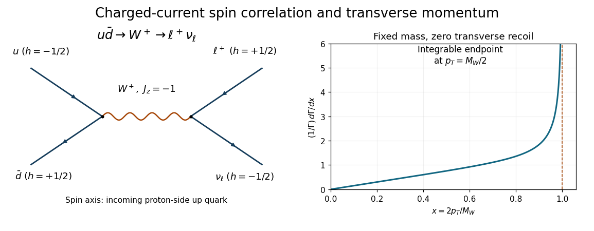

<h1 id="1/a/i/solution">Solution</h1>

↑ **Parent:** [I](../i.md)

A leading valence-level process is $u\bar d\to W^+\to e^+\nu_e$, with the [up quark](../../../../../up-quark.md) supplied by the [proton](../../../../../proton.md) and the [down antiquark](../../../../../down-antiquark.md) by the [antiproton](../../../../../antiproton.md). The same [Feynman diagram](../../../../../feynman-diagram.md) works with $e^+\nu_e$ replaced by $\mu^+\nu_\mu$. Both vertices are [weak charged current](../../../../../charged-current.md) vertices; the production [scattering amplitude](../../../../../scattering-amplitude.md) contains the [CKM matrix](../../../../../cabibbo-kobayashi-maskawa-matrix.md) element $V_{ud}$ or its conjugate according to the chosen fermion-flow convention. The intermediate [W boson](../../../../../w-boson.md) is produced near its [mass shell](../../../../../mass-shell.md).

**[Figure 1](#1/a/i/image-original-charged-current-production-diagram-and-the-normalized-ideal-charged-lepton-transverse-momentum-density-the-angular-axis-is-measured-from-the-proton-side-incoming-up-quark). Original charged-current production diagram and the normalized ideal charged-lepton transverse-momentum density. The angular axis is measured from the proton-side incoming up quark.**

## ↑ Ancestors (13)

1. [I](../i.md)
2. [A](../../a.md)
3. [1](../../../1.md)
4. [2019](../../../../2019-split.md)
5. [Past exam of the particle physics course of the University of Oxford](../../../../split.md)
6. [Particle physics course of the University of Oxford](../../../../../particle-physics-course-of-the-university-of-oxford.md)
7. [Year 4 of the physics course of the University of Oxford](../../../../../year-4-of-the-physics-course-of-the-university-of-oxford.md)
8. [Physics course of the University of Oxford](../../../../../physics-course-of-the-university-of-oxford.md)
9. [Undergraduate course of the University of Oxford](../../../../../undergraduate-course-of-the-university-of-oxford.md)
10. [Course of the University of Oxford](../../../../../course-of-the-university-of-oxford.md)
11. [University of Oxford](../../../../../university-of-oxford-split.md)
12. [List of universities](../../../../../list-of-universities.md)
13. [Codex Wiki](../../../../../split.md)
