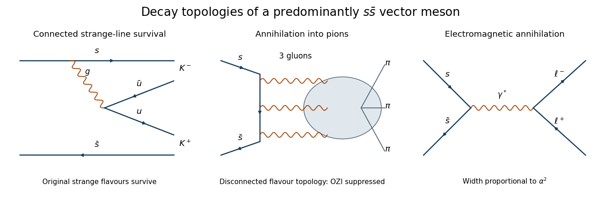

<h1 id="3/c/solution">Solution</h1>

↑ **Parent:** [C](../c.md)

The observed dominance of [kaons](../../../../kaon.md) supports a predominantly $s\bar s$ [phi meson](../../../../phi-meson.md). In a connected strong decay, the original strange [quark](../../../../quark.md) and [antiquark](../../../../antiquark.md) survive into different [kaons](../../../../kaon.md), while a [gluon](../../../../gluon.md) produces a light $q\bar q$ pair:

$$
s\bar s\longrightarrow(s\bar q)(q\bar s),\qquad q=u,d.
$$

This gives $K^-K^+$ or $\bar K^0K^0$ and is allowed by the [OZI rule](../../../../ozi-rule.md). A pionic final state contains no strange valence constituents, so the initial $s\bar s$ pair must annihilate. The strong annihilation of a colour-singlet $1^{--}$ state requires at least three [gluons](../../../../gluon.md): one [gluon](../../../../gluon.md) cannot carry the [singlet](../../../../singlet-representation.md) colour, and two have the wrong charge-conjugation quantum number. This disconnected [flavour](../../../../quark-flavor.md) topology is suppressed by the [OZI rule](../../../../ozi-rule.md), although it need not vanish.

**[Figure 2](#3/c/image-original-quark-level-topologies-for-connected-kaon-production-three-gluon-annihilation-into-pions-and-electromagnetic-annihilation-into-leptons-the-hadronization-blob-is-schematic). Original quark-level topologies for connected kaon production, three-gluon annihilation into pions, and electromagnetic annihilation into leptons. The hadronization blob is schematic.**

The leptonic mode proceeds through $s\bar s\to\gamma^*\to\ell^+\ell^-$ and is suppressed by [electromagnetic couplings](../../../../electromagnetic-interaction.md); its width is proportional to $\alpha^2$ times the vector-meson overlap. Unlike a strong [hadronic](../../../../hadron.md) decay, it cannot create its final [particles](../../../../particle-physics.md) through [quark](../../../../quark.md) rearrangement. Hence a [branching fraction](../../../../branching-fraction.md) of order $10^{-4}$ is qualitatively consistent with [electromagnetic](../../../../electromagnetism-split.md) annihilation competing with strong modes.

Kaon dominance is especially suggestive because [phase space](../../../../phase-space.md) is limited: using the supplied neutral-kaon and phi [masses](../../../../mass.md),

$$
\boxed{p_K=\sqrt{\frac{m_\phi^2}{4}-m_{K^0}^2}\simeq110\ \mathrm{MeV},\qquad
m_\phi-2m_{K^0}=24\ \mathrm{MeV}.}
$$

The two spin-zero [kaons](../../../../kaon.md) have [orbital angular momentum](../../../../orbital-angular-momentum.md) $L=1$ to match the vector parent, so their [partial width](../../../../partial-decay-width.md) has the additional near-threshold factor $p_K^3$. Pionic modes have more [phase space](../../../../phase-space.md) yet remain subdominant because of their annihilation topology. The observations therefore support, but do not establish exact, [ideal vector-meson mixing](../../../../ideal-vector-meson-mixing.md): a small nonstrange admixture, [electromagnetic](../../../../electromagnetism-split.md) amplitudes and nonperturbative strong dynamics can all contribute to the pionic rate.

## ↑ Ancestors (12)

1. [C](../c.md)
2. [3](../../3.md)
3. [2019](../../../2019-split.md)
4. [Past exam of the particle physics course of the University of Oxford](../../../split.md)
5. [Particle physics course of the University of Oxford](../../../../particle-physics-course-of-the-university-of-oxford.md)
6. [Year 4 of the physics course of the University of Oxford](../../../../year-4-of-the-physics-course-of-the-university-of-oxford.md)
7. [Physics course of the University of Oxford](../../../../physics-course-of-the-university-of-oxford.md)
8. [Undergraduate course of the University of Oxford](../../../../undergraduate-course-of-the-university-of-oxford.md)
9. [Course of the University of Oxford](../../../../course-of-the-university-of-oxford.md)
10. [University of Oxford](../../../../university-of-oxford-split.md)
11. [List of universities](../../../../list-of-universities.md)
12. [Codex Wiki](../../../../split.md)
