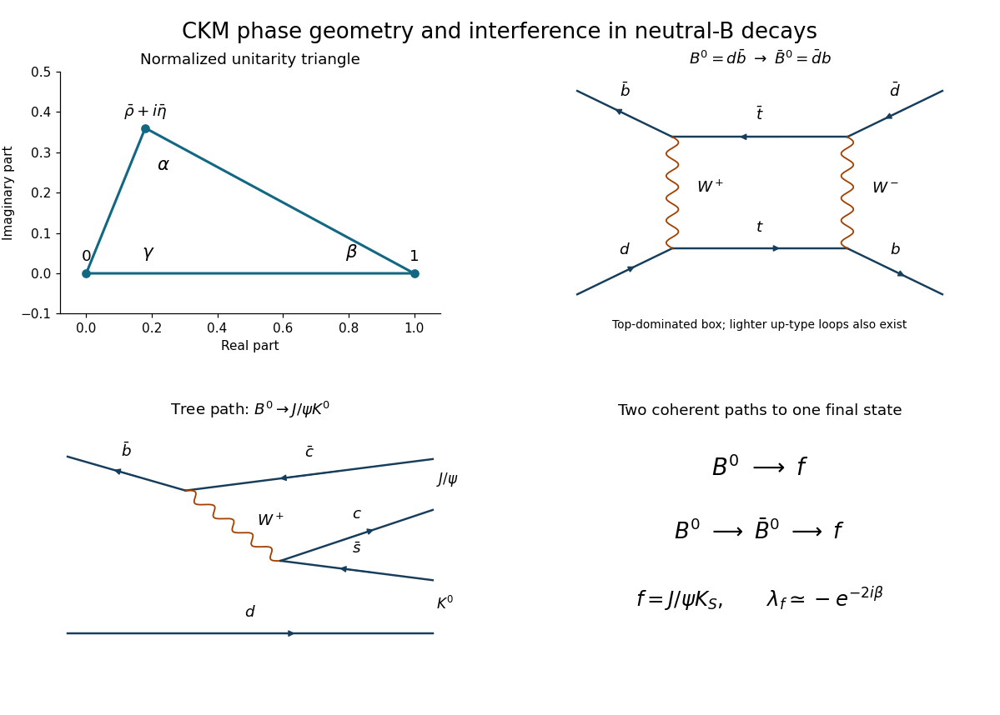

<h1 id="4/b/solution">Solution</h1>

↑ **Parent:** [B](../b.md)

The inner product of columns one and three is

$$
V_{ud}^*V_{ub}+V_{cd}^*V_{cb}+V_{td}^*V_{tb}
=A\lambda^3[(\rho-i\eta)-1+(1-\rho+i\eta)]+O(\lambda^5)=O(\lambda^5).
$$

The leading terms cancel, establishing compatibility with [unitarity](../../../../unitary-operator.md) at cubic order. Direct multiplication of the printed truncation leaves $-A\lambda^5(\rho-i\eta)/2$, so it must not be treated as exactly unitary beyond its stated accuracy.

For the exact matrix, conjugate the closure relation and define

$$
a=V_{ud}V_{ub}^*,\quad b=V_{cd}V_{cb}^*,\quad c=V_{td}V_{tb}^*,\qquad a+b+c=0.
$$

Divide by $-b$ and let $z=-a/b=\bar\rho+i\bar\eta$. Then $a/(-b)=z$ and $c/(-b)=1-z$, giving a [CKM unitarity triangle](../../../../ckm-unitarity-triangle.md) with vertices

$$
\boxed{(0,0),\qquad(1,0),\qquad(\bar\rho,\bar\eta).}
$$

At leading Wolfenstein order these are $(0,0),(1,0),(\rho,\eta)$. The barred coordinates define the exact triangle; they differ from the unbarred parameters beyond leading order.

**[Figure 3](#4/b/image-original-normalized-unitarity-triangle-top-dominated-neutral-b-mixing-box-and-the-leading-tree-topology-for-a-common-charmonium-kaon-final-state-the-triangle-coordinates-are-illustrative). Original normalized unitarity triangle, top-dominated neutral-B mixing box, and the leading tree topology for a common charmonium-kaon final state. The triangle coordinates are illustrative.**

For positive $\bar\eta$, define $\gamma$ at the origin, $\beta$ at $(1,0)$, and $\alpha$ at the apex. Comparing the directions of the incident complex sides gives the rephasing-invariant relations

$$
\boxed{\begin{aligned}
\alpha&=\arg\left[-\frac{V_{td}V_{tb}^*}{V_{ud}V_{ub}^*}\right],\\
\beta&=\arg\left[-\frac{V_{cd}V_{cb}^*}{V_{td}V_{tb}^*}\right],\\
\gamma&=\arg\left[-\frac{V_{ud}V_{ub}^*}{V_{cd}V_{cb}^*}\right],\qquad
\alpha+\beta+\gamma=\pi.
\end{aligned}}
$$

To leading order $\gamma=\arg(\rho+i\eta)$ and $\beta=\operatorname{atan2}(\eta,1-\rho)$; the remaining angle follows by subtraction. Each ratio cancels the unphysical common phase of the corresponding column-orthogonality terms.

## ↑ Ancestors (12)

1. [B](../b.md)
2. [4](../../4.md)
3. [2019](../../../2019-split.md)
4. [Past exam of the particle physics course of the University of Oxford](../../../split.md)
5. [Particle physics course of the University of Oxford](../../../../particle-physics-course-of-the-university-of-oxford.md)
6. [Year 4 of the physics course of the University of Oxford](../../../../year-4-of-the-physics-course-of-the-university-of-oxford.md)
7. [Physics course of the University of Oxford](../../../../physics-course-of-the-university-of-oxford.md)
8. [Undergraduate course of the University of Oxford](../../../../undergraduate-course-of-the-university-of-oxford.md)
9. [Course of the University of Oxford](../../../../course-of-the-university-of-oxford.md)
10. [University of Oxford](../../../../university-of-oxford-split.md)
11. [List of universities](../../../../list-of-universities.md)
12. [Codex Wiki](../../../../split.md)
