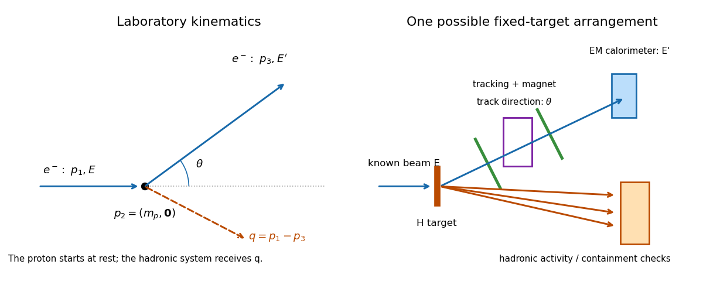
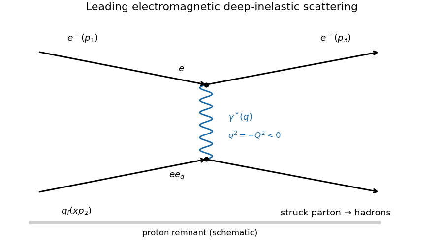
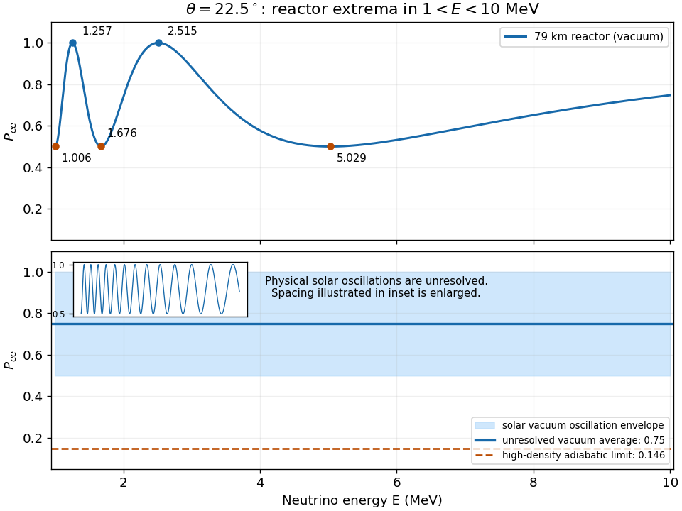

# 2021

↑ **Parent:** [Past exam of the particle physics course of the University of Oxford](../past-exam-of-the-particle-physics-course-of-the-university-of-oxford.md)

Source paper: [https://www.whatdotheyknow.com/request/oxford_physics_past_papers_2/response/2340696/attach/9/Physics%20Papers%202020.pdf?cookie_passthrough=1](https://www.whatdotheyknow.com/request/oxford_physics_past_papers_2/response/2340696/attach/9/Physics%20Papers%202020.pdf?cookie_passthrough=1)

The source is on bundle pages 34–41. Its cover gives Trinity Term 2021 despite the attachment's 2020 filename. These solutions use [natural units](../mathematical-physics.md#natural-units) $\hbar=c=1$ unless a conversion is written explicitly.

**Table of contents**

- [1](#1)
  - [a](#1/a)
    - [Solution](#1/a/solution)
  - [b](#1/b)
    - [Solution](#1/b/solution)
  - [c](#1/c)
    - [Solution](#1/c/solution)
  - [d](#1/d)
    - [Solution](#1/d/solution)
  - [e](#1/e)
    - [Solution](#1/e/solution)
- [2](#2)
  - [a](#2/a)
    - [Solution](#2/a/solution)
  - [b](#2/b)
    - [Solution](#2/b/solution)
  - [c](#2/c)
    - [Solution](#2/c/solution)
  - [d](#2/d)
    - [Solution](#2/d/solution)
  - [e](#2/e)
    - [Solution](#2/e/solution)
  - [f](#2/f)
    - [Solution](#2/f/solution)
- [3](#3)
  - [a](#3/a)
    - [Solution](#3/a/solution)
  - [b](#3/b)
    - [Solution](#3/b/solution)
  - [c](#3/c)
    - [Solution](#3/c/solution)
  - [d](#3/d)
    - [Solution](#3/d/solution)
- [4](#4)
  - [a](#4/a)
    - [Solution](#4/a/solution)
  - [b](#4/b)
    - [Solution](#4/b/solution)
  - [c](#4/c)
    - [Solution](#4/c/solution)
  - [d](#4/d)
    - [Solution](#4/d/solution)
  - [e](#4/e)
    - [Solution](#4/e/solution)
- [5](#5)
  - [a](#5/a)
    - [Solution](#5/a/solution)
  - [b](#5/b)
    - [Solution](#5/b/solution)
  - [c](#5/c)
    - [Solution](#5/c/solution)
  - [d](#5/d)
    - [Solution](#5/d/solution)
  - [e](#5/e)
    - [Solution](#5/e/solution)
- [6](#6)
  - [a](#6/a)
    - [Solution](#6/a/solution)
  - [b](#6/b)
    - [Solution](#6/b/solution)
  - [c](#6/c)
    - [Solution](#6/c/solution)
  - [d](#6/d)
    - [Solution](#6/d/solution)
  - [e](#6/e)
    - [Solution](#6/e/solution)

## 1

↑ **Parent:** [2021](2021.md)

<h3 id="1/a">a</h3>

↑ **Parent:** [1](#1)

<h4 id="1/a/solution">Solution</h4>

↑ **Parent:** [A](#1/a)

In a [relativistic two-body decay](../special-relativity.md#relativistic-two-body-decay), [four-momentum conservation](../special-relativity.md#four-momentum-conservation) in the parent's [rest frame](../mathematical-physics.md#rest-frame) requires $\mathbf p_1^*=-\mathbf p_2^*$ and

$$
M=\sqrt{p^{*2}+m_1^2}+\sqrt{p^{*2}+m_2^2}.
$$

For fixed daughter [masses](../classical-mechanics.md#mass), this fixes a unique $p^*$, independent of direction. In the [Lorentz-invariant phase space](../relativistic-quantum-field.md#lorentz-invariant-phase-space) integral, the [Dirac delta distribution](../distribution-theory.md#dirac-delta-function) enforcing [conservation of energy](../mathematical-physics.md#conservation-of-energy) therefore performs the radial [momentum](../momentum.md) integration. Only the [solid angle](../euclidean-geometry.md#solid-angle) remains to be integrated; the resulting $p^*$ can be taken outside that integral, even if the [matrix element](../vector-space.md#matrix-element) depends strongly on direction.

For three or more final particles, [four-momentum conservation](../special-relativity.md#four-momentum-conservation) generally leaves continuously variable daughter [energies](../energy.md) and [momenta](../momentum.md), so the [decay rate](../relativistic-quantum-field.md#decay-width) includes integrations over them, or equivalently over independent [invariant masses](../special-relativity.md#invariant-mass) in a [Dalitz plot](../relativistic-quantum-field.md#dalitz-plot). Integrating over a variable daughter [invariant mass](../special-relativity.md#invariant-mass) is also necessary when an unstable daughter is treated with a finite [decay width](../relativistic-quantum-field.md#decay-width) rather than a fixed [mass](../classical-mechanics.md#mass).

<h3 id="1/b">b</h3>

↑ **Parent:** [1](#1)

<h4 id="1/b/solution">Solution</h4>

↑ **Parent:** [B](#1/b)

Useful examples with no net [quark flavor](../standard-model.md#quark-flavor) are the [eta c meson](../physics.md#eta-c-meson) $\eta_c=c\bar c$ and the [eta b meson](../physics.md#eta-b-meson) $\eta_b=b\bar b$. Examples with nonzero [quark flavor](../standard-model.md#quark-flavor) are the [kaon](../physics.md#kaon) $K^+=u\bar s$ and the [D meson](../physics.md#d-meson) $D^+=c\bar d$. These are [pseudoscalar mesons](../physics.md#pseudoscalar-meson): in the lowest [quark model](../physics.md#quark-model) configuration the constituent [spins](../angular-momentum-operator.md#spin) combine to $S=0$, the relative [orbital angular momentum](../quantum-mechanics.md#orbital-angular-momentum) is $L=0$, and the total [angular momentum](../momentum.md#angular-momentum) and [parity](../quantum-mechanics.md#parity) are $J^P=0^-$. For the self-conjugate examples, [meson parity and charge conjugation](../physics.md#meson-parity-and-charge-conjugation) also gives $C=(-1)^{L+S}=+1$. Electrical neutrality alone would not imply zero net [quark flavor](../standard-model.md#quark-flavor); for example $K^0=d\bar s$ has strangeness.

Restoring [reduced Planck constant](../quantum-mechanics.md#reduced-planck-constant), [decay width](../relativistic-quantum-field.md#decay-width) and [mean lifetime](../relativistic-quantum-field.md#mean-lifetime-physics) satisfy $\Gamma\tau=\hbar$. Thus the representative numbers correspond to

$$
\tau_{20\,\mathrm{MeV}}=\frac{6.582\times10^{-22}\ \mathrm{MeV\,s}}{20\ \mathrm{MeV}}=3.29\times10^{-23}\ \mathrm s,\qquad
\Gamma_{1\,\mathrm{ps}}=6.582\times10^{-10}\ \mathrm{MeV}.
$$

The [mean lifetimes](../relativistic-quantum-field.md#mean-lifetime-physics) differ by at least $3.0\times10^{10}$. Hidden-heavy-flavor [quarkonium](../physics.md#quarkonium) can undergo [quark](../standard-model.md#quark)-[antiquark](../standard-model.md#antiquark) [annihilation](../relativistic-quantum-field.md#annihilation) into [gluons](../standard-model.md#gluon), followed by [hadronization](../standard-model.md#hadronization). A $0^{-+}$ color-singlet state can annihilate into two [gluons](../standard-model.md#gluon). A lightest open-flavor [meson](../physics.md#meson) cannot simply annihilate through the [strong interaction](../standard-model.md#strong-interaction), which conserves net [quark flavor](../standard-model.md#quark-flavor). With no lighter accessible final state carrying that flavor, it must undergo a [weak interaction](../standard-model.md#weak-interaction) changing a constituent's flavor. The small [weak interaction](../standard-model.md#weak-interaction) amplitude, [CKM matrix](../standard-model.md#cabibbo-kobayashi-maskawa-matrix) factors and available [Lorentz-invariant phase space](../relativistic-quantum-field.md#lorentz-invariant-phase-space) produce a much smaller [decay width](../relativistic-quantum-field.md#decay-width).

**Qualification.** A [decay width](../relativistic-quantum-field.md#decay-width) of order tens of MeV is not a universal property of flavor-neutral [pseudoscalar mesons](../physics.md#pseudoscalar-meson). The [neutral pion](../standard-model.md#neutral-pion) has $\Gamma\simeq7.8\ \mathrm{eV}$ and decays predominantly by the [electromagnetic interaction](../electromagnetism.md#electromagnetic-interaction), a concrete counterexample. Its [mass](../classical-mechanics.md#mass) lies below the lightest allowed hadronic final state. The examples above illustrate the intended annihilation-versus-open-flavor comparison; the numerical scale depends on thresholds and selection rules.[Meson summary tables: neutral-pion width and heavy pseudoscalar properties](../physics-bibliography.md#review-of-particle-physics-by-particle-data-group-2022)

<h3 id="1/c">c</h3>

↑ **Parent:** [1](#1)

<h4 id="1/c/solution">Solution</h4>

↑ **Parent:** [C](#1/c)

Assume the [charmonium](../physics.md#charmonium) state annihilates through a virtual [photon](../quantum-mechanics.md#photon), with [lepton universality](../standard-model.md#lepton-universality) and negligible higher-order corrections. For a [vector meson](../physics.md#vector-meson) of [mass](../classical-mechanics.md#mass) $M$, the [partial decay width](../relativistic-quantum-field.md#partial-decay-width) into a [charged lepton](../standard-model.md#charged-lepton) pair contains both the [relativistic two-body decay](../special-relativity.md#relativistic-two-body-decay) factor $\beta_\ell$ and a vector-current [spin](../angular-momentum-operator.md#spin) factor:

$$
\Gamma_{\ell\ell}=C\left(1+\frac{2m_\ell^2}{M^2}\right)\sqrt{1-\frac{4m_\ell^2}{M^2}},\qquad
\beta_\ell=\sqrt{1-4m_\ell^2/M^2}.
$$

[PDF p. 3, Eqs. (1)–(2): vector-current lepton-mass correction](../physics-bibliography.md#first-measurement-of-the-branching-fraction-of-the-decay-psi-2s-to-tau-pairs-by-the-bes-collaboration) For example, contracting the vector polarization sum with the [Dirac trace](../relativistic-quantum-field.md#gamma-matrix-trace) for the two final [fermions](../tensor-product-of-quantum-systems.md#fermion) gives a factor proportional to $M^2+2m_\ell^2$, explaining why retaining only $\beta_\ell$ is insufficient. Using $m_\tau=1.777\ \mathrm{GeV}$, $m_\mu=0.1057\ \mathrm{GeV}$ and $M=3.686\ \mathrm{GeV}$ gives

$$
\frac{\Gamma_{\tau\tau}}{\Gamma_{\mu\mu}}\simeq0.388,\qquad
\boxed{\mathcal B_{\tau\tau}\simeq0.008\times0.388=3.10\times10^{-3}=0.31\%.}
$$

The supplied total [decay width](../relativistic-quantum-field.md#decay-width) also gives $\Gamma_{\mu\mu}=2.352\ \mathrm{keV}$ and $\Gamma_{\tau\tau}\simeq0.91\ \mathrm{keV}$. It cancels from the [branching fraction](../relativistic-quantum-field.md#branching-fraction) ratio.

The decisive change at $3.770\ \mathrm{GeV}$ is crossing the open-charm [D meson](../physics.md#d-meson)-pair threshold, approximately $3.73\ \mathrm{GeV}$. The [strong interaction](../standard-model.md#strong-interaction) can now create a light [quark](../standard-model.md#quark)-[antiquark](../standard-model.md#antiquark) pair and rearrange $c\bar c$ into $D\bar D$, without annihilating the heavy pair. This increases the total [decay width](../relativistic-quantum-field.md#decay-width) from hundreds of keV to tens of MeV. The [leptonic decay](../physics.md#leptonic-decay) [partial decay width](../relativistic-quantum-field.md#partial-decay-width) is additionally smaller because $\psi(3770)$ is predominantly a $1\,{}^3D_1$ state, whereas $\psi(3686)$ is predominantly $2\,{}^3S_1$; the short-distance annihilation overlap is suppressed for nonzero [orbital angular momentum](../quantum-mechanics.md#orbital-angular-momentum). A roughly hundredfold increase in total [decay width](../relativistic-quantum-field.md#decay-width) together with an order-ten reduction in leptonic [partial decay width](../relativistic-quantum-field.md#partial-decay-width) explains the order-thousand reduction in [branching fraction](../relativistic-quantum-field.md#branching-fraction). Attributing all three orders of magnitude to the threshold alone would miss the second effect.[Charmonium listings: total and leptonic widths of psi(2S) and psi(3770)](../physics-bibliography.md#review-of-particle-physics-by-particle-data-group-2022)

<h3 id="1/d">d</h3>

↑ **Parent:** [1](#1)

<h4 id="1/d/solution">Solution</h4>

↑ **Parent:** [D](#1/d)

At an [electron-positron collider](../particle-accelerator.md#electron-positron-collider) tuned to the [charmonium](../physics.md#charmonium) [resonance](../dynamical-systems.md#resonance), select the mixed leptonic [tau lepton](../standard-model.md#tau-particle) decays

$$
\tau^-\to e^-\bar\nu_e\nu_\tau,\qquad \tau^+\to\mu^+\nu_\mu\bar\nu_\tau,
$$

and their charge conjugates. Require exactly two well-reconstructed oppositely charged tracks, one identified [electron](../physics.md#electron) and one identified [muon](../standard-model.md#muon), little extra visible activity, visible [energy](../energy.md) below the beam total, and significant [missing momentum](../particle-detection.md#missing-momentum) pointing into the instrumented region. The multiple [neutrinos](../standard-model.md#neutrino) prevent full reconstruction of each [tau lepton](../standard-model.md#tau-particle), but the known initial [four-momentum](../special-relativity.md#four-momentum), lepton spectra and missing [energy](../energy.md) support a statistical signal extraction. Off-resonance data constrain nonresonant [electron-positron annihilation](../relativistic-quantum-field.md#electron-positron-annihilation) into a [tau lepton](../standard-model.md#tau-particle) pair; that continuum is present at both beam [energies](../energy.md).[Event selection using mixed electron-muon tau decays and continuum subtraction](../physics-bibliography.md#first-measurement-of-the-branching-fraction-of-the-decay-psi-2s-to-tau-pairs-by-the-bes-collaboration)

A resonant [muon](../standard-model.md#muon) pair is one possible detector background: one [muon](../standard-model.md#muon) can be misidentified as an [electron](../physics.md#electron), while radiation escaping along the beam or a badly measured track produces apparent [missing energy](../standard-model.md#missing-energy). Particle-identification requirements and rejection of almost back-to-back tracks near the beam [momentum](../momentum.md) suppress it. This background needs detector mismeasurement; an ideal measurement would distinguish it.

Above the open-charm threshold, $\psi(3770)\to D\bar D$ supplies an additional resonant background. Semileptonic decays of the two [D mesons](../physics.md#d-meson) can give an [electron](../physics.md#electron), a [muon](../standard-model.md#muon) and [neutrinos](../standard-model.md#neutrino); unreconstructed hadrons let some events pass the selection. This on-shell [D meson](../physics.md#d-meson)-pair background is kinematically forbidden at $\psi(3686)$.

<h3 id="1/e">e</h3>

↑ **Parent:** [1](#1)

<h4 id="1/e/solution">Solution</h4>

↑ **Parent:** [E](#1/e)

The three structures are the radiative cascades

$$
\psi(2S)\to\gamma_l\chi_{cJ},\qquad \chi_{cJ}\to\gamma_h J/\psi,\qquad J=0,1,2.
$$

In the [quark model](../physics.md#quark-model), the [J/psi meson](../physics.md#j-psi-meson) and $\psi(2S)$ are respectively $1\,{}^3S_1$ and $2\,{}^3S_1$ [charmonium](../physics.md#charmonium) states. Thus $L=0$, $S=1$, $J=1$, and [meson parity and charge conjugation](../physics.md#meson-parity-and-charge-conjugation) gives $J^{PC}=1^{--}$. The intermediate [chi c mesons](../physics.md#chi-c-meson) are $1\,{}^3P_J$: $L=1$, $S=1$, and [addition of angular momentum](../angular-momentum-operator.md#addition-of-angular-momentum) permits $J=0,1,2$. Consequently

$$
\boxed{\chi_{c0}:0^{++},\qquad \chi_{c1}:1^{++},\qquad \chi_{c2}:2^{++}.}
$$

These are [electric dipole transitions](../quantum-mechanics.md#electric-dipole-transition), changing $L$ by one and preserving $S$ to leading order. A singlet $1\,{}^1P_1$ state has $J^{PC}=1^{+-}$ and is not another member of these spin-triplet cascades.

The primary [photon](../quantum-mechanics.md#photon) [energy](../energy.md) is $(M_{2S}^2-M_{\chi_J}^2)/(2M_{2S})$, about $261$, $171$ and $128\ \mathrm{MeV}$ for $J=0,1,2$. The secondary [photon](../quantum-mechanics.md#photon) remains more energetic even after its boost into the parent [rest frame](../mathematical-physics.md#rest-frame). Hence $m^2(J/\psi\gamma_h)=M_{\chi_J}^2$: with this quantity on the vertical axis, each [resonance](../dynamical-systems.md#resonance) gives a horizontal band. A finite [decay width](../relativistic-quantum-field.md#decay-width) and detector [measurement resolution](../physics.md#measurement-resolution) broaden each band; photon ordering removes the mirrored duplication of an unordered [Dalitz plot](../relativistic-quantum-field.md#dalitz-plot).

The faint band beside the negative-slope diagonal boundary is $\psi(2S)\to J/\psi\,\pi^0$, followed by $\pi^0\to\gamma\gamma$. The [neutral pion](../standard-model.md#neutral-pion) is predominantly $(u\bar u-d\bar d)/\sqrt2$, a ${}^1S_0$ [pseudoscalar meson](../physics.md#pseudoscalar-meson) with $J^{PC}=0^{-+}$. This production transition violates [isospin](../standard-model.md#isospin), accounting for its small rate. To locate the band, set $X=m^2(J/\psi\gamma_l)$ and $Y=m^2(J/\psi\gamma_h)$. [Four-momentum conservation](../special-relativity.md#four-momentum-conservation) gives

$$
\boxed{X+Y=M_{2S}^2+M_{J/\psi}^2-m_{\gamma\gamma}^2.}
$$

For the [neutral pion](../standard-model.md#neutral-pion), $m_{\gamma\gamma}^2=m_{\pi^0}^2$ is small, putting the line just inside the $m_{\gamma\gamma}^2=0$ boundary. The allowed $J/\psi\,\eta$ channel, with the [eta meson](../physics.md#eta-meson) also $0^{-+}$, produces a parallel line further inside, at $m_{\gamma\gamma}^2=m_\eta^2$. The positive-slope edge $X=Y$ instead comes from ordering the two [photon energies](../quantum-mechanics.md#photon-energy); proximity to that edge alone would not identify the two-photon state.

## 2

↑ **Parent:** [2021](2021.md)

<h3 id="2/a">a</h3>

↑ **Parent:** [2](#2)

<h4 id="2/a/solution">Solution</h4>

↑ **Parent:** [A](#2/a)

Use the [Minkowski metric](../special-relativity.md#minkowski-metric) $(+,-,-,-)$ and choose the incoming [electron](../physics.md#electron) along $+z$, with the scattered [electron](../physics.md#electron) in the $xz$ plane. In [natural units](../mathematical-physics.md#natural-units), neglecting the [electron mass](../physics.md#electron-mass), the [four-momenta](../special-relativity.md#four-momentum) are

$$
p_1=(E,0,0,E),\qquad p_2=(m_p,0,0,0),\qquad
p_3=(E',E'\sin\theta,0,E'\cos\theta).
$$

The [momentum transfer](../quantum-scattering.md#momentum-transfer) entering the [proton](../physics.md#proton) is therefore

$$
\boxed{q=p_1-p_3=(E-E',-E'\sin\theta,0,E-E'\cos\theta).}
$$

The outgoing hadronic system carries $p_X=p_2+q$. The [energy transfer](../quantum-scattering.md#energy-transfer) is $\nu=E-E'$, while $\mathbf q$ need not point along the original beam.

**[Figure 1](#2/a/image-fixed-target-deep-inelastic-scattering-laboratory-directions-and-a-schematic-detector). Fixed-target deep inelastic scattering: laboratory directions and a schematic detector**.

<h3 id="2/b">b</h3>

↑ **Parent:** [2](#2)

<h4 id="2/b/solution">Solution</h4>

↑ **Parent:** [B](#2/b)

With the [four-momenta](../special-relativity.md#four-momentum) in [a](#2/a), $q^2=-2EE'(1-\cos\theta)$, $p_2\cdot q=m_p(E-E')$, and $p_2\cdot p_1=m_pE$. Thus the measured beam [energy](../energy.md) $E$, scattered [electron](../physics.md#electron) [energy](../energy.md) $E'$ and [scattering angle](../quantum-scattering.md#scattering-angle) $\theta$ determine

$$
\boxed{Q^2=4EE'\sin^2\frac\theta2,\qquad y=1-\frac{E'}E,\qquad x=\frac{2EE'\sin^2(\theta/2)}{m_p(E-E')}.}
$$

Here $Q^2$ measures the spacelike [momentum transfer](../quantum-scattering.md#momentum-transfer), $y$ is the fractional [energy transfer](../quantum-scattering.md#energy-transfer), and the [Bjorken scaling variable](../standard-model.md#bjorken-scaling-variable) $x$ is the struck [parton](../standard-model.md#parton)'s longitudinal [momentum](../momentum.md) fraction in the leading collinear description. The hadronic [invariant mass](../special-relativity.md#invariant-mass) satisfies $W^2=(p_2+q)^2=m_p^2+Q^2(1/x-1)$; large $Q^2$ and $W^2$ select [deep inelastic scattering](../standard-model.md#deep-inelastic-scattering).

A beam spectrometer measures $E$ before a thin stationary hydrogen target. Tracking layers on both sides of a magnetic spectrometer measure the outgoing [electron](../physics.md#electron) direction, charge and curvature; an [electromagnetic calorimeter](../particle-detection.md#electromagnetic-calorimeter) measures its [energy](../energy.md). Matching the track to its [particle shower](../particle-detection.md#particle-shower), with downstream [muon](../standard-model.md#muon) rejection where useful, separates the scattered [electron](../physics.md#electron) from hadronic tracks. A downstream hadronic detector measures the hadronic activity and supports event-quality checks. The sketch in [a](#2/a) shows these separate measurements.

The scattered [electron](../physics.md#electron) provides a clean, single-particle reconstruction. Reconstructing the entire hadronic system requires summing many charged and neutral fragments, correcting unequal [particle calorimeter](../particle-detection.md#calorimeter-particle-physics) response and losses through beam holes, and sometimes accounting for escaping [neutrinos](../standard-model.md#neutrino). Thus the leptonic definition is experimentally convenient. It is not a fundamental requirement of [Lorentz invariance](../special-relativity.md#lorentz-invariance): exact reconstruction of $p_X$ gives the same $q=p_X-p_2$, and hadronic or combined reconstructions can be preferable in some kinematic regions.

<h3 id="2/c">c</h3>

↑ **Parent:** [2](#2)

<h4 id="2/c/solution">Solution</h4>

↑ **Parent:** [C](#2/c)

At leading order in [QED](../perturbative-quantum-field-theory.md#quantum-electrodynamics), the [electron](../physics.md#electron) exchanges one spacelike virtual [photon](../quantum-mechanics.md#photon) with a charged [parton](../standard-model.md#parton) inside the [proton](../physics.md#proton).

**[Figure 2](#2/c/image-one-photon-exchange-feynman-diagram-for-inclusive-electron-proton-deep-inelastic-scattering). One-photon-exchange Feynman diagram for inclusive electron-proton deep inelastic scattering**.

The two [Feynman vertices](../perturbative-quantum-field-theory.md#interaction-vertex) contribute $e$ and $e e_q$, while the [photon propagator](../quantum-field-theory.md#photon-propagator) contributes $1/q^2=-1/Q^2$. Hence the [scattering amplitude](../quantum-scattering.md#scattering-amplitude) scales as $e^2e_q/Q^2$ and its squared [absolute value](../real-analysis.md#absolute-value) as $e^4e_q^2/Q^4$. Since the [fine-structure constant](../perturbative-quantum-field-theory.md#fine-structure-constant) is $\alpha=e^2/(4\pi)$, the electromagnetic coupling dependence is $\alpha^2/Q^4$. The numerical $4\pi$ in the stated [differential scattering cross-section](../quantum-scattering.md#differential-scattering-cross-section) additionally uses the flux, [Lorentz-invariant phase space](../relativistic-quantum-field.md#lorentz-invariant-phase-space), azimuthal integration and the convention defining the [deep-inelastic structure function](../standard-model.md#deep-inelastic-structure-function); it cannot be deduced from the propagator alone.

For each measured $x,Q^2$ bin form the reduced quantity

$$
\boxed{F_2(x,Q^2)=\frac{xQ^4}{4\pi\alpha^2[1-y+y^2/2]}\frac{d^2\sigma}{dx\,dQ^2}.}
$$

Plot this against $Q^2$ at several fixed $x$ values, normally using a logarithmic $Q^2$ axis. [Bjorken scaling](../standard-model.md#bjorken-scaling) predicts an approximately horizontal curve at each $x$, or equivalently collapse of different-$Q^2$ data onto one $F_2(x)$ curve. Raw [cross sections](../physics.md#cross-section-physics) do not collapse because their explicit kinematic factors vary. [QCD](../standard-model.md#quantum-chromodynamics) predicts logarithmic [scaling violations](../standard-model.md#scaling-violation), so exact independence is only the ideal [parton model](../standard-model.md#parton-model) limit. The stated extraction also assumes negligible [longitudinal deep-inelastic structure function](../standard-model.md#longitudinal-deep-inelastic-structure-function), as in the leading massless spin-half [parton](../standard-model.md#parton) approximation.

<h3 id="2/d">d</h3>

↑ **Parent:** [2](#2)

<h4 id="2/d/solution">Solution</h4>

↑ **Parent:** [D](#2/d)

This labelled part supplies a definition rather than a separate task. Its notation is interpreted as an incoherent charge-squared sum: the [photon](../quantum-mechanics.md#photon) couples to a [quark](../standard-model.md#quark) with [electric charge](../electric-charge.md) $e e_q$, and the squared [scattering amplitude](../quantum-scattering.md#scattering-amplitude) weights its contribution by $e_q^2$. To make the [antiquark](../standard-model.md#antiquark) convention explicit, let

$$
U=u^p+\bar u^p,\qquad D=d^p+\bar d^p,\qquad S=s^p+\bar s^p.
$$

Then, restricting the displayed example to three active light [quark flavors](../standard-model.md#quark-flavor), the [deep-inelastic structure function](../standard-model.md#deep-inelastic-structure-function) is

$$
\boxed{F_2^p=x\left[\frac49U+\frac19(D+S)\right].}
$$

Thus the source's sum must either include [antiquarks](../standard-model.md#antiquark) as separate [partons](../standard-model.md#parton) or define each $q^p$ to include its antiquark distribution. It must not silently omit the [sea quarks](../standard-model.md#sea-quark), especially in the small-$x$ limit used below.

<h3 id="2/e">e</h3>

↑ **Parent:** [2](#2)

<h4 id="2/e/solution">Solution</h4>

↑ **Parent:** [E](#2/e)

Assume approximate [charge symmetry of nucleon parton distributions](../standard-model.md#charge-symmetry-of-nucleon-parton-distributions), the interchange of [up quarks](../standard-model.md#up-quark) and [down quarks](../standard-model.md#down-quark) under the [isospin](../standard-model.md#isospin) rotation carrying the [proton](../physics.md#proton) into the [neutron](../neutron.md):

$$
u^n=d^p,\quad d^n=u^p,\quad \bar u^n=\bar d^p,\quad \bar d^n=\bar u^p,\quad s^n=s^p,\quad\bar s^n=\bar s^p.
$$

Corrections from the [up quark](../standard-model.md#up-quark)-[down quark](../standard-model.md#down-quark) [mass](../classical-mechanics.md#mass) difference and the [electromagnetic interaction](../electromagnetism.md#electromagnetic-interaction) are neglected. With the proton-only shorthand in [d](#2/d),

$$
\boxed{F_2^p=\frac{x}{9}(4U+D+S),\qquad F_2^n=\frac{x}{9}(4D+U+S).}
$$

If charm is active, add the same $4x(c^p+\bar c^p)/9$ to each; heavier flavors are treated similarly. These formulae use the same $Q^2$ and factorization convention for all [parton distribution functions](../standard-model.md#parton-distribution-function).

<h3 id="2/f">f</h3>

↑ **Parent:** [2](#2)

<h4 id="2/f/solution">Solution</h4>

↑ **Parent:** [F](#2/f)

Subtracting the [deep-inelastic structure functions](../standard-model.md#deep-inelastic-structure-function) in [e](#2/e) gives

$$
F_2^p-F_2^n=\frac{x}{3}(U-D).
$$

Thus at moderate and large $x$, the charge-weighted [up quark](../standard-model.md#up-quark) content of the [proton](../physics.md#proton) exceeds its [down quark](../standard-model.md#down-quark) content. In the [valence quark](../standard-model.md#valence-quark) dominated regime this is consistent with the $uud$ valence structure, compared with $udd$ for the [neutron](../neutron.md). The larger $2/3$ [up quark](../standard-model.md#up-quark) [electric charge](../electric-charge.md) makes the [proton](../physics.md#proton) scatter more strongly. This observation alone does not establish $u^p(x)=2d^p(x)$ pointwise: the valence-number sum rules constrain integrals, not every $x$ bin.

If the small-$x$ observation means equality to good _relative_ accuracy, it supports dominance by approximately charge-symmetric [sea quarks](../standard-model.md#sea-quark), with $U\simeq D$ and negligible relative valence excess. [Gluon splitting](../standard-model.md#gluon-splitting) creates [quark](../standard-model.md#quark)-[antiquark](../standard-model.md#antiquark) pairs, and the leading [strong interaction](../standard-model.md#strong-interaction) treats light [quark flavors](../standard-model.md#quark-flavor) similarly. It does not follow that every [sea quark](../standard-model.md#sea-quark) flavor has exactly the same distribution at every $x$.

**Logical qualification.** Equality of the limiting values alone is weaker than equality of their ratio. For example $U=2$, $D=1$, $S=0$ near $x=0$ gives $F_2^p=x$ and $F_2^n=2x/3$: both tend to zero, although $U\ne D$ and $F_2^n/F_2^p=2/3$. The usual inference about a symmetric sea needs $F_2^n/F_2^p\to1$ or equivalent information about relative differences, rather than merely coincident zero limits.

## 3

↑ **Parent:** [2021](2021.md)

<h3 id="3/a">a</h3>

↑ **Parent:** [3](#3)

<h4 id="3/a/solution">Solution</h4>

↑ **Parent:** [A](#3/a)

A [mass eigenstate](../finite-element-method.md#mass-eigenstate) $\lvert\nu_i\rangle$ has a definite [neutrino mass](../standard-model.md#neutrino-mass) $m_i$ and acquires a definite propagation phase at fixed [momentum](../momentum.md). An [interaction eigenstate](../standard-model.md#interaction-eigenstate) is the [neutrino flavor](../standard-model.md#neutrino-flavor) selected by a [weak charged current](../standard-model.md#charged-current): $\nu_e$ is produced or detected together with an [electron](../physics.md#electron), and $\nu_\mu$ together with a [muon](../standard-model.md#muon). The two bases are related by a [unitary matrix](../linear-operator-theory.md#unitary-matrix), here the real [rotation matrix](../linear-algebra.md#rotation-matrix) $U$.

Inverting the supplied transformation gives $\lvert\nu_e\rangle=c\lvert\nu_1\rangle+s\lvert\nu_2\rangle$ and $\lvert\nu_\mu\rangle=-s\lvert\nu_1\rangle+c\lvert\nu_2\rangle$, where $c=\cos\theta$, $s=\sin\theta$. If $\theta=0$, these bases coincide: each produced [neutrino flavor](../standard-model.md#neutrino-flavor) propagates as one [mass eigenstate](../finite-element-method.md#mass-eigenstate), and there is no [neutrino oscillation](../standard-model.md#neutrino-oscillation), even if the two [masses](../classical-mechanics.md#mass) differ. Conversely, equal [masses](../classical-mechanics.md#mass) also prevent vacuum [neutrino oscillation](../standard-model.md#neutrino-oscillation), even when a nonzero basis-rotation angle is written down.

<h3 id="3/b">b</h3>

↑ **Parent:** [3](#3)

<h4 id="3/b/solution">Solution</h4>

↑ **Parent:** [B](#3/b)

Write $\bar\chi=(\chi_1+\chi_2)/2$ and $\delta\chi=\chi_2-\chi_1$. Since the supplied [rotation matrix](../linear-algebra.md#rotation-matrix) is real and orthogonal, $U^{-1}=U^T$. Direct [matrix multiplication](../vector-space.md#matrix-multiplication) gives the flavor-basis [Hamiltonian](../hamiltonian-mechanics.md#hamiltonian)

$$
H'=\begin{pmatrix}\chi_1c^2+\chi_2s^2&(\chi_2-\chi_1)sc\\(\chi_2-\chi_1)sc&\chi_1s^2+\chi_2c^2\end{pmatrix}
=\boxed{\bar\chi I+\frac{\delta\chi}{2}\begin{pmatrix}-\cos2\theta&\sin2\theta\\\sin2\theta&\cos2\theta\end{pmatrix}.}
$$

The common term $\bar\chi I$ produces only an overall quantum phase. The off-diagonal elements $H'_{e\mu}=H'_{\mu e}=(\delta\chi/2)\sin2\theta$ couple the two [interaction eigenstates](../standard-model.md#interaction-eigenstate) in the [Schrödinger equation](../mathematical-physics.md#schrodinger-equation). Flavor change requires both $\delta\chi\ne0$ and $\sin2\theta\ne0$. For [ultrarelativistic neutrinos](../standard-model.md#ultrarelativistic-neutrino) in vacuum, $\delta\chi\simeq\Delta m^2/(2E)$, so a nonzero squared-[mass](../classical-mechanics.md#mass) difference is needed. Observable [neutrino oscillation](../standard-model.md#neutrino-oscillation) also requires coherent production and propagation of the two components and a resolvable nonzero relative phase; special propagation times can return the initial flavor even when these Hamiltonian conditions hold.

A useful distinction for the next part is that $H'_{ee}$ is an [energy](../energy.md), not a time-dependent survival [probability amplitude](../wave-function.md#probability-amplitude). The latter is the $ee$ element of $S(t)=\exp(-iH't)$.

<h3 id="3/c">c</h3>

↑ **Parent:** [3](#3)

<h4 id="3/c/solution">Solution</h4>

↑ **Parent:** [C](#3/c)

Starting with the [electron neutrino](../standard-model.md#electron-neutrino) state in [a](#3/a), the survival [probability amplitude](../wave-function.md#probability-amplitude) is

$$
S_{ee}(t)=c^2e^{-i\chi_1t}+s^2e^{-i\chi_2t}.
$$

Taking its squared [absolute value](../real-analysis.md#absolute-value) gives

$$
P_{ee}=1-\sin^22\theta\sin^2\frac{\delta\chi t}{2}
=\cos^22\theta+\sin^22\theta\cos^2\frac{\delta\chi t}{2}.
$$

This derives the supplied survival [probability](../probability-theory.md#probability) from the evolution operator rather than from a Hamiltonian entry. It also shows why the two written forms agree. For the stipulated phase and $\theta=22.5^\circ$, $\sin^22\theta=1/2$, so at $L=79\ \mathrm{km}$,

$$
\boxed{P_{ee}(E)=\frac12+\frac12\cos^2(7.9/E),\qquad E\text{ in MeV}.}
$$

The phase decreases monotonically from $7.9$ to $0.79$ over the open interval $1<E<10$. Differentiating gives $dP_{ee}/dE=[7.9/(2E^2)]\sin(15.8/E)$. The interior maxima occur at $7.9/E=n\pi$ and the interior minima at $7.9/E=(n+1/2)\pi$. Enumerating those phases gives

$$
\begin{array}{c|c|c}
\text{type}&E\ (\mathrm{MeV})&P_{ee}\\\hline
\text{minimum}&7.9/(5\pi/2)=1.0059&1/2\\
\text{maximum}&7.9/(2\pi)=1.2573&1\\
\text{minimum}&7.9/(3\pi/2)=1.6764&1/2\\
\text{maximum}&7.9/\pi=2.5146&1\\
\text{minimum}&7.9/(\pi/2)=5.0293&1/2
\end{array}
$$

The minimum just above $1\ \mathrm{MeV}$ must not be lost by rounding the lower endpoint. Neither excluded endpoint is an additional extremum.

**[Figure 3](#3/c/image-reactor-survival-extrema-and-the-unresolved-solar-vacuum-oscillation-envelope). Reactor survival extrema and the unresolved solar vacuum-oscillation envelope**.

For [solar neutrinos](../stellar-astrophysics.md#solar-neutrino) propagating in the same _vacuum_ model, the vastly longer baseline makes the oscillations extremely fine in [energy](../energy.md), with the same bounds $1/2$ and $1$. The figure uses a deliberately schematic enlargement of the oscillation spacing to show those bounds. A $1\ \mathrm{MeV}$ detector [energy resolution](../physics.md#energy-resolution) averages very many periods, so $\langle\cos^2\varphi\rangle=1/2$ and

$$
\boxed{\langle P_{ee}\rangle_{\rm vacuum}=1-\tfrac12\sin^22\theta=\tfrac34.}
$$

The detector averages event rates weighted by source spectrum, interaction [cross section](../physics.md#cross-section-physics) and response; the displayed constant follows when these vary slowly across each tiny oscillation period. Reactor production physically gives [electron antineutrinos](../standard-model.md#electron-antineutrino). In this two-flavor vacuum approximation their survival [probability](../probability-theory.md#probability) is identical; the positive matter-potential discussion in [d](#3/d) concerns [solar neutrinos](../stellar-astrophysics.md#solar-neutrino).

<h3 id="3/d">d</h3>

↑ **Parent:** [3](#3)

<h4 id="3/d/solution">Solution</h4>

↑ **Parent:** [D](#3/d)

For a positive [electron neutrino](../standard-model.md#electron-neutrino) matter potential and the normal ordering implicit in positive $K$, choose $0\le\theta_m\le\pi/2$ by continuous diagonalization of the matter [Hamiltonian](../hamiltonian-mechanics.md#hamiltonian). With $D=[(\cos2\theta-K\rho)^2+\sin^22\theta]^{1/2}$, the quadrant is fixed by

$$
\cos2\theta_m=\frac{\cos2\theta-K\rho}{D},\qquad\sin2\theta_m=\frac{\sin2\theta}{D}.
$$

At high density $\cos2\theta_m\to-1$, so

$$
\boxed{\theta_m\to\pi/2,\qquad \lvert\nu_e\rangle\simeq\lvert\nu_{2m}\rangle.}
$$

Taking a principal-value arctangent alone and concluding $\theta_m\to0$ would select the wrong branch. The production state is the second _matter propagation eigenstate_, rather than literally the vacuum [mass eigenstate](../finite-element-method.md#mass-eigenstate) while still inside the dense medium.

Assume the solar density decreases slowly enough for [adiabatic matter-enhanced neutrino conversion](../standard-model.md#adiabatic-matter-enhanced-neutrino-conversion), and neglect subsequent Earth matter effects. The state follows $\nu_{2m}$ continuously into the vacuum [mass eigenstate](../finite-element-method.md#mass-eigenstate) $\nu_2$. Since $\langle\nu_e\vert\nu_2\rangle=\sin\theta$,

$$
\boxed{P_{ee}^{\rm adiabatic}=\sin^2\theta=\sin^2(22.5^\circ)=\frac{2-\sqrt2}{4}\simeq0.1464.}
$$

This is substantially below the phase-averaged vacuum result $0.75$. There is no interference between two populated vacuum [mass eigenstates](../finite-element-method.md#mass-eigenstate) in this ideal adiabatic limit. More generally, after phase averaging, $P_{ee}=\tfrac12+\tfrac12\cos2\theta\cos2\theta_m$ at production if the evolution is adiabatic. In the high-density limit, a nonadiabatic level-jump [probability](../probability-theory.md#probability) $P_c$ instead gives $P_{ee}=(1-P_c)\sin^2\theta+P_c\cos^2\theta$. Thus the supplied core-density condition alone does not guarantee the numerical Earth result: the usual solar adiabatic assumption is also needed. These are the stipulated two-flavor parameters, not a precision prediction for the measured three-flavor solar spectrum.

## 4

↑ **Parent:** [2021](2021.md)

<h3 id="4/a">a</h3>

↑ **Parent:** [4](#4)

<h4 id="4/a/solution">Solution</h4>

↑ **Parent:** [A](#4/a)

The [chiral projectors](../relativistic-quantum-field.md#chiral-projector) $P_{L,R}=(1\mp\gamma^5)/2$ obey $\gamma^\mu P_L=P_R\gamma^\mu$, while the [Dirac adjoints](../relativistic-quantum-field.md#dirac-adjoint) are $\bar\psi_L=\bar\psi P_R$ and $\bar\psi_R=\bar\psi P_L$. Consequently the cross terms vanish and the [vector current](../relativistic-quantum-field.md#vector-current) is

$$
\bar\psi\gamma^\mu\psi=\bar\psi_L\gamma^\mu\psi_L+\bar\psi_R\gamma^\mu\psi_R.
$$

The vector interaction preserves [fermion chirality](../relativistic-quantum-field.md#chirality-physics) at a vertex and couples equally to left and right components. This statement about the vertex does not assert that a [fermion](../tensor-product-of-quantum-systems.md#fermion) [mass](../classical-mechanics.md#mass) term preserves [chirality](../relativistic-quantum-field.md#chirality-physics). Under [parity](../quantum-mechanics.md#parity), left and right components are exchanged; their equal coefficients allow a parity-invariant contraction with a true vector field.

An axial vector must couple to the [axial current](../relativistic-quantum-field.md#axial-current) to obtain the analogous parity-invariant interaction. Since $\gamma^5\psi_L=-\psi_L$ and $\gamma^5\psi_R=\psi_R$,

$$
\bar\psi\gamma^\mu\gamma^5\psi=-\bar\psi_L\gamma^\mu\psi_L+\bar\psi_R\gamma^\mu\psi_R,
\qquad
\boxed{\mathcal L_A=-g_A(-\bar\psi_L\gamma^\mu\psi_L+\bar\psi_R\gamma^\mu\psi_R)A_\mu.}
$$

The relative sign changes; the overall sign is conventional. A pure axial interaction can itself conserve [parity](../quantum-mechanics.md#parity) when $A_\mu$ transforms as an axial vector. Simply contracting the original [vector current](../relativistic-quantum-field.md#vector-current) with an axial-vector field would instead produce a parity-odd interaction.

<h3 id="4/b">b</h3>

↑ **Parent:** [4](#4)

<h4 id="4/b/solution">Solution</h4>

↑ **Parent:** [B](#4/b)

For a massless [fermion](../tensor-product-of-quantum-systems.md#fermion), [chirality](../relativistic-quantum-field.md#chirality-physics) is fixed by [helicity](../special-relativity.md#helicity). For a massless [antifermion](../relativistic-quantum-field.md#antifermion), the field-chirality label is opposite to its physical [helicity](../special-relativity.md#helicity): a left-chiral field creates negative-helicity particles and positive-helicity antiparticles. At $E\gg m$, wrong-chirality amplitudes are suppressed by $m/E$, so chirality-preserving vector vertices conserve [helicity](../special-relativity.md#helicity) along a physical fermion line up to these corrections.

For [electron-positron annihilation into a muon pair](../perturbative-quantum-field-theory.md#electron-positron-annihilation-into-a-muon-pair) through a vector mediator, each annihilating or created pair therefore has opposite physical [helicities](../special-relativity.md#helicity). Writing each pair in the order (negative particle, positive particle), the nonzero possibilities are

$$
\boxed{(L,R)_e\to(L,R)_\mu,\quad(L,R)_e\to(R,L)_\mu,\quad(R,L)_e\to(L,R)_\mu,\quad(R,L)_e\to(R,L)_\mu.}
$$

Here $L,R$ refer to physical [helicity](../special-relativity.md#helicity) along each particle's own [momentum](../momentum.md), not to the sign of its spin projected on a single common axis. The incoming pair has total spin projection $m=\pm1$ along the [electron](../physics.md#electron) beam; the outgoing pair has $m'=\pm1$ along the [muon](../standard-model.md#muon) direction. Same-helicity pairs vanish in the strictly massless vector-current limit.

<h3 id="4/c">c</h3>

↑ **Parent:** [4](#4)

<h4 id="4/c/solution">Solution</h4>

↑ **Parent:** [C](#4/c)

Assume unpolarized beams, negligible [electron](../physics.md#electron) and [muon](../standard-model.md#muon) [masses](../classical-mechanics.md#mass), a single [scattering s-channel](../special-relativity.md#scattering-s-channel) spin-one mediator with equal left and right vector couplings, and leading-order [QED](../perturbative-quantum-field-theory.md#quantum-electrodynamics). [Z boson](../standard-model.md#z-boson) exchange and radiative corrections are omitted. The angular factors are the [Wigner D-matrix](../angular-momentum-operator.md#wigner-d-matrix) elements $d^1_{mm'}(\theta^\star)$, with $m,m'=\pm1$. Up to common phases and normalization they are $(1+\cos\theta^\star)$ for equal pair-spin projections and $(1-\cos\theta^\star)$ for opposite projections. The four orthogonal [helicity](../special-relativity.md#helicity) channels add incoherently, giving

$$
2(1+\cos\theta^\star)^2+2(1-\cos\theta^\star)^2=4(1+\cos^2\theta^\star).
$$

With $s$ the squared [center-of-mass energy](../special-relativity.md#center-of-mass-energy), the normalized [differential scattering cross-sections](../quantum-scattering.md#differential-scattering-cross-section) are

$$
\boxed{\frac{d\sigma}{d\Omega}=\frac{\alpha^2}{4s}(1+\cos^2\theta^\star),\qquad
\frac{d\sigma}{d\theta^\star}=\frac{\pi\alpha^2}{2s}\sin\theta^\star(1+\cos^2\theta^\star).}
$$

The second expression includes the [solid angle](../euclidean-geometry.md#solid-angle) Jacobian: a distribution per angle is different from one per $\cos\theta^\star$. Integration gives $\sigma=4\pi\alpha^2/(3s)$.

[Parity](../quantum-mechanics.md#parity) reverses all [momenta](../momentum.md) but leaves the [spin](../angular-momentum-operator.md#spin) axial vector unchanged, so it interchanges $L\leftrightarrow R$. The $LR\to LR$ and $RL\to RL$ amplitudes have equal magnitudes, as do $LR\to RL$ and $RL\to LR$. Thus every configuration has the same rate as its parity transform, proving [parity conservation](../quantum-mechanics.md#parity-conservation). The summed distribution is also forward-backward symmetric. Strictly, [parity](../quantum-mechanics.md#parity) reverses both the beam and outgoing [momenta](../momentum.md), leaving their relative angle unchanged; forward-backward reflection by itself is not the definition of [parity](../quantum-mechanics.md#parity).

<h3 id="4/d">d</h3>

↑ **Parent:** [4](#4)

<h4 id="4/d/solution">Solution</h4>

↑ **Parent:** [D](#4/d)

Assume the same left and right couplings $g_l,g_r$ at the [electron](../physics.md#electron) and [muon](../standard-model.md#muon) vertices. This [lepton universality](../standard-model.md#lepton-universality) assumption is necessary to describe both vertices using just two numbers. Define $a=|g_l|^2$, $b=|g_r|^2$ and $z=\cos\theta^\star$. The two same-chirality channels have squared coupling weights $a^2,b^2$ and angular factor $(1+z)^2$; the other two each have weight $ab$ and factor $(1-z)^2$. Hence, for a common positive normalization $C$,

$$
\frac{d\sigma}{dz}=C\big[(a^2+b^2)(1+z)^2+2ab(1-z)^2\big]
=\boxed{C\big[(a+b)^2(1+z^2)+2(a-b)^2z\big].}
$$

If $|g_l/g_r|\ne1$, then $a\ne b$, so a forward-backward term survives. At the amplitude level, [parity](../quantum-mechanics.md#parity) interchanges the $g_l^2$ and $g_r^2$ channels; their unequal squared magnitudes show directly that the interaction violates [parity](../quantum-mechanics.md#parity). Equivalently the chiral current contains both [vector current](../relativistic-quantum-field.md#vector-current) and [axial current](../relativistic-quantum-field.md#axial-current) terms, with coefficients $(g_r+g_l)/2$ and $(g_r-g_l)/2$; unequal magnitudes preclude a pure parity eigen-current.

The odd-in-$z$ term is a useful signature within these assumptions, but it should not itself be called a parity-odd scalar: the unpolarized relative angle is unchanged when _all_ [momenta](../momentum.md) are reversed. If the two species have independent couplings, the coefficient is instead proportional to $(a_e-b_e)(a_\mu-b_\mu)$, and a parity-violating coupling at only one vertex need not produce an unpolarized forward-backward asymmetry.

<h3 id="4/e">e</h3>

↑ **Parent:** [4](#4)

<h4 id="4/e/solution">Solution</h4>

↑ **Parent:** [E](#4/e)

Integrating the distribution in [d](#4/d), use $\int_{-1}^1(1+z^2)\,dz=8/3$ and $\int_0^1z\,dz-\int_{-1}^0z\,dz=1$. Therefore

$$
\boxed{A_{\rm fb}=\frac34\left(\frac{a-b}{a+b}\right)^2.}
$$

Subtract backgrounds and correct the measured forward and backward yields for [detector acceptance](../particle-detection.md#detector-acceptance), charge misidentification and selection efficiency; radiative effects and other mediators must be removed or included in a fit. With $t=\sqrt{4A_{\rm fb}/3}$ and $r=|g_l/g_r|$, inversion gives

$$
\boxed{r=\sqrt{\frac{1+t}{1-t}}\quad\text{or}\quad r=\sqrt{\frac{1-t}{1+t}}.}
$$

A single unpolarized measurement determines the ratio up to $r\leftrightarrow1/r$. A polarized-beam observable or another signed chiral asymmetry is needed to choose which coupling is larger. Values outside $0\le A_{\rm fb}\le3/4$ would contradict this ideal universal single-mediator model, apart from experimental uncertainties.

## 5

↑ **Parent:** [2021](2021.md)

<h3 id="5/a">a</h3>

↑ **Parent:** [5](#5)

<h4 id="5/a/solution">Solution</h4>

↑ **Parent:** [A](#5/a)

One suitable implementation is a dense homogeneous scintillating-crystal [electromagnetic calorimeter](../particle-detection.md#electromagnetic-calorimeter), with crystals directed approximately towards the collision region and read out by magnetic-field-compatible photodetectors. An incident [electron](../physics.md#electron) emits [bremsstrahlung](../electromagnetic-radiation.md#bremsstrahlung) [photons](../quantum-mechanics.md#photon); these produce [electron](../physics.md#electron)-[Positron](../physics.md#positron) pairs, which radiate again. This [electromagnetic shower](../particle-detection.md#electromagnetic-shower) develops over successive [radiation lengths](../particle-detection.md#radiation-length) until the daughter [energies](../energy.md) approach the [critical energy of an electromagnetic shower](../particle-detection.md#critical-energy-of-an-electromagnetic-shower), below which [ionization](../atomic-physics.md#ionization) dominates. The deposited [energy](../energy.md) creates scintillation light, and calibrated integrated detector signals estimate the incident [energy](../energy.md).

A depth of roughly $25$ [radiation lengths](../particle-detection.md#radiation-length) contains most of a high-[energy](../energy.md) [electromagnetic shower](../particle-detection.md#electromagnetic-shower). Small transverse cells resolve its lateral profile, distinguish nearby deposits and permit position reconstruction. Crystal material, optical transmission, gain and electronics must remain stable under the LHC radiation exposure. Fast shaping, timing, segmentation and radiation-tolerant readout permit operation at high collision rates; [collision pileup](../particle-detection.md#collision-pileup) and [particle showers](../particle-detection.md#particle-shower) from nearby particles require reconstruction and calibration. A dense crystal array offers good intrinsic [energy resolution](../physics.md#energy-resolution) because it measures almost all the shower deposition rather than only the sampled fraction.

<h3 id="5/b">b</h3>

↑ **Parent:** [5](#5)

<h4 id="5/b/solution">Solution</h4>

↑ **Parent:** [B](#5/b)

Independent fluctuations add as [variances](../variance.md). A useful parametrization of the [electromagnetic calorimeter](../particle-detection.md#electromagnetic-calorimeter) [energy resolution](../physics.md#energy-resolution) is

$$
\boxed{\left(\frac{\sigma_E}{E}\right)^2=\frac{a^2}{E/\mathrm{GeV}}+\frac{b^2}{(E/\mathrm{GeV})^2}+c^2.}
$$

The convention makes $a,b,c$ dimensionless when $E$ is inserted in GeV. The three terms describe different mechanisms.

The stochastic term comes from fluctuations in the [electromagnetic shower](../particle-detection.md#electromagnetic-shower), scintillation production and detected photoelectron counts. If the number of detected photoelectrons is $N=kE$, [Poisson distribution](../discrete-probability-distribution.md#poisson-distribution) gives $\sigma_N=\sqrt N$, hence $\sigma_E/E=1/\sqrt{kE}\propto E^{-1/2}$. A sampling [electromagnetic calorimeter](../particle-detection.md#electromagnetic-calorimeter) also has fluctuations in the fraction deposited in its active material, contributing to the same approximate scaling. A homogeneous detector suppresses that sampling contribution.

The noise term represents approximately fixed absolute electronics and dark-current noise for a chosen reconstruction window. Additional [collision pileup](../particle-detection.md#collision-pileup) fluctuations can behave similarly over a specified operating range. A nearly constant $\sigma_E$ gives $\sigma_E/E\propto E^{-1}$.

The constant term describes residual fractional cell-calibration errors, gain drifts, temperature dependence, nonuniform light collection, dead material, and imperfect correction for longitudinal and transverse leakage. These effects often scale approximately with the incident [energy](../energy.md), so they approach a constant fractional error. For [electrons](../physics.md#electron), upstream [bremsstrahlung](../electromagnetic-radiation.md#bremsstrahlung) and conversion of the radiated [photons](../quantum-mechanics.md#photon) spread the deposit over multiple cells; material mapping and clustering are essential. Leakage and material losses can also produce non-Gaussian tails, so the three-term parametrization describes a resolution core rather than every feature of the response. Noise dominates at low [energy](../energy.md), stochastic fluctuations at intermediate [energy](../energy.md), and the constant term eventually limits performance.

<h3 id="5/c">c</h3>

↑ **Parent:** [5](#5)

<h4 id="5/c/solution">Solution</h4>

↑ **Parent:** [C](#5/c)

Use a clean [Z boson](../standard-model.md#z-boson) sample with final-state radiation, $Z\to e^+e^-\gamma$, and independently calibrated [electron](../physics.md#electron) [four-momenta](../special-relativity.md#four-momentum). For measured $P=p_{e^+}+p_{e^-}$ and measured [photon](../quantum-mechanics.md#photon) direction $\hat n_\gamma$, write $p_\gamma=E_\gamma(1,\hat n_\gamma)$. The known [Z boson](../standard-model.md#z-boson) [mass](../classical-mechanics.md#mass) supplies

$$
M_Z^2=P^2+2E_\gamma(P^0-\mathbf P\cdot\hat n_\gamma),\qquad
\boxed{E_\gamma^{\rm pred}=\frac{M_Z^2-m_{ee}^2}{2(P^0-\mathbf P\cdot\hat n_\gamma)}.}
$$

Comparing the reconstructed [photon energy](../quantum-mechanics.md#photon-energy) with this prediction constrains its scale versus [energy](../energy.md), detector position and conversion status. In practice fit the $e^+e^-\gamma$ [invariant mass](../special-relativity.md#invariant-mass) distribution, allowing for the physical [Z boson](../standard-model.md#z-boson) [decay width](../relativistic-quantum-field.md#decay-width), detector response and backgrounds, instead of assigning every event exactly $M_Z$. Select final-state-radiation topologies: an initial-state-radiation [photon](../quantum-mechanics.md#photon) is not part of the [Z boson](../standard-model.md#z-boson) decay and generally does not satisfy the same mass constraint. The calibration applies over the populated [photon energy](../quantum-mechanics.md#photon-energy) range; extrapolation to still higher [energies](../energy.md) needs a validated response model.

<h3 id="5/d">d</h3>

↑ **Parent:** [5](#5)

<h4 id="5/d/solution">Solution</h4>

↑ **Parent:** [D](#5/d)

For two [photons](../quantum-mechanics.md#photon), [four-momentum conservation](../special-relativity.md#four-momentum-conservation) and their vanishing rest [masses](../classical-mechanics.md#mass) give the [diphoton invariant mass](../special-relativity.md#diphoton-invariant-mass)

$$
M^2=2E_1E_2(1-\cos\alpha).
$$

Taking a logarithmic differential,

$$
2\frac{dM}{M}=\frac{dE_1}{E_1}+\frac{dE_2}{E_2}+\frac{\sin\alpha}{1-\cos\alpha}\,d\alpha.
$$

For small mutually independent measurement errors, [propagation of uncertainty](../wave-equation.md#propagation-of-uncertainty) consequently gives

$$
\boxed{\left(\frac{\sigma_M}{M}\right)^2=\frac14\left[\left(\frac{\sigma_{E_1}}{E_1}\right)^2+\left(\frac{\sigma_{E_2}}{E_2}\right)^2+\left(\frac{\sin\alpha\,\sigma_\alpha}{1-\cos\alpha}\right)^2\right].}
$$

**Printed-formula correction.** The source's left-hand side, if it means $(\Delta M/M)^2$ as its description suggests, is missing the factor $1/4$ on the right. Its right-hand side instead equals $\operatorname{Var}(M^2)/M^4$ to first order. A concrete counterexample is a fixed opening angle and an exactly known $E_2$: because $M\propto\sqrt{E_1}$, a small $1\%$ fractional error in $E_1$ produces a $0.5\%$ fractional error in $M$, not $1\%$. Likewise, interpreting $\Delta M^2$ literally as a small change in $M^2$ would make the unsquared left-hand side incompatible with the squared terms. Correlated errors require the covariance terms as well.

The space angle is determined by the two polar angles and azimuthal separation:

$$
\cos\alpha=\cos\theta_1\cos\theta_2+\sin\theta_1\sin\theta_2\cos(\Delta\phi).
$$

At $\theta_1=\theta_2=45^\circ$ and $\Delta\phi=180^\circ$, $\cos\alpha=0$ and $\alpha=90^\circ$. The angular coefficient is therefore one. Equal contribution of opening-angle uncertainty and the _combined_ two independent $1\%$ [photon energy](../quantum-mechanics.md#photon-energy) errors requires

$$
\sigma_\alpha^2=2(0.01)^2,\qquad
\boxed{\sigma_\alpha=0.01414\ \mathrm{rad}\simeq0.81^\circ.}
$$

For independent equally precise single-[photon](../quantum-mechanics.md#photon) polar directions, $\sigma_\alpha^2=\sigma_{\theta_1}^2+\sigma_{\theta_2}^2$ at this geometry, so

$$
\boxed{\sigma_\theta=0.0100\ \mathrm{rad}\simeq0.57^\circ\quad\text{per photon}.}
$$

An azimuthal error contributes only at second order about $\Delta\phi=\pi$. The corresponding [invariant-mass resolution](../particle-detection.md#invariant-mass-resolution) from the two [energy](../energy.md) errors alone is $0.707\%$; with an equally large angular contribution it is $1.00\%$. The common missing factor of four cancels when equating the two contributions, so the angular estimates remain valid despite the printed error.

<h3 id="5/e">e</h3>

↑ **Parent:** [5](#5)

<h4 id="5/e/solution">Solution</h4>

↑ **Parent:** [E](#5/e)

Use a longitudinally segmented [electromagnetic calorimeter](../particle-detection.md#electromagnetic-calorimeter) with fine transverse position readout. The [electromagnetic shower](../particle-detection.md#electromagnetic-shower) centroids in two separated depth layers define a line, providing [photon](../quantum-mechanics.md#photon) pointing without assuming the longitudinal collision position. Combine this information with the reconstructed primary collision vertex from charged-particle [track reconstruction](../particle-detection.md#track-reconstruction). The two lines from that vertex to the shower positions then determine the opening angle.

For an order-of-magnitude requirement, a single-direction precision of $10\ \mathrm{mrad}$ corresponds to a transverse position uncertainty of $15\ \mathrm{mm}$ over a $1.5\ \mathrm m$ vertex-to-shower lever arm, provided the vertex is known sufficiently well. Centroid reconstruction across finely segmented cells can reach this scale. At high [collision pileup](../particle-detection.md#collision-pileup), identifying the correct primary vertex is essential: using the wrong vertex can dominate the angular error even if the shower position is accurately measured. Converted [photons](../quantum-mechanics.md#photon) offer an additional pointing constraint from the reconstructed $e^+e^-$ conversion tracks, but conversion is not required by the method described here.

## 6

↑ **Parent:** [2021](2021.md)

<h3 id="6/a">a</h3>

↑ **Parent:** [6](#6)

<h4 id="6/a/solution">Solution</h4>

↑ **Parent:** [A](#6/a)

For a selected [lepton](../standard-model.md#lepton) sample, subtract backgrounds and correct for [detector acceptance](../particle-detection.md#detector-acceptance), reconstruction and particle-identification efficiency, trigger efficiency and live time. Schematically,

$$
\boxed{\sigma_{\rm fid}=\frac{N_{\rm obs}-N_{\rm bg}}{\mathcal L_{\rm int}\,\epsilon},\qquad
\sigma_{\rm total}=\frac{N_{\rm obs}-N_{\rm bg}}{\mathcal L_{\rm int}\,A\epsilon}.}
$$

The first expression applies when the published signal definition is a specified fiducial region; the second additionally extrapolates by acceptance $A$. Resolution-induced migration across selections must be unfolded or included in a detector-response fit. [Tau lepton](../standard-model.md#tau-particle) reconstruction also needs the relevant [branching fractions](../relativistic-quantum-field.md#branching-fraction) if only selected decay modes are counted. Initial- and final-state [QED](../perturbative-quantum-field-theory.md#quantum-electrodynamics) radiation and beam-[energy](../energy.md) spread change the measured line shape; extracting a Born-level or pole [cross section](../physics.md#cross-section-physics) requires the corresponding radiative corrections. In the [electron](../physics.md#electron) channel, [Bhabha scattering](../perturbative-quantum-field-theory.md#bhabha-scattering) also has a non-annihilation $t$-channel contribution that must be treated.

For [quarks](../standard-model.md#quark), [hadronization](../standard-model.md#hadronization) means the detector observes hadrons and [jets](../standard-model.md#jet-particle-physics), rather than free [quarks](../standard-model.md#quark). Correct the selection and any flavor tagging using fragmentation and decay modeling, including losses to heavy-hadron decays with [neutrinos](../standard-model.md#neutrino). In comparison with a pointlike [lepton](../standard-model.md#lepton) [cross section](../physics.md#cross-section-physics), also include the three [color charges](../standard-model.md#color-charge) per [quark flavor](../standard-model.md#quark-flavor) and [QCD](../standard-model.md#quantum-chromodynamics) corrections, schematically $N_c[1+\alpha_s/\pi+\cdots]$ with $N_c=3$ at high [energy](../energy.md). The color multiplicity is a physical production factor, not an extra factor by which to divide an already efficiency-corrected inclusive hadronic event count.

<h3 id="6/b">b</h3>

↑ **Parent:** [6](#6)

<h4 id="6/b/solution">Solution</h4>

↑ **Parent:** [B](#6/b)

Count a reference process whose fiducial [cross section](../physics.md#cross-section-physics) is accurately calculable. At an [electron-positron collider](../particle-accelerator.md#electron-positron-collider), small-angle [Bhabha scattering](../perturbative-quantum-field-theory.md#bhabha-scattering), dominated by $t$-channel [photon](../quantum-mechanics.md#photon) exchange, is abundant and provides a standard choice. Require coincident high-[energy](../energy.md) [electron](../physics.md#electron) and [Positron](../physics.md#positron) deposits on opposite sides of the interaction point, with consistent back-to-back directions, and impose precisely specified angular and [energy](../energy.md) cuts. Then

$$
\boxed{\mathcal L_{\rm int}=\frac{N_{\rm Bh}-N_{\rm Bh,bg}}{\epsilon_{\rm Bh}\,\sigma_{\rm Bh}^{\rm fid}}.}
$$

The theoretical prediction must include radiation and other relevant electroweak effects under the same event definition. Finite angular resolution, alignment, beam position, live time, trigger efficiency and background contamination enter the uncertainty budget. For small [scattering angle](../quantum-scattering.md#scattering-angle) $\theta$, $t\simeq-s\theta^2/4$ and the leading [differential scattering cross-section](../quantum-scattering.md#differential-scattering-cross-section) behaves approximately as $d\sigma/d\theta\propto\theta^{-3}$; the inner fiducial angle must therefore be particularly accurately known. Binning these counts in time can also measure the instantaneous [collider luminosity](../standard-model.md#collider-luminosity).

<h3 id="6/c">c</h3>

↑ **Parent:** [6](#6)

<h4 id="6/c/solution">Solution</h4>

↑ **Parent:** [C](#6/c)

A compact silicon-tungsten sampling [electromagnetic calorimeter](../particle-detection.md#electromagnetic-calorimeter) can serve as the small-angle luminosity monitor. Alternate dense tungsten absorber plates with finely segmented silicon sensor planes. Incident [electrons](../physics.md#electron) and [Positrons](../physics.md#positron) create [electromagnetic showers](../particle-detection.md#electromagnetic-shower) in the absorber; their charged daughters create [electron](../physics.md#electron)-hole pairs by [ionization](../atomic-physics.md#ionization) in depleted silicon. An [electric field](../electric-field.md) collects the charge, and the summed calibrated signal estimates shower [energy](../energy.md).

Radial and azimuthal sensor segmentation gives precise shower positions and hence polar angles using the measured distance to the interaction point. Multiple layers measure shower development and improve the centroid estimate. Opposite-side coincidence, beam-time synchronization and an [energy](../energy.md) requirement reject beam backgrounds. Mechanical survey, alignment and edge-response calibration define the small-angle fiducial boundary: high position precision matters especially because the [Bhabha scattering](../perturbative-quantum-field-theory.md#bhabha-scattering) rate changes steeply with angle. The monitor's overall [energy resolution](../physics.md#energy-resolution) need not match the central precision crystal detector; it must accurately reconstruct its own fiducial selection and efficiency.

<h3 id="6/d">d</h3>

↑ **Parent:** [6](#6)

<h4 id="6/d/solution">Solution</h4>

↑ **Parent:** [D](#6/d)

Fit radiatively corrected visible [cross sections](../physics.md#cross-section-physics) across the [Z boson](../standard-model.md#z-boson) [resonance](../dynamical-systems.md#resonance). The line shape determines $M_Z$, the total [decay width](../relativistic-quantum-field.md#decay-width) $\Gamma_Z$, and pole normalizations

$$
\sigma_f^0=\frac{12\pi}{M_Z^2}\frac{\Gamma_e\Gamma_f}{\Gamma_Z^2}.
$$

The first extraction uses the fitted total and visible [partial decay widths](../relativistic-quantum-field.md#partial-decay-width). Assuming [lepton universality](../standard-model.md#lepton-universality), $\Gamma_e=\Gamma_\mu=\Gamma_\tau=\Gamma_\ell$, an absolute leptonic pole [cross section](../physics.md#cross-section-physics) gives $\Gamma_\ell=\Gamma_Z\sqrt{M_Z^2\sigma_\ell^0/(12\pi)}$. The hadronic-to-leptonic ratio gives $R_\ell=\Gamma_{\rm had}/\Gamma_\ell$. Subtracting every visible channel then yields

$$
\boxed{\Gamma_{\rm inv}=\Gamma_Z-\Gamma_{\rm had}-3\Gamma_\ell.}
$$

Without [lepton universality](../standard-model.md#lepton-universality), separately fitted visible leptonic widths replace $3\Gamma_\ell$, with sufficient independent information to disentangle their products with $\Gamma_e$.

A second, useful peak-normalization extraction first determines the invisible-to-leptonic ratio. Because

$$
\sigma_{\rm had}^0=\frac{12\pi}{M_Z^2}R_\ell\left(\frac{\Gamma_\ell}{\Gamma_Z}\right)^2,
$$

one obtains

$$
\boxed{R_{\rm inv}\equiv\frac{\Gamma_{\rm inv}}{\Gamma_\ell}=\sqrt{\frac{12\pi R_\ell}{M_Z^2\sigma_{\rm had}^0}}-R_\ell-3.}
$$

This ratio extraction does not require the measured line width. Multiplication by an independently predicted leptonic [partial decay width](../relativistic-quantum-field.md#partial-decay-width), or by $\Gamma_Z/(R_{\rm inv}+R_\ell+3)$ from the scan, converts it to $\Gamma_{\rm inv}$. Alternatively dividing $R_{\rm inv}$ by the predicted single-species ratio $\Gamma_\nu/\Gamma_\ell$ gives the number of light active [neutrinos](../standard-model.md#neutrino). These are two standard uses of line-shape information, with different choices of theoretical input; if both use the same fitted $\Gamma_\ell$, they are algebraically equivalent and statistically correlated, not independent determinations.

Statistical uncertainties in the reference-process counts give fluctuations in the [collider luminosity](../standard-model.md#collider-luminosity) at individual scan points, propagating into normalization and fitted line width. They decrease with additional reference events. A common multiplicative luminosity-scale systematic largely cancels in $R_\ell$ and the normalized line shape, but shifts every absolute peak [cross section](../physics.md#cross-section-physics). It therefore does not cancel from either invisible-width extraction. For a fractional upward luminosity shift $\varepsilon$, $\sigma_{\rm had}^0$ shifts by $-\varepsilon$, and at fixed $R_\ell,M_Z,\Gamma_Z$,

$$
\delta R_{\rm inv}\simeq\frac\varepsilon2(R_{\rm inv}+R_\ell+3),\qquad
\delta\Gamma_{\rm inv}\simeq\frac\varepsilon2(\Gamma_{\rm had}+3\Gamma_\ell).
$$

Thus overestimating luminosity increases the inferred invisible contribution. Energy-dependent systematic errors can also distort the line shape and its total [decay width](../relativistic-quantum-field.md#decay-width). The covariance matrix must retain correlations between scan points and experiments, including common theoretical uncertainty in the [Bhabha scattering](../perturbative-quantum-field-theory.md#bhabha-scattering) calculation.

<h3 id="6/e">e</h3>

↑ **Parent:** [6](#6)

<h4 id="6/e/solution">Solution</h4>

↑ **Parent:** [E](#6/e)

Tag an energetic [initial-state radiation](../particle-detection.md#initial-state-radiation) [photon](../quantum-mechanics.md#photon) in $e^+e^-\to\gamma Z^{(*)}\to\gamma+\text{invisible}$, observing a single-photon signature with [missing energy](../standard-model.md#missing-energy) and [missing momentum](../particle-detection.md#missing-momentum). At known squared [center-of-mass energy](../special-relativity.md#center-of-mass-energy) $s$, the leading single-[photon](../quantum-mechanics.md#photon) recoil [invariant mass](../special-relativity.md#invariant-mass) is

$$
\boxed{m_{\rm recoil}^2=(p_{e^+}+p_{e^-}-p_\gamma)^2=s-2\sqrt s\,E_\gamma.}
$$

Above the [Z boson](../standard-model.md#z-boson) [mass](../classical-mechanics.md#mass), radiative-return events cluster at $m_{\rm recoil}\simeq M_Z$. At or near the pole the full off-shell recoil spectrum is fitted instead. Folding the [Breit-Wigner resonance cross section](../quantum-scattering.md#breit-wigner-resonance-cross-section) with the calculable [QED](../perturbative-quantum-field-theory.md#quantum-electrodynamics) radiation kernel gives a predicted tagged rate proportional to $\Gamma_e\Gamma_{\rm inv}$ for fixed total [decay width](../relativistic-quantum-field.md#decay-width). A fit with the known luminosity and visible line-shape parameters therefore determines $\Gamma_{\rm inv}$ directly from invisible events, rather than subtracting visible widths. Comparing identically selected radiative-return events with visible [Z boson](../standard-model.md#z-boson) decays can instead constrain $\Gamma_{\rm inv}/\Gamma_{\rm vis}$ while cancelling much of the luminosity normalization.

The detector needs efficient single-[photon](../quantum-mechanics.md#photon) triggering, good [photon energy](../quantum-mechanics.md#photon-energy) and angular resolution, reliable timing, and nearly hermetic charged-particle and [particle calorimeter](../particle-detection.md#calorimeter-particle-physics) coverage. Forward vetoes reject radiative [Bhabha scattering](../perturbative-quantum-field-theory.md#bhabha-scattering) with escaped [electrons](../physics.md#electron); additional-photon vetoes reject $\gamma\gamma$ events with a lost [photon](../quantum-mechanics.md#photon). Require sufficient transverse [photon momentum](../quantum-mechanics.md#photon-momentum) that a recoiling visible system could not all disappear down a beam hole. Timing rejects cosmic rays and beam backgrounds. Detector inefficiencies and beam holes must be measured, since visible final states with lost particles imitate the signal. The irreducible $e^+e^-\to\nu_e\bar\nu_e\gamma$ contribution from $t$-channel [W boson](../standard-model.md#w-boson) exchange and its interference must be included when isolating the [Z boson](../standard-model.md#z-boson) invisible [decay width](../relativistic-quantum-field.md#decay-width).

## ↑ Ancestors (9)

1. [Past exam of the particle physics course of the University of Oxford](../past-exam-of-the-particle-physics-course-of-the-university-of-oxford.md)
2. [Particle physics course of the University of Oxford](../university-of-oxford.md#particle-physics-course-of-the-university-of-oxford)
3. [Year 4 of the physics course of the University of Oxford](../university-of-oxford.md#year-4-of-the-physics-course-of-the-university-of-oxford)
4. [Physics course of the University of Oxford](../university-of-oxford.md#physics-course-of-the-university-of-oxford)
5. [Undergraduate course of the University of Oxford](../university-of-oxford.md#undergraduate-course-of-the-university-of-oxford)
6. [Course of the University of Oxford](../university-of-oxford.md#course-of-the-university-of-oxford)
7. [University of Oxford](../university-of-oxford.md)
8. [List of universities](../README.md#list-of-universities)
9. [Codex Wiki](../README.md)
