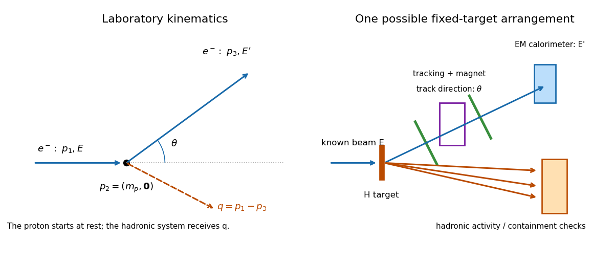

<h1 id="2/a/solution">Solution</h1>

↑ **Parent:** [A](../a.md)

Use the [Minkowski metric](../../../../minkowski-metric.md) $(+,-,-,-)$ and choose the incoming [electron](../../../../electron.md) along $+z$, with the scattered [electron](../../../../electron.md) in the $xz$ plane. In [natural units](../../../../natural-units.md), neglecting the [electron mass](../../../../electron-mass.md), the [four-momenta](../../../../four-momentum.md) are

$$
p_1=(E,0,0,E),\qquad p_2=(m_p,0,0,0),\qquad
p_3=(E',E'\sin\theta,0,E'\cos\theta).
$$

The [momentum transfer](../../../../momentum-transfer.md) entering the [proton](../../../../proton.md) is therefore

$$
\boxed{q=p_1-p_3=(E-E',-E'\sin\theta,0,E-E'\cos\theta).}
$$

The outgoing hadronic system carries $p_X=p_2+q$. The [energy transfer](../../../../energy-transfer.md) is $\nu=E-E'$, while $\mathbf q$ need not point along the original beam.

**[Figure 1](#2/a/image-fixed-target-deep-inelastic-scattering-laboratory-directions-and-a-schematic-detector). Fixed-target deep inelastic scattering: laboratory directions and a schematic detector**.

## ↑ Ancestors (12)

1. [A](../a.md)
2. [2](../../2.md)
3. [2021](../../../2021-split.md)
4. [Past exam of the particle physics course of the University of Oxford](../../../split.md)
5. [Particle physics course of the University of Oxford](../../../../particle-physics-course-of-the-university-of-oxford.md)
6. [Year 4 of the physics course of the University of Oxford](../../../../year-4-of-the-physics-course-of-the-university-of-oxford.md)
7. [Physics course of the University of Oxford](../../../../physics-course-of-the-university-of-oxford.md)
8. [Undergraduate course of the University of Oxford](../../../../undergraduate-course-of-the-university-of-oxford.md)
9. [Course of the University of Oxford](../../../../course-of-the-university-of-oxford.md)
10. [University of Oxford](../../../../university-of-oxford-split.md)
11. [List of universities](../../../../list-of-universities.md)
12. [Codex Wiki](../../../../split.md)
