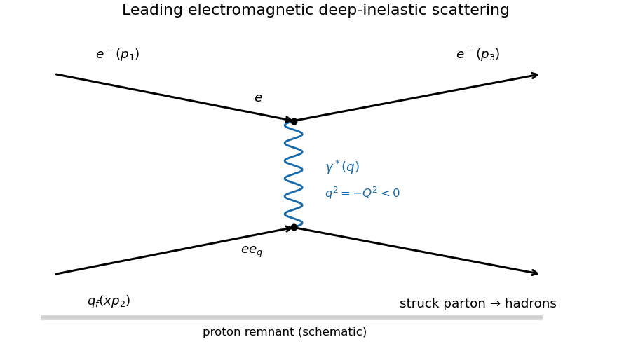

<h1 id="2/c/solution">Solution</h1>

↑ **Parent:** [C](../c.md)

At leading order in [QED](../../../../quantum-electrodynamics.md), the [electron](../../../../electron.md) exchanges one spacelike virtual [photon](../../../../photon.md) with a charged [parton](../../../../parton.md) inside the [proton](../../../../proton.md).

**[Figure 2](#2/c/image-one-photon-exchange-feynman-diagram-for-inclusive-electron-proton-deep-inelastic-scattering). One-photon-exchange Feynman diagram for inclusive electron-proton deep inelastic scattering**.

The two [Feynman vertices](../../../../interaction-vertex.md) contribute $e$ and $e e_q$, while the [photon propagator](../../../../photon-propagator.md) contributes $1/q^2=-1/Q^2$. Hence the [scattering amplitude](../../../../scattering-amplitude.md) scales as $e^2e_q/Q^2$ and its squared [absolute value](../../../../absolute-value.md) as $e^4e_q^2/Q^4$. Since the [fine-structure constant](../../../../fine-structure-constant.md) is $\alpha=e^2/(4\pi)$, the electromagnetic coupling dependence is $\alpha^2/Q^4$. The numerical $4\pi$ in the stated [differential scattering cross-section](../../../../differential-scattering-cross-section.md) additionally uses the flux, [Lorentz-invariant phase space](../../../../lorentz-invariant-phase-space.md), azimuthal integration and the convention defining the [deep-inelastic structure function](../../../../deep-inelastic-structure-function.md); it cannot be deduced from the propagator alone.

For each measured $x,Q^2$ bin form the reduced quantity

$$
\boxed{F_2(x,Q^2)=\frac{xQ^4}{4\pi\alpha^2[1-y+y^2/2]}\frac{d^2\sigma}{dx\,dQ^2}.}
$$

Plot this against $Q^2$ at several fixed $x$ values, normally using a logarithmic $Q^2$ axis. [Bjorken scaling](../../../../bjorken-scaling.md) predicts an approximately horizontal curve at each $x$, or equivalently collapse of different-$Q^2$ data onto one $F_2(x)$ curve. Raw [cross sections](../../../../cross-section-physics.md) do not collapse because their explicit kinematic factors vary. [QCD](../../../../quantum-chromodynamics.md) predicts logarithmic [scaling violations](../../../../scaling-violation.md), so exact independence is only the ideal [parton model](../../../../parton-model.md) limit. The stated extraction also assumes negligible [longitudinal deep-inelastic structure function](../../../../longitudinal-deep-inelastic-structure-function.md), as in the leading massless spin-half [parton](../../../../parton.md) approximation.

## ↑ Ancestors (12)

1. [C](../c.md)
2. [2](../../2.md)
3. [2021](../../../2021-split.md)
4. [Past exam of the particle physics course of the University of Oxford](../../../split.md)
5. [Particle physics course of the University of Oxford](../../../../particle-physics-course-of-the-university-of-oxford.md)
6. [Year 4 of the physics course of the University of Oxford](../../../../year-4-of-the-physics-course-of-the-university-of-oxford.md)
7. [Physics course of the University of Oxford](../../../../physics-course-of-the-university-of-oxford.md)
8. [Undergraduate course of the University of Oxford](../../../../undergraduate-course-of-the-university-of-oxford.md)
9. [Course of the University of Oxford](../../../../course-of-the-university-of-oxford.md)
10. [University of Oxford](../../../../university-of-oxford-split.md)
11. [List of universities](../../../../list-of-universities.md)
12. [Codex Wiki](../../../../split.md)
