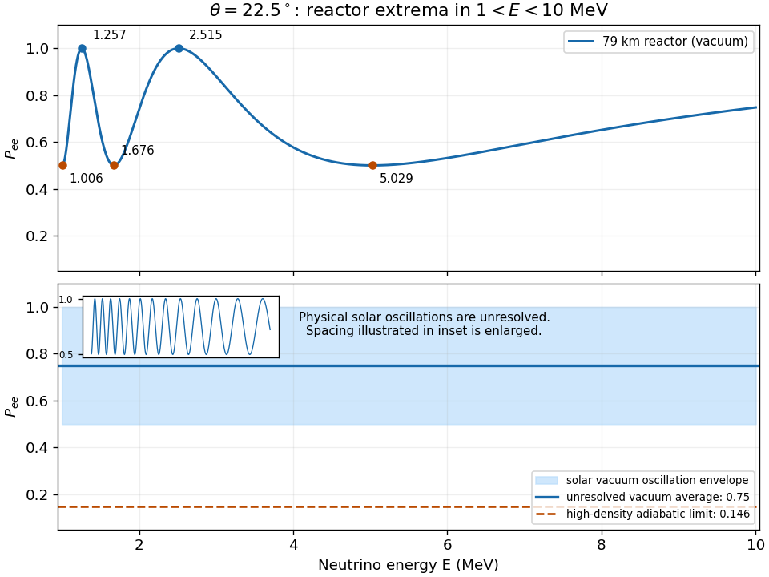

<h1 id="3/c/solution">Solution</h1>

↑ **Parent:** [C](../c.md)

Starting with the [electron neutrino](../../../../electron-neutrino.md) state in [a](../a.md), the survival [probability amplitude](../../../../probability-amplitude.md) is

$$
S_{ee}(t)=c^2e^{-i\chi_1t}+s^2e^{-i\chi_2t}.
$$

Taking its squared [absolute value](../../../../absolute-value.md) gives

$$
P_{ee}=1-\sin^22\theta\sin^2\frac{\delta\chi t}{2}
=\cos^22\theta+\sin^22\theta\cos^2\frac{\delta\chi t}{2}.
$$

This derives the supplied survival [probability](../../../../probability.md) from the evolution operator rather than from a Hamiltonian entry. It also shows why the two written forms agree. For the stipulated phase and $\theta=22.5^\circ$, $\sin^22\theta=1/2$, so at $L=79\ \mathrm{km}$,

$$
\boxed{P_{ee}(E)=\frac12+\frac12\cos^2(7.9/E),\qquad E\text{ in MeV}.}
$$

The phase decreases monotonically from $7.9$ to $0.79$ over the open interval $1<E<10$. Differentiating gives $dP_{ee}/dE=[7.9/(2E^2)]\sin(15.8/E)$. The interior maxima occur at $7.9/E=n\pi$ and the interior minima at $7.9/E=(n+1/2)\pi$. Enumerating those phases gives

$$
\begin{array}{c|c|c}
\text{type}&E\ (\mathrm{MeV})&P_{ee}\\\hline
\text{minimum}&7.9/(5\pi/2)=1.0059&1/2\\
\text{maximum}&7.9/(2\pi)=1.2573&1\\
\text{minimum}&7.9/(3\pi/2)=1.6764&1/2\\
\text{maximum}&7.9/\pi=2.5146&1\\
\text{minimum}&7.9/(\pi/2)=5.0293&1/2
\end{array}
$$

The minimum just above $1\ \mathrm{MeV}$ must not be lost by rounding the lower endpoint. Neither excluded endpoint is an additional extremum.

**[Figure 3](#3/c/image-reactor-survival-extrema-and-the-unresolved-solar-vacuum-oscillation-envelope). Reactor survival extrema and the unresolved solar vacuum-oscillation envelope**.

For [solar neutrinos](../../../../solar-neutrino.md) propagating in the same _vacuum_ model, the vastly longer baseline makes the oscillations extremely fine in [energy](../../../../energy-split.md), with the same bounds $1/2$ and $1$. The figure uses a deliberately schematic enlargement of the oscillation spacing to show those bounds. A $1\ \mathrm{MeV}$ detector [energy resolution](../../../../energy-resolution.md) averages very many periods, so $\langle\cos^2\varphi\rangle=1/2$ and

$$
\boxed{\langle P_{ee}\rangle_{\rm vacuum}=1-\tfrac12\sin^22\theta=\tfrac34.}
$$

The detector averages event rates weighted by source spectrum, interaction [cross section](../../../../cross-section-physics.md) and response; the displayed constant follows when these vary slowly across each tiny oscillation period. Reactor production physically gives [electron antineutrinos](../../../../electron-antineutrino.md). In this two-flavor vacuum approximation their survival [probability](../../../../probability.md) is identical; the positive matter-potential discussion in [d](../d.md) concerns [solar neutrinos](../../../../solar-neutrino.md).

## ↑ Ancestors (12)

1. [C](../c.md)
2. [3](../../3.md)
3. [2021](../../../2021-split.md)
4. [Past exam of the particle physics course of the University of Oxford](../../../split.md)
5. [Particle physics course of the University of Oxford](../../../../particle-physics-course-of-the-university-of-oxford.md)
6. [Year 4 of the physics course of the University of Oxford](../../../../year-4-of-the-physics-course-of-the-university-of-oxford.md)
7. [Physics course of the University of Oxford](../../../../physics-course-of-the-university-of-oxford.md)
8. [Undergraduate course of the University of Oxford](../../../../undergraduate-course-of-the-university-of-oxford.md)
9. [Course of the University of Oxford](../../../../course-of-the-university-of-oxford.md)
10. [University of Oxford](../../../../university-of-oxford-split.md)
11. [List of universities](../../../../list-of-universities.md)
12. [Codex Wiki](../../../../split.md)
