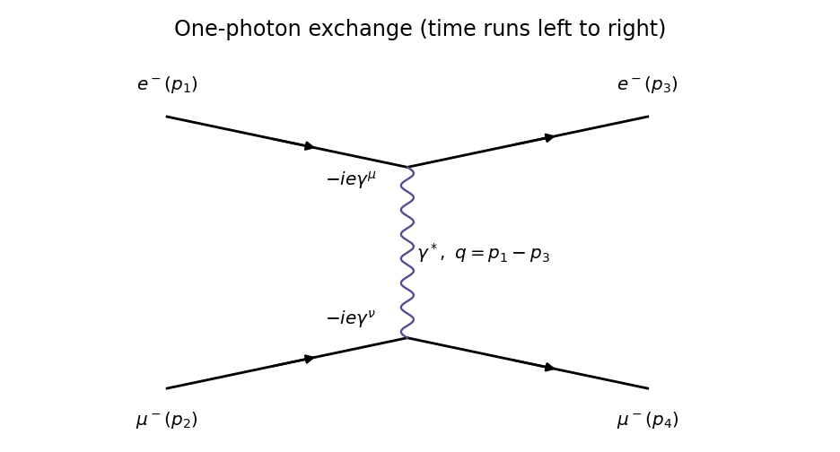
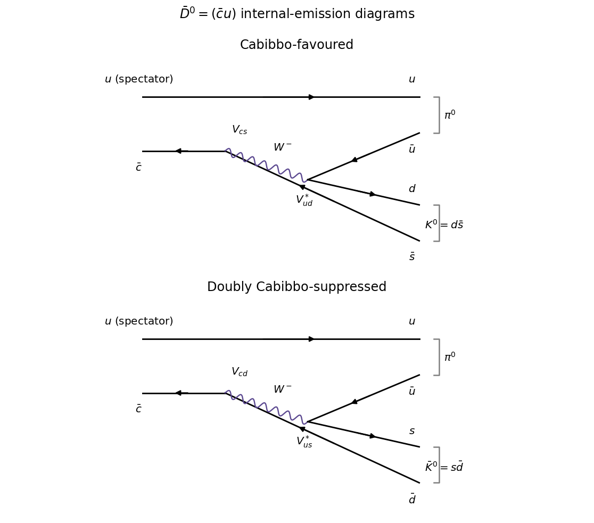
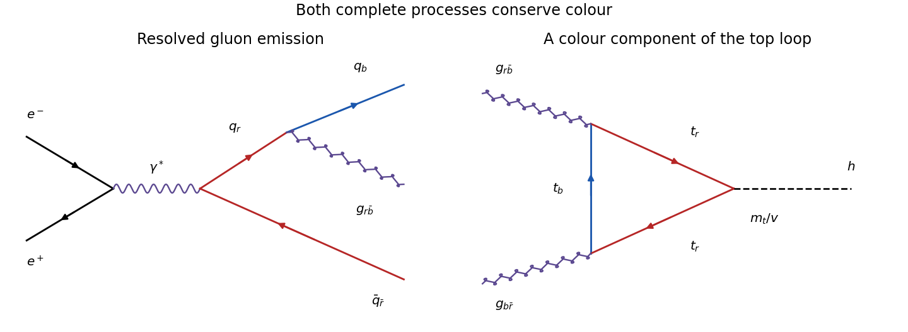
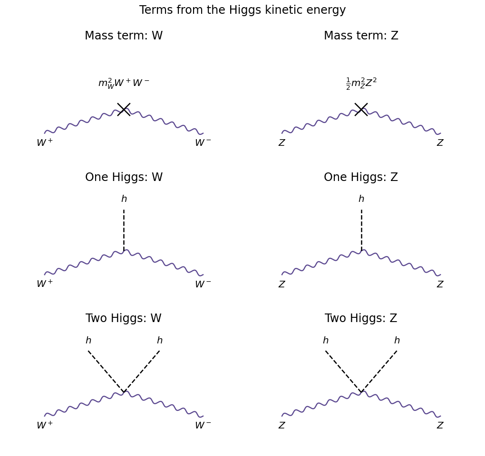
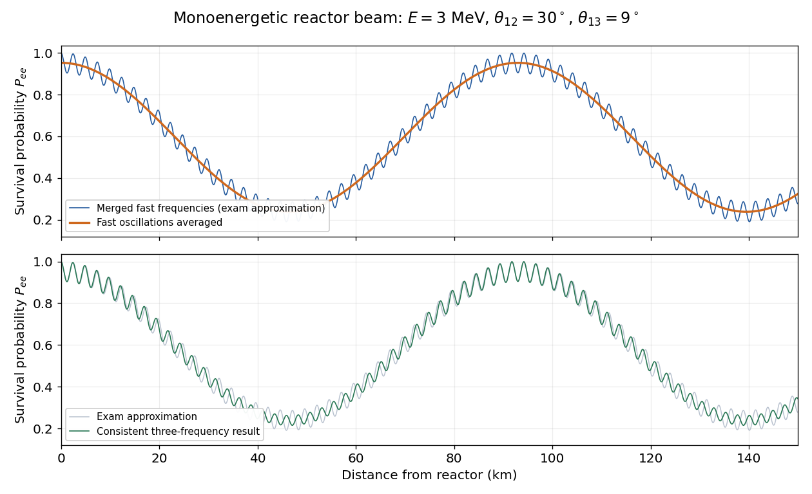

# 2022

↑ **Parent:** [Past exam of the particle physics course of the University of Oxford](../past-exam-of-the-particle-physics-course-of-the-university-of-oxford.md)

Source: [https://www.whatdotheyknow.com/request/oxford_physics_past_papers_2/response/2340696/attach/10/Physics%20Papers%202021.pdf?cookie_passthrough=1](https://www.whatdotheyknow.com/request/oxford_physics_past_papers_2/response/2340696/attach/10/Physics%20Papers%202021.pdf?cookie_passthrough=1)

Source bundle pages 31–39. The cover dates this paper to 2022; the attachment filename says 2021. These solutions use [natural units](../mathematical-physics.md#natural-units) $\hbar=c=1$, except where units are restored explicitly.

**Table of contents**

- [1](#1)
  - [a](#1/a)
    - [Solution](#1/a/solution)
  - [b](#1/b)
    - [Solution](#1/b/solution)
  - [c](#1/c)
    - [Solution](#1/c/solution)
  - [d](#1/d)
    - [Solution](#1/d/solution)
  - [e](#1/e)
    - [Solution](#1/e/solution)
- [2](#2)
  - [a](#2/a)
    - [Solution](#2/a/solution)
  - [b](#2/b)
    - [Solution](#2/b/solution)
  - [c](#2/c)
    - [Solution](#2/c/solution)
  - [d](#2/d)
    - [Solution](#2/d/solution)
- [3](#3)
  - [a](#3/a)
    - [Solution](#3/a/solution)
  - [b](#3/b)
    - [Solution](#3/b/solution)
  - [c](#3/c)
    - [Solution](#3/c/solution)
  - [d](#3/d)
    - [Solution](#3/d/solution)
  - [e](#3/e)
    - [Solution](#3/e/solution)
- [4](#4)
  - [a](#4/a)
    - [i](#4/a/i)
      - [Solution](#4/a/i/solution)
    - [ii](#4/a/ii)
      - [Solution](#4/a/ii/solution)
  - [b](#4/b)
    - [i](#4/b/i)
      - [Solution](#4/b/i/solution)
    - [ii](#4/b/ii)
      - [Solution](#4/b/ii/solution)
    - [iii](#4/b/iii)
      - [Solution](#4/b/iii/solution)
    - [iv](#4/b/iv)
      - [Solution](#4/b/iv/solution)
  - [c](#4/c)
    - [Solution](#4/c/solution)
- [5](#5)
  - [a](#5/a)
    - [Solution](#5/a/solution)
  - [b](#5/b)
    - [Solution](#5/b/solution)
  - [c](#5/c)
    - [Solution](#5/c/solution)
  - [d](#5/d)
    - [Solution](#5/d/solution)
- [6](#6)
  - [a](#6/a)
    - [Solution](#6/a/solution)
  - [b](#6/b)
    - [Solution](#6/b/solution)
  - [c](#6/c)
    - [Solution](#6/c/solution)
  - [d](#6/d)
    - [i](#6/d/i)
      - [Solution](#6/d/i/solution)
    - [ii](#6/d/ii)
      - [Solution](#6/d/ii/solution)
    - [iii](#6/d/iii)
      - [Solution](#6/d/iii/solution)
    - [iv](#6/d/iv)
      - [Solution](#6/d/iv/solution)
    - [v](#6/d/v)
      - [Solution](#6/d/v/solution)
    - [vi](#6/d/vi)
      - [Solution](#6/d/vi/solution)
    - [vii](#6/d/vii)
      - [Solution](#6/d/vii/solution)

## 1

↑ **Parent:** [2022](2022.md)

<h3 id="1/a">a</h3>

↑ **Parent:** [1](#1)

<h4 id="1/a/solution">Solution</h4>

↑ **Parent:** [A](#1/a)

An incoming [fermion](../tensor-product-of-quantum-systems.md#fermion) contributes a [Dirac spinor](../relativistic-quantum-field.md#dirac-spinor) $u_s(p)$ and an outgoing [fermion](../tensor-product-of-quantum-systems.md#fermion) contributes its [Dirac adjoint](../relativistic-quantum-field.md#dirac-adjoint) $\bar u_s(p)=u_s^\dagger(p)\gamma^0$. The label $s$ specifies a [spin](../angular-momentum-operator.md#spin) state; $p$ is the on-shell [four-momentum](../special-relativity.md#four-momentum). Incoming and outgoing [antifermions](../relativistic-quantum-field.md#antifermion) instead contribute $\bar v_s(p)$ and $v_s(p)$.

The exchanged [boson](../tensor-product-of-quantum-systems.md#boson) is a virtual [photon](../quantum-mechanics.md#photon), represented in the [Feynman rules](../perturbative-quantum-field-theory.md#feynman-rules) by the [photon propagator](../quantum-field-theory.md#photon-propagator) $-ig_{\mu\nu}/(q^2+i\epsilon)$ in [Feynman gauge](../relativistic-quantum-field.md#feynman-gauge). Its [momentum transfer](../quantum-scattering.md#momentum-transfer) is $q=p_1-p_3=p_4-p_2$; unlike an external real [photon](../quantum-mechanics.md#photon), it need not satisfy $q^2=0$. Each [Feynman vertex](../perturbative-quantum-field-theory.md#interaction-vertex) contracts a [gamma matrix](../algebra-over-a-field.md#gamma-matrices) with this [propagator](../quantum-field-theory.md#propagator) and contributes $-ie\gamma^\mu$ in a conventional [QED](../perturbative-quantum-field-theory.md#quantum-electrodynamics) sign convention. The [coupling constant](../statistical-model.md#coupling-constant-physics) $e$ sets the interaction strength, with [fine-structure constant](../perturbative-quantum-field-theory.md#fine-structure-constant) $\alpha=e^2/(4\pi)$. One may reverse the sign of the [photon](../quantum-mechanics.md#photon) field and both vertex signs without changing the result. The [gamma matrices](../algebra-over-a-field.md#gamma-matrices) obey $\{\gamma^\mu,\gamma^\nu\}=2g^{\mu\nu}I$, with [Minkowski metric](../special-relativity.md#minkowski-metric) $g=\operatorname{diag}(1,-1,-1,-1)$.

<h3 id="1/b">b</h3>

↑ **Parent:** [1](#1)

<h4 id="1/b/solution">Solution</h4>

↑ **Parent:** [B](#1/b)

There is one [tree-level Feynman diagram](../perturbative-quantum-field-theory.md#tree-level-feynman-diagram): the distinguishable [electron](../physics.md#electron) and [muon](../standard-model.md#muon) exchange a [photon](../quantum-mechanics.md#photon) in the $t$ channel. There is no identical-particle exchange diagram.

**[Figure 1](#1/b/image-electron-muon-scattering-by-one-photon-exchange). Electron-muon scattering by one-photon exchange**.

Multiplying the external [Dirac spinors](../relativistic-quantum-field.md#dirac-spinor), the two [Feynman vertices](../perturbative-quantum-field-theory.md#interaction-vertex) and the [photon propagator](../quantum-field-theory.md#photon-propagator) gives

$$
i\mathcal M=[\bar u_3(-ie\gamma^\mu)u_1]\frac{-ig_{\mu\nu}}{q^2+i\epsilon}[\bar u_4(-ie\gamma^\nu)u_2],\qquad
\boxed{\mathcal M=\frac{e^2}{q^2}[\bar u_3\gamma^\mu u_1][\bar u_4\gamma_\mu u_2].}
$$

The overall phase of this [scattering amplitude](../quantum-scattering.md#scattering-amplitude) is convention dependent. Four external [spin](../angular-momentum-operator.md#spin) labels with two choices each give $2^4=16$ possible configurations before taking a limit. For $E\gg m,M$, the vector [QED](../perturbative-quantum-field-theory.md#quantum-electrodynamics) interaction preserves [fermion chirality](../relativistic-quantum-field.md#chirality-physics), which becomes [helicity](../special-relativity.md#helicity) for each external particle. Thus the surviving configurations, written as $(h_e,h_\mu)_{\rm in}\to(h_e,h_\mu)_{\rm out}$, are

$$
\boxed{LL\to LL,\quad LR\to LR,\quad RL\to RL,\quad RR\to RR.}
$$

Here $L,R$ specify [helicity](../special-relativity.md#helicity) along each particle's own [momentum](../momentum.md). The other configurations require at least one [mass](../classical-mechanics.md#mass)-suppressed flip and vanish in the strictly massless limit.

<h3 id="1/c">c</h3>

↑ **Parent:** [1](#1)

<h4 id="1/c/solution">Solution</h4>

↑ **Parent:** [C](#1/c)

Define the [Mandelstam variables](../special-relativity.md#mandelstam-variables) for the scattering labels by $s=(p_1+p_2)^2$, $t=(p_1-p_3)^2=q^2$ and $u=(p_1-p_4)^2$. Dropping the [electron](../physics.md#electron) and [muon](../standard-model.md#muon) [masses](../classical-mechanics.md#mass) gives

$$
p_1\cdot p_2=p_3\cdot p_4=\frac{s}{2},\qquad
p_1\cdot p_4=p_3\cdot p_2=-\frac{u}{2}.
$$

These identities follow by expanding the corresponding squared [four-momenta](../special-relativity.md#four-momentum), using $p_i^2=0$ and [four-momentum conservation](../special-relativity.md#four-momentum-conservation). Substitution into the supplied spin-averaged [matrix element](../vector-space.md#matrix-element) yields

$$
\overline{|\mathcal M|^2}
=\frac{8e^4}{t^2}\left(\frac{s^2}{4}+\frac{u^2}{4}\right)
=\boxed{2e^4\frac{s^2+u^2}{t^2}}.
$$

The $1/4$ initial [spin](../angular-momentum-operator.md#spin) average is already included in the given expression; no further averaging factor belongs here.

<h3 id="1/d">d</h3>

↑ **Parent:** [1](#1)

<h4 id="1/d/solution">Solution</h4>

↑ **Parent:** [D](#1/d)

To implement [crossing symmetry](../quantum-scattering.md#crossing-symmetry) with the annihilation labels, replace the old scattering [four-momenta](../special-relativity.md#four-momentum) by $(p_1,-p_3,-p_2,p_4)$. The scattering [Mandelstam variables](../special-relativity.md#mandelstam-variables) then become $(s_{\rm old},t_{\rm old},u_{\rm old})=(t,s,u)$, where now $s=(p_1+p_2)^2$, $t=(p_1-p_3)^2$ and $u=(p_1-p_4)^2$. Consequently

$$
\overline{|\mathcal M_{\rm ann}|^2}=2e^4\frac{t^2+u^2}{s^2}.
$$

In the [centre-of-momentum frame](../special-relativity.md#center-of-momentum-frame), take $\theta$ between the incoming [electron](../physics.md#electron) and outgoing positive [muon](../standard-model.md#muon), $p_3$. For negligible [masses](../classical-mechanics.md#mass), $t=-s(1-\cos\theta)/2$ and $u=-s(1+\cos\theta)/2$. Therefore

$$
\boxed{\overline{|\mathcal M_{\rm ann}|^2}=e^4(1+\cos^2\theta).}
$$

Defining $\theta$ using the outgoing negative [muon](../standard-model.md#muon) interchanges $t$ and $u$ and leaves the result unchanged.

<h3 id="1/e">e</h3>

↑ **Parent:** [1](#1)

<h4 id="1/e/solution">Solution</h4>

↑ **Parent:** [E](#1/e)

The intermediate [photon](../quantum-mechanics.md#photon) carries [spin](../angular-momentum-operator.md#spin) $J=1$. In the massless limit, a back-to-back [fermion](../tensor-product-of-quantum-systems.md#fermion)-[antifermion](../relativistic-quantum-field.md#antifermion) pair coupled to its vector current has opposite [helicities](../special-relativity.md#helicity), so the initial and final projections along their respective axes are $m,m'=\pm1$. A rotation between these axes contributes the [Wigner D-matrix](../angular-momentum-operator.md#wigner-d-matrix) elements $d^1_{m'm}(\theta)$. The relevant elements have magnitudes $(1+\cos\theta)/2$ and $(1-\cos\theta)/2$. Summing the four squared [helicity amplitudes](../quantum-scattering.md#helicity-amplitude) gives the angular factor

$$
2\left(\frac{1+\cos\theta}{2}\right)^2+
2\left(\frac{1-\cos\theta}{2}\right)^2=1+\cos^2\theta.
$$

The common coupling and normalization factors recover the result in [d](#1/d). The $m=0$ terms do not contribute: the massless external vector currents eliminate the corresponding [helicity](../special-relativity.md#helicity) configurations.

## 2

↑ **Parent:** [2022](2022.md)

<h3 id="2/a">a</h3>

↑ **Parent:** [2](#2)

<h4 id="2/a/solution">Solution</h4>

↑ **Parent:** [A](#2/a)

The favoured [weak charged current](../standard-model.md#charged-current) transition is $\bar c\to\bar sW^-$ followed by $W^-\to d\bar u$. The [spectator quark](../standard-model.md#spectator-quark) $u$ combines with $\bar u$ to form the $u\bar u/\sqrt2$ component of the [neutral pion](../standard-model.md#neutral-pion), while $d\bar s$ forms $K^0$. The product of [CKM matrix](../standard-model.md#cabibbo-kobayashi-maskawa-matrix) factors is $V_{cs}V_{ud}^*$. The doubly [Cabibbo suppressed](../standard-model.md#cabibbo-suppression) transition is $\bar c\to\bar dW^-$ followed by $W^-\to s\bar u$, with factors $V_{cd}V_{us}^*$; the final $s\bar d$ is the [neutral antikaon](../physics.md#neutral-antikaon). Both are colour-suppressed internal-emission [Feynman diagrams](../perturbative-quantum-field-theory.md#feynman-diagram), with the same spectator routing.

**[Figure 2](#2/a/image-favoured-and-doubly-suppressed-neutral-charm-decay-diagrams). Favoured and doubly suppressed neutral-charm decay diagrams**.

In the two-generation approximation to the [CKM matrix](../standard-model.md#cabibbo-kobayashi-maskawa-matrix), $V_{ud}=V_{cs}=\cos\theta_C$, $V_{us}=\sin\theta_C$ and $V_{cd}=-\sin\theta_C$. For equal magnitudes of the [hadronic matrix elements](../vector-space.md#hadronic-matrix-element),

$$
\boxed{\frac{|A(\bar D^0\to\bar K^0\pi^0)|}{|A(\bar D^0\to K^0\pi^0)|}=\tan^2\theta_C,\qquad
\frac{\Gamma_{\rm suppressed}}{\Gamma_{\rm favoured}}\simeq\tan^4\theta_C.}
$$

The rate ratio is about $2.8\times10^{-3}$ with the supplied [CKM matrix](../standard-model.md#cabibbo-kobayashi-maskawa-matrix) magnitudes. The minus sign of a particular product of [CKM matrix](../standard-model.md#cabibbo-kobayashi-maskawa-matrix) elements must be combined with the phases of the [hadronic matrix elements](../vector-space.md#hadronic-matrix-element) and [kaon](../physics.md#kaon) basis states; it is not by itself the observable interference sign.

<h3 id="2/b">b</h3>

↑ **Parent:** [2](#2)

<h4 id="2/b/solution">Solution</h4>

↑ **Parent:** [B](#2/b)

Choose the [exchange-positive CP convention for neutral kaon mixing](../physics.md#exchange-positive-cp-convention-for-neutral-kaon-mixing), $CP|K^0\rangle=|\bar K^0\rangle$. Neglecting [CP violation](../quantum-field-theory.md#cp-violation), the [kaon CP eigenstates](../physics.md#kaon-cp-eigenstates) can then be written

$$
|K_S\rangle=\frac{|K^0\rangle+|\bar K^0\rangle}{\sqrt2},\qquad
|K_L\rangle=\frac{|K^0\rangle-|\bar K^0\rangle}{\sqrt2}.
$$

Writing $A=A(\bar D^0\to K^0\pi^0)$ and $B=A(\bar D^0\to\bar K^0\pi^0)$, projection on these coherent final states gives

$$
\boxed{A_S=\frac{A+B}{\sqrt2}=\frac{A}{\sqrt2}(1+B/A),\qquad
A_L=\frac{A-B}{\sqrt2}=\frac{A}{\sqrt2}(1-B/A).}
$$

This is the convention implicit in the printed sum. Changing the sign convention for the [neutral antikaon](../physics.md#neutral-antikaon) changes both its coefficient in the [kaon CP eigenstates](../physics.md#kaon-cp-eigenstates) and $B$; it cannot change either physical [decay rate](../relativistic-quantum-field.md#decay-width). The extremely small $K_S$–$K_L$ [mass](../classical-mechanics.md#mass) difference can be ignored in the two-body [phase space](../hamiltonian-mechanics.md#phase-space).

<h3 id="2/c">c</h3>

↑ **Parent:** [2](#2)

<h4 id="2/c/solution">Solution</h4>

↑ **Parent:** [C](#2/c)

Put $r=B/A$. Equal two-body [phase space](../hamiltonian-mechanics.md#phase-space) gives $\Gamma_{S,L}\propto|A|^2|1\pm r|^2/2$, so the [decay-rate asymmetry](../relativistic-quantum-field.md#decay-rate-asymmetry) is exactly

$$
\mathcal R=\frac{|1+r|^2-|1-r|^2}{|1+r|^2+|1-r|^2}
=\frac{2\operatorname{Re}r}{1+|r|^2}.
$$

The stated magnitude assumption fixes $|r|=\tan^2\theta_C$. Retaining the relative [strong phase](../standard-model.md#strong-phase) $\delta$ in the convention of [b](#2/b) therefore gives

$$
\boxed{\mathcal R=\frac{2\tan^2\theta_C\cos\delta}{1+\tan^4\theta_C}
=2\tan^2\theta_C\cos\delta+O(\tan^6\theta_C).}
$$

**A magnitude assumption alone does not determine $\mathcal R$.** For example, $r=i\tan^2\theta_C$ has the stipulated magnitude but gives $\mathcal R=0$, whereas a real positive $r$ gives a positive asymmetry. With the additional aligned-amplitude assumption $\delta=0$, conventionally used for this idealised extraction, the intended leading result is $\boxed{\mathcal R\simeq2\tan^2\theta_C}$. The sign of $r$ here refers to the complete amplitude after choosing the [kaon](../physics.md#kaon) phase convention, not to a bare [CKM matrix](../standard-model.md#cabibbo-kobayashi-maskawa-matrix) product. A flavour-symmetry relation can supply further information, but is stronger than the printed magnitude assumption.

<h3 id="2/d">d</h3>

↑ **Parent:** [2](#2)

<h4 id="2/d/solution">Solution</h4>

↑ **Parent:** [D](#2/d)

The long-lived, electrically neutral [kaon](../physics.md#kaon) often traverses the [particle detector](../particle-detection.md#particle-detector) without decaying into a reconstructable charged final state. Identifying it through a hadronic interaction or missing [four-momentum](../special-relativity.md#four-momentum) is much less efficient than reconstructing the short-lived [kaon](../physics.md#kaon) through its nearby two-[pion](../standard-model.md#pion) [decay vertex](../particle-detection.md#decay-vertex). The efficiencies must be applied to the observed counts before taking their asymmetry:

$$
N_S=\frac{1107}{0.93}=1190.32,\qquad N_L=\frac{49}{0.05}=980,
\qquad \mathcal R=\frac{N_S-N_L}{N_S+N_L}=0.09691.
$$

Using the leading aligned-amplitude approximation from [c](#2/c),

$$
\boxed{\theta_C=\arctan\sqrt{\mathcal R/2}=0.21667\ \mathrm{rad}=12.41^\circ.}
$$

The exact aligned formula instead gives $12.43^\circ$, an immaterial correction here. Treating the observed counts as independent [Poisson random variables](../discrete-probability-distribution.md#poisson-distribution) and the efficiencies as known, [propagation of uncertainty](../wave-equation.md#propagation-of-uncertainty) gives

$$
\sigma_S=\frac{\sqrt{1107}}{0.93}=35.78,\qquad \sigma_L=\frac{\sqrt{49}}{0.05}=140,
$$

$$
\sigma_{\mathcal R}^2=\left[\frac{2N_L}{(N_S+N_L)^2}\right]^2\sigma_S^2+
\left[\frac{2N_S}{(N_S+N_L)^2}\right]^2\sigma_L^2,
\qquad \boxed{\sigma_{\mathcal R}=0.0723.}
$$

The separate contributions to $\sigma_{\mathcal R}$ are $0.0149$ and $0.0708$; the small $K_L$ sample dominates. Linear [propagation of uncertainty](../wave-equation.md#propagation-of-uncertainty) yields $\sigma(\theta_C)\simeq4.49^\circ$, although the nonlinear extraction and physical boundary make a symmetric [confidence interval](../statistical-inference.md#confidence-interval) a rough summary. Unknown efficiency uncertainties, especially that of $K_L$, would be additional systematic contributions.

The supplied [CKM matrix](../standard-model.md#cabibbo-kobayashi-maskawa-matrix) gives $\sin\theta_C\simeq0.224$, hence $\theta_C\simeq12.94^\circ$ and $\mathcal R\simeq2(0.224/0.975)^2=0.1056$. The asymmetry difference is only about $0.12$ statistical [standard deviations](../variance.md#standard-deviation), so the measurement is compatible. Without the phase assumption, these data measure $\tan^2\theta_C\cos\delta$ to leading order and do not uniquely measure the [Cabibbo angle](../standard-model.md#cabibbo-angle).

## 3

↑ **Parent:** [2022](2022.md)

<h3 id="3/a">a</h3>

↑ **Parent:** [3](#3)

<h4 id="3/a/solution">Solution</h4>

↑ **Parent:** [A](#3/a)

The $\Delta^{++}$ [Delta baryon](../physics.md#delta-baryon) has [electric charge](../electric-charge.md) $+2$ and [valence quark](../standard-model.md#valence-quark) content $uuu$. In its ground state the spatial wavefunction has orbital [angular momentum](../momentum.md#angular-momentum) $L=0$ and is symmetric. Its [spin](../angular-momentum-operator.md#spin) is $3/2$; the maximal projection state $u_\uparrow u_\uparrow u_\uparrow$ is symmetric in [spin](../angular-momentum-operator.md#spin), and its [quark flavour](../standard-model.md#quark-flavor) wavefunction is symmetric as well. Three identical [fermions](../tensor-product-of-quantum-systems.md#fermion) require an antisymmetric total wavefunction by the [Pauli exclusion principle](../tensor-product-of-quantum-systems.md#pauli-exclusion-principle). A further internal degree of freedom must therefore supply the antisymmetry.

With three [color charges](../standard-model.md#color-charge), that factor is the normalized [colour singlet](../standard-model.md#colour-singlet)

$$
\boxed{|C\rangle=\frac{|rgb\rangle+|gbr\rangle+|brg\rangle-|rbg\rangle-|grb\rangle-|bgr\rangle}{\sqrt6}.}
$$

It changes sign under exchange of any two [quarks](../standard-model.md#quark). The remaining symmetric factors then give the required antisymmetric total state. This argument motivates [color charge](../standard-model.md#color-charge) independently of the already present [quark flavour](../standard-model.md#quark-flavor) and [spin](../angular-momentum-operator.md#spin) labels.

<h3 id="3/b">b</h3>

↑ **Parent:** [3](#3)

<h4 id="3/b/solution">Solution</h4>

↑ **Parent:** [B](#3/b)

For [quarks](../standard-model.md#quark) in an $N_c$-dimensional internal space $V$, complete antisymmetrization of three labels corresponds to a [Young diagram](../representation-theory-of-the-symmetric-group.md#young-diagram) with one column of three boxes, the partition $(1,1,1)$. Its [representation](../representation-theory.md#group-representation) is the [exterior power](../multilinear-algebra.md#exterior-power) $\bigwedge^3V$ and has [dimension](../vector-space.md#dimension-vector-space)

$$
\dim\bigwedge^3V=\binom{N_c}{3}.
$$

For $N_c=2$, the column is too tall: $\bigwedge^3\mathbb C^2=0$. With only two labels at least two of the three coincide, and the [Young tableau](../representation-theory-of-the-symmetric-group.md#young-tableau) column antisymmetrizer annihilates the state. For $N_c=3$, the filled column $r,g,b$ spans a one-dimensional determinant [representation](../representation-theory.md#group-representation). It is a [colour singlet](../standard-model.md#colour-singlet) of [SU(3)](../topological-group.md#su-3-group) because every group element has determinant one.

Equivalently, the [tensor product of group representations](../representation-theory.md#tensor-product-of-group-representations) decomposes as

$$
\boxed{3\otimes3\otimes3=10_{[3]}\oplus8_{[2,1]}\oplus8_{[2,1]}\oplus1_{[1,1,1]}.}
$$

The two mixed-symmetry terms account for $16$ dimensions, so the total is $10+8+8+1=27$. Antisymmetry alone establishes **at least** three internal states. Exactly three follows in the usual [special unitary group](../topological-group.md#special-unitary-group) model when the observed three-[quark](../standard-model.md#quark) [baryon](../physics.md#baryon) must be a [colour singlet](../standard-model.md#colour-singlet): for $N_c>3$ the antisymmetric third [exterior power](../multilinear-algebra.md#exterior-power) has dimension greater than one and is not a singlet. This extra assumption should be made explicit.

<h3 id="3/c">c</h3>

↑ **Parent:** [3](#3)

<h4 id="3/c/solution">Solution</h4>

↑ **Parent:** [C](#3/c)

Away from narrow [resonances](../dynamical-systems.md#resonance) and [quark](../standard-model.md#quark) thresholds, the [QED](../perturbative-quantum-field-theory.md#quantum-electrodynamics) annihilation [cross section](../physics.md#cross-section-physics) into each accessible [quark flavour](../standard-model.md#quark-flavor) is its squared fractional [electric charge](../electric-charge.md) times the [muon](../standard-model.md#muon)-pair [cross section](../physics.md#cross-section-physics), multiplied by the number $N_c$ of distinguishable [color charges](../standard-model.md#color-charge). Thus the inclusive hadronic ratio is

$$
R_{\rm had}=\frac{\sigma(e^+e^-\to\text{hadrons})}{\sigma(e^+e^-\to\mu^+\mu^-)}
\simeq N_c\sum_f Q_f^2.
$$

With $N_c=3$, the continuum predictions are $R_{uds}=2$, $R_{udsc}=10/3$ and $R_{udscb}=11/3$ as successive [charm quark](../standard-model.md#charm-quark) and [bottom quark](../standard-model.md#bottom-quark) channels become accessible. The measured normalization and steps support three [color charges](../standard-model.md#color-charge). At leading order these hadronic events form two back-to-back [jets](../standard-model.md#jet-particle-physics) from the [quark](../standard-model.md#quark) and [antiquark](../standard-model.md#antiquark); quantitative comparisons include [QCD](../standard-model.md#quantum-chromodynamics) corrections and avoid the nonperturbative threshold region.

The extra resolved [jet](../standard-model.md#jet-particle-physics) is explained by $e^+e^-\to\gamma^*\to q\bar qg$, with [gluon](../standard-model.md#gluon) radiation from either the [quark](../standard-model.md#quark) or [antiquark](../standard-model.md#antiquark). One possible [color charge](../standard-model.md#color-charge) routing is initial $q_r\bar q_{\bar r}$ followed by $q_r\to q_b+g_{r\bar b}$; the final $q_b$, $\bar q_{\bar r}$ and $g_{r\bar b}$ combine to a net [colour singlet](../standard-model.md#colour-singlet).

**[Figure 3](#3/c/image-colour-flow-in-a-three-jet-process-and-in-gluon-fusion-higgs-production). Colour flow in a three-jet process and in gluon-fusion Higgs production**.

The three-[jet](../standard-model.md#jet-particle-physics) [cross section](../physics.md#cross-section-physics) contains one additional [strong interaction](../standard-model.md#strong-interaction) vertex in the amplitude, so its ratio to the two-[jet](../standard-model.md#jet-particle-physics) rate is of order $\alpha_s=g_s^2/(4\pi)$ times a resolution-dependent kinematic coefficient. A resolved fraction of order $15\%$ is consistent with perturbative [QCD](../standard-model.md#quantum-chromodynamics) and a [strong coupling constant](../standard-model.md#strong-coupling-constant) much larger than the [fine-structure constant](../perturbative-quantum-field-theory.md#fine-structure-constant). It is not an equality $\alpha_s=0.15$: the [jet](../standard-model.md#jet-particle-physics) definition and cuts are needed. [Photon](../quantum-mechanics.md#photon) radiation has a much smaller electromagnetic rate. The large hadronic third-[jet](../standard-model.md#jet-particle-physics) rate supports [gluon](../standard-model.md#gluon) radiation; identifying the radiated object specifically as a colour-octet [gluon](../standard-model.md#gluon) also uses the [QCD](../standard-model.md#quantum-chromodynamics) vertex and colour-flow description, not merely the existence of three visible [jets](../standard-model.md#jet-particle-physics).

<h3 id="3/d">d</h3>

↑ **Parent:** [3](#3)

<h4 id="3/d/solution">Solution</h4>

↑ **Parent:** [D](#3/d)

Represent the [color charges](../standard-model.md#color-charge) by $r=(1,0,0)^T$, $g=(0,1,0)^T$ and $b=(0,0,1)^T$. The [Gell-Mann matrices](../algebra.md#gell-mann-matrices) satisfy

$$
\lambda^4r=b,\qquad\lambda^5r=ib,\qquad
\frac{\lambda^4-i\lambda^5}{2}=|b\rangle\langle r|.
$$

The physical [quark](../standard-model.md#quark)-[gluon](../standard-model.md#gluon) [Feynman vertex](../perturbative-quantum-field-theory.md#interaction-vertex) contains $g_sT^a$ with $T^a=\lambda^a/2$; the off-diagonal combination therefore allows $r\to b$. [Color charge](../standard-model.md#color-charge) conservation assigns the emitted [gluon](../standard-model.md#gluon) the colour-flow label $r\bar b$.

**The claimed impossibility of $r\to r$ is false.** A direct counterexample from the printed matrices is

$$
\boxed{\lambda^3r=r,\qquad\lambda^8r=\frac{r}{\sqrt3}.}
$$

Thus both diagonal [gluons](../standard-model.md#gluon) have nonzero $r\to r$ vertex elements, $(T^3)_{rr}=1/2$ and $(T^8)_{rr}=1/(2\sqrt3)$. They correspond to the traceless combinations

$$
\frac{r\bar r-g\bar g}{\sqrt2},\qquad
\frac{r\bar r+g\bar g-2b\bar b}{\sqrt6}.
$$

A [Gell-Mann matrix](../algebra.md#gell-mann-matrices) is a generator rather than a finite rotation, but exponentiating a diagonal generator also leaves the red basis direction fixed up to a phase. The actual excluded object is the identity generator, proportional to the [colour singlet](../standard-model.md#colour-singlet) $(r\bar r+g\bar g+b\bar b)/\sqrt3$. Adding it would extend [SU(3)](../topological-group.md#su-3-group) to [unitary group](../topological-group.md#unitary-group) and introduce a ninth singlet vector boson. A colour-preserving vertex among the existing eight [gluons](../standard-model.md#gluon) does **not** require that extra boson and does not make the ordinary diagonal [gluons](../standard-model.md#gluon) colour singlets.

<h3 id="3/e">e</h3>

↑ **Parent:** [3](#3)

<h4 id="3/e/solution">Solution</h4>

↑ **Parent:** [E](#3/e)

In [gluon-fusion Higgs production](../standard-model.md#gluon-fusion-higgs-production), two [gluons](../standard-model.md#gluon) couple to a closed [top quark](../standard-model.md#top-quark) loop, and the [Higgs boson](../standard-model.md#higgs-boson) couples to that massive [quark](../standard-model.md#quark) through its [Yukawa interaction](../standard-model.md#yukawa-interaction). The right panel of the diagram in [c](#3/c) shows one explicit colour-flow component: internal $t_r\to t_b$ at one [gluon](../standard-model.md#gluon) insertion, then $t_b\to t_r$ at the other; the colour-neutral [Higgs boson](../standard-model.md#higgs-boson) insertion preserves the internal [color charge](../standard-model.md#color-charge). Include both loop orderings. The [color charge](../standard-model.md#color-charge) factor is

$$
\operatorname{tr}(T^aT^b)=\frac12\delta^{ab},
$$

so the two incoming [gluons](../standard-model.md#gluon) are projected onto a [colour singlet](../standard-model.md#colour-singlet). The [Yukawa coupling](../standard-model.md#yukawa-interaction) is $y_t=\sqrt2m_t/v$, and the $h\bar tt$ vertex has strength $m_t/v$. No direct tree-level $hgg$ [mass](../classical-mechanics.md#mass) coupling is needed. Integrating out a sufficiently heavy [top quark](../standard-model.md#top-quark) generates an effective interaction proportional to $(h/v)G^a_{\mu\nu}G^{a\mu\nu}$, which is allowed by [gauge invariance](../relativistic-quantum-field.md#gauge-invariance) even though the [gluon](../standard-model.md#gluon) is massless.

There is also no kinematic obstacle: two massless particles with nonparallel [momenta](../momentum.md) can have nonzero total [invariant mass](../special-relativity.md#invariant-mass). In particular, head-on [gluons](../standard-model.md#gluon) have $\hat s=4E_1E_2$, providing the [energy](../energy.md) needed for the [Higgs boson](../standard-model.md#higgs-boson) at the [LHC](../particle-accelerator.md#large-hadron-collider).

## 4

↑ **Parent:** [2022](2022.md)

<h3 id="4/a">a</h3>

↑ **Parent:** [4](#4)

<h4 id="4/a/i">i</h4>

↑ **Parent:** [A](#4/a)

<h5 id="4/a/i/solution">Solution</h5>

↑ **Parent:** [I](#4/a/i)

The [Lorentz force](../relativistic-electromagnetism.md#lorentz-force) is $d\mathbf p/dt=q\mathbf v\times\mathbf B$. Because it is perpendicular to the velocity, it changes the direction of [momentum](../momentum.md) without changing its magnitude. For a [charged particle in a uniform magnetic field](../electromagnetism.md#charged-particle-in-a-uniform-magnetic-field), the radius of curvature is $R=p/(|q|B)$. Over the short track, the bending angle is $\phi\simeq L/R$. Equivalently, integrate the force for a time $L/v$ while neglecting the small rotation in its direction. The magnitude of the acquired [momentum](../momentum.md) component perpendicular to the incident direction is

$$
\boxed{|\Delta p_\perp|=p\sin\phi\simeq p\phi=|q|BL.}
$$

Its direction follows $q\mathbf v\times\mathbf B$; a signed component can therefore be written $qBL$ after fixing an oriented bending axis. Chord length and arc length agree at this order in $L/R$.

<h4 id="4/a/ii">ii</h4>

↑ **Parent:** [A](#4/a)

<h5 id="4/a/ii/solution">Solution</h5>

↑ **Parent:** [Ii](#4/a/ii)

The [sagitta](../topology.md#sagitta) is the maximum distance between the circular track and its chord. The perpendicular bisector of a chord of length $L$ gives a right triangle with hypotenuse $R$ and sides $L/2$ and $R-s$. Hence

$$
s=R-\sqrt{R^2-L^2/4}=\frac{L^2}{8R}+O(L^4/R^3)
\simeq\boxed{\frac{|q|BL^2}{8p}}.
$$

At fixed [electric charge](../electric-charge.md), [magnetic field](../magnetic-field.md) and lever arm, $p=|q|BL^2/(8s)$, so differentiation and [propagation of uncertainty](../wave-equation.md#propagation-of-uncertainty) give

$$
\boxed{\frac{\sigma(p)}p=\frac{\sigma(s)}s=\frac{8p\,\sigma(s)}{|q|BL^2}.}
$$

Thus a fixed spatial [measurement uncertainty](../physics.md#measurement-uncertainty) produces a relative [momentum](../momentum.md) uncertainty growing linearly with $p$. If [momentum](../momentum.md) is expressed in $\mathrm{GeV}/c$, $B$ in tesla, $L,s$ in metres and $z=q/e$, restore the usual conversion $p=0.2998|z|BR$.

<h3 id="4/b">b</h3>

↑ **Parent:** [4](#4)

<h4 id="4/b/i">i</h4>

↑ **Parent:** [B](#4/b)

<h5 id="4/b/i/solution">Solution</h5>

↑ **Parent:** [I](#4/b/i)

For azimuthally symmetric [Rutherford scattering](../atomic-physics.md#rutherford-scattering), integrate over the [solid angle](../euclidean-geometry.md#solid-angle), $d\Omega=2\pi\sin\theta\,d\theta$. Substituting $u=\sin(\theta/2)$ gives $\sin\theta\,d\theta=4u\,du$, so

$$
\begin{aligned}
\sigma&=\frac{2\pi K}{p^2}\int_{\theta_{\min}}^{\theta_{\max}}
\frac{\sin\theta}{\sin^4(\theta/2)}\,d\theta\\
&=\frac{4\pi K}{p^2}\left[\csc^2\frac{\theta_{\min}}2-\csc^2\frac{\theta_{\max}}2\right].
\end{aligned}
$$

The small lower cutoff dominates when $\theta_{\max}\gg\theta_{\min}$ and $\theta_{\min}\ll1$. Using $\sin(\theta_{\min}/2)\simeq\theta_{\min}/2$, the leading total [cross section](../physics.md#cross-section-physics) is

$$
\boxed{\sigma\simeq\frac{16\pi K}{p^2\theta_{\min}^2}.}
$$

A nonzero cutoff is essential: the unscreened forward [cross section](../physics.md#cross-section-physics) otherwise diverges.

<h4 id="4/b/ii">ii</h4>

↑ **Parent:** [B](#4/b)

<h5 id="4/b/ii/solution">Solution</h5>

↑ **Parent:** [Ii](#4/b/ii)

Let $\ell=\ln(\theta_{\max}/\theta_{\min})$. The supplied second moment gives the single-scatter [root mean square](../analysis.md#root-mean-square) angle

$$
\theta_{\rm rms,1}=\sqrt{\langle\theta^2\rangle}\simeq\sqrt2\,\theta_{\min}\sqrt\ell.
$$

For independent scatters with uniform azimuth, the small angular-deflection vectors have zero mean. Their cross terms average to zero, so their [variances](../variance.md) add. After $N$ scatters,

$$
\boxed{\operatorname{RMS}(\theta)=\sqrt{N\langle\theta^2\rangle}
\simeq\theta_{\min}\sqrt{2N\ell}.}
$$

This is the [root mean square](../analysis.md#root-mean-square) magnitude of the two-dimensional angular deflection. Its projection into one specified plane has a [variance](../variance.md) smaller by a factor of two, hence a [root mean square](../analysis.md#root-mean-square) smaller by $\sqrt2$.

<h4 id="4/b/iii">iii</h4>

↑ **Parent:** [B](#4/b)

<h5 id="4/b/iii/solution">Solution</h5>

↑ **Parent:** [Iii](#4/b/iii)

For a thickness $x$ with [number density](../statistical-physics.md#number-density) $\rho_n$ of scattering centres, the mean count is $N=\rho_nx\sigma$. Using the total [cross section](../physics.md#cross-section-physics) in [i](#4/b/i) and the [variance](../variance.md) addition in [ii](#4/b/ii),

$$
\begin{aligned}
\operatorname{RMS}(\theta)^2
&\simeq\rho_nx\frac{16\pi K}{p^2\theta_{\min}^2}\,2\theta_{\min}^2\ell\\
&=\frac{32\pi K\rho_nx\ell}{p^2}.
\end{aligned}
$$

Thus

$$
\boxed{\operatorname{RMS}(\theta)\simeq\sqrt{32\pi K\rho_n\ln(\theta_{\max}/\theta_{\min})}\,\frac{\sqrt x}{p}.}
$$

The stated assumptions make the prefactor independent of $x$ and approximately independent of $p$. The lower-cutoff factors cancel except inside the slowly varying logarithm. Treating $N$ as a [Poisson random variable](../discrete-probability-distribution.md#poisson-distribution) rather than a fixed count gives the same result after replacing $N$ by its mean.

<h4 id="4/b/iv">iv</h4>

↑ **Parent:** [B](#4/b)

<h5 id="4/b/iv/solution">Solution</h5>

↑ **Parent:** [Iv](#4/b/iv)

The magnetic bending angle is $\phi\simeq|q|BL/p$. For a [momentum](../momentum.md) estimate based on this angle, [propagation of uncertainty](../wave-equation.md#propagation-of-uncertainty) gives $\sigma(p)/p=\sigma(\phi)/\phi$. Comparing the total [Multiple Coulomb scattering](../wave.md#multiple-coulomb-scattering) angle with the bend therefore gives the commonly intended characteristic estimate

$$
\boxed{\left(\frac{\sigma(p)}p\right)_{\rm ms}\sim
\frac{p\operatorname{RMS}(\theta)}{|q|BL}
=\frac{\sqrt{32\pi K\rho_nx\ln(\theta_{\max}/\theta_{\min})}}{|q|BL}.}
$$

Its independence of $p$ is the key result for relativistic particles: the scattering angle and magnetic bend both scale as $1/p$.

A precise standard deviation requires specifying how tracks are measured. If $\phi$ is obtained from independently measured entrance and exit directions and all the material lies between them, the bending-plane projected [root mean square](../analysis.md#root-mean-square) is $\operatorname{RMS}(\theta)/\sqrt2$. For that estimator the equality is

$$
\left(\frac{\sigma(p)}p\right)_{\rm ms,angle}
=\frac{\sqrt{16\pi K\rho_nx\ln(\theta_{\max}/\theta_{\min})}}{|q|BL}.
$$

A three-point [sagitta](../topology.md#sagitta) fit weights scatter positions differently again. The paper does not specify these measurement details, so it fixes the scaling and characteristic estimate, but not one universal geometric coefficient for all track fits.

<h3 id="4/c">c</h3>

↑ **Parent:** [4](#4)

<h4 id="4/c/solution">Solution</h4>

↑ **Parent:** [C](#4/c)

At high [momentum](../momentum.md), the fixed spatial [measurement uncertainty](../physics.md#measurement-uncertainty) dominates because [ii](#4/a/ii) grows as $p$. At lower, still relativistic [momentum](../momentum.md), [Multiple Coulomb scattering](../wave.md#multiple-coulomb-scattering) dominates the relative uncertainty, which approaches the approximately constant term in [iv](#4/b/iv). Below the relativistic regime the additional velocity dependence of scattering must also be included.

Three complementary improvements are: increase $B$ and the tracking lever arm $L$ to enlarge the magnetic bend; improve hit-position resolution and alignment to reduce $\sigma(s)$; and reduce passive material and detector-layer thickness to reduce $x$ and hence [Multiple Coulomb scattering](../wave.md#multiple-coulomb-scattering). For independent contributions one commonly writes

$$
\frac{\sigma(p)}p\simeq\sqrt{(Ap)^2+C^2},
\qquad A=\frac{8\sigma(s)}{|q|BL^2},
$$

where $C$ is the scattering term for the specified material distribution and track estimator.

## 5

↑ **Parent:** [2022](2022.md)

<h3 id="5/a">a</h3>

↑ **Parent:** [5](#5)

<h4 id="5/a/solution">Solution</h4>

↑ **Parent:** [A](#5/a)

The [covariant derivative](../general-relativity.md#covariant-derivative) $D_\mu$ differentiates a field while preserving its transformation law under the local [electroweak gauge symmetry](../standard-model.md#electroweak-gauge-symmetry) $SU(2)_L\times U(1)_Y$. Here $\partial_\mu$ is the ordinary spacetime derivative and $\mu$ a [Lorentz index](../special-relativity.md#lorentz-index). The [gauge fields](../relativistic-quantum-field.md#gauge-field) $W^j_\mu$, $j=1,2,3$, are the three [SU(2)](../topological-group.md#su-2-group) fields; $B_\mu$ is the [U(1)](../lie-theory.md#circle-group) field. The corresponding dimensionless [coupling constant](../statistical-model.md#coupling-constant-physics) is $g$ for [SU(2)](../topological-group.md#su-2-group) and $g'$ for [U(1)](../lie-theory.md#circle-group).

The $\tau_j$ are [weak isospin](../standard-model.md#weak-isospin) generators in the representation of the differentiated field, with $\tau_j=\sigma_j/2$ on a doublet and $\tau_j=0$ on an [SU(2)](../topological-group.md#su-2-group) singlet. The repeated index $j$ is summed. The generator $Y/2$ supplies the field's [weak hypercharge](../standard-model.md#hypercharge) in the convention $Q=\tau_3+Y/2$, where $Q$ is its fractional [electric charge](../electric-charge.md). The factor $-i$ follows the convention of Hermitian generators. The two connection terms compensate the derivatives of spacetime-dependent [gauge transformations](../electromagnetism.md#gauge-transformation).

<h3 id="5/b">b</h3>

↑ **Parent:** [5](#5)

<h4 id="5/b/solution">Solution</h4>

↑ **Parent:** [B](#5/b)

Set $G=\sqrt{g^2+g'^2}$ and $s_W=\sin\theta_W$. First expand the charged term using the [ladder operators](../semisimple-lie-algebra.md#ladder-operator):

$$
\tau^+W^++\tau^-W^-=
\frac{(\tau_1+i\tau_2)(W^1-iW^2)+(\tau_1-i\tau_2)(W^1+iW^2)}{\sqrt2}
=\sqrt2(\tau_1W^1+\tau_2W^2).
$$

Substituting the neutral [gauge fields](../relativistic-quantum-field.md#gauge-field) as well, the [covariant derivative](../general-relativity.md#covariant-derivative) becomes

$$
\begin{aligned}
D_\mu={}&\partial_\mu-ig(\tau_1W^1_\mu+\tau_2W^2_\mu)\\
&-i\left[g(\tau_3-Qs_W^2)+\frac{eg'}GQ\right]W^3_\mu\\
&-i\left[-g'(\tau_3-Qs_W^2)+\frac{eg}{G}Q\right]B_\mu.
\end{aligned}
$$

Matching $W^3$ to $g\tau_3$ requires

$$
gs_W^2=\frac{eg'}G.
$$

Matching $B$ to $g'(Q-\tau_3)=g'Y/2$ requires

$$
g's_W^2+\frac{eg}G=g'.
$$

For $g,g'>0$, elimination yields

$$
\boxed{\sin^2\theta_W=\frac{g'^2}{g^2+g'^2},\quad
\tan\theta_W=\frac{g'}g,\quad
\theta_W=\arctan\frac{g'}g,\quad
e=\frac{gg'}{\sqrt{g^2+g'^2}}.}
$$

Equivalently, $e=g\sin\theta_W=g'\cos\theta_W$ and $1/e^2=1/g^2+1/g'^2$. The conventional [Weinberg angle](../standard-model.md#weinberg-angle) lies in the first quadrant.

<h3 id="5/c">c</h3>

↑ **Parent:** [5](#5)

<h4 id="5/c/solution">Solution</h4>

↑ **Parent:** [C](#5/c)

Write $f=(v+h)/\sqrt2$. The [Pauli matrices](../algebra.md#pauli-matrices) give the [weak isospin](../standard-model.md#weak-isospin) operators

$$
\tau^+=\begin{pmatrix}0&1\\0&0\end{pmatrix},\qquad
\tau^-=\begin{pmatrix}0&0\\1&0\end{pmatrix},\qquad
\tau_3=\frac12\begin{pmatrix}1&0\\0&-1\end{pmatrix}.
$$

For the [Higgs doublet](../standard-model.md#higgs-field) $\Phi=(0,f)^T$ with [weak hypercharge](../standard-model.md#hypercharge) $Y=1$,

$$
\boxed{\tau^+\Phi=\begin{pmatrix}f\\0\end{pmatrix},\quad
\tau^-\Phi=0,\quad
\tau_3\Phi=\begin{pmatrix}0\\-f/2\end{pmatrix},\quad
Q\Phi=(\tau_3+\tfrac12 I)\Phi=0.}
$$

The [Higgs field](../standard-model.md#higgs-field) direction, including its [vacuum expectation value](../quantum-field-theory.md#vacuum-expectation-value), is electrically neutral. Consequently the electromagnetic [U(1)](../lie-theory.md#circle-group) leaves the vacuum invariant: [electroweak symmetry breaking](../standard-model.md#electroweak-symmetry-breaking) preserves electromagnetism and the [photon](../quantum-mechanics.md#photon) remains massless. The result concerns this neutral vacuum direction; it does not say that both components of the full [Higgs doublet](../standard-model.md#higgs-field) have zero [electric charge](../electric-charge.md).

<h3 id="5/d">d</h3>

↑ **Parent:** [5](#5)

<h4 id="5/d/solution">Solution</h4>

↑ **Parent:** [D](#5/d)

Using [c](#5/c) and omitting $\partial_\mu\Phi$, the [covariant derivative](../general-relativity.md#covariant-derivative) is

$$
D_\mu\Phi=\begin{pmatrix}-igfW^+_\mu/\sqrt2\\ iGfZ_\mu/2\end{pmatrix},
\qquad G=\sqrt{g^2+g'^2}.
$$

The two components are orthogonal, so their squared magnitudes add; $(W^+_\mu)^\dagger=W^-_\mu$. Thus the [Higgs field](../standard-model.md#higgs-field) kinetic contribution to the [Lagrangian density](../classical-field-theory.md#lagrangian-density) is

$$
\boxed{\mathcal L=(v^2+2vh+h^2)\left(\frac{g^2}{4}W^+_\mu W^{-\mu}+\frac{G^2}{8}Z_\mu Z^\mu\right).}
$$

The two $v^2$ terms are [gauge boson](../relativistic-quantum-field.md#gauge-boson) [mass](../classical-mechanics.md#mass) terms. Comparing with $m_W^2W^+W^-+\tfrac12m_Z^2Z^2$ gives $\boxed{m_W=gv/2,\ m_Z=Gv/2}$ and $m_W/m_Z=\cos\theta_W$. The factor $1/2$ for the real [Z boson](../standard-model.md#z-boson) field is essential.

The two $2vh$ terms are the cubic [Higgs boson coupling to W bosons](../standard-model.md#higgs-boson-coupling-to-w-bosons) and [Higgs boson coupling to Z bosons](../standard-model.md#higgs-boson-coupling-to-z-bosons). They produce the three-leg $hW^+W^-$ and $hZZ$ [Feynman vertices](../perturbative-quantum-field-theory.md#interaction-vertex), allowing [Higgs decay to two W bosons](../standard-model.md#higgs-decay-to-two-w-bosons), [Higgs decay to two Z bosons](../standard-model.md#higgs-decay-to-two-z-bosons) when kinematically available, and the corresponding production mechanisms with virtual [gauge bosons](../relativistic-quantum-field.md#gauge-boson). The two $h^2$ terms are quartic $hhW^+W^-$ and $hhZZ$ interactions, including vector-boson scattering into a [Higgs boson](../standard-model.md#higgs-boson) pair. Written in terms of the [masses](../classical-mechanics.md#mass),

$$
\mathcal L\supset m_W^2W^+W^-+\tfrac12m_Z^2Z^2
+\frac{2m_W^2}v hW^+W^-+\frac{m_Z^2}v hZ^2
+\frac{m_W^2}{v^2}h^2W^+W^-+\frac{m_Z^2}{2v^2}h^2Z^2.
$$

The corresponding [Feynman vertex](../perturbative-quantum-field-theory.md#interaction-vertex) factors are $2im_V^2g_{\mu\nu}/v$ for one $h$ and $2im_V^2g_{\mu\nu}/v^2$ for two $h$, for $V=W,Z$, after differentiating with respect to identical fields. These six contributions contain no [photon](../quantum-mechanics.md#photon) [mass](../classical-mechanics.md#mass) or direct $hAA$ interaction because $Q\Phi=0$.

**[Figure 4](#5/d/image-mass-insertions-and-cubic-and-quartic-higgs-gauge-vertices). Mass insertions and cubic and quartic Higgs-gauge vertices**.

## 6

↑ **Parent:** [2022](2022.md)

<h3 id="6/a">a</h3>

↑ **Parent:** [6](#6)

<h4 id="6/a/solution">Solution</h4>

↑ **Parent:** [A](#6/a)

The [lepton mixing matrix](../standard-model.md#lepton-mixing-matrix) is [unitary](../vector-bundle.md#unitary-connection), so each row has unit norm. Explicitly its electron row obeys

$$
|U_{e1}|^2+|U_{e2}|^2+|U_{e3}|^2
=c_{13}^2(c_{12}^2+s_{12}^2)+s_{13}^2=1,
$$

where $c_{ij}=\cos\theta_{ij}$ and $s_{ij}=\sin\theta_{ij}$. This is also the normalization needed for unit [electron neutrino](../standard-model.md#electron-neutrino) survival at $L=0$.

Use $\operatorname{Re}(1-e^{ix})=1-\cos x=2\sin^2(x/2)$ and define $\Delta_{ij}=(\phi_i-\phi_j)/2=\Delta m_{ij}^2L/(4E)$ in [natural units](../mathematical-physics.md#natural-units). The exact vacuum [neutrino oscillation](../standard-model.md#neutrino-oscillation) result becomes

$$
P_{ee}=1-4\sum_{i<j}|U_{ei}|^2|U_{ej}|^2\sin^2\Delta_{ij}.
$$

The given [mass-squared differences](../standard-model.md#mass-squared-difference) satisfy $|\Delta m_{12}^2/\Delta m_{23}^2|\simeq0.027\ll1$, so the two fast [oscillation](../wave.md#oscillation) frequencies are close: $\Delta_{13}=\Delta_{23}+\Delta_{12}$. Approximating their phases as equal combines their coefficients into

$$
4s_{13}^2c_{13}^2(c_{12}^2+s_{12}^2)=\sin^22\theta_{13},
$$

while $4c_{12}^2s_{12}^2c_{13}^4=c_{13}^4\sin^22\theta_{12}$. Hence

$$
\boxed{P_{ee}\simeq1-\cos^4\theta_{13}\sin^22\theta_{12}\sin^2\Delta_{12}
-\sin^22\theta_{13}\sin^2\Delta_{23}.}
$$

The complex [CP](../quantum-field-theory.md#cp-symmetry) phase cancels from every $|U_{ei}|^2$. The phase-replacement approximation is uniformly reliable for $|\Delta_{12}|\ll1$, especially at short reactor baselines; closeness of the [mass-squared differences](../standard-model.md#mass-squared-difference) alone does not guarantee close sine values at arbitrarily large $L/E$. At medium baselines the distinct fast frequencies can beat, so the exact three-frequency expression is preferable if their detailed pattern matters.

<h3 id="6/b">b</h3>

↑ **Parent:** [6](#6)

<h4 id="6/b/solution">Solution</h4>

↑ **Parent:** [B](#6/b)

Restoring units in the [oscillation phase](../wave.md#phase-waves) gives $\Delta_{ij}=\Delta m_{ij}^2L/(4E\hbar c)$. With $\hbar c=1.97327\times10^{-7}\ \mathrm{eV\,m}$, one kilometre is $5.06773\times10^9\ \mathrm{eV}^{-1}$. Thus

$$
\Delta_{ij}=\frac{5.06773\times10^9}{4\times10^6}
\frac{\Delta m_{ij}^2[\mathrm{eV}^2]L[\mathrm{km}]}{E[\mathrm{MeV}]},
\qquad \boxed{k_{\rm practical}=1.26693\times10^3.}
$$

Here $k_{\rm practical}$ denotes the coefficient in $\Delta=k_{\rm practical}\Delta m^2[\mathrm{eV}^2]L[\mathrm{km}]/E[\mathrm{MeV}]$. The familiar $1.267$ applies when $E$ is in GeV, not MeV. Strictly, the dimensionless definition $\Delta=2k(\phi_i-\phi_j)$ keeps $k=1/4$ once the $\phi_j$ already include the unit conversion. The intended numerical question concerns the practical coefficient multiplying the numerical values of $\Delta m^2L/E$.

<h3 id="6/c">c</h3>

↑ **Parent:** [6](#6)

<h4 id="6/c/solution">Solution</h4>

↑ **Parent:** [C](#6/c)

Using the two-frequency approximation in [a](#6/a) and $L$ in kilometres, the survival [probability](../probability-theory.md#probability) is

$$
\boxed{P_{ee}(L)\simeq1-0.71374\sin^2(0.0337849L)-0.0954915\sin^2(1.26693L).}
$$

The slow coefficient is $\cos^4(9^\circ)\sin^2(60^\circ)=0.71374$; the fast one is $\sin^2(18^\circ)=0.09549$. Since $\sin^2x$ has period $\pi$, the two individual [oscillation](../wave.md#oscillation) periods are

$$
\boxed{T_{12}=\frac{\pi E}{k_{\rm practical}|\Delta m_{12}^2|}=92.99\ \mathrm{km},\qquad
T_{23}=\frac{\pi E}{k_{\rm practical}|\Delta m_{23}^2|}=2.480\ \mathrm{km}.}
$$

The first broad trough is near $46.5$ km and the second near $139.5$ km; the slow component returns to its crest near $93$ km. Small, rapid ripples of depth about $0.0955$ sit on the broad envelope. Averaging over unresolved fast [oscillations](../wave.md#oscillation) replaces their squared sine by $1/2$, giving $\langle P_{ee}\rangle\simeq0.95225-0.71374\sin^2(\pi L/92.99)$.

**[Figure 5](#6/c/image-reactor-survival-probability-and-the-limits-of-merging-the-fast-frequencies). Reactor survival probability and the limits of merging the fast frequencies**.

There is no single short period for the combined curve. If the supplied ratio $0.003/0.00008=75/2$ is taken as exact, its mathematical common period is $2T_{12}=75T_{23}\simeq186$ km, outside the plotted range; the approximate physical data do not warrant interpreting that commensurability as exact.

The figure also shows the unmerged expression

$$
P_{ee}^{\rm exact}=1-4c_{13}^4c_{12}^2s_{12}^2\sin^2\Delta_{12}
-4c_{13}^2s_{13}^2\left(c_{12}^2\sin^2\Delta_{13}+s_{12}^2\sin^2\Delta_{23}\right).
$$

For that comparison take $\Delta m_{23}^2=0.003$ and enforce the identity $\Delta m_{13}^2=\Delta m_{23}^2+\Delta m_{12}^2=0.00308\ \mathrm{eV}^2$, with a consistent sign convention. This illustrates the limitation identified in [a](#6/a): the simplified envelope is useful, but its individual fast ripples need not match the three-frequency result over 150 km. The supplied $\theta_{23}$ has no effect on vacuum electron-flavour disappearance.

<h3 id="6/d">d</h3>

↑ **Parent:** [6](#6)

<h4 id="6/d/i">i</h4>

↑ **Parent:** [D](#6/d)

<h5 id="6/d/i/solution">Solution</h5>

↑ **Parent:** [I](#6/d/i)

For a rate measurement of the small [mixing angle](../standard-model.md#mixing-angle) $\theta_{13}$, choose the first fast disappearance maximum,

$$
\Delta_{23}=\frac\pi2,\qquad
\boxed{L_{\rm opt}\simeq\frac{\pi E}{2k_{\rm practical}|\Delta m_{23}^2|}=1.24\ \mathrm{km}\quad(E=3\ \mathrm{MeV}).}
$$

A 47 km baseline instead lies near the slow [oscillation](../wave.md#oscillation) maximum associated with $\theta_{12}$. Its much lower flux, approximately falling as $1/L^2$, and the many fast [oscillations](../wave.md#oscillation) washed out by a reactor's broad [energy](../energy.md) spectrum make it a poor choice for this simple $\theta_{13}$ design. A medium-baseline spectral experiment can still constrain [neutrino oscillation](../standard-model.md#neutrino-oscillation) parameters if it has enough events and resolution; 47 km is not intrinsically useless, but it is not the optimal short-baseline rate experiment. In [a](#6/a), $\theta_{13}$ also affects the slow envelope through $\cos^4\theta_{13}$, so the sensitivity there is not identically zero.

<h4 id="6/d/ii">ii</h4>

↑ **Parent:** [D](#6/d)

<h5 id="6/d/ii/solution">Solution</h5>

↑ **Parent:** [Ii](#6/d/ii)

Matched near and far [particle detectors](../particle-detection.md#particle-detector) are a good design. A near [particle detector](../particle-detection.md#particle-detector), close enough that the fast [oscillation phase](../wave.md#phase-waves) is small, measures the unoscillated reactor spectrum and normalization. A far [particle detector](../particle-detection.md#particle-detector) near the first fast maximum measures the disappearance. Their appropriately geometry-corrected ratio cancels much of the uncertain reactor flux and common [cross section](../physics.md#cross-section-physics) and [detection efficiency](../physics.md#detection-efficiency). Relative calibration, different backgrounds, multiple reactor distances and any residual near-site [oscillation](../wave.md#oscillation) still need treatment. The near site should retain enough shielding to suppress cosmic backgrounds.[Section 14.6.4, Reactor Antineutrinos: relative near/far measurements of the reactor disappearance signal](../physics-bibliography.md#review-of-particle-physics-by-particle-data-group-2022)

<h4 id="6/d/iii">iii</h4>

↑ **Parent:** [D](#6/d)

<h5 id="6/d/iii/solution">Solution</h5>

↑ **Parent:** [Iii](#6/d/iii)

A fission reactor supplies predominantly [electron antineutrinos](../standard-model.md#electron-antineutrino), with typical [energies](../energy.md) of a few MeV. Even if they oscillate to [muon antineutrinos](../standard-model.md#muon-antineutrino), producing a real [muon](../standard-model.md#muon) through a [charged current](../standard-model.md#charged-current) requires roughly the [muon](../standard-model.md#muon) rest [energy](../energy.md), over $100$ MeV for a free nucleon target. For example,

$$
E_{\rm th}(\bar\nu_\mu p\to\mu^+n)
=\frac{(m_n+m_\mu)^2-m_p^2}{2m_p}\simeq113\ \mathrm{MeV}.
$$

Thus a [muon](../standard-model.md#muon) spectrometer cannot observe this appearance channel from a reactor. Measure [electron antineutrino](../standard-model.md#electron-antineutrino) disappearance instead, most commonly through [inverse beta decay](../physics.md#inverse-beta-decay), $\bar\nu_ep\to e^+n$, using the prompt [Positron](../physics.md#positron) and delayed [neutron](../neutron.md) signal.

<h4 id="6/d/iv">iv</h4>

↑ **Parent:** [D](#6/d)

<h5 id="6/d/iv/solution">Solution</h5>

↑ **Parent:** [Iv](#6/d/iv)

The [radiation length](../particle-detection.md#radiation-length) $X_0$ is the characteristic length for high-[energy](../energy.md) [electron](../physics.md#electron) [energy](../energy.md) loss by [bremsstrahlung](../electromagnetic-radiation.md#bremsstrahlung); smaller $X_0$ means **more** radiative loss for the same traversed thickness. To limit that loss, minimize $x/X_0$, choosing less material or a larger $X_0$, rather than minimizing $X_0$ itself. At reactor [Positron](../physics.md#positron) [energies](../energy.md) of a few MeV, ionization and subsequent annihilation matter more than high-[energy](../energy.md) [bremsstrahlung](../electromagnetic-radiation.md#bremsstrahlung). A sufficiently large [scintillation counter](../particle-detection.md#scintillation-counter) measures the deposited [energy](../energy.md), so containment of the [Positron](../physics.md#positron) and annihilation [photons](../quantum-mechanics.md#photon), light yield and calibration are the relevant design issues.[Sections 34.4.1–34.4.4: collision losses, radiation length, bremsstrahlung and critical energy](../physics-bibliography.md#review-of-particle-physics-by-particle-data-group-2022)

<h4 id="6/d/v">v</h4>

↑ **Parent:** [D](#6/d)

<h5 id="6/d/v/solution">Solution</h5>

↑ **Parent:** [V](#6/d/v)

A [Positron](../physics.md#positron) signal is correct for the reactor's **antineutrinos**, through [inverse beta decay](../physics.md#inverse-beta-decay),

$$
\bar\nu_e+p\to e^++n,\qquad E_{\bar\nu,\rm th}\simeq1.806\ \mathrm{MeV}.
$$

A true [electron neutrino](../standard-model.md#electron-neutrino) [charged current](../standard-model.md#charged-current) interaction instead produces an [electron](../physics.md#electron), for example $\nu_e+n\to e^-+p$. This corrects the source's loose use of “neutrino” for the reactor beam.

After slowing, the [Positron](../physics.md#positron) annihilates with an [electron](../physics.md#electron), generally producing two $511$ keV [photons](../quantum-mechanics.md#photon). The prompt visible [energy](../energy.md) includes both the [Positron](../physics.md#positron) kinetic [energy](../energy.md) and annihilation [energy](../energy.md); neglecting the small [neutron](../neutron.md) recoil,

$$
E_{\rm prompt}\simeq T_{e^+}+2m_e\simeq E_{\bar\nu}-0.782\ \mathrm{MeV}.
$$

A delayed [neutron](../neutron.md) capture supplies a powerful coincidence tag. Detecting only two annihilation [photons](../quantum-mechanics.md#photon) discards useful prompt [energy](../energy.md) and does not uniquely identify the [charged current](../standard-model.md#charged-current) event.

<h4 id="6/d/vi">vi</h4>

↑ **Parent:** [D](#6/d)

<h5 id="6/d/vi/solution">Solution</h5>

↑ **Parent:** [Vi](#6/d/vi)

The relevant resolution condition is on the [oscillation phase](../wave.md#phase-waves), not solely on which [mixing angle](../standard-model.md#mixing-angle) is being measured. Since $\Delta\propto L/E$,

$$
\sigma_\Delta\simeq|\Delta|\frac{\sigma_E}{E}.
$$

At the same medium baseline, the fast $\theta_{13}$-dependent ripples have phases about $37.5$ times larger than the slow $\theta_{12}$ component. Resolving those ripples therefore requires a much better fractional [energy resolution](../physics.md#energy-resolution). At 47 km, $|\Delta_{23}|\simeq59.5$; avoiding substantial phase smearing requires a resolution appreciably better than $1/59.5\simeq1.7\%$.

However, a short-baseline $\theta_{13}$ experiment near 1.24 km and a $\theta_{12}$ experiment near 46.5 km each operate near their relevant first maximum, $\Delta\simeq\pi/2$. Their intrinsic fractional phase-resolution requirements are then comparable. The smaller $\theta_{13}$ disappearance amplitude demands careful relative calibration and background control, but it does not by itself impose a universally finer [energy resolution](../physics.md#energy-resolution). The proposal is conditional on baseline and analysis, rather than a general requirement.

<h4 id="6/d/vii">vii</h4>

↑ **Parent:** [D](#6/d)

<h5 id="6/d/vii/solution">Solution</h5>

↑ **Parent:** [Vii](#6/d/vii)

In vacuum the electron-flavour survival [probability](../probability-theory.md#probability) depends only on $|U_{ei}|^2$ and the [mass-squared differences](../standard-model.md#mass-squared-difference). Complex conjugation of the [lepton mixing matrix](../standard-model.md#lepton-mixing-matrix) therefore leaves it unchanged:

$$
\boxed{P(\nu_e\to\nu_e)=P(\bar\nu_e\to\bar\nu_e),\qquad
\frac{\partial P_{ee}}{\partial\delta}=0.}
$$

Thus a reactor disappearance measurement cannot search for the intrinsic [CP violation](../quantum-field-theory.md#cp-violation) phase in the standard three-[neutrino](../standard-model.md#neutrino) model. Sensitivity to that phase calls for suitable appearance channels and, usually, comparison of [neutrino](../standard-model.md#neutrino) and [antineutrino](../standard-model.md#antineutrino) beams. Matter can produce differences between propagation of [neutrinos](../standard-model.md#neutrino) and [antineutrinos](../standard-model.md#antineutrino); these are not by themselves intrinsic [CP violation](../quantum-field-theory.md#cp-violation), and are small for the proposed short reactor baseline.

## ↑ Ancestors (9)

1. [Past exam of the particle physics course of the University of Oxford](../past-exam-of-the-particle-physics-course-of-the-university-of-oxford.md)
2. [Particle physics course of the University of Oxford](../university-of-oxford.md#particle-physics-course-of-the-university-of-oxford)
3. [Year 4 of the physics course of the University of Oxford](../university-of-oxford.md#year-4-of-the-physics-course-of-the-university-of-oxford)
4. [Physics course of the University of Oxford](../university-of-oxford.md#physics-course-of-the-university-of-oxford)
5. [Undergraduate course of the University of Oxford](../university-of-oxford.md#undergraduate-course-of-the-university-of-oxford)
6. [Course of the University of Oxford](../university-of-oxford.md#course-of-the-university-of-oxford)
7. [University of Oxford](../university-of-oxford.md)
8. [List of universities](../README.md#list-of-universities)
9. [Codex Wiki](../README.md)
