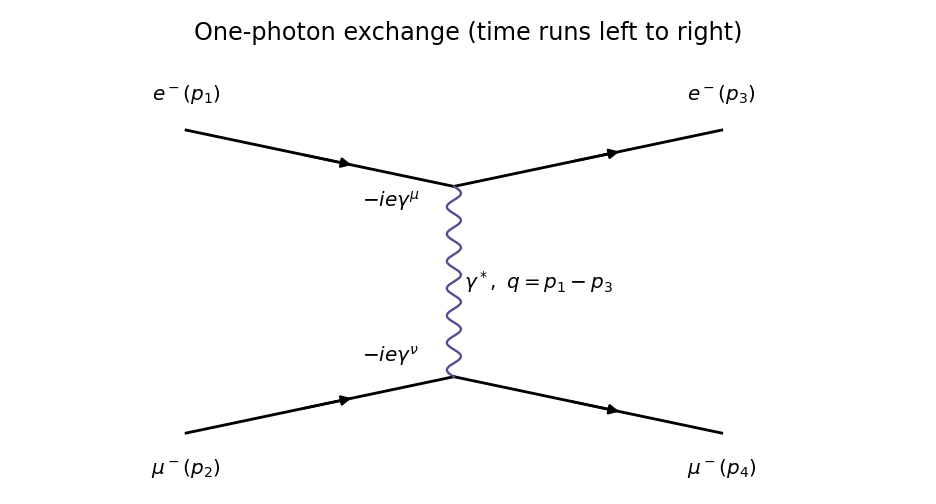

<h1 id="1/b/solution">Solution</h1>

↑ **Parent:** [B](../b.md)

There is one [tree-level Feynman diagram](../../../../tree-level-feynman-diagram.md): the distinguishable [electron](../../../../electron.md) and [muon](../../../../muon.md) exchange a [photon](../../../../photon.md) in the $t$ channel. There is no identical-particle exchange diagram.

**[Figure 1](#1/b/image-electron-muon-scattering-by-one-photon-exchange). Electron-muon scattering by one-photon exchange**.

Multiplying the external [Dirac spinors](../../../../dirac-spinor.md), the two [Feynman vertices](../../../../interaction-vertex.md) and the [photon propagator](../../../../photon-propagator.md) gives

$$
i\mathcal M=[\bar u_3(-ie\gamma^\mu)u_1]\frac{-ig_{\mu\nu}}{q^2+i\epsilon}[\bar u_4(-ie\gamma^\nu)u_2],\qquad
\boxed{\mathcal M=\frac{e^2}{q^2}[\bar u_3\gamma^\mu u_1][\bar u_4\gamma_\mu u_2].}
$$

The overall phase of this [scattering amplitude](../../../../scattering-amplitude.md) is convention dependent. Four external [spin](../../../../spin.md) labels with two choices each give $2^4=16$ possible configurations before taking a limit. For $E\gg m,M$, the vector [QED](../../../../quantum-electrodynamics.md) interaction preserves [fermion chirality](../../../../chirality-physics.md), which becomes [helicity](../../../../helicity.md) for each external particle. Thus the surviving configurations, written as $(h_e,h_\mu)_{\rm in}\to(h_e,h_\mu)_{\rm out}$, are

$$
\boxed{LL\to LL,\quad LR\to LR,\quad RL\to RL,\quad RR\to RR.}
$$

Here $L,R$ specify [helicity](../../../../helicity.md) along each particle's own [momentum](../../../../momentum-split.md). The other configurations require at least one [mass](../../../../mass.md)-suppressed flip and vanish in the strictly massless limit.

## ↑ Ancestors (12)

1. [B](../b.md)
2. [1](../../1.md)
3. [2022](../../../2022-split.md)
4. [Past exam of the particle physics course of the University of Oxford](../../../split.md)
5. [Particle physics course of the University of Oxford](../../../../particle-physics-course-of-the-university-of-oxford.md)
6. [Year 4 of the physics course of the University of Oxford](../../../../year-4-of-the-physics-course-of-the-university-of-oxford.md)
7. [Physics course of the University of Oxford](../../../../physics-course-of-the-university-of-oxford.md)
8. [Undergraduate course of the University of Oxford](../../../../undergraduate-course-of-the-university-of-oxford.md)
9. [Course of the University of Oxford](../../../../course-of-the-university-of-oxford.md)
10. [University of Oxford](../../../../university-of-oxford-split.md)
11. [List of universities](../../../../list-of-universities.md)
12. [Codex Wiki](../../../../split.md)
