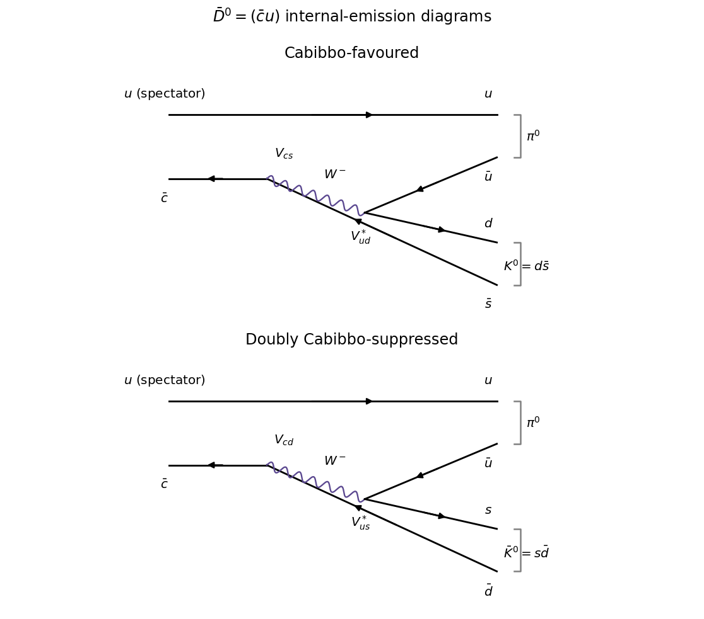

<h1 id="2/a/solution">Solution</h1>

↑ **Parent:** [A](../a.md)

The favoured [weak charged current](../../../../charged-current.md) transition is $\bar c\to\bar sW^-$ followed by $W^-\to d\bar u$. The [spectator quark](../../../../spectator-quark.md) $u$ combines with $\bar u$ to form the $u\bar u/\sqrt2$ component of the [neutral pion](../../../../neutral-pion.md), while $d\bar s$ forms $K^0$. The product of [CKM matrix](../../../../cabibbo-kobayashi-maskawa-matrix.md) factors is $V_{cs}V_{ud}^*$. The doubly [Cabibbo suppressed](../../../../cabibbo-suppression.md) transition is $\bar c\to\bar dW^-$ followed by $W^-\to s\bar u$, with factors $V_{cd}V_{us}^*$; the final $s\bar d$ is the [neutral antikaon](../../../../neutral-antikaon.md). Both are colour-suppressed internal-emission [Feynman diagrams](../../../../feynman-diagram.md), with the same spectator routing.

**[Figure 2](#2/a/image-favoured-and-doubly-suppressed-neutral-charm-decay-diagrams). Favoured and doubly suppressed neutral-charm decay diagrams**.

In the two-generation approximation to the [CKM matrix](../../../../cabibbo-kobayashi-maskawa-matrix.md), $V_{ud}=V_{cs}=\cos\theta_C$, $V_{us}=\sin\theta_C$ and $V_{cd}=-\sin\theta_C$. For equal magnitudes of the [hadronic matrix elements](../../../../hadronic-matrix-element.md),

$$
\boxed{\frac{|A(\bar D^0\to\bar K^0\pi^0)|}{|A(\bar D^0\to K^0\pi^0)|}=\tan^2\theta_C,\qquad
\frac{\Gamma_{\rm suppressed}}{\Gamma_{\rm favoured}}\simeq\tan^4\theta_C.}
$$

The rate ratio is about $2.8\times10^{-3}$ with the supplied [CKM matrix](../../../../cabibbo-kobayashi-maskawa-matrix.md) magnitudes. The minus sign of a particular product of [CKM matrix](../../../../cabibbo-kobayashi-maskawa-matrix.md) elements must be combined with the phases of the [hadronic matrix elements](../../../../hadronic-matrix-element.md) and [kaon](../../../../kaon.md) basis states; it is not by itself the observable interference sign.

## ↑ Ancestors (12)

1. [A](../a.md)
2. [2](../../2.md)
3. [2022](../../../2022-split.md)
4. [Past exam of the particle physics course of the University of Oxford](../../../split.md)
5. [Particle physics course of the University of Oxford](../../../../particle-physics-course-of-the-university-of-oxford.md)
6. [Year 4 of the physics course of the University of Oxford](../../../../year-4-of-the-physics-course-of-the-university-of-oxford.md)
7. [Physics course of the University of Oxford](../../../../physics-course-of-the-university-of-oxford.md)
8. [Undergraduate course of the University of Oxford](../../../../undergraduate-course-of-the-university-of-oxford.md)
9. [Course of the University of Oxford](../../../../course-of-the-university-of-oxford.md)
10. [University of Oxford](../../../../university-of-oxford-split.md)
11. [List of universities](../../../../list-of-universities.md)
12. [Codex Wiki](../../../../split.md)
