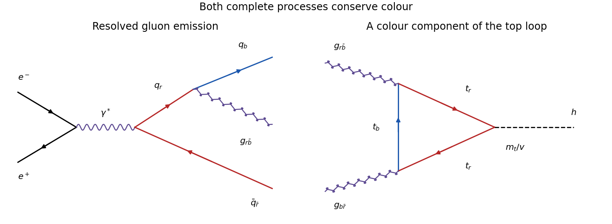

<h1 id="3/c/solution">Solution</h1>

↑ **Parent:** [C](../c.md)

Away from narrow [resonances](../../../../resonance.md) and [quark](../../../../quark.md) thresholds, the [QED](../../../../quantum-electrodynamics.md) annihilation [cross section](../../../../cross-section-physics.md) into each accessible [quark flavour](../../../../quark-flavor.md) is its squared fractional [electric charge](../../../../electric-charge-split.md) times the [muon](../../../../muon.md)-pair [cross section](../../../../cross-section-physics.md), multiplied by the number $N_c$ of distinguishable [color charges](../../../../color-charge.md). Thus the inclusive hadronic ratio is

$$
R_{\rm had}=\frac{\sigma(e^+e^-\to\text{hadrons})}{\sigma(e^+e^-\to\mu^+\mu^-)}
\simeq N_c\sum_f Q_f^2.
$$

With $N_c=3$, the continuum predictions are $R_{uds}=2$, $R_{udsc}=10/3$ and $R_{udscb}=11/3$ as successive [charm quark](../../../../charm-quark.md) and [bottom quark](../../../../bottom-quark.md) channels become accessible. The measured normalization and steps support three [color charges](../../../../color-charge.md). At leading order these hadronic events form two back-to-back [jets](../../../../jet-particle-physics.md) from the [quark](../../../../quark.md) and [antiquark](../../../../antiquark.md); quantitative comparisons include [QCD](../../../../quantum-chromodynamics.md) corrections and avoid the nonperturbative threshold region.

The extra resolved [jet](../../../../jet-particle-physics.md) is explained by $e^+e^-\to\gamma^*\to q\bar qg$, with [gluon](../../../../gluon.md) radiation from either the [quark](../../../../quark.md) or [antiquark](../../../../antiquark.md). One possible [color charge](../../../../color-charge.md) routing is initial $q_r\bar q_{\bar r}$ followed by $q_r\to q_b+g_{r\bar b}$; the final $q_b$, $\bar q_{\bar r}$ and $g_{r\bar b}$ combine to a net [colour singlet](../../../../colour-singlet.md).

**[Figure 3](#3/c/image-colour-flow-in-a-three-jet-process-and-in-gluon-fusion-higgs-production). Colour flow in a three-jet process and in gluon-fusion Higgs production**.

The three-[jet](../../../../jet-particle-physics.md) [cross section](../../../../cross-section-physics.md) contains one additional [strong interaction](../../../../strong-interaction.md) vertex in the amplitude, so its ratio to the two-[jet](../../../../jet-particle-physics.md) rate is of order $\alpha_s=g_s^2/(4\pi)$ times a resolution-dependent kinematic coefficient. A resolved fraction of order $15\%$ is consistent with perturbative [QCD](../../../../quantum-chromodynamics.md) and a [strong coupling constant](../../../../strong-coupling-constant.md) much larger than the [fine-structure constant](../../../../fine-structure-constant.md). It is not an equality $\alpha_s=0.15$: the [jet](../../../../jet-particle-physics.md) definition and cuts are needed. [Photon](../../../../photon.md) radiation has a much smaller electromagnetic rate. The large hadronic third-[jet](../../../../jet-particle-physics.md) rate supports [gluon](../../../../gluon.md) radiation; identifying the radiated object specifically as a colour-octet [gluon](../../../../gluon.md) also uses the [QCD](../../../../quantum-chromodynamics.md) vertex and colour-flow description, not merely the existence of three visible [jets](../../../../jet-particle-physics.md).

## ↑ Ancestors (12)

1. [C](../c.md)
2. [3](../../3.md)
3. [2022](../../../2022-split.md)
4. [Past exam of the particle physics course of the University of Oxford](../../../split.md)
5. [Particle physics course of the University of Oxford](../../../../particle-physics-course-of-the-university-of-oxford.md)
6. [Year 4 of the physics course of the University of Oxford](../../../../year-4-of-the-physics-course-of-the-university-of-oxford.md)
7. [Physics course of the University of Oxford](../../../../physics-course-of-the-university-of-oxford.md)
8. [Undergraduate course of the University of Oxford](../../../../undergraduate-course-of-the-university-of-oxford.md)
9. [Course of the University of Oxford](../../../../course-of-the-university-of-oxford.md)
10. [University of Oxford](../../../../university-of-oxford-split.md)
11. [List of universities](../../../../list-of-universities.md)
12. [Codex Wiki](../../../../split.md)
