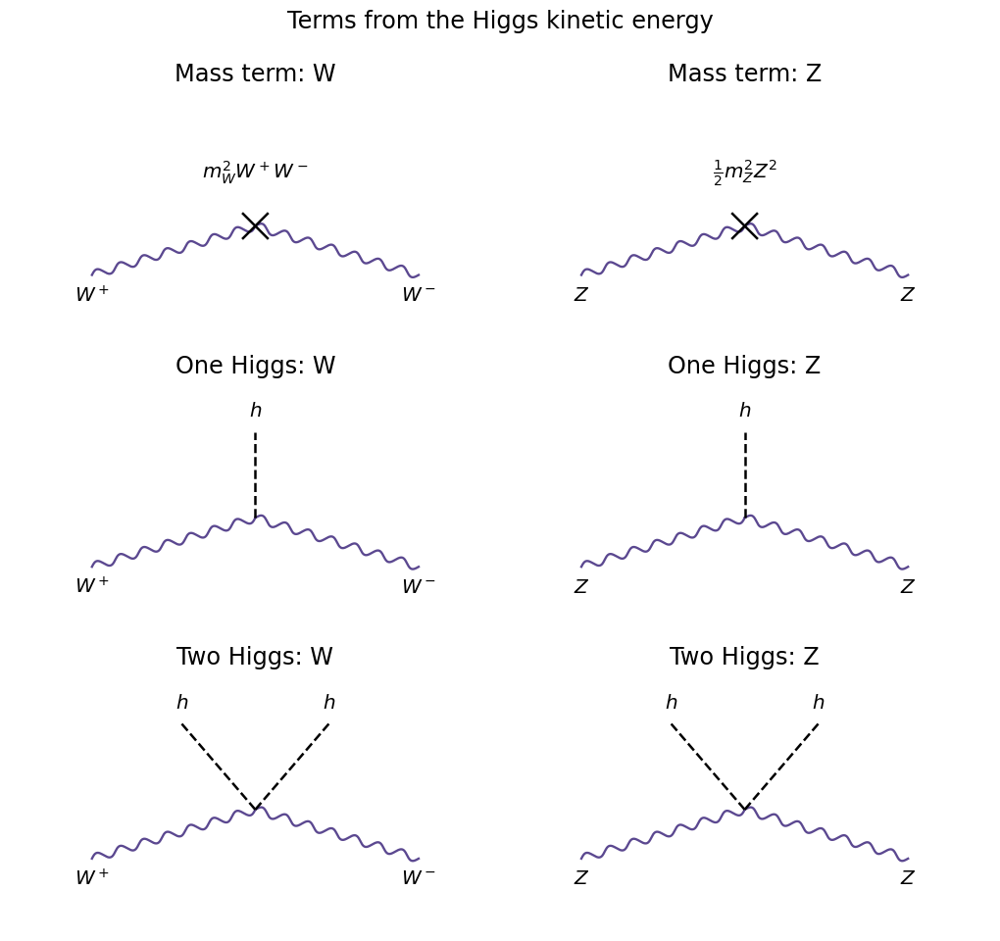

<h1 id="5/d/solution">Solution</h1>

↑ **Parent:** [D](../d.md)

Using [c](../c.md) and omitting $\partial_\mu\Phi$, the [covariant derivative](../../../../covariant-derivative.md) is

$$
D_\mu\Phi=\begin{pmatrix}-igfW^+_\mu/\sqrt2\\ iGfZ_\mu/2\end{pmatrix},
\qquad G=\sqrt{g^2+g'^2}.
$$

The two components are orthogonal, so their squared magnitudes add; $(W^+_\mu)^\dagger=W^-_\mu$. Thus the [Higgs field](../../../../higgs-field.md) kinetic contribution to the [Lagrangian density](../../../../lagrangian-density.md) is

$$
\boxed{\mathcal L=(v^2+2vh+h^2)\left(\frac{g^2}{4}W^+_\mu W^{-\mu}+\frac{G^2}{8}Z_\mu Z^\mu\right).}
$$

The two $v^2$ terms are [gauge boson](../../../../gauge-boson.md) [mass](../../../../mass.md) terms. Comparing with $m_W^2W^+W^-+\tfrac12m_Z^2Z^2$ gives $\boxed{m_W=gv/2,\ m_Z=Gv/2}$ and $m_W/m_Z=\cos\theta_W$. The factor $1/2$ for the real [Z boson](../../../../z-boson.md) field is essential.

The two $2vh$ terms are the cubic [Higgs boson coupling to W bosons](../../../../higgs-boson-coupling-to-w-bosons.md) and [Higgs boson coupling to Z bosons](../../../../higgs-boson-coupling-to-z-bosons.md). They produce the three-leg $hW^+W^-$ and $hZZ$ [Feynman vertices](../../../../interaction-vertex.md), allowing [Higgs decay to two W bosons](../../../../higgs-decay-to-two-w-bosons.md), [Higgs decay to two Z bosons](../../../../higgs-decay-to-two-z-bosons.md) when kinematically available, and the corresponding production mechanisms with virtual [gauge bosons](../../../../gauge-boson.md). The two $h^2$ terms are quartic $hhW^+W^-$ and $hhZZ$ interactions, including vector-boson scattering into a [Higgs boson](../../../../higgs-boson.md) pair. Written in terms of the [masses](../../../../mass.md),

$$
\mathcal L\supset m_W^2W^+W^-+\tfrac12m_Z^2Z^2
+\frac{2m_W^2}v hW^+W^-+\frac{m_Z^2}v hZ^2
+\frac{m_W^2}{v^2}h^2W^+W^-+\frac{m_Z^2}{2v^2}h^2Z^2.
$$

The corresponding [Feynman vertex](../../../../interaction-vertex.md) factors are $2im_V^2g_{\mu\nu}/v$ for one $h$ and $2im_V^2g_{\mu\nu}/v^2$ for two $h$, for $V=W,Z$, after differentiating with respect to identical fields. These six contributions contain no [photon](../../../../photon.md) [mass](../../../../mass.md) or direct $hAA$ interaction because $Q\Phi=0$.

**[Figure 4](#5/d/image-mass-insertions-and-cubic-and-quartic-higgs-gauge-vertices). Mass insertions and cubic and quartic Higgs-gauge vertices**.

## ↑ Ancestors (12)

1. [D](../d.md)
2. [5](../../5.md)
3. [2022](../../../2022-split.md)
4. [Past exam of the particle physics course of the University of Oxford](../../../split.md)
5. [Particle physics course of the University of Oxford](../../../../particle-physics-course-of-the-university-of-oxford.md)
6. [Year 4 of the physics course of the University of Oxford](../../../../year-4-of-the-physics-course-of-the-university-of-oxford.md)
7. [Physics course of the University of Oxford](../../../../physics-course-of-the-university-of-oxford.md)
8. [Undergraduate course of the University of Oxford](../../../../undergraduate-course-of-the-university-of-oxford.md)
9. [Course of the University of Oxford](../../../../course-of-the-university-of-oxford.md)
10. [University of Oxford](../../../../university-of-oxford-split.md)
11. [List of universities](../../../../list-of-universities.md)
12. [Codex Wiki](../../../../split.md)
