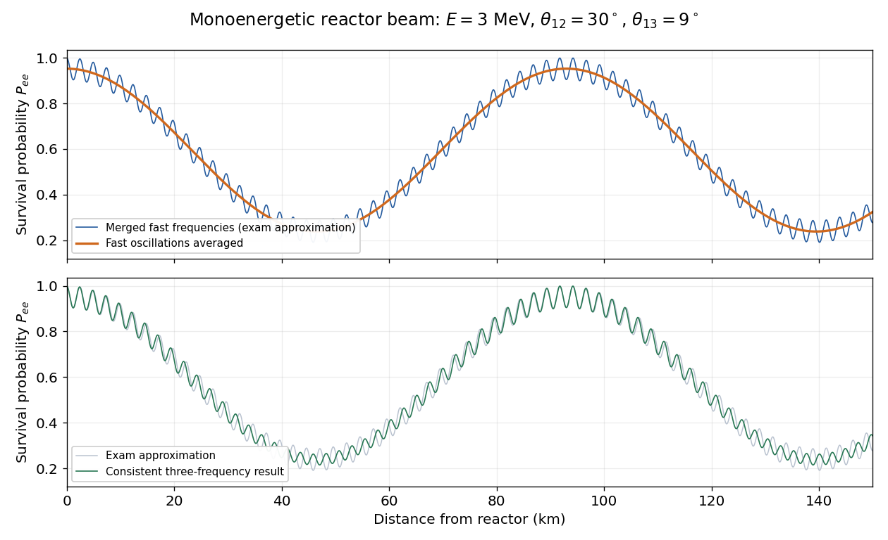

<h1 id="6/c/solution">Solution</h1>

↑ **Parent:** [C](../c.md)

Using the two-frequency approximation in [a](../a.md) and $L$ in kilometres, the survival [probability](../../../../probability.md) is

$$
\boxed{P_{ee}(L)\simeq1-0.71374\sin^2(0.0337849L)-0.0954915\sin^2(1.26693L).}
$$

The slow coefficient is $\cos^4(9^\circ)\sin^2(60^\circ)=0.71374$; the fast one is $\sin^2(18^\circ)=0.09549$. Since $\sin^2x$ has period $\pi$, the two individual [oscillation](../../../../oscillation.md) periods are

$$
\boxed{T_{12}=\frac{\pi E}{k_{\rm practical}|\Delta m_{12}^2|}=92.99\ \mathrm{km},\qquad
T_{23}=\frac{\pi E}{k_{\rm practical}|\Delta m_{23}^2|}=2.480\ \mathrm{km}.}
$$

The first broad trough is near $46.5$ km and the second near $139.5$ km; the slow component returns to its crest near $93$ km. Small, rapid ripples of depth about $0.0955$ sit on the broad envelope. Averaging over unresolved fast [oscillations](../../../../oscillation.md) replaces their squared sine by $1/2$, giving $\langle P_{ee}\rangle\simeq0.95225-0.71374\sin^2(\pi L/92.99)$.

**[Figure 5](#6/c/image-reactor-survival-probability-and-the-limits-of-merging-the-fast-frequencies). Reactor survival probability and the limits of merging the fast frequencies**.

There is no single short period for the combined curve. If the supplied ratio $0.003/0.00008=75/2$ is taken as exact, its mathematical common period is $2T_{12}=75T_{23}\simeq186$ km, outside the plotted range; the approximate physical data do not warrant interpreting that commensurability as exact.

The figure also shows the unmerged expression

$$
P_{ee}^{\rm exact}=1-4c_{13}^4c_{12}^2s_{12}^2\sin^2\Delta_{12}
-4c_{13}^2s_{13}^2\left(c_{12}^2\sin^2\Delta_{13}+s_{12}^2\sin^2\Delta_{23}\right).
$$

For that comparison take $\Delta m_{23}^2=0.003$ and enforce the identity $\Delta m_{13}^2=\Delta m_{23}^2+\Delta m_{12}^2=0.00308\ \mathrm{eV}^2$, with a consistent sign convention. This illustrates the limitation identified in [a](../a.md): the simplified envelope is useful, but its individual fast ripples need not match the three-frequency result over 150 km. The supplied $\theta_{23}$ has no effect on vacuum electron-flavour disappearance.

## ↑ Ancestors (12)

1. [C](../c.md)
2. [6](../../6.md)
3. [2022](../../../2022-split.md)
4. [Past exam of the particle physics course of the University of Oxford](../../../split.md)
5. [Particle physics course of the University of Oxford](../../../../particle-physics-course-of-the-university-of-oxford.md)
6. [Year 4 of the physics course of the University of Oxford](../../../../year-4-of-the-physics-course-of-the-university-of-oxford.md)
7. [Physics course of the University of Oxford](../../../../physics-course-of-the-university-of-oxford.md)
8. [Undergraduate course of the University of Oxford](../../../../undergraduate-course-of-the-university-of-oxford.md)
9. [Course of the University of Oxford](../../../../course-of-the-university-of-oxford.md)
10. [University of Oxford](../../../../university-of-oxford-split.md)
11. [List of universities](../../../../list-of-universities.md)
12. [Codex Wiki](../../../../split.md)
