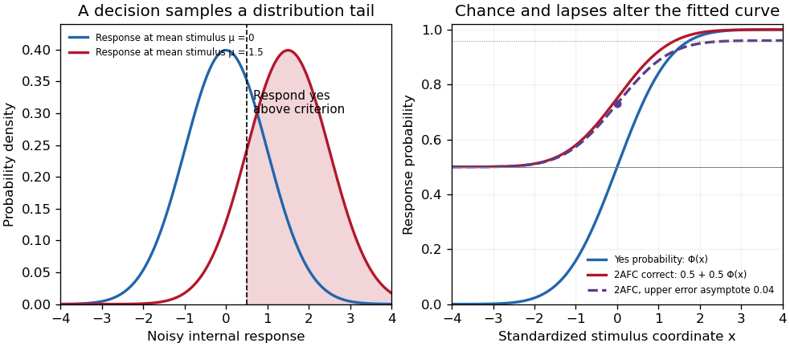
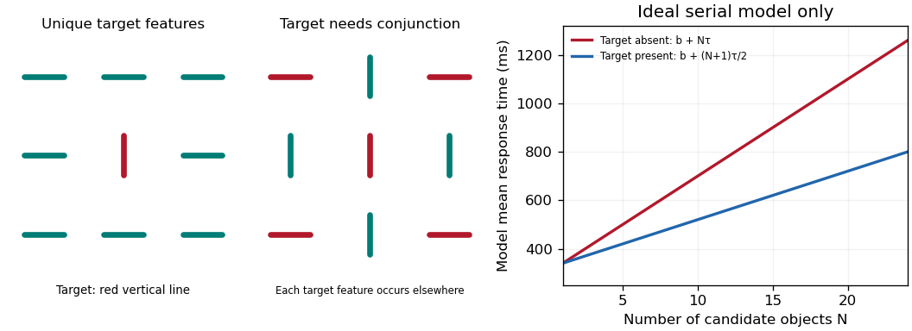
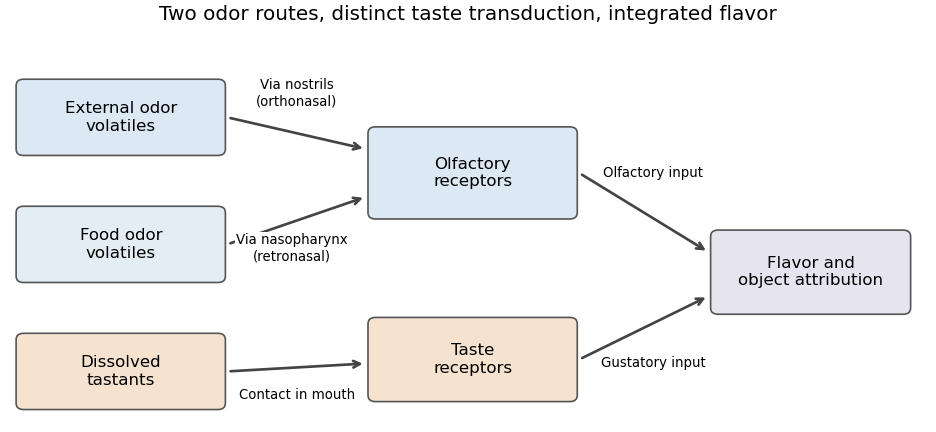

# 2022

↑ **Parent:** [Past exam of the perception course of the year 2 of the psychology (experimental) course of the University of Oxford](../past-exam-of-the-perception-course-of-the-year-2-of-the-psychology-experimental-course-of-the-university-of-oxford.md)

Answers to all five essay options in Oxford's [Perception](../neuroscience.md#perception) paper of 20 April 2022. Each answer is kept below the source's 1,500-word limit, although the examination required only one option. Scientific evidence is restricted to work published before the examination date; later archive-upload and portrait-file dates do not represent later scientific findings. Source release: [released examination archive](https://www.whatdotheyknow.com/request/experimental_psychology_past_exa/response/2757831/attach/3/New%20Compressed%20zipped%20Folder.zip?cookie_passthrough=1). Original diagrams illustrate mechanisms or explicit theoretical assumptions; they are not experimental data.

**Table of contents**

- [1](#1)
  - [Solution](#1/solution)
- [2](#2)
  - [Solution](#2/solution)
- [3](#3)
  - [Solution](#3/solution)
- [4](#4)
  - [Solution](#4/solution)
- [5](#5)
  - [Solution](#5/solution)

## 1

↑ **Parent:** [2022](2022.md)

<h3 id="1/solution">Solution</h3>

↑ **Parent:** [1](#1)

**Individual differences show that [color vision](../optics.md#color-vision) depends on receptor signals, their neural interpretation and the task used to measure them.** They provide natural perturbations of the system, but differences in genes, matching, discrimination, naming and subjective appearance must not be treated as interchangeable.

A useful starting point is the [principle of univariance](../neuroscience.md#principle-of-univariance). For a [cone cell](../neuroscience.md#cone-cell) class $j$, a simplified [receptor quantum catch](../optics.md#receptor-quantum-catch) is $Q_j=\int N(\lambda)a_j(\lambda)\,d\lambda$, where $N$ is the incident photon distribution, including optical filtering, and $a_j$ is effective absorptance. One receptor's absorption count does not uniquely identify [wavelength](../wave-equation.md#wavelength): increasing [intensity](../wave.md#intensity-physics) can compensate for a change in [spectral sensitivity](../neuroscience.md#spectral-sensitivity). Comparing classes supplies spectral information. With three classes, distinct spectra can satisfy three equal-catch constraints and therefore be [metamers](../optics.md#metamer). This is information loss: if a spectrum is represented by more than three independent [wavelength](../wave-equation.md#wavelength) bins, its three-channel sampling matrix has a nontrivial [kernel](../kernel-of-a-linear-map.md). Around a strictly positive spectrum, sufficiently small changes along that [kernel](../kernel-of-a-linear-map.md) preserve nonnegative stimulus values and all three catches. Thus the observer, not [wavelength](../wave-equation.md#wavelength) alone, defines a [color](../optics.md#color) match. With [luminance](../optics.md#luminance) fixed, three independent receptor coordinates leave at most two independent chromatic coordinates.

Inherited differences test that account. [Dichromacy](../optics.md#dichromacy) removes one independent class of cone input; [anomalous trichromacy](../optics.md#anomalous-trichromacy) retains three classes but with altered spectral separation, often weakening particular discriminations. L and M are overlapping long- and middle-wave sensitivities, not detectors that individually label light “red” and “green.” Molecular work by [Jeremy Nathans](../neuroscientist.md#jeremy-nathans) and colleagues identified cone pigment genes, then related inherited red–green variation to changes in the corresponding gene arrays.[Science 232, pp. 193–202, pigment-gene identification](../neuroscience-bibliography.md#molecular-genetics-of-human-color-vision-the-genes-encoding-blue-green-and-red-pigments-by-jeremy-nathans-and-others)[Science 232, pp. 203–210, genotype–phenotype comparison](../psychology-bibliography.md#molecular-genetics-of-inherited-variation-in-human-color-vision-by-jeremy-nathans-and-others) The important inference is a relation between biological variation and available spectral signals, not a claim that all observers with one label have identical vision.

A [Rayleigh color match](../optics.md#rayleigh-color-match) makes that inference measurable. An observer adjusts a mixture of two narrowband lights to match a comparison light, with brightness adjusted separately. The accepted mixture and matching range constrain pigment sensitivities and discriminability. A [color discrimination](../optics.md#color-discrimination) task instead measures whether two stimuli can be distinguished, ideally with [luminance](../optics.md#luminance) cues controlled and a fitted [psychometric function](../neuroscience.md#psychometric-function). Plate tests and everyday [color](../optics.md#color) names are less specific: learned labels or a brightness difference can support a correct response without normal chromatic discrimination. Conversely, reduced discrimination does not imply a world without [color](../optics.md#color).

Individual differences also reveal compensation. [Heidi Hofer](../neuroscientist.md#heidi-hofer) and colleagues used [adaptive optics](../optical-instrument.md#adaptive-optics) retinal imaging with selective pigment bleaching and retinal densitometry to classify [cone cells](../neuroscience.md#cone-cell) in living eyes. In their small sample, men passing normal color-vision tests had L:M cone ratios spanning approximately 1.1:1 to 16.5:1; the paper's corrected abstract supplies the lower value. The ratio was not fixed even within the normal category.[Methods and abstract, eight observers; corrected L:M ratio; J Neurosci 25, pp. 9669–9679](../psychology-bibliography.md#organization-of-the-human-trichromatic-cone-mosaic-by-heidi-hofer-and-others) This rules out a simple requirement for one universal cone proportion. For example, [opponent color processing](../optics.md#opponent-color-processing) could compare gain-adjusted cone signals rather than raw cell counts. It is compatible with post-receptoral gain adjustment and [chromatic adaptation](../neuron.md#chromatic-adaptation), but normal test scores do not prove identical [subjective experiences](../neuroscience.md#subjective-experience) or one uniquely identified compensatory mechanism.

A stronger question is whether more receptor classes create more perceptual dimensions. Heterozygous carriers of certain X-linked pigment variants can, through [X-chromosome inactivation](../molecular-genetics.md#x-chromosome-inactivation), have a [retina](../neuroscience.md#retina) containing more than three spectrally distinct cone types. Yet four types need not supply four functionally independent signals to behavior. [Gabriele Jordan](../psychologist.md#gabriele-jordan) and colleagues combined forced-choice matching, multidimensional scaling and genetic analysis. One of 24 obligate carriers of deuteranomaly showed behavior consistent with [tetrachromacy](../optics.md#tetrachromacy) across their tests; most did not.[Abstract and behavioral/genetic tests, J Vis 10(8):12](../psychology-bibliography.md#the-dimensionality-of-color-vision-in-carriers-of-anomalous-trichromacy-by-gabriele-jordan-and-others) This distinction between potential and demonstrated extra dimensionality is crucial. The selected sample cannot establish population prevalence, and additional [opsin](../neuroscience.md#opsin) variants alone cannot establish enhanced discrimination or richer experience.

Finally, optical and experiential differences must be controlled. Lens and macular filtering change the spectrum reaching the [cone cells](../neuroscience.md#cone-cell); age, adaptation, illumination and task [learning](../animal-behaviour.md#learning) can therefore mimic or modify receptor differences. Repeated measurements should separate within-person variability from stable between-person variation. Matching should be compared with discrimination, naming and appearance judgments rather than assuming that one measures all the others. [Color](../optics.md#color) naming can change without changing the receptor information; matching can change without entailing a particular verbal category.

The strongest conclusions arise when genetics, retinal measurements and controlled behavior converge. **Variation establishes both the constraints imposed by receptor sampling and the flexibility of later processing; it does not directly disclose another person's [color](../optics.md#color) qualia.**

## 2

↑ **Parent:** [2022](2022.md)

<h3 id="2/solution">Solution</h3>

↑ **Parent:** [2](#2)

A [psychometric function](../neuroscience.md#psychometric-function) specifies the [probability](../probability-theory.md#probability) of a measured response as a physical stimulus variable changes. The response might be “present,” “clockwise,” or correct in a [two-alternative forced-choice task](../neuroscience.md#two-alternative-forced-choice-task). These are different dependent variables. **Understanding the function's shape is necessary to distinguish sensory changes from decision, [attention](../psychology.md#attention) and measurement effects.** A reported threshold without its task, response definition and performance criterion is incomplete. For example, a visual experiment could use calibrated display [visual contrasts](../neuroscience.md#visual-contrast), timed two-interval presentations, fixation control and button choices; the observer’s choice supplies the dependent variable.

A smooth curve need not mean that a receptor has a smoothly varying conscious threshold. Consider a noisy internal response $R=\mu(x)+\varepsilon$, with “yes” reported when $R>c$. Here $c$ is a [decision criterion](../neuroscience.md#decision-criterion), not necessarily a biological detection limit. If $F_\varepsilon$ is the noise [cumulative distribution function](../probability-distribution.md#cumulative-distribution-function),

$$
P(\text{yes}\mid x)=1-F_\varepsilon(c-\mu(x)).
$$

With [Gaussian noise](../probability-distribution.md#gaussian-noise) of [standard deviation](../variance.md#standard-deviation) $\sigma$, symmetry of the [normal distribution](../probability-distribution.md#normal-distribution) gives a [Gaussian psychometric function](../neuroscience.md#gaussian-psychometric-function)

$$
P(\text{yes}\mid x)=\Phi\left(\frac{\mu(x)-c}{\sigma}\right).
$$

The sigmoid is therefore a distribution tail swept by a changing mean response. At low means, few responses exceed the criterion; near it, many trials switch category; at high means, almost all do. The derivative is $\phi((\mu-c)/\sigma)\mu'(x)/\sigma$, so slope depends on both sensory gain and variability. Moving $c$ shifts the curve without necessarily improving sensitivity. If noise vanished and the mean crossed the criterion sharply, this simple model would approach a step rather than a graded transition.

There is no universal sigmoid in every stimulus coordinate. A nonlinear transduction function changes the curve, and a logarithmic [intensity](../wave.md#intensity-physics) axis changes its appearance. As a counterexample, a toy detector responding whenever at least one event occurs in a [Poisson distribution](../discrete-probability-distribution.md#poisson-distribution) with mean $kx$ has $P(\text{yes}\mid x)=1-e^{-kx}$. This is concave on a linear positive-intensity axis. It follows immediately by subtracting the zero-event [probability](../probability-theory.md#probability) from one. It is a mathematical example, not evidence that human detection universally uses a one-event rule. Variation in [attention](../psychology.md#attention) or [decision criterion](../neuroscience.md#decision-criterion) across trials can broaden a measured curve even if the within-state sensory noise is unchanged.

Task conventions determine the endpoints. A useful [psychometric function with guessing and lapses](../neuroscience.md#psychometric-function-with-guessing-and-lapses) is

$$
p(x)=\gamma+(1-\gamma-\lambda)\Phi\left(\frac{x-\alpha}{\beta}\right),\qquad \beta>0.
$$

Here $\gamma$ is the lower asymptote and $\lambda$ the upper error asymptote. In balanced [two-alternative forced-choice](../neuroscience.md#two-alternative-forced-choice-task) performance, $\gamma$ is commonly fixed at $1/2$. A yes/no response [probability](../probability-theory.md#probability) does not automatically have this lower bound. In this particular cumulative-Gaussian parameterization, $p(\alpha)=\gamma+(1-\gamma-\lambda)/2$; thus $\alpha$ gives 75% correct only for $\gamma=1/2$ and $\lambda=0$. Other function families use different scale parameters. Nor is $\lambda$ automatically the fraction of inattentive trials: if a fraction $r$ of trials involves random two-choice guessing, those trials contribute an upper error [probability](../probability-theory.md#probability) $r/2$.

**[Figure 1](#2/image-original-theoretical-noisy-decision-and-psychometric-curve-examples-the-right-panel-is-a-phenomenological-family-not-observed-participant-data). Original theoretical noisy-decision and psychometric-curve examples; the right panel is a phenomenological family, not observed participant data**.

The relation to [signal detection theory](../neuroscience.md#signal-detection-theory) is equally important. Under independent equal-variance Gaussian signal and noise samples, define [sensitivity index](../neuroscience.md#sensitivity-index) $d'=(\mu_s-\mu_n)/\sigma$. In an ideal two-interval comparison, the response difference has mean $\mu_s-\mu_n$ and [variance](../variance.md) $2\sigma^2$, giving

$$
P(\text{correct})=P(R_s-R_n>0)=\Phi(d'/\sqrt2).
$$

This [Gaussian forced-choice sensitivity relation](../neuroscience.md#gaussian-forced-choice-sensitivity-relation) follows by standardizing the Gaussian difference. It is a specified decision model, not an identity for every forced-choice experiment. In a yes/no task, hits and false alarms are both needed: under the corresponding equal-variance model, $d'=\Phi^{-1}(H)-\Phi^{-1}(F)$. A criterion change can increase both rates while leaving $d'$ unchanged. The phenomenological fit above need not have parameters identical to these internal-response parameters.

These distinctions affect experiments. [Felix A. Wichmann](../psychologist.md#felix-a-wichmann) and [N. Jeremy Hill](../psychologist.md#n-jeremy-hill) used simulation and statistical modeling to show that unmodeled stimulus-independent errors can bias threshold and slope estimates, even when lapses are uncommon.[Notation, lapse simulations, and summary; Percept Psychophys 63, pp. 1293–1313](../psychology-bibliography.md#the-psychometric-function-i-fitting-sampling-and-goodness-of-fit-by-felix-a-wichmann-and-n-jeremy-hill) Ignoring high-intensity errors can make a function appear shallower and falsely suggest worse sensory precision. A broad group-average curve can likewise reflect a mixture of individually sharp functions with different locations.

At predetermined stimulus levels, independent trials give counts $k_i\sim\operatorname{Binomial}(n_i,p(x_i))$. The parameter-dependent [log-likelihood](../maximum-likelihood-estimation.md#log-likelihood) is $\sum_i[k_i\log p_i+(n_i-k_i)\log(1-p_i)]$. Fitting this [binomial likelihood](../discrete-probability-distribution.md#binomial-likelihood), checking goodness of fit and quantifying uncertainty are preferable to drawing a curve through noisy proportions. Easy trials help constrain lapses; levels near the transition constrain location and slope. Randomization, stable calibration and checks for [learning](../animal-behaviour.md#learning) or fatigue help distinguish a stationary sensory relation from drift. Adaptive procedures require inference appropriate to their sampling design.

Thus the function is both a description and a testable model. **Its shape determines what a threshold means, how an experiment should sample, and which claims about sensory mechanisms are warranted.**

## 3

↑ **Parent:** [2022](2022.md)

<h3 id="3/solution">Solution</h3>

↑ **Parent:** [3](#3)

**Hearing requires estimating sound-producing events from noisy mixtures at two ears.** It involves mechanical detection, neural coding, source segregation and recognition. A frequency analysis alone cannot identify who or what produced the sound.

The physical input is an [acoustic pressure](../linear-acoustics.md#sound-pressure) fluctuation. At one ear a simplified room model is

$$
p(t)=\sum_j(h_j*s_j)(t)+n(t),
$$

where source signals $s_j$ are filtered by propagation and reflection paths $h_j$, and $n$ is noise. The [convolution](../fourier-analysis.md#convolution) model assumes approximately linear, time-invariant propagation over the analysis interval; a moving source or listener can violate that simplification. This is a many-to-one [inverse problem](../inverse-problem.md): different source configurations can produce similar ear signals. Distance, reverberation and head orientation alter a source's waveform. Pressure level is logarithmic: [sound pressure level](../linear-acoustics.md#sound-pressure-level) is $L_p=20\log_{10}(p_{\rm rms}/p_0)$, with reference $p_0=20\,\mu\mathrm{Pa}$ in air. A 100 dB difference corresponds to a pressure ratio $10^{100/20}=10^5$. The system must remain sensitive to weak signals while avoiding saturation over a large operating range.

The [middle ear](../neuroscience.md#middle-ear) helps transfer airborne vibrations into cochlear fluids despite an [acoustic impedance](../elasticity-physics.md#acoustic-impedance) mismatch. Within the [cochlea](../neuroscience.md#cochlea), the graded mechanics of the [basilar membrane](../neuroscience.md#basilar-membrane) produce frequency-dependent traveling-wave responses: high frequencies peak nearer the base, low frequencies farther toward the apex. This [tonotopy](../neuroscience.md#tonotopy) provides a distributed spectral representation. Deflection of sensory [hair cells](../neuroscience.md#hair-cell) drives [mechanotransduction](../signal-transduction.md#mechanotransduction); [inner hair cells](../neuroscience.md#inner-hair-cell) provide most afferent signaling, while [outer hair cells](../neuroscience.md#outer-hair-cell) contribute to mechanical amplification and tuning. Detection therefore depends on an active biological filter, not merely a passive bank of resonators.

A revealing experiment by [Mario A. Ruggero](../neuroscientist.md#mario-a-ruggero) and colleagues measured chinchilla basilar-membrane vibrations using the Mössbauer technique or Doppler laser velocimetry before and after a reversible intervention that reduced cochlear transduction currents. Responses near the characteristic frequency were reduced particularly strongly for weak sounds, with smaller changes at high levels and away from that frequency.[Abstract and response-level/frequency comparisons, J Neurosci 11, pp. 1057–1067](../psychology-bibliography.md#furosemide-alters-organ-of-corti-mechanics-evidence-for-feedback-of-outer-hair-cells-upon-the-basilar-membrane-by-mario-a-ruggero-and-others) This supports feedback-dependent cochlear gain. The intervention also affects other cochlear processes, so it does not by itself identify every cellular contribution or directly measure human loudness. The important methodological contrast is controlled sound input plus measured mechanical output and a reversible physiological perturbation.

The resulting neural code must preserve several attributes simultaneously. Place of excitation and [neural phase locking](../neuroscience.md#neural-phase-locking) can provide complementary frequency and temporal information; firing rates, adaptation and population responses encode level and envelopes. Individual [neurons](../neuron.md) have limited dynamic ranges, and temporal precision has limits. [Pitch](../neuroscience.md#pitch) is not simply the location of the strongest spectral component, and [timbre](../neuroscience.md#timbre) depends on spectral shape and temporal development. Even physically, a signal containing harmonics at 200 and 300 Hz repeats every 10 ms although it contains no 100 Hz component: both components complete integer cycles in that interval. Recovering source periodicity is therefore different from selecting a component in a [frequency spectrum](../fourier-analysis.md#frequency-spectrum). It does not follow that every such signal has one obligatory perceptual [pitch](../neuroscience.md#pitch).

Localization adds ambiguity. Ear separation yields [interaural time differences](../neuroscience.md#interaural-time-difference); head shadow yields [interaural level differences](../neuroscience.md#interaural-level-difference); outer-ear filtering supplies direction-dependent spectral cues. In an ideal far-field point-receiver model, $\Delta t\simeq d\sin\theta/c$, obtained by dividing the path-length difference by sound speed. Real head diffraction modifies this approximation. One time difference can be compatible with several spatial directions, and phase is ambiguous when several cycles fit the delay. [Head-related transfer functions](../neuroscience.md#head-related-transfer-function), head movements and environmental context help resolve these ambiguities. Reverberation also requires distinguishing useful early information from later reflections.

Competing sources create both [energetic masking](../neuroscience.md#energetic-masking), in which the target is poorly represented against overlapping acoustic energy, and [informational masking](../neuroscience.md#informational-masking), involving source confusion or selection despite available acoustic cues. Common onsets, harmonic relations, coherent modulation, [timbre](../neuroscience.md#timbre) and spatial cues help group components into [auditory objects](../neuroscience.md#auditory-object). The grouping must remain stable when streams overlap, but also update when a source changes. These are the problems of [auditory scene analysis](../neuroscience.md#auditory-scene-analysis).

[E. Colin Cherry](../electrical-engineering.md#colin-cherry)'s classic experiments used simultaneous spoken messages and separate messages delivered to the two ears. Asking listeners to repeat one message while ignoring the other made source selection experimentally measurable.[Experiments on simultaneous speech and dichotic shadowing, JASA 25, pp. 975–979](../psychology-bibliography.md#some-experiments-on-the-recognition-of-speech-with-one-and-with-two-ears-by-e-colin-cherry) Ear and voice differences can aid selection; the result does not show that unattended information is never processed, nor that real rooms provide the clean separation of headphone channels.

Finally, meaningful recognition requires tolerance of speaker, rate and context variation. [Richard M. Warren](../psychologist.md#richard-m-warren) removed a speech segment and substituted a cough-like sound. Listeners could hear the utterance as continuous and had difficulty locating the replacement, whereas a silent interruption was more readily detected.[Science 167, pp. 392–393, replacement-sound versus silence comparison](../psychology-bibliography.md#perceptual-restoration-of-missing-speech-sounds-by-richard-m-warren) [Phonemic restoration](../neuroscience.md#phonemic-restoration) shows that recognition uses constraints beyond the momentary waveform; it does not mean missing acoustic information has been physically recovered. **Successful auditory [perception](../neuroscience.md#perception) combines peripheral sensitivity with grouping and context-sensitive inference, while retaining the possibility of masking, ambiguity and systematic error.**

## 4

↑ **Parent:** [2022](2022.md)

<h3 id="4/solution">Solution</h3>

↑ **Parent:** [4](#4)

**[Feature integration theory](../psychology.md#feature-integration-theory) remains influential as an account of binding and attentional selection, but its simplest serial-search interpretation is not a complete theory of everyday search or a ready-made model for every sense.** Its historical achievement was to turn apparently effortless object [perception](../neuroscience.md#perception) into experimentally separable operations.

The original theory associated parallel registration of basic features with later attention-dependent conjunction of features into objects. In a typical [visual search](../neuroscience.md#visual-search) experiment, an observer judges whether a specified target is present among varying numbers of distractors. A unique [color](../optics.md#color) or orientation can support efficient [feature search](../neuroscience.md#feature-search), whereas a target defined by a particular combination can require more selection. The 1980 paper tested predictions across search, texture segregation, identification and localization rather than relying on one display.[Cognitive Psychology 12, pp. 97–136, theory and experimental paradigms](../psychology-bibliography.md#a-feature-integration-theory-of-attention-by-anne-treisman-and-others) “Feature” was a functional hypothesis; a [color](../optics.md#color) or shape label is not automatically an independent neural channel.

The ideal serial model makes a quantitative prediction. Suppose each of $N$ items is examined once, without replacement, at time cost $\tau$, and other processing contributes $b$. If all items must be rejected on absent trials, $E[T_{\rm absent}]=b+N\tau$. If the target is equally likely at each inspected position and search stops when it is found,

$$
E[T_{\rm present}]=b+\frac{\tau}{N}\sum_{k=1}^Nk
=b+\frac{N+1}{2}\tau.
$$

This [serial self-terminating search benchmark](../neuroscience.md#serial-self-terminating-search-benchmark) has an absent-trial slope twice the present-trial slope under those assumptions. This is a derived benchmark, not a unique signature of serial [attention](../psychology.md#attention): decision rules, guidance, limited-resolution processing and parallel models can generate related trends. Flat slopes likewise do not establish that processing requires no [attention](../psychology.md#attention).

**[Figure 2](#4/image-original-target-displays-and-the-ideal-serial-search-predictions-plotted-times-use-arbitrary-model-parameters-and-are-not-historical-experimental-results). Original target displays and the ideal serial-search predictions; plotted times use arbitrary model parameters and are not historical experimental results**.

Binding errors provide a different test. In the 1982 [illusory conjunction](../psychology.md#illusory-conjunction) experiments, briefly presented colored-letter displays were combined with another reporting demand. Observers sometimes reported a letter with another item's [color](../optics.md#color). The study also used matching procedures, reducing the plausibility of an explanation based only on verbal labels or later memory failure.[Abstract and matching experiments, Cognitive Psychology 14, pp. 107–141](../psychology-bibliography.md#illusory-conjunctions-in-the-perception-of-objects-by-anne-treisman-and-others) These results support a distinction between detecting features and assigning them correctly. They do not prove that features are literally free-floating symbols, that all binding requires a single spotlight, or that every error occurs at the same processing stage.

Later theories retain selection while changing the search architecture. In [guided search](../neuroscience.md#guided-search), the target's known properties and stimulus salience prioritize likely candidates, allowing some conjunction searches to be efficient without exhaustive random inspection. The 2021 [Guided Search 6.0](../neuroscience.md#guided-search-6-0) model adds selection history, reward and scene meaning to feature guidance, and allows serial selections to feed overlapping recognition processes.[Abstract, Guidance, and The Search Process; Psychon Bull Rev 28, pp. 1060–1092](../psychology-bibliography.md#guided-search-6-0-an-updated-model-of-visual-search-by-jeremy-m-wolfe) It is an explicit modeling development published before this examination, not a later empirical discovery. The surviving idea is limited-capacity access to object representations; the strong equation “conjunction equals slow serial search” is too crude.

Real scenes reveal additional limits. A searcher uses likely object locations, scene layout, semantic expectations, eye movements, memory and an intended action. Finding a mug involves scale, viewpoint, occlusion and target variability, not just selecting one invariant [color](../optics.md#color)–orientation pair. Objects are unevenly visible across the [retina](../neuroscience.md#retina), and clutter can limit identification. A model must explain misses and stopping decisions as well as mean [reaction time](../psychology.md#reaction-time).

The [target prevalence effect](../neuroscience.md#target-prevalence-effect) is particularly instructive. [Jeremy M. Wolfe](../psychologist.md#jeremy-m-wolfe) and colleagues used an artificial baggage-screening task with semitransparent objects on noisy backgrounds. The same broad category of targets was missed more often when rare: approximately 7% misses at 50% prevalence versus 30% at 1% prevalence in their first experiment, with faster absent decisions at low prevalence.[Experiment 1 and Figure 2, Nature 435, pp. 439–440](../psychology-bibliography.md#rare-items-often-missed-in-visual-searches-by-jeremy-m-wolfe-and-others) This controlled result implicates search termination and expectation in addition to feature binding. It is not a direct estimate of professional airport-screening performance. Original [feature integration theory](../psychology.md#feature-integration-theory) needs additional decision and scene mechanisms to predict such effects.

Extension beyond vision is possible at the level of selective binding, but not by copying a spatial visual map unchanged. Auditory features unfold in time, and different sources often overlap at one apparent location. Temporal coherence, [pitch](../neuroscience.md#pitch) and [timbre](../neuroscience.md#timbre) can establish an [auditory object](../neuroscience.md#auditory-object) before a reliable spatial location exists. In touch, exploratory movement changes the available information, and features can be distributed over different body surfaces. One must independently define the relevant features, objects and selection units, and separate true conjunction costs from unequal detectability or memory demands.

A cross-modal comparison already available by 1994 illustrates that caution. [David L. Woods](../neuroscientist.md#david-l-woods) and colleagues recorded [event-related potentials](../neurology.md#event-related-potential) during selective listening for tones specified by frequency and ear/location. Conjunction-related [attention](../psychology.md#attention) differences began later than single-feature differences, but before feature analysis was complete.[Abstract, timing of feature and conjunction Nd responses, J Exp Psychol Hum Percept Perform 20, pp. 81–94](../psychology-bibliography.md#stages-of-auditory-feature-conjunction-an-event-related-brain-potential-study-by-david-l-woods-and-others) This supports temporally structured integration without a strictly completed feature stage followed by an entirely separate binding stage. Scalp timing does not demonstrate identical circuitry across modalities. **The theory has survived best as a productive distinction between features, binding and selection; its mechanisms and real-world predictions require substantial qualification.**

## 5

↑ **Parent:** [2022](2022.md)

<h3 id="5/solution">Solution</h3>

↑ **Parent:** [5](#5)

**Taste–smell confusion is widespread evidence for integrated [flavor perception](../neuroscience.md#flavor-perception); it is not sufficient to establish that everyone has developmental [synesthesia](../neuroscience.md#synesthesia).** A broader description as learned odor–taste [synesthesia](../neuroscience.md#synesthesia) can capture genuine acquired taste-like odor qualities, but “ubiquitous” and “the same mechanism” are additional claims requiring evidence.

First separate receptors, routes and experience. [Gustation](../neuroscience.md#gustation) detects dissolved chemicals at taste receptors; [olfaction](../neuroscience.md#olfaction) detects volatile chemicals at olfactory receptors. [Orthonasal olfaction](../neuroscience.md#orthonasal-olfaction) samples volatiles entering through the nostrils, while [retronasal olfaction](../neuroscience.md#retronasal-olfaction) samples food volatiles reaching the nasal cavity from the mouth via the nasopharynx. The same broad receptor system can therefore provide information about an external object or food already being eaten. The resulting [flavor perception](../neuroscience.md#flavor-perception) also incorporates oral touch, temperature and other chemical sensations. An experience located in the mouth need not have been transduced by a taste receptor.

**[Figure 3](#5/image-original-functional-diagram-of-orthonasal-and-retronasal-odor-access-and-separate-gustatory-transduction-it-illustrates-routes-not-a-literal-anatomical-or-neural-wiring-map). Original functional diagram of orthonasal and retronasal odor access and separate gustatory transduction; it illustrates routes, not a literal anatomical or neural wiring map**.

[Paul Rozin](../psychologist.md#paul-rozin)'s 1982 argument emphasized this dual role of [olfaction](../neuroscience.md#olfaction) and the ordinary use of “taste” for components of flavor. His observations included different evaluations of the smell and ingested flavor of foods and difficulty identifying the taste components associated with familiar smells.[Percept Psychophys 31, pp. 397–401, oral versus external attribution and behavioral observations](../psychology-bibliography.md#taste-smell-confusions-and-the-duality-of-the-olfactory-sense-by-paul-rozin) These findings motivate [olfactory referral](../neuroscience.md#olfactory-referral): an odor contribution is assigned to an object in the mouth. They do not imply that the nose is physiologically converted into a tongue, nor that every verbal use of “taste” reports a literal gustatory quality.

Route manipulations offer stronger evidence than labels alone. [Dana M. Small](../neuroscientist.md#dana-m-small) and colleagues delivered vaporized odorants by the orthonasal and retronasal routes while measuring responses with [functional magnetic resonance imaging](../nuclear-magnetic-resonance.md#functional-magnetic-resonance-imaging). They found route-dependent neural responses, including effects that depended on odor identity: patterns for chocolate were not reproduced identically by every comparison odor.[Abstract, route-by-odor comparisons, Neuron 47, pp. 593–605](../psychology-bibliography.md#differential-neural-responses-evoked-by-orthonasal-versus-retronasal-odorant-perception-in-humans-by-dana-m-small-and-others) This supports a role for route and object context in olfactory processing. It does not identify a unique [synesthesia](../neuroscience.md#synesthesia) mechanism; delivery route can alter peripheral stimulation and airflow, and a regional imaging difference alone cannot determine the experience causing it.

[Learning](../animal-behaviour.md#learning) can also change the qualities attributed to odors. In [Richard J. Stevenson](../psychologist.md#richard-j-stevenson) and colleagues' 1995 experiments, selected odors were paired with sucrose or citric acid. Before-and-after ratings showed that the sucrose-paired odor was subsequently judged sweeter and the acid-paired odor sourer, including when odors were sniffed.[Experiment 1 and conditioning tests, Learning and Motivation 26, pp. 433–455](../psychology-bibliography.md#the-acquisition-of-taste-properties-by-odors-by-richard-j-stevenson-and-others) This [odor-taste conditioning](../animal-behaviour.md#odor-taste-conditioning) shows that an odor's taste-like character need not be fixed by its chemistry. It supports a learned-synesthesia interpretation, but does not demonstrate that every participant acquired a separately experienced gustatory concurrent. Ratings can reflect perceptual change, associative retrieval, expectation or how the response scale is used.

A narrow developmental [synesthesia](../neuroscience.md#synesthesia) claim concerns an inducer reliably and involuntarily eliciting an additional experience, with stable individual mappings. [Julia Simner](../psychologist.md#julia-simner) and colleagues combined population sampling with objective checks rather than treating self-description as sufficient evidence.[Sampling and objective verification, Perception 35, pp. 1024–1033](../psychology-bibliography.md#synaesthesia-the-prevalence-of-atypical-cross-modal-experiences-by-julia-simner-and-others) This motivates testing consistency and automaticity, while avoiding the claim that one test diagnoses every form. Synesthetic experiences can be internally associated rather than externally projected; an external sensory image is not required. Conversely, being able to learn or name an odor–taste association is not sufficient.

A discriminating experiment would therefore assess the same odor repeatedly, measure its taste-like quality separately from odor identity and pleasantness, and manipulate oral delivery, taste congruence and [learning](../animal-behaviour.md#learning) history. Nose closure or controlled nasal delivery can test the contribution of olfactory access; separate gustatory and odor controls are needed because blocking airflow can also change breathing and stimulus delivery. Providing distinct rating scales can test [response dumping](../neuroscience.md#response-dumping), in which an unlisted sensory component is assigned to an available scale. Tasks measuring involuntary interference or transfer beyond the trained ratings would be more persuasive than a single “sweet” judgment. These are proposed controls, not invented results.

The theoretical alternatives also need to be stated fairly. A sensory system can normally bind correlated signals into one food percept, so integration need not be a wiring error. But its prevalence does not make an acquired taste-like odor quality unreal: ordinary [learning](../animal-behaviour.md#learning) can generate experiences that differ from the receptor category providing the input. **The evidence supports common oral attribution and learned cross-sensory qualities; treating these as universally equivalent to developmental [synesthesia](../neuroscience.md#synesthesia) goes beyond what the experiments establish.**

## ↑ Ancestors (9)

1. [Past exam of the perception course of the year 2 of the psychology (experimental) course of the University of Oxford](../past-exam-of-the-perception-course-of-the-year-2-of-the-psychology-experimental-course-of-the-university-of-oxford.md)
2. [Perception course of the year 2 of the psychology (experimental) course of the University of Oxford](../university-of-oxford.md#perception-course-of-the-year-2-of-the-psychology-experimental-course-of-the-university-of-oxford)
3. [Year 2 of the psychology (experimental) course of the University of Oxford](../university-of-oxford.md#year-2-of-the-psychology-experimental-course-of-the-university-of-oxford)
4. [Psychology (experimental) course of the University of Oxford](../university-of-oxford.md#psychology-experimental-course-of-the-university-of-oxford)
5. [Undergraduate course of the University of Oxford](../university-of-oxford.md#undergraduate-course-of-the-university-of-oxford)
6. [Course of the University of Oxford](../university-of-oxford.md#course-of-the-university-of-oxford)
7. [University of Oxford](../university-of-oxford.md)
8. [List of universities](../README.md#list-of-universities)
9. [Codex Wiki](../README.md)
