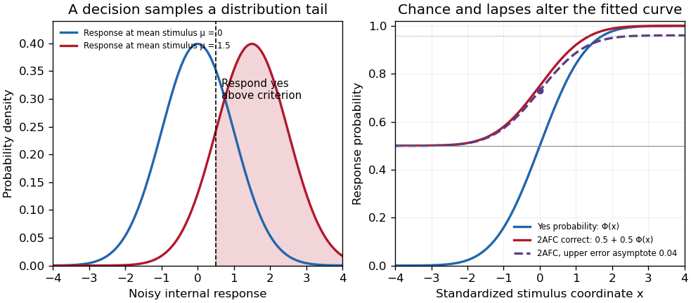

<h1 id="2/solution">Solution</h1>

↑ **Parent:** [2](../2.md)

A [psychometric function](../../../psychometric-function.md) specifies the [probability](../../../probability.md) of a measured response as a physical stimulus variable changes. The response might be “present,” “clockwise,” or correct in a [two-alternative forced-choice task](../../../two-alternative-forced-choice-task.md). These are different dependent variables. **Understanding the function's shape is necessary to distinguish sensory changes from decision, [attention](../../../attention.md) and measurement effects.** A reported threshold without its task, response definition and performance criterion is incomplete. For example, a visual experiment could use calibrated display [visual contrasts](../../../visual-contrast.md), timed two-interval presentations, fixation control and button choices; the observer’s choice supplies the dependent variable.

A smooth curve need not mean that a receptor has a smoothly varying conscious threshold. Consider a noisy internal response $R=\mu(x)+\varepsilon$, with “yes” reported when $R>c$. Here $c$ is a [decision criterion](../../../decision-criterion.md), not necessarily a biological detection limit. If $F_\varepsilon$ is the noise [cumulative distribution function](../../../cumulative-distribution-function.md),

$$
P(\text{yes}\mid x)=1-F_\varepsilon(c-\mu(x)).
$$

With [Gaussian noise](../../../gaussian-noise.md) of [standard deviation](../../../standard-deviation.md) $\sigma$, symmetry of the [normal distribution](../../../normal-distribution.md) gives a [Gaussian psychometric function](../../../gaussian-psychometric-function.md)

$$
P(\text{yes}\mid x)=\Phi\left(\frac{\mu(x)-c}{\sigma}\right).
$$

The sigmoid is therefore a distribution tail swept by a changing mean response. At low means, few responses exceed the criterion; near it, many trials switch category; at high means, almost all do. The derivative is $\phi((\mu-c)/\sigma)\mu'(x)/\sigma$, so slope depends on both sensory gain and variability. Moving $c$ shifts the curve without necessarily improving sensitivity. If noise vanished and the mean crossed the criterion sharply, this simple model would approach a step rather than a graded transition.

There is no universal sigmoid in every stimulus coordinate. A nonlinear transduction function changes the curve, and a logarithmic [intensity](../../../intensity-physics.md) axis changes its appearance. As a counterexample, a toy detector responding whenever at least one event occurs in a [Poisson distribution](../../../poisson-distribution.md) with mean $kx$ has $P(\text{yes}\mid x)=1-e^{-kx}$. This is concave on a linear positive-intensity axis. It follows immediately by subtracting the zero-event [probability](../../../probability.md) from one. It is a mathematical example, not evidence that human detection universally uses a one-event rule. Variation in [attention](../../../attention.md) or [decision criterion](../../../decision-criterion.md) across trials can broaden a measured curve even if the within-state sensory noise is unchanged.

Task conventions determine the endpoints. A useful [psychometric function with guessing and lapses](../../../psychometric-function-with-guessing-and-lapses.md) is

$$
p(x)=\gamma+(1-\gamma-\lambda)\Phi\left(\frac{x-\alpha}{\beta}\right),\qquad \beta>0.
$$

Here $\gamma$ is the lower asymptote and $\lambda$ the upper error asymptote. In balanced [two-alternative forced-choice](../../../two-alternative-forced-choice-task.md) performance, $\gamma$ is commonly fixed at $1/2$. A yes/no response [probability](../../../probability.md) does not automatically have this lower bound. In this particular cumulative-Gaussian parameterization, $p(\alpha)=\gamma+(1-\gamma-\lambda)/2$; thus $\alpha$ gives 75% correct only for $\gamma=1/2$ and $\lambda=0$. Other function families use different scale parameters. Nor is $\lambda$ automatically the fraction of inattentive trials: if a fraction $r$ of trials involves random two-choice guessing, those trials contribute an upper error [probability](../../../probability.md) $r/2$.

**[Figure 1](#2/image-original-theoretical-noisy-decision-and-psychometric-curve-examples-the-right-panel-is-a-phenomenological-family-not-observed-participant-data). Original theoretical noisy-decision and psychometric-curve examples; the right panel is a phenomenological family, not observed participant data**.

The relation to [signal detection theory](../../../signal-detection-theory.md) is equally important. Under independent equal-variance Gaussian signal and noise samples, define [sensitivity index](../../../sensitivity-index.md) $d'=(\mu_s-\mu_n)/\sigma$. In an ideal two-interval comparison, the response difference has mean $\mu_s-\mu_n$ and [variance](../../../variance-split.md) $2\sigma^2$, giving

$$
P(\text{correct})=P(R_s-R_n>0)=\Phi(d'/\sqrt2).
$$

This [Gaussian forced-choice sensitivity relation](../../../gaussian-forced-choice-sensitivity-relation.md) follows by standardizing the Gaussian difference. It is a specified decision model, not an identity for every forced-choice experiment. In a yes/no task, hits and false alarms are both needed: under the corresponding equal-variance model, $d'=\Phi^{-1}(H)-\Phi^{-1}(F)$. A criterion change can increase both rates while leaving $d'$ unchanged. The phenomenological fit above need not have parameters identical to these internal-response parameters.

These distinctions affect experiments. [Felix A. Wichmann](../../../felix-a-wichmann.md) and [N. Jeremy Hill](../../../n-jeremy-hill.md) used simulation and statistical modeling to show that unmodeled stimulus-independent errors can bias threshold and slope estimates, even when lapses are uncommon.[Notation, lapse simulations, and summary; Percept Psychophys 63, pp. 1293–1313](../../../the-psychometric-function-i-fitting-sampling-and-goodness-of-fit-by-felix-a-wichmann-and-n-jeremy-hill.md) Ignoring high-intensity errors can make a function appear shallower and falsely suggest worse sensory precision. A broad group-average curve can likewise reflect a mixture of individually sharp functions with different locations.

At predetermined stimulus levels, independent trials give counts $k_i\sim\operatorname{Binomial}(n_i,p(x_i))$. The parameter-dependent [log-likelihood](../../../log-likelihood.md) is $\sum_i[k_i\log p_i+(n_i-k_i)\log(1-p_i)]$. Fitting this [binomial likelihood](../../../binomial-likelihood.md), checking goodness of fit and quantifying uncertainty are preferable to drawing a curve through noisy proportions. Easy trials help constrain lapses; levels near the transition constrain location and slope. Randomization, stable calibration and checks for [learning](../../../learning.md) or fatigue help distinguish a stationary sensory relation from drift. Adaptive procedures require inference appropriate to their sampling design.

Thus the function is both a description and a testable model. **Its shape determines what a threshold means, how an experiment should sample, and which claims about sensory mechanisms are warranted.**

## ↑ Ancestors (11)

1. [2](../2.md)
2. [2022](../../2022-split.md)
3. [Past exam of the perception course of the year 2 of the psychology (experimental) course of the University of Oxford](../../split.md)
4. [Perception course of the year 2 of the psychology (experimental) course of the University of Oxford](../../../perception-course-of-the-year-2-of-the-psychology-experimental-course-of-the-university-of-oxford.md)
5. [Year 2 of the psychology (experimental) course of the University of Oxford](../../../year-2-of-the-psychology-experimental-course-of-the-university-of-oxford.md)
6. [Psychology (experimental) course of the University of Oxford](../../../psychology-experimental-course-of-the-university-of-oxford.md)
7. [Undergraduate course of the University of Oxford](../../../undergraduate-course-of-the-university-of-oxford.md)
8. [Course of the University of Oxford](../../../course-of-the-university-of-oxford.md)
9. [University of Oxford](../../../university-of-oxford-split.md)
10. [List of universities](../../../list-of-universities.md)
11. [Codex Wiki](../../../split.md)
