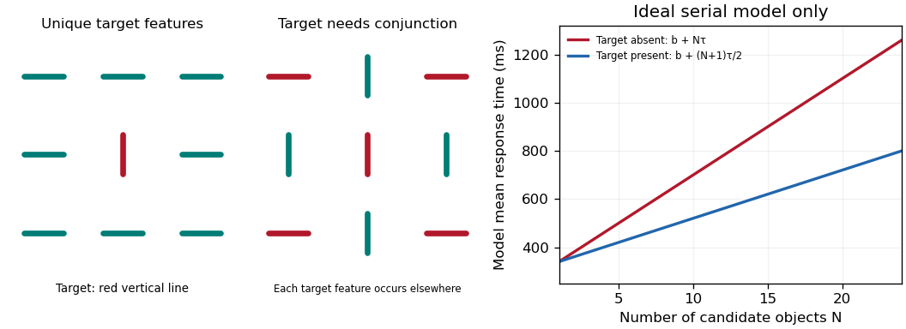

<h1 id="4/solution">Solution</h1>

↑ **Parent:** [4](../4.md)

**[Feature integration theory](../../../feature-integration-theory.md) remains influential as an account of binding and attentional selection, but its simplest serial-search interpretation is not a complete theory of everyday search or a ready-made model for every sense.** Its historical achievement was to turn apparently effortless object [perception](../../../perception.md) into experimentally separable operations.

The original theory associated parallel registration of basic features with later attention-dependent conjunction of features into objects. In a typical [visual search](../../../visual-search.md) experiment, an observer judges whether a specified target is present among varying numbers of distractors. A unique [color](../../../color.md) or orientation can support efficient [feature search](../../../feature-search.md), whereas a target defined by a particular combination can require more selection. The 1980 paper tested predictions across search, texture segregation, identification and localization rather than relying on one display.[Cognitive Psychology 12, pp. 97–136, theory and experimental paradigms](../../../a-feature-integration-theory-of-attention-by-anne-treisman-and-others.md) “Feature” was a functional hypothesis; a [color](../../../color.md) or shape label is not automatically an independent neural channel.

The ideal serial model makes a quantitative prediction. Suppose each of $N$ items is examined once, without replacement, at time cost $\tau$, and other processing contributes $b$. If all items must be rejected on absent trials, $E[T_{\rm absent}]=b+N\tau$. If the target is equally likely at each inspected position and search stops when it is found,

$$
E[T_{\rm present}]=b+\frac{\tau}{N}\sum_{k=1}^Nk
=b+\frac{N+1}{2}\tau.
$$

This [serial self-terminating search benchmark](../../../serial-self-terminating-search-benchmark.md) has an absent-trial slope twice the present-trial slope under those assumptions. This is a derived benchmark, not a unique signature of serial [attention](../../../attention.md): decision rules, guidance, limited-resolution processing and parallel models can generate related trends. Flat slopes likewise do not establish that processing requires no [attention](../../../attention.md).

**[Figure 2](#4/image-original-target-displays-and-the-ideal-serial-search-predictions-plotted-times-use-arbitrary-model-parameters-and-are-not-historical-experimental-results). Original target displays and the ideal serial-search predictions; plotted times use arbitrary model parameters and are not historical experimental results**.

Binding errors provide a different test. In the 1982 [illusory conjunction](../../../illusory-conjunction.md) experiments, briefly presented colored-letter displays were combined with another reporting demand. Observers sometimes reported a letter with another item's [color](../../../color.md). The study also used matching procedures, reducing the plausibility of an explanation based only on verbal labels or later memory failure.[Abstract and matching experiments, Cognitive Psychology 14, pp. 107–141](../../../illusory-conjunctions-in-the-perception-of-objects-by-anne-treisman-and-others.md) These results support a distinction between detecting features and assigning them correctly. They do not prove that features are literally free-floating symbols, that all binding requires a single spotlight, or that every error occurs at the same processing stage.

Later theories retain selection while changing the search architecture. In [guided search](../../../guided-search.md), the target's known properties and stimulus salience prioritize likely candidates, allowing some conjunction searches to be efficient without exhaustive random inspection. The 2021 [Guided Search 6.0](../../../guided-search-6-0.md) model adds selection history, reward and scene meaning to feature guidance, and allows serial selections to feed overlapping recognition processes.[Abstract, Guidance, and The Search Process; Psychon Bull Rev 28, pp. 1060–1092](../../../guided-search-6-0-an-updated-model-of-visual-search-by-jeremy-m-wolfe.md) It is an explicit modeling development published before this examination, not a later empirical discovery. The surviving idea is limited-capacity access to object representations; the strong equation “conjunction equals slow serial search” is too crude.

Real scenes reveal additional limits. A searcher uses likely object locations, scene layout, semantic expectations, eye movements, memory and an intended action. Finding a mug involves scale, viewpoint, occlusion and target variability, not just selecting one invariant [color](../../../color.md)–orientation pair. Objects are unevenly visible across the [retina](../../../retina.md), and clutter can limit identification. A model must explain misses and stopping decisions as well as mean [reaction time](../../../reaction-time.md).

The [target prevalence effect](../../../target-prevalence-effect.md) is particularly instructive. [Jeremy M. Wolfe](../../../jeremy-m-wolfe.md) and colleagues used an artificial baggage-screening task with semitransparent objects on noisy backgrounds. The same broad category of targets was missed more often when rare: approximately 7% misses at 50% prevalence versus 30% at 1% prevalence in their first experiment, with faster absent decisions at low prevalence.[Experiment 1 and Figure 2, Nature 435, pp. 439–440](../../../rare-items-often-missed-in-visual-searches-by-jeremy-m-wolfe-and-others.md) This controlled result implicates search termination and expectation in addition to feature binding. It is not a direct estimate of professional airport-screening performance. Original [feature integration theory](../../../feature-integration-theory.md) needs additional decision and scene mechanisms to predict such effects.

Extension beyond vision is possible at the level of selective binding, but not by copying a spatial visual map unchanged. Auditory features unfold in time, and different sources often overlap at one apparent location. Temporal coherence, [pitch](../../../pitch.md) and [timbre](../../../timbre.md) can establish an [auditory object](../../../auditory-object.md) before a reliable spatial location exists. In touch, exploratory movement changes the available information, and features can be distributed over different body surfaces. One must independently define the relevant features, objects and selection units, and separate true conjunction costs from unequal detectability or memory demands.

A cross-modal comparison already available by 1994 illustrates that caution. [David L. Woods](../../../david-l-woods.md) and colleagues recorded [event-related potentials](../../../event-related-potential.md) during selective listening for tones specified by frequency and ear/location. Conjunction-related [attention](../../../attention.md) differences began later than single-feature differences, but before feature analysis was complete.[Abstract, timing of feature and conjunction Nd responses, J Exp Psychol Hum Percept Perform 20, pp. 81–94](../../../stages-of-auditory-feature-conjunction-an-event-related-brain-potential-study-by-david-l-woods-and-others.md) This supports temporally structured integration without a strictly completed feature stage followed by an entirely separate binding stage. Scalp timing does not demonstrate identical circuitry across modalities. **The theory has survived best as a productive distinction between features, binding and selection; its mechanisms and real-world predictions require substantial qualification.**

## ↑ Ancestors (11)

1. [4](../4.md)
2. [2022](../../2022-split.md)
3. [Past exam of the perception course of the year 2 of the psychology (experimental) course of the University of Oxford](../../split.md)
4. [Perception course of the year 2 of the psychology (experimental) course of the University of Oxford](../../../perception-course-of-the-year-2-of-the-psychology-experimental-course-of-the-university-of-oxford.md)
5. [Year 2 of the psychology (experimental) course of the University of Oxford](../../../year-2-of-the-psychology-experimental-course-of-the-university-of-oxford.md)
6. [Psychology (experimental) course of the University of Oxford](../../../psychology-experimental-course-of-the-university-of-oxford.md)
7. [Undergraduate course of the University of Oxford](../../../undergraduate-course-of-the-university-of-oxford.md)
8. [Course of the University of Oxford](../../../course-of-the-university-of-oxford.md)
9. [University of Oxford](../../../university-of-oxford-split.md)
10. [List of universities](../../../list-of-universities.md)
11. [Codex Wiki](../../../split.md)
