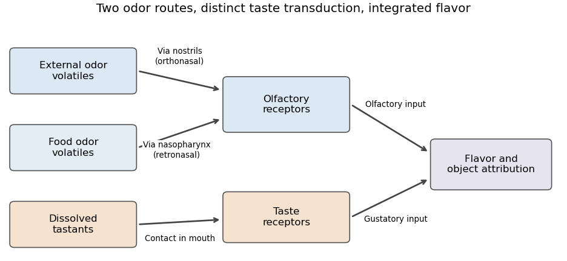

<h1 id="5/solution">Solution</h1>

↑ **Parent:** [5](../5.md)

**Taste–smell confusion is widespread evidence for integrated [flavor perception](../../../flavor-perception.md); it is not sufficient to establish that everyone has developmental [synesthesia](../../../synesthesia.md).** A broader description as learned odor–taste [synesthesia](../../../synesthesia.md) can capture genuine acquired taste-like odor qualities, but “ubiquitous” and “the same mechanism” are additional claims requiring evidence.

First separate receptors, routes and experience. [Gustation](../../../gustation.md) detects dissolved chemicals at taste receptors; [olfaction](../../../olfaction.md) detects volatile chemicals at olfactory receptors. [Orthonasal olfaction](../../../orthonasal-olfaction.md) samples volatiles entering through the nostrils, while [retronasal olfaction](../../../retronasal-olfaction.md) samples food volatiles reaching the nasal cavity from the mouth via the nasopharynx. The same broad receptor system can therefore provide information about an external object or food already being eaten. The resulting [flavor perception](../../../flavor-perception.md) also incorporates oral touch, temperature and other chemical sensations. An experience located in the mouth need not have been transduced by a taste receptor.

**[Figure 3](#5/image-original-functional-diagram-of-orthonasal-and-retronasal-odor-access-and-separate-gustatory-transduction-it-illustrates-routes-not-a-literal-anatomical-or-neural-wiring-map). Original functional diagram of orthonasal and retronasal odor access and separate gustatory transduction; it illustrates routes, not a literal anatomical or neural wiring map**.

[Paul Rozin](../../../paul-rozin.md)'s 1982 argument emphasized this dual role of [olfaction](../../../olfaction.md) and the ordinary use of “taste” for components of flavor. His observations included different evaluations of the smell and ingested flavor of foods and difficulty identifying the taste components associated with familiar smells.[Percept Psychophys 31, pp. 397–401, oral versus external attribution and behavioral observations](../../../taste-smell-confusions-and-the-duality-of-the-olfactory-sense-by-paul-rozin.md) These findings motivate [olfactory referral](../../../olfactory-referral.md): an odor contribution is assigned to an object in the mouth. They do not imply that the nose is physiologically converted into a tongue, nor that every verbal use of “taste” reports a literal gustatory quality.

Route manipulations offer stronger evidence than labels alone. [Dana M. Small](../../../dana-m-small.md) and colleagues delivered vaporized odorants by the orthonasal and retronasal routes while measuring responses with [functional magnetic resonance imaging](../../../functional-magnetic-resonance-imaging.md). They found route-dependent neural responses, including effects that depended on odor identity: patterns for chocolate were not reproduced identically by every comparison odor.[Abstract, route-by-odor comparisons, Neuron 47, pp. 593–605](../../../differential-neural-responses-evoked-by-orthonasal-versus-retronasal-odorant-perception-in-humans-by-dana-m-small-and-others.md) This supports a role for route and object context in olfactory processing. It does not identify a unique [synesthesia](../../../synesthesia.md) mechanism; delivery route can alter peripheral stimulation and airflow, and a regional imaging difference alone cannot determine the experience causing it.

[Learning](../../../learning.md) can also change the qualities attributed to odors. In [Richard J. Stevenson](../../../richard-j-stevenson.md) and colleagues' 1995 experiments, selected odors were paired with sucrose or citric acid. Before-and-after ratings showed that the sucrose-paired odor was subsequently judged sweeter and the acid-paired odor sourer, including when odors were sniffed.[Experiment 1 and conditioning tests, Learning and Motivation 26, pp. 433–455](../../../the-acquisition-of-taste-properties-by-odors-by-richard-j-stevenson-and-others.md) This [odor-taste conditioning](../../../odor-taste-conditioning.md) shows that an odor's taste-like character need not be fixed by its chemistry. It supports a learned-synesthesia interpretation, but does not demonstrate that every participant acquired a separately experienced gustatory concurrent. Ratings can reflect perceptual change, associative retrieval, expectation or how the response scale is used.

A narrow developmental [synesthesia](../../../synesthesia.md) claim concerns an inducer reliably and involuntarily eliciting an additional experience, with stable individual mappings. [Julia Simner](../../../julia-simner.md) and colleagues combined population sampling with objective checks rather than treating self-description as sufficient evidence.[Sampling and objective verification, Perception 35, pp. 1024–1033](../../../synaesthesia-the-prevalence-of-atypical-cross-modal-experiences-by-julia-simner-and-others.md) This motivates testing consistency and automaticity, while avoiding the claim that one test diagnoses every form. Synesthetic experiences can be internally associated rather than externally projected; an external sensory image is not required. Conversely, being able to learn or name an odor–taste association is not sufficient.

A discriminating experiment would therefore assess the same odor repeatedly, measure its taste-like quality separately from odor identity and pleasantness, and manipulate oral delivery, taste congruence and [learning](../../../learning.md) history. Nose closure or controlled nasal delivery can test the contribution of olfactory access; separate gustatory and odor controls are needed because blocking airflow can also change breathing and stimulus delivery. Providing distinct rating scales can test [response dumping](../../../response-dumping.md), in which an unlisted sensory component is assigned to an available scale. Tasks measuring involuntary interference or transfer beyond the trained ratings would be more persuasive than a single “sweet” judgment. These are proposed controls, not invented results.

The theoretical alternatives also need to be stated fairly. A sensory system can normally bind correlated signals into one food percept, so integration need not be a wiring error. But its prevalence does not make an acquired taste-like odor quality unreal: ordinary [learning](../../../learning.md) can generate experiences that differ from the receptor category providing the input. **The evidence supports common oral attribution and learned cross-sensory qualities; treating these as universally equivalent to developmental [synesthesia](../../../synesthesia.md) goes beyond what the experiments establish.**

## ↑ Ancestors (11)

1. [5](../5.md)
2. [2022](../../2022-split.md)
3. [Past exam of the perception course of the year 2 of the psychology (experimental) course of the University of Oxford](../../split.md)
4. [Perception course of the year 2 of the psychology (experimental) course of the University of Oxford](../../../perception-course-of-the-year-2-of-the-psychology-experimental-course-of-the-university-of-oxford.md)
5. [Year 2 of the psychology (experimental) course of the University of Oxford](../../../year-2-of-the-psychology-experimental-course-of-the-university-of-oxford.md)
6. [Psychology (experimental) course of the University of Oxford](../../../psychology-experimental-course-of-the-university-of-oxford.md)
7. [Undergraduate course of the University of Oxford](../../../undergraduate-course-of-the-university-of-oxford.md)
8. [Course of the University of Oxford](../../../course-of-the-university-of-oxford.md)
9. [University of Oxford](../../../university-of-oxford-split.md)
10. [List of universities](../../../list-of-universities.md)
11. [Codex Wiki](../../../split.md)
