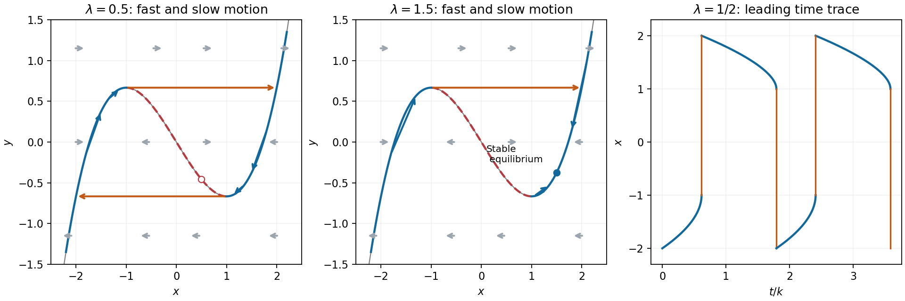
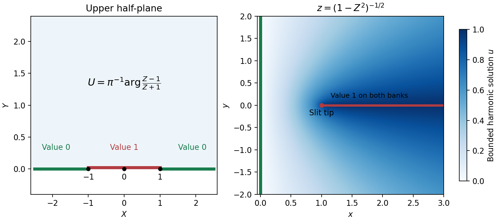
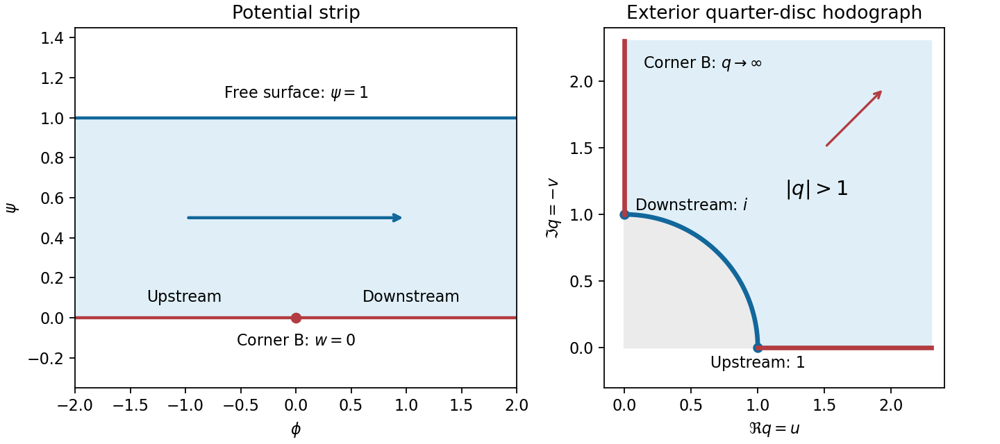

# 2007

↑ **Parent:** [Past exam of the perturbation methods and applied complex variables course of the University of Oxford](../past-exam-of-the-perturbation-methods-and-applied-complex-variables-course-of-the-university-of-oxford.md)

**Table of contents**

- [A](#a)
  - [1](#a/1)
    - [Solution](#a/1/solution)
  - [2](#a/2)
    - [Solution](#a/2/solution)
  - [3](#a/3)
    - [Solution](#a/3/solution)
  - [4](#a/4)
    - [Solution](#a/4/solution)
- [B](#b)
  - [5](#b/5)
    - [Solution](#b/5/solution)
  - [6](#b/6)
    - [a](#b/6/a)
      - [Solution](#b/6/a/solution)
    - [b](#b/6/b)
      - [Solution](#b/6/b/solution)
  - [7](#b/7)
    - [a](#b/7/a)
      - [Solution](#b/7/a/solution)
    - [b](#b/7/b)
      - [Solution](#b/7/b/solution)
  - [8](#b/8)
    - [Solution](#b/8/solution)

## A

↑ **Parent:** [2007](2007.md)

<h3 id="a/1">1</h3>

↑ **Parent:** [A](#a)

<h4 id="a/1/solution">Solution</h4>

↑ **Parent:** [1](#a/1)

Away from the boundary, [derivatives](../calculus.md#derivative) of a smoothly varying solution are much smaller than $k^2f$ unless the [outer solution](../singular-perturbation.md#outer-expansion) vanishes. Nonzero boundary data therefore require a rapidly varying layer. If its thickness is $\delta$, the radial second [derivative](../calculus.md#derivative) is of order $f/\delta^2$; balancing it with $k^2f$ gives $\delta=k^{-1}$.

Put $R=k(1-r)$ and write $f(r,\theta)=F(R,\theta)$. The equation becomes

$$
F_{RR}-\frac1{kr}F_R+\frac1{k^2r^2}F_{\theta\theta}=F.
$$

For fixed $R$ and boundary data with angular variation independent of $k$, the leading equation is $F_{RR}=F$. Matching to the zero [outer solution](../singular-perturbation.md#outer-expansion) removes the growing exponential, and the [boundary value](../differential-equation.md#boundary-value) at $R=0$ fixes its coefficient:

$$
\boxed{F_0(R,\theta)=g(\theta)e^{-R}.}
$$

This approximation describes the layer; it is not a uniform expansion in polar coordinates at the origin.

[Laplace's method](../asymptotic-expansion.md#laplace-s-method) localizes an exponential [integral](../integral.md) near maxima of its real phase. At an isolated smooth interior [maximum](../set.md#maximum-of-a-subset-of-a-total-order) $t_0$ with $G''(t_0)<0$ and $F(t_0)\neq0$, [Taylor expansion](../calculus.md#taylor-expansion) and [Gaussian integral](../integral.md#gaussian-integral) give

$$
\int F(t)e^{kG(t)}dt\sim F(t_0)e^{kG(t_0)}
\sqrt{\frac{2\pi}{k|G''(t_0)|}}.
$$

An endpoint [maximum](../set.md#maximum-of-a-subset-of-a-total-order) with nonzero inward phase slope instead gives an inverse-$k$ factor. Degenerate maxima require their first nonzero local phase term; continuous differentiability alone does not guarantee the quadratic formula.

Here $\cos(ix\sin\phi)=\cosh(x\sin\phi)$. In its two exponentials, the positive exponential dominates at the interior [maximum](../set.md#maximum-of-a-subset-of-a-total-order) $\phi=\pi/2$ of $\sin\phi$. Since $\sin(\pi/2+s)=1-s^2/2+O(s^4)$,

$$
I_0(x)\sim\frac1{2\pi}e^x\int_{-\infty}^{\infty}e^{-xs^2/2}ds
=\frac{e^x}{\sqrt{2\pi x}}.
$$

The negative exponential has no comparable positive [maximum](../set.md#maximum-of-a-subset-of-a-total-order) and is negligible. Consequently, where $kr\to\infty$,

$$
\frac{I_0(kr)}{I_0(k)}\sim r^{-1/2}e^{-k(1-r)}.
$$

In the [boundary layer](../continuum-mechanics.md#boundary-layer) $r=1-R/k$, $r^{-1/2}=1+O(k^{-1})$, so this reduces to **$e^{-R}$**, agreeing with the formal result when $g=1$.

<h3 id="a/2">2</h3>

↑ **Parent:** [A](#a)

<h4 id="a/2/solution">Solution</h4>

↑ **Parent:** [2](#a/2)

Define $y=k^{-1}\dot x+x^3/3-x$. Differentiation and the original equation give $\dot y=(\lambda-x)/k$, while rearrangement gives $\dot x=k(y-x^3/3+x)$. Write $h(x)=x^3/3-x$.

On the fast scale $\tau=kt$,

$$
\frac{dx}{d\tau}=y-h(x),\qquad \frac{dy}{d\tau}=\frac{\lambda-x}{k^2}\sim0.
$$

Fast trajectories are horizontal. Their [equilibria](../dynamical-systems.md#equilibrium-point-of-a-dynamical-system) lie on the cubic $y=h(x)$; the transverse [linearization](../algebra.md#linearization) is $-h'(x)=1-x^2$, so the outer branches $|x|>1$ attract and the middle branch repels. On a horizontal line, arrows point right when $y>h(x)$ and left when $y<h(x)$.

The source prints the slow time as $T=k/t$. The slow variable needed here is **$T=t/k$**. With this correction,

$$
k^{-2}\frac{dx}{dT}=y-h(x),\qquad \frac{dy}{dT}=\lambda-x.
$$

At leading order $y=h(x)$ and

$$
(x^2-1)\frac{dx}{dT}=\lambda-x.
$$

The reciprocal printed variable would give $-T^2y_T=\lambda-x$, rather than the autonomous slow equations used in the stated [period](../mathematics.md#period-of-a-function) formula.

For $-1<\lambda<1$, the left attracting branch runs from $x=-2$ to the fold $x=-1$, where $y=2/3$. The horizontal fast jump at this height lands at $x=2$. The right branch then runs from $2$ to the fold $1$, where $y=-2/3$, followed by a fast jump to $-2$. The [equilibrium](../dynamical-systems.md#equilibrium-point-of-a-dynamical-system) at $x=\lambda$ is on the repelling middle branch. The two slow segments dominate the [period](../mathematics.md#period-of-a-function):

$$
\boxed{\mathcal T\sim k\left[\int_{-2}^{-1}\frac{x^2-1}{\lambda-x}\,dx+
\int_1^2\frac{x^2-1}{x-\lambda}\,dx\right].}
$$

The jump times are negligible on this $O(k)$ scale. Substituting $u=-x$ in the first [integral](../integral.md) also gives the compact value

$$
\mathcal T\sim k\left[3+(\lambda^2-1)\log\frac{4-\lambda^2}{1-\lambda^2}\right].
$$

For $\lambda=1/2$, the negative slow segment takes $k[1-\tfrac34\log(5/3)]$, and the positive one takes $k[2-\tfrac34\log3]$. Thus $x(t)$ rises slowly from $-2$ to $-1$, jumps to $2$, decreases more slowly to $1$, then jumps back to $-2$; the jumps are nearly vertical in the time trace.

For $\lambda>1$ the fast horizontal field and attracting branches are unchanged. The right slow branch has arrows toward $x=\lambda$ from both directions; the left branch still moves toward $-1$ and jumps right. The [equilibrium](../dynamical-systems.md#equilibrium-point-of-a-dynamical-system) $(\lambda,h(\lambda))$ is stable, so the large relaxation cycle is replaced by approach to this [equilibrium](../dynamical-systems.md#equilibrium-point-of-a-dynamical-system). If $\lambda>2$, a landing at $2$ moves right toward $\lambda$, rather than left. The sketches display the representative case $\lambda=3/2$.

**[Figure 1](#a/2/image-fast-horizontal-flow-slow-cubic-branches-and-the-asymmetric-relaxation-cycle). Fast horizontal flow, slow cubic branches, and the asymmetric relaxation cycle**.

<h3 id="a/3">3</h3>

↑ **Parent:** [A](#a)

<h4 id="a/3/solution">Solution</h4>

↑ **Parent:** [3](#a/3)

For fixed nonzero $x$, expand the denominator geometrically:

$$
f(x)=\frac{e^{-x}}{x^2}-\epsilon^2\frac{e^{-x}}{x^4}+O(\epsilon^4).
$$

The effective expansion parameter is $\epsilon^2/x^2$, so the expansion fails when $x=O(\epsilon)$. In the [inner variable](../singular-perturbation.md#inner-variable) $X=x/\epsilon$,

$$
F(X)=\frac{e^{-\epsilon X}}{\epsilon^2(1+X^2)}
=\frac{\epsilon^{-2}}{1+X^2}-\frac{\epsilon^{-1}X}{1+X^2}+O(1)
$$

for fixed $X$. Expanding the leading outer term toward $x=0$ gives $x^{-2}$ at leading order; expanding the leading inner term for large $X$ and returning to $x$ gives $\epsilon^{-2}X^{-2}=x^{-2}$. Thus the two one-term re-expansions match in $\epsilon\ll x\ll1$. The next common contribution is $-x^{-1}$ when the corresponding next inner order is retained.

On $x\geq\delta$, the relative denominator error is bounded by $\epsilon^2/\delta^2$, hence

$$
I_2=\left[1+O\left(\frac{\epsilon^2}{\delta^2}\right)\right]
\int_\delta^\infty\frac{e^{-x}}{x^2}dx.
$$

[Integration by parts](../calculus.md#integration-by-parts) yields

$$
\int_\delta^\infty\frac{e^{-x}}{x^2}dx
=\frac{e^{-\delta}}{\delta}-\int_\delta^\infty\frac{e^{-x}}x\,dx
=\frac1\delta+\log\delta+O(1).
$$

For the last step split the remaining [integral](../integral.md) at one: $\int_\delta^1 dx/x=-\log\delta$, and replacing $e^{-x}$ by one on that interval has a bounded error.

In the inner interval, $|e^{-x}-1|\leq x$ gives an explicit error estimate:

$$
I_1=\frac1\epsilon\arctan\frac\delta\epsilon
+O\left(\log\left(1+\frac{\delta^2}{\epsilon^2}\right)\right)
=\frac{\pi}{2\epsilon}-\frac1\delta
+O\left(\frac{\epsilon^2}{\delta^3}+
\log\left(1+\frac{\delta^2}{\epsilon^2}\right)\right).
$$

The $1/\delta$ terms cancel between regions. Every displayed remainder is $o(\epsilon^{-1})$ whenever $\epsilon/\delta\to0$ and $\delta\to0$; for example $\epsilon(\epsilon^2/\delta^3)=(\epsilon/\delta)^3$. Therefore the leading answer is independent of the arbitrary intermediate cutoff:

$$
\boxed{I\sim\frac{\pi}{2\epsilon}.}
$$

<h3 id="a/4">4</h3>

↑ **Parent:** [A](#a)

<h4 id="a/4/solution">Solution</h4>

↑ **Parent:** [4](#a/4)

On the two independent variables, the total [derivative](../calculus.md#derivative) is $D_x=\partial_x+\epsilon^{-1}\partial_X$. Multiplication of $D_x(aD_xy)=f$ by $\epsilon^2$ gives exactly the stated multiple-scale equation.

At order one, $\partial_X(a\,\partial_Xy_0)=0$. Integrating twice gives

$$
y_0=B(x)+A(x)\int^X\frac{dS}{a(x,S)}.
$$

The periodic reciprocal coefficient has strictly positive mean. Unless $A=0$, the [integral](../integral.md) has a nonzero linear drift in $X$, violating the periodic cell ansatz and creating secular growth when $X=x/\epsilon$. Thus $A=0$ and $y_0=y_0(x)$.

At order $\epsilon$,

$$
\partial_X\{a(y_{1X}+y_0')\}=0,\qquad
y_{1X}=\frac{C(x)}{a(x,X)}-y_0'.
$$

Periodicity requires the [derivative](../calculus.md#derivative) to have zero cell average. Consequently

$$
0=C(x)\int_0^1a^{-1}(x,X)dX-y_0',
\qquad C(x)=\hat a(x)y_0'(x).
$$

At order $\epsilon^2$, the equation is

$$
\partial_X\{a(y_{2X}+y_{1x})\}
+\partial_x\{a(y_{1X}+y_0')\}=f(x,X).
$$

The second flux inside braces is $C(x)$, independent of $X$. Integrating over one [period](../mathematics.md#period-of-a-function) annihilates the first [derivative](../calculus.md#derivative), by periodicity, and yields $C'(x)=\int_0^1f(x,X)dX$. Hence

$$
\boxed{\frac d{dx}\bigl(\hat a(x)y_0'(x)\bigr)=\hat f(x),\quad
\hat a(x)=\left(\int_0^1a(x,X)^{-1}dX\right)^{-1},\quad
\hat f(x)=\int_0^1f(x,X)dX.}
$$

The effective transport coefficient is the [harmonic mean](../arithmetic.md#harmonic-mean) of $a$ over the fast [period](../mathematics.md#period-of-a-function); the source is averaged arithmetically. Smoothness sufficient for these formal differentiations and uniform positivity on the cells are understood.

## B

↑ **Parent:** [2007](2007.md)

<h3 id="b/5">5</h3>

↑ **Parent:** [B](#b)

<h4 id="b/5/solution">Solution</h4>

↑ **Parent:** [5](#b/5)

Choose each factor with its argument between zero and $\pi$ in the [upper half-plane](../complex-analysis.md#upper-half-plane-complex-analysis). On an interval between consecutive real prevertices, each factor has a constant boundary argument, so $f'$ has constant argument and the image is a straight side. Crossing $X_j$ from left to right decreases $\arg(Z-X_j)$ by $\pi$, hence increases $\arg f'$ by $\beta_j\pi$, giving the prescribed exterior turn. Locally,

$$
f(Z)-z_j\sim C_j(Z-X_j)^{1-\beta_j},
$$

so an upper half-disc maps to angle $(1-\beta_j)\pi$, the required interior angle. The overall constant rotates and scales the polygon; integration adds translation. For a general prescribed polygon, the [prevertex](../geometry-and-topology.md#prevertex-of-a-schwarz-christoffel-map) positions must also satisfy the side-length conditions: the [derivative](../calculus.md#derivative) formula fixes angles but arbitrary choices do not fix arbitrary side lengths.

For the slit domain, the slit tip has interior angle $2\pi$, so its exterior parameter is $-1$. The two vertices at infinity give the factors at $\pm1$, leading to $f'(Z)$ proportional to $Z(1-Z^2)^{-3/2}$. Integrating and imposing the tip value gives

$$
\boxed{z=f(Z)=\frac1{\sqrt{1-Z^2}}.}
$$

The [square root](../algebra.md#square-root) is the principal one: for $\Im Z>0$, $1-Z^2$ never lies on the nonpositive real axis. Thus $\Re f>0$. Boundary points $-1<X<1$ map to the two banks of the slit, with $X=0$ at the tip; the outside intervals map to the imaginary axis. The [derivative](../calculus.md#derivative) is nonzero in the open [half-plane](../geometry-and-topology.md#half-plane). Conversely each point of the slit domain determines exactly one root $Z$ of $Z^2=1-z^{-2}$ with positive [imaginary part](../complex-analysis.md#imaginary-part), proving bijectivity.

The [Möbius map](../group-theory.md#mobius-transformation) $(Z-1)/(Z+1)$ takes the [upper half-plane](../complex-analysis.md#upper-half-plane-complex-analysis) to itself, so its [principal argument](../complex-analysis.md#principal-argument) lies in $(0,\pi)$. The [imaginary part](../complex-analysis.md#imaginary-part) of its analytic [logarithm](../calculus.md#logarithm) is [harmonic](../partial-differential-equation.md#harmonic-function), equals $\pi$ on $(-1,1)$ and zero on the other real intervals. Thus

$$
U(X,Y)=\frac1\pi\arg\frac{Z-1}{Z+1}.
$$

It lies between zero and one and has the required boundary limits away from the two discontinuities. Pulling this [harmonic function](../partial-differential-equation.md#harmonic-function) back by the inverse [conformal map](../geometry-and-topology.md#conformal-map) yields

$$
\boxed{u(x,y)=\frac1\pi\arg\frac{Z(z)-1}{Z(z)+1},\qquad
Z(z)^2=1-z^{-2},\quad\Im Z(z)>0.}
$$

This specifies all branches and remains bounded even as $z$ tends to either end at infinity.

To exhibit nonuniqueness without the growth restriction, put

$$
H(z)=\Im\frac{Z(z)}{1-Z(z)^2}.
$$

This is [harmonic](../partial-differential-equation.md#harmonic-function) in the domain. On its boundary the corresponding $Z$ is real and the rational expression is real, except at $\pm1$, which represent infinity. At $Z=\infty$, representing $z=0$, the expression tends to zero. Thus $H$ has zero finite boundary data. It is nonzero, since for $Z=iY$ its value is $Y/(1+Y^2)>0$, and it is unbounded as $Z$ approaches either pole $\pm1$ non-tangentially. Therefore **$u+cH$ gives distinct solutions** with the same finite boundary data when boundedness at infinity is removed.

**[Figure 2](#b/5/image-prevertices-the-slit-domain-and-the-bounded-harmonic-boundary-values). Prevertices, the slit domain, and the bounded harmonic boundary values**.

<h3 id="b/6">6</h3>

↑ **Parent:** [B](#b)

<h4 id="b/6/a">a</h4>

↑ **Parent:** [6](#b/6)

<h5 id="b/6/a/solution">Solution</h5>

↑ **Parent:** [A](#b/6/a)

[Conformality](../geometry-and-topology.md#conformality) implies $f'(0)\neq0$, so $a_1\neq0$. Apply the stated [Green's theorem](../multivariable-calculus.md#green-theorem) with $F=z^n\bar z$:

$$
M_n=\frac1{2i}\oint_\Gamma z^n\bar z\,dz
=\frac1{2i}\oint_{|\zeta|=1}f(\zeta)^n
\left(\sum_{j=1}^N\bar a_j\zeta^{-j}\right)f'(\zeta)\,d\zeta.
$$

Here $\bar\zeta=\zeta^{-1}$ on the [unit circle](../complex-analysis.md#complex-unit-circle). The lowest power in $f^nf'$ is $\zeta^n$, while the most negative power in the conjugate [polynomial](../polynomial.md) is $\zeta^{-N}$. For $n\geq N$ their product has no $\zeta^{-1}$ term. The [residue theorem](../analysis.md#residue-theorem) gives **$M_n=0$ for all $n\geq N$**.

When $N=2$, the residue for $n=0$ is $|a_1|^2+2|a_2|^2$. For $n=1$, expand

$$
ff'=a_1^2\zeta+3a_1a_2\zeta^2+2a_2^2\zeta^3.
$$

Only $a_1^2\zeta\,\bar a_2\zeta^{-2}$ contributes. Therefore

$$
\boxed{M_0=\pi(|a_1|^2+2|a_2|^2),\qquad M_1=\pi a_1^2\bar a_2.}
$$

The first is the area; the second records its complex first moment, and need not be real.

<h4 id="b/6/b">b</h4>

↑ **Parent:** [6](#b/6)

<h5 id="b/6/b/solution">Solution</h5>

↑ **Parent:** [B](#b/6/b)

The potential plane is the strip $0<\psi<1$. The wall maps to its lower boundary, with upstream $\phi\to-\infty$, the corner at $w=0$, and downstream $\phi\to+\infty$. The [free surface](../fluid-mechanics.md#free-surface) maps to its upper boundary.

Write $q=w'=u-iv$. Far upstream $q=1$; far downstream the flow points vertically down and $q=i$. On the two wall rays, $q$ runs along the positive real and positive imaginary axes. The reentrant fluid corner has angle $3\pi/2$, so its potential behaves locally as $(z-B)^{2/3}$ and its speed diverges like $|z-B|^{-1/3}$. Thus **the corner corresponds to $q=\infty$, not $q=0$**. The [free surface](../fluid-mechanics.md#free-surface) has $|q|=1$, giving the hodograph domain

$$
\Re q>0,\qquad\Im q>0,\qquad |q|>1.
$$

It is the exterior of a quarter [unit disc](../topology.md#unit-disc) in the first quadrant.

Now $s=q^2$ maps this domain to the part of the [upper half-plane](../complex-analysis.md#upper-half-plane-complex-analysis) outside the [unit disc](../topology.md#unit-disc). The map

$$
t=\frac{s-1}{s+1}
$$

takes it to the first quadrant: its real and imaginary parts are positive because $|s|>1$ and $\Im s>0$. Finally $\eta=t^2$ maps that quadrant to the [upper half-plane](../complex-analysis.md#upper-half-plane-complex-analysis). The corresponding strip map is $\eta=e^{\pi w}$. Both give upstream $\eta=0$, corner $\eta=1$, and downstream $\eta=\infty$, so the three boundary normalizations fix the remaining real Möbius freedom. Consequently

$$
\boxed{e^{\pi w}=\left(\frac{q^2-1}{q^2+1}\right)^2,\qquad q=w'.}
$$

On the [free surface](../fluid-mechanics.md#free-surface) $q=e^{i\theta}$, $t=i\tan\theta$, so $\eta$ is negative and $\Im w=1$ as required. On the wall $\eta>0$, giving $\Im w=0$.

**[Figure 3](#b/6/b/image-the-strip-and-the-exterior-quarter-disc-hodograph-domain). The strip and the exterior quarter-disc hodograph domain**.

<h3 id="b/7">7</h3>

↑ **Parent:** [B](#b)

<h4 id="b/7/a">a</h4>

↑ **Parent:** [7](#b/7)

<h5 id="b/7/a/solution">Solution</h5>

↑ **Parent:** [A](#b/7/a)

The [integral](../integral.md) construction requires differentiation under the [integral](../integral.md) and vanishing boundary terms. With those assumptions, [integration by parts](../calculus.md#integration-by-parts) gives

$$
w''+zw=[g(\zeta)e^{z\zeta}]_{\partial\Gamma}
+\int_\Gamma(\zeta^2g-g')e^{z\zeta}\,d\zeta.
$$

The standard construction therefore sets $g'=\zeta^2g$, giving $g=C e^{\zeta^3/3}$. Convergent [contours](../complex-analysis.md#complex-integration-contour) run between rays where $\Re\zeta^3<0$: convenient central rays have arguments $-\pi/3$, $\pi/3$ and $\pi$. Two choices are the oriented paths

$$
\Gamma_1:\infty e^{-i\pi/3}\longrightarrow0\longrightarrow\infty e^{i\pi/3},
\qquad
\Gamma_2:\infty e^{i\pi/3}\longrightarrow0\longrightarrow-\infty.
$$

The cubic exponential dominates the linear one at both ends. To verify independence directly, put $A=\int_0^\infty e^{-r^3/3}dr>0$ and $B=\int_0^\infty r e^{-r^3/3}dr>0$. At $z=0$ the value and [derivative](../calculus.md#derivative) of the [integral](../integral.md) along rays $\theta_1,\theta_2$ are $A(e^{i\theta_2}-e^{i\theta_1})$ and $B(e^{2i\theta_2}-e^{2i\theta_1})$. For the two [contours](../complex-analysis.md#complex-integration-contour) above their derivative-to-value ratios are respectively $B/A$ and $(B/A)(e^{i\pi/3}-1)$, which differ. Hence their [Wronskian](../linear-ordinary-differential-equation.md#wronskian) is nonzero.

For the second equation multiply by $z$ before integrating by parts:

$$
z(w''+w)+w'
=[(1+\zeta^2)g e^{z\zeta}]_{\partial\Gamma}
-\int_\Gamma\bigl((1+\zeta^2)g'+\zeta g\bigr)e^{z\zeta}d\zeta.
$$

Setting the residual weight to zero gives $g=C(1+\zeta^2)^{-1/2}$. One [contour](../complex-analysis.md#complex-integration-contour) is the segment from $-i$ to $i$, with the [square root](../algebra.md#square-root) positive at $\zeta=0$. Its [integral](../integral.md) is a nonzero multiple of $J_0(z)$: substituting $\zeta=it$ gives $i\int_{-1}^1e^{izt}(1-t^2)^{-1/2}dt$, an [entire function](../holomorphic-function.md#entire-function) nonzero at zero.

A second [contour](../complex-analysis.md#complex-integration-contour) starts at $i$ and follows $\zeta=i-t$, $0\leq t<\infty$, choosing a continuous branch along the path. For $\Re z>0$ it converges at infinity; at the branch endpoint its integrable singularity is $t^{-1/2}$. In both cases the boundary term contains $\sqrt{1+\zeta^2}$ and vanishes at branch endpoints. The second [integral](../integral.md) has a nonzero [logarithmic divergence](../real-analysis.md#logarithmic-divergence) as $z\to0$ through positive real values, because its large-$t$ integrand is a nonzero multiple of $e^{-zt}/t$. It is therefore independent of the entire first solution; [analytic continuation](../holomorphic-function.md#analytic-continuation) supplies solutions elsewhere away from the equation's singular point.

Strictly, nonzero $w$ and an arbitrary [contour](../complex-analysis.md#complex-integration-contour) alone do not prove the printed necessity for $g$. Necessity also needs [injectivity](../algebra.md#injective-function) of the chosen Laplace representation, while the vanishing-integrand argument above is the usual sufficient construction. For a concrete counterexample to unconditional necessity in the Bessel case, take a positively oriented circle $|\zeta|=R>1$, choose the branch $(1+\zeta^2)^{-1/2}\sim1/\zeta$ outside the cut $[-i,i]$, and add one to that weight. The added entire integrand integrates to zero. Expanding the original weight on this circle gives [integral](../integral.md) $2\pi i J_0(z)$, which is nonzero and solves the equation, although the modified weight is not a constant multiple of the printed one. The standard weights and [contours](../complex-analysis.md#complex-integration-contour) above still give the requested independent solutions.

<h4 id="b/7/b">b</h4>

↑ **Parent:** [7](#b/7)

<h5 id="b/7/b/solution">Solution</h5>

↑ **Parent:** [B](#b/7/b)

Let

$$
q_j=\sqrt{\kappa_j^2+i\epsilon}\quad(j=0,1)
$$

be the root with positive real and positive imaginary parts. More explicitly, with $r_j=\sqrt{\kappa_j^4+\epsilon^2}$,

$$
q_j=\sqrt{\frac{r_j+\kappa_j^2}{2}}+
i\sqrt{\frac{r_j-\kappa_j^2}{2}}.
$$

Decay at each infinity and [continuity](../calculus.md#continuous-function) at zero force $y=Ae^{-iq_0x}$ for $x<0$ and $y=Ae^{iq_1x}$ for $x>0$. The [derivative](../calculus.md#derivative) jump is $i(q_1+q_0)A=1$, so

$$
\boxed{y(x)=\frac1{i(q_0+q_1)}
\begin{cases}e^{-iq_0x},&x<0,\\e^{iq_1x},&x>0.\end{cases}}
$$

The two roots lie in the first quadrant, so their sum cannot vanish.

Integrating the [differential equation](../differential-equation.md) twice by parts on each half-line gives

$$
(q_0^2-k^2)\hat y_-=-y'(0-)+iky(0),\qquad
(q_1^2-k^2)\hat y_+=y'(0+)-iky(0).
$$

Their sum is the stated identity with right side one. Equivalently the global distributional equation is $y''+\kappa^2y=\delta_0$, since the [derivative](../calculus.md#derivative) has jump one.

The direct half-transforms are

$$
\hat y_-=\frac{A}{i(k-q_0)},\qquad
\boxed{\hat y_+=-\frac{A}{i(k+q_1)}
=\frac1{(q_0+q_1)(k+q_1)}.}
$$

Here $\hat y_+$ is analytic above its lower-half-plane pole $-q_1$, while $\hat y_-$ is analytic below its upper-half-plane pole $q_0$.

To recover the same result from the transform identity alone, use [Wiener-Hopf factorization](../boundary-value-problem.md#wiener-hopf-factorization):

$$
\hat y_++\frac{(q_0-k)(q_0+k)}{(q_1-k)(q_1+k)}\hat y_-
=\frac1{(q_1-k)(q_1+k)}.
$$

Multiply by $(q_1+k)/(q_0+k)$. The coefficient of $\hat y_-$ becomes $(q_0-k)/(q_1-k)$, analytic and zero-free in the lower [half-plane](../geometry-and-topology.md#half-plane), while the coefficient of $\hat y_+$ is analytic and zero-free in the [upper half-plane](../complex-analysis.md#upper-half-plane-complex-analysis). Split the right side as

$$
\frac1{(q_0+k)(q_1-k)}
=\frac1{q_0+q_1}\left(\frac1{q_0+k}+\frac1{q_1-k}\right).
$$

The first term is analytic above and the second below. Equating the separated [functions](../function.md) and using their decay at infinity fixes the entire remainder to zero, yielding the boxed $\hat y_+$, with the branches fixed before factorization.

<h3 id="b/8">8</h3>

↑ **Parent:** [B](#b)

<h4 id="b/8/solution">Solution</h4>

↑ **Parent:** [8](#b/8)

There are two distinct inconsistencies in the printed formulas. First the initial [Cauchy integral](../complex-analysis.md#cauchy-transform) has coefficient $1/(2\pi)$, whereas the stated boundary limits require **$1/(2\pi i)$**. Second the final [integral](../integral.md) is a solution of a difference jump problem, although the intervening equation for $W$ is a sum jump problem. We derive the valid identities, show precisely where that final deduction fails, and give the corrected construction. Take $c>0$ and, initially, a Hölder continuous density on the interior with integrable endpoints, so the boundary limits and [principal values](../complex-analysis.md#cauchy-principal-value) exist.

Define the [Cauchy principal value](../complex-analysis.md#cauchy-principal-value) by

$$
\operatorname{pv}\int_0^c\frac{f(t)}{t-x}dt
=\lim_{\delta\downarrow0}\left(\int_0^{x-\delta}\frac{f(t)}{t-x}dt+
\int_{x+\delta}^c\frac{f(t)}{t-x}dt\right).
$$

For the corrected normalization $C_f(z)=(2\pi i)^{-1}\int_0^cf(t)/(t-z)\,dt$, subtract $f(x)$ from the numerator near $x$. The subtracted [integral](../integral.md) has the common principal-value limit, while integration of the remaining constant density produces boundary arguments differing by $2\pi$. This proves the [Sokhotski–Plemelj theorem](../holomorphic-function.md#sokhotski-plemelj-theorem)

$$
(C_f)_\pm=\pm\frac12f+\frac1{2\pi i}\operatorname{pv}\int_0^c\frac{f(t)}{t-x}dt.
$$

In particular $f=(C_f)_+-(C_f)_-$ and $(C_f)_++(C_f)_-=(\pi i)^{-1}\operatorname{pv}\int f(t)/(t-x)dt$. With the literal printed [integral](../integral.md) $w=iC_f$ instead, the limits are $\pm if/2+(2\pi)^{-1}\operatorname{pv}\int f/(t-x)$, and the next stated boundary equation would have right side $i\gamma$.

Use the corrected normalization from now on and write $w=C_f$, $a=\alpha+\beta$, $b=\alpha-\beta$. The original [singular integral equation](../functional-analysis.md#singular-integral-equation) then becomes

$$
\alpha(w_+-w_-)+\beta(w_++w_-)=\gamma,
\qquad\boxed{a w_+-b w_-=\gamma.}
$$

If $\tilde w$ satisfies the printed homogeneous relation $a\tilde w_++b\tilde w_-=0$, division of $w=\tilde w W$ gives, correctly,

$$
W_++W_-=\frac{\gamma}{a\tilde w_+}.
$$

A nonvanishing factor is needed as well as the printed nonvanishing of $a,b$; its zeros would require separate treatment.

The next printed step is invalid because a [Cauchy integral](../complex-analysis.md#cauchy-transform) of $g$ has boundary difference $g$, not boundary sum $g$. A particularly direct counterexample is $\alpha=1$, $\beta=0$, $\gamma=1$. The original equation is simply **$f=1$**. Choose $\tilde w=\rho(z)=\sqrt{z(z-c)}$, with $\rho(z)\sim z$ at infinity and cut $[0,c]$. Its [boundary values](../differential-equation.md#boundary-value) are $\rho_\pm(x)=\pm i\sqrt{x(c-x)}$, so it satisfies precisely the printed homogeneous sum relation. But the printed proposed [integral](../integral.md) yields

$$
I(z)=\int_0^c\frac{dt}{\rho_+(t)(t-z)}
=\frac{i\pi}{\rho(z)},\qquad
\frac{\tilde w(z)I(z)}{2\pi i}=\frac12.
$$

The [integral](../integral.md) follows by $t=c(1+\cos\theta)/2$, or the usual elementary [integral](../integral.md) $\int_0^\pi d\theta/(A+B\cos\theta)$. Its proposed $w$ is constant, has jump zero, and is not the Cauchy transform of $f=1$; it also fails the required decay at infinity. If the printed $I(x)$ is interpreted as [principal value](../complex-analysis.md#cauchy-principal-value) in its last formula, that value is zero, giving $f=0$ and the same contradiction.

To solve the sum jump correctly, introduce this sign-changing factor $\rho$. Set $V=W/\rho$, so

$$
V_+-V_-=\frac{\gamma}{a\tilde w_+\rho_+}.
$$

The corrected local Cauchy representation is consequently

$$
\boxed{w(z)=\tilde w(z)\rho(z)
\left[\frac1{2\pi i}\int_0^c
\frac{\gamma(t)\,dt}{a(t)\tilde w_+(t)\rho_+(t)(t-z)}+H(z)\right].}
$$

Here $H$ has no jump across the open interval; its possible endpoint singularities and [polynomial](../polynomial.md) part are determined by endpoint admissibility, absence of unwanted poles, and $w(z)=O(1/z)$ at infinity. Some choices of factor require a weighted or regularized [integral](../integral.md) at the endpoints. Thus nonvanishing of $a,b$ alone does not determine a unique global solution without a [function](../function.md) class and growth conditions.

Equivalently put $X=\tilde w\rho$. It satisfies the homogeneous _difference_ relation $aX_+-bX_-=0$. If $g=\gamma/(aX_+)$, $J(z)=\int_0^c g(t)/(t-z)\,dt$, and the [integral](../integral.md) is admissible, then

$$
w=X\left(\frac{J}{2\pi i}+H\right).
$$

Taking its jump gives the usable density formula

$$
\boxed{f(x)=\frac{X_+-X_-}{2\pi i}\operatorname{pv}J(x)
+\frac{X_++X_-}{2}\frac{\gamma(x)}{a(x)X_+(x)}
+(X_+-X_-)H(x).}
$$

This formula, together with the endpoint and infinity conditions, replaces the last printed equation. Alternatively, if the homogeneous relation in the question is changed from plus to minus, its unweighted Cauchy representation becomes a valid particular solution, but the density must still be obtained from this jump calculation and homogeneous terms still require normalization. The statements cannot all hold simultaneously as printed.

## ↑ Ancestors (9)

1. [Past exam of the perturbation methods and applied complex variables course of the University of Oxford](../past-exam-of-the-perturbation-methods-and-applied-complex-variables-course-of-the-university-of-oxford.md)
2. [Perturbation methods and applied complex variables course of the University of Oxford](../university-of-oxford.md#perturbation-methods-and-applied-complex-variables-course-of-the-university-of-oxford)
3. [Year 4 of the mathematics course of the University of Oxford](../university-of-oxford.md#year-4-of-the-mathematics-course-of-the-university-of-oxford)
4. [Mathematics course of the University of Oxford](../university-of-oxford.md#mathematics-course-of-the-university-of-oxford)
5. [Undergraduate course of the University of Oxford](../university-of-oxford.md#undergraduate-course-of-the-university-of-oxford)
6. [Course of the University of Oxford](../university-of-oxford.md#course-of-the-university-of-oxford)
7. [University of Oxford](../university-of-oxford.md)
8. [List of universities](../README.md#list-of-universities)
9. [Codex Wiki](../README.md)
