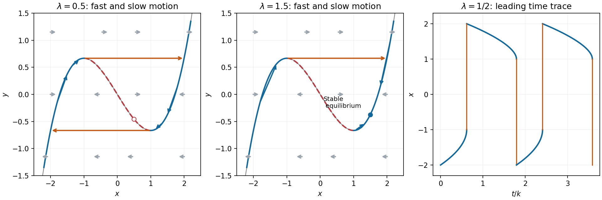

<h1 id="a/2/solution">Solution</h1>

↑ **Parent:** [2](../2.md)

Define $y=k^{-1}\dot x+x^3/3-x$. Differentiation and the original equation give $\dot y=(\lambda-x)/k$, while rearrangement gives $\dot x=k(y-x^3/3+x)$. Write $h(x)=x^3/3-x$.

On the fast scale $\tau=kt$,

$$
\frac{dx}{d\tau}=y-h(x),\qquad \frac{dy}{d\tau}=\frac{\lambda-x}{k^2}\sim0.
$$

Fast trajectories are horizontal. Their [equilibria](../../../../equilibrium-point-of-a-dynamical-system.md) lie on the cubic $y=h(x)$; the transverse [linearization](../../../../linearization.md) is $-h'(x)=1-x^2$, so the outer branches $|x|>1$ attract and the middle branch repels. On a horizontal line, arrows point right when $y>h(x)$ and left when $y<h(x)$.

The source prints the slow time as $T=k/t$. The slow variable needed here is **$T=t/k$**. With this correction,

$$
k^{-2}\frac{dx}{dT}=y-h(x),\qquad \frac{dy}{dT}=\lambda-x.
$$

At leading order $y=h(x)$ and

$$
(x^2-1)\frac{dx}{dT}=\lambda-x.
$$

The reciprocal printed variable would give $-T^2y_T=\lambda-x$, rather than the autonomous slow equations used in the stated [period](../../../../period-of-a-function.md) formula.

For $-1<\lambda<1$, the left attracting branch runs from $x=-2$ to the fold $x=-1$, where $y=2/3$. The horizontal fast jump at this height lands at $x=2$. The right branch then runs from $2$ to the fold $1$, where $y=-2/3$, followed by a fast jump to $-2$. The [equilibrium](../../../../equilibrium-point-of-a-dynamical-system.md) at $x=\lambda$ is on the repelling middle branch. The two slow segments dominate the [period](../../../../period-of-a-function.md):

$$
\boxed{\mathcal T\sim k\left[\int_{-2}^{-1}\frac{x^2-1}{\lambda-x}\,dx+
\int_1^2\frac{x^2-1}{x-\lambda}\,dx\right].}
$$

The jump times are negligible on this $O(k)$ scale. Substituting $u=-x$ in the first [integral](../../../../integral-split.md) also gives the compact value

$$
\mathcal T\sim k\left[3+(\lambda^2-1)\log\frac{4-\lambda^2}{1-\lambda^2}\right].
$$

For $\lambda=1/2$, the negative slow segment takes $k[1-\tfrac34\log(5/3)]$, and the positive one takes $k[2-\tfrac34\log3]$. Thus $x(t)$ rises slowly from $-2$ to $-1$, jumps to $2$, decreases more slowly to $1$, then jumps back to $-2$; the jumps are nearly vertical in the time trace.

For $\lambda>1$ the fast horizontal field and attracting branches are unchanged. The right slow branch has arrows toward $x=\lambda$ from both directions; the left branch still moves toward $-1$ and jumps right. The [equilibrium](../../../../equilibrium-point-of-a-dynamical-system.md) $(\lambda,h(\lambda))$ is stable, so the large relaxation cycle is replaced by approach to this [equilibrium](../../../../equilibrium-point-of-a-dynamical-system.md). If $\lambda>2$, a landing at $2$ moves right toward $\lambda$, rather than left. The sketches display the representative case $\lambda=3/2$.

**[Figure 1](#a/2/image-fast-horizontal-flow-slow-cubic-branches-and-the-asymmetric-relaxation-cycle). Fast horizontal flow, slow cubic branches, and the asymmetric relaxation cycle**.

## ↑ Ancestors (12)

1. [2](../2.md)
2. [A](../../a.md)
3. [2007](../../../2007-split.md)
4. [Past exam of the perturbation methods and applied complex variables course of the University of Oxford](../../../split.md)
5. [Perturbation methods and applied complex variables course of the University of Oxford](../../../../perturbation-methods-and-applied-complex-variables-course-of-the-university-of-oxford.md)
6. [Year 4 of the mathematics course of the University of Oxford](../../../../year-4-of-the-mathematics-course-of-the-university-of-oxford.md)
7. [Mathematics course of the University of Oxford](../../../../mathematics-course-of-the-university-of-oxford.md)
8. [Undergraduate course of the University of Oxford](../../../../undergraduate-course-of-the-university-of-oxford.md)
9. [Course of the University of Oxford](../../../../course-of-the-university-of-oxford.md)
10. [University of Oxford](../../../../university-of-oxford-split.md)
11. [List of universities](../../../../list-of-universities.md)
12. [Codex Wiki](../../../../split.md)
